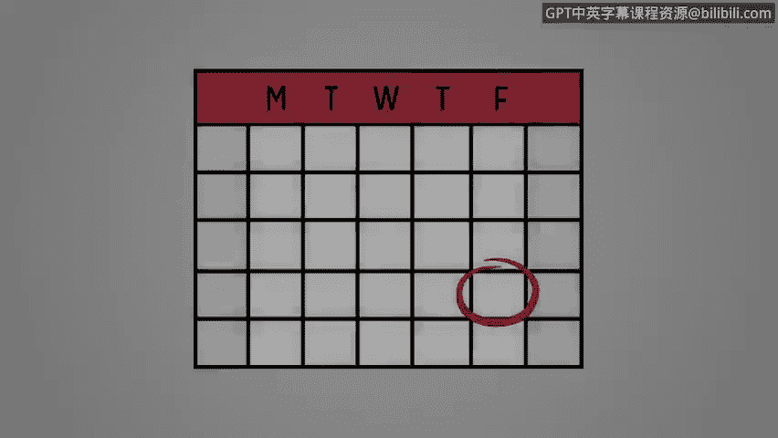

# 艾伯塔大学软件产品管理课程6：《软件产品管理毕业项目》｜software-product-management-capstone｜ - P47：22_05_6-7-video-simulation-project-retrospective.en_subtitled - GPT中英字幕课程资源 - BV1Su411T7fE

🎼。😊，🎼不是一不。😊，🎼不不。

Well this was quite the ride， I hope you all had fun， I would like to do a project retrospective。

 I know we've done sprint retrospectives in the past。

 but how many of you have done a project retrospective？I haven't。 I've heard of them。

 but I've never done one before。 Okay， well， as we were all just so eloquently told。

 this project wouldn't have happened without all the hard work by every member of this team and。

I personally just want to say that I'm really proud to have worked with all of you。Okay。

 so the first step in any project retrospective is to make sure that everyone feels comfortable talking openly about what's on their mind。

 so I'd just like to do a quick anonymous poll， if you can just put a number on the piece of paper from one to five。

 this number represents how safe you feel contributing to an open conversation in this meeting。

 a one indicates that you are very uncomfortable and a five indicates that you're very comfortable。

Okay， well， this is great。 I didn't think we'd have any issues。

 but nobody said anything less than a4， not that I had any doubts。 So let's continue。

Did everyone bring in their artifacts？So what do we do with these Well。

 I would like everyone to talk about what artifact means the most to them。Josh。

 would you like to start Okay， so I brought in a screenshot。

 it's a printout of a screenshot that I took。And it's a screenshot of my unit tests。Failing。

I took this the first time my test failed when I thought that they wouldn't。

 and I like it because it's a good reminder that， my code isn't always perfect and that unit tests are important too。

Even if they take up more time。Oh， and I also brought a can of bugs spray that Alexa bought me as a joke。

Excellent choice， Josh。Okay， I'll go next I brought in this post note that someone left on my desk。

 it says good work today， keep it up， I don't know who wrote it so don't tell me because I kind of like not knowing but yeah it helped me get through kind of a hard day。

It's just nice to be appreciated， you。 So thank you to whoever wrote it。 Well， wonderful。

 It was really great working with you。😊，I run in something too， of course。😊。

I brought in our burn down chart from the project。 I think it's incredible the amount of work that we did and that we accomplished together。

 and I wanted to remind everyone of that。嗯。I also brought in a children's book。

 it's a hard copy of the one we were using for Candata， I went out and bought it。

But it's a momentummento of the project that will hopefully bring books like this to deserving children all over the world。

 It's perfect。 Thank you。 Maybe later， we could take a picture with our artifacts as a team。 Yeah。

 good idea。 great。😊，So let's talk about the project a little bit more。 Was it a success。

 I don't know I。We got everything done that we were supposed to。

 but I just wish that we could keep working on it。 I feel like we didn't build the best product that we could have built。

 I see what you mean， but you have to remember that we did do a really good job of staying focused on what was important and staying on time。

 Yeah， and we had to deliver something for the trade show in just a few sprints。

 You can't expect to get much done in so little time where you're not wrong。 We could have done more。

 What do you think， Josh。Actually， I thought it was pretty good。I mean。

 really nothing major happen So okay well then the next exercise is building our project timeline。

 I mean it should be pretty straightforward considering how short the project was so we'll all write down an event on a sticky note and then put them on the piece of paper and then we'll write down other significant events and put them on the paper as well。

 so yeah let's I'll start with the beginning of the project when we all started working together。

So the first major event should be when we started building the app， right？

I think we should put down the requirements process first， I think we can put them both down。

 It was a collaborative effort。Perfect， okay， well， let's just think about this timeline a bit。

 Our lovely product manager has given us some topics to discuss。 So let's talk about them。

 what worked well for us。 Our process， I think we followed the agile practices really well。

 That's so true。😊，I think we worked really well as a team。

 and we communicated pretty well when all was said and done。Okay， anything else？No， all right。

 what did we learn。I learned that writing test cases isn't really all that hard。

I learned that it isn't good to just do what you think is right without talking to everyone first。

Okay， very good you too I learned that scrum can be used on small projects with good success I also learned that I work well in a team better than I thought I would Anything else no Okay let's move on shall we。

What would you do differently next time。You guys， rock， do you know that this is a lot of stuff。

 And wow， we really did a lot during this project， didn't we。All right。 Well， that's just about it。

 I don't think there was anything else that we need to talk about。 Can you guys think of anything。

Nope， not me。 All right， well then。This has been fun。How about we take a picture with all this stuff。

 and then I can send it to you guys right away。Awesome， thanks for doing this with me。

