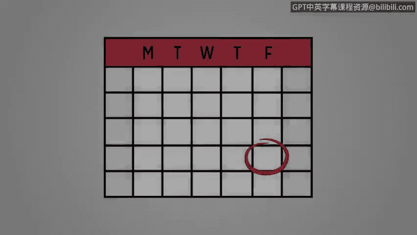

# 软件产品管理：6.7：项目回顾模拟 🎬

在本节课中，我们将通过一个模拟场景，学习如何进行一次完整的项目回顾会议。项目回顾是敏捷开发中的重要环节，旨在总结经验、识别改进点，以帮助团队在未来做得更好。

---

上一节我们介绍了项目收尾的各项工作，本节中我们来看看如何通过结构化的回顾会议，对整个项目进行复盘和反思。

这次项目旅程相当精彩，希望大家都乐在其中。现在，我想进行一次项目回顾。

我知道我们过去做过冲刺回顾，但你们中有多少人做过项目回顾？我没有。我听说过，但从未实践过。

这个项目的成功离不开团队每一位成员的辛勤工作。我个人想说，能与你们所有人共事，我感到非常自豪。

**第一步：营造安全氛围**

任何项目回顾的第一步，都是确保每个人都能舒适地、开放地谈论自己的想法。因此，我想先做一个快速的匿名投票。请在一张纸上写下一个1到5的数字，这个数字代表你在此次会议中参与开放对话的安全感程度。1表示非常不舒适，5表示非常舒适。

很好。我本以为不会有什么问题，确实，没有人给出低于4的分数。我们继续。

**第二步：分享意义物件**

大家都带了自己的“意义物件”吗？我们该如何处理这些物件呢？我希望每个人谈谈哪个物件对他们意义最大。

以下是团队成员分享的物件：

*   **乔什**：我带来了一张截图，是我第一次单元测试失败时的打印件。我喜欢它，因为它提醒我，我的代码并非总是完美的，单元测试也很重要，即使它们会占用更多时间。哦，我还带来了亚历克莎给我买的一罐“杀虫剂”，是个玩笑。
*   **亚历克莎**：我带来了这张有人留在我桌上的便利贴，上面写着“今天干得不错，继续加油”。我不知道是谁写的，请别告诉我，我有点喜欢这种未知的感觉。它帮我度过了一个艰难的日子，被欣赏的感觉很好。所以，谢谢写它的人。
*   **产品经理**：我当然也带了东西。我带来了我们项目的燃尽图。我认为我们共同完成的工作量是惊人的，我想提醒大家这一点。我还带来了一本童书的实体版，就是我们为坎达塔项目使用的那本，我特意去买了一本。它是这个项目的纪念品，希望未来能将这样的书籍带给全世界更多需要的孩子。

也许之后，我们可以作为一个团队，和我们的物件一起拍张照片。

**第三步：评估项目成功与否**

那么，我们来多谈谈这个项目。它成功吗？我不知道。我们完成了所有预定任务，但我只是希望我们能继续做下去。我感觉我们没有打造出我们能打造的最好的产品。

我明白你的意思，但你必须记住，我们在专注于重要事项和按时交付方面确实做得非常好。而且我们必须在仅仅几个冲刺内为贸易展交付一些东西。在这么短的时间里，你不能期望完成太多。你说得对，我们本可以做得更多。乔什，你怎么看？实际上，我认为它相当不错。我的意思是，确实没发生什么大事。

**第四步：构建项目时间线**

那么，下一个练习是构建我们的项目时间线。考虑到项目周期很短，这应该相当简单。我们每个人在一张便利贴上写下一个事件，然后贴在这张纸上。之后我们再写下其他重要事件也贴上去。我来从项目开始，我们所有人开始一起工作的时候写起。

第一个重大事件应该是我们开始构建应用程序的时候，对吧？我认为我们应该先写下需求分析过程。我们可以把两者都写下来，这是一个协作的过程。

**第五步：结构化讨论**

现在，让我们思考一下这个时间线。我们可爱的产品经理给了我们一些讨论主题。我们来谈谈它们。

**什么对我们很有效？**

*   我们的流程。我认为我们很好地遵循了敏捷实践。
*   我认为我们作为一个团队合作得非常好，并且在所有事情结束后，我们的沟通也相当不错。

**我们学到了什么？**

*   我学到了编写测试用例并没有那么难。
*   我学到了在未与所有人沟通前，不应只做自己认为正确的事。
*   我学到了Scrum可以成功应用于小型项目。我还学到了我在团队中工作得比我想象的要好。

**下次我们会有什么不同的做法？**

伙计们，你们太棒了。知道吗，这有很多内容。哇，我们在这个项目中确实做了很多，不是吗？

好了，差不多就这些了。我认为没有其他需要讨论的了。你们还能想到什么吗？没有，我想不到了。

**第六步：会议收尾**

那么，就这样吧。这次很有趣。我们拿着所有这些物件拍张照片怎么样？然后我可以马上发给你们。太棒了，谢谢你们和我一起完成这次回顾。

---

本节课中我们一起学习了项目回顾会议的标准流程。从**营造安全氛围**开始，通过**分享意义物件**建立情感连接，进而**评估项目整体成败**，并**可视化项目时间线**。最后，通过结构化讨论聚焦于“**什么做得好**”、“**学到了什么**”以及“**下次如何改进**”这三个核心问题，从而系统性地完成项目复盘，促进团队持续成长。