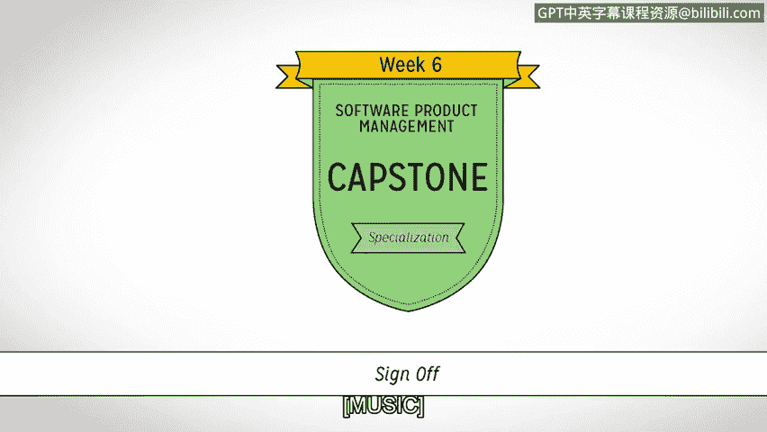
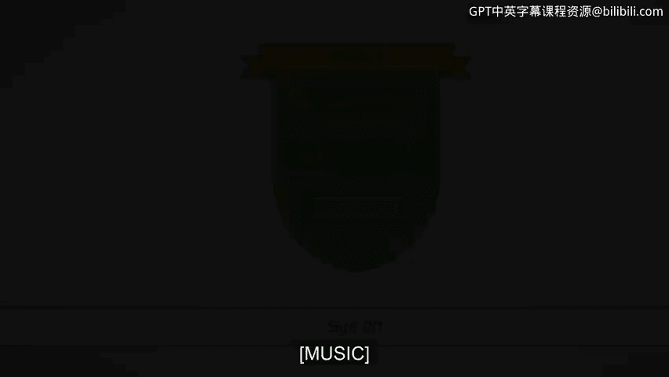

# 艾伯塔大学软件产品管理课程6：《软件产品管理毕业项目》｜software-product-management-capstone｜ - P48：23_07_6-10-congratulations-on-completing-the-capstone.en_subtitled - GPT中英字幕课程资源 - BV1Su411T7fE

🎼。😊。

Well， you made it， congratulations。We here at the University of Alberta are so proud of the hard work that you've put in this specialization。

We hope that you take this knowledge with you wherever your career takes you。

We appreciate every form post and email， it was a great journey having you here with us and we thank you for your commitment。

We had a blast making these courses for you， and we hope that you enjoyed taking them just as much。

We want to wish you the best of luck for all your future endeavors。

 so please keep us updated for where this specialization has taken you。

Thank you and congratulations again。

