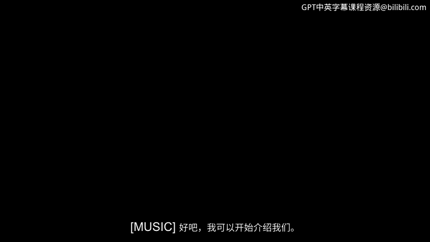
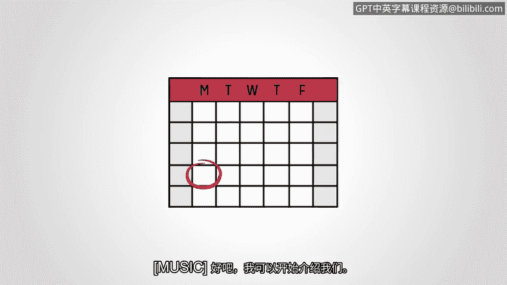

# 艾伯塔大学软件产品管理课程6：《软件产品管理毕业项目》｜software-product-management-capstone｜ - P4：3_第1.6节 视频模拟开发团队简介 星期一.zh - GPT中英字幕课程资源 - BV1Su411T7fE

🎼。😊。

🎼不是一不。😊，🎼Well I might as well start us off my name is Kathleen。

 but please call me Ka Kathleen is far too formal I've been working in the industry since。

Let's just say it's been a long time in my career I've been fortunate enough to experience software from many different perspectives。

 I started off as a developer， but I've also worked as a scrum master product owner and a Scrum coach but I really missed creating。

 I loved working with other teams and inspiring them to do better but I really missed the creative outlet that programming allows so a few years back I returned to my development routes。

 I am an avid Yogi， I practice yoga most nights at a fabulous little studio just a couple blocks away if any of you ever want to join me。

 I find it really great for creating balance in your life。😊，Actually。

 I think it would be a great team bonding exercise， I'll go to a class together。

 I think it would make us a really strong team mentally and spiritually。Well， that's cat。

 I'm really looking forward to getting to know all of you and creating something spectacular。Alexa。

 why don't you go next？Okay。E'm Alexa。I've worked in the industry for several years now。

 and I've worked on some pretty cool projects。 Most recently。

 I've been focusing on video game development。So yeah， I left the last company that I worked for。

Theyre pretty controlling。 Like they always wanted me to write down all of my hours and stuff。

 I mean， why can they just trust that I was doing my work， I mean。

 I produce more code than any of the other developers there。

What about what you like to do in your spare time？Oh， well， there's not much， I guess I play bass。

 I play bass Sna all Girl punk band， yeah we're getting pretty popular actually in the local music scene。

And I like to draw。I like to design outfits。 you know， I haven't actually made many outfits， but。

I have a lot of drawings， so maybe I'll pursue that further Wendy。Wow， that sounds wonderful。 Well。

 maybe the team can come see one of your shows。 Please let us know when you're playing next。😊，Josh。

 why don't you go next。Heい。I'm Josh。 I've been doing this for a while。

 I started programming when I was nine years old， I built a robot to spy on my brothers。

 I know most programming languages， at least the useful ones in my spare time。😊。

I'm usually on the computer when I'm not programming， I'm blogging， I'm really into gaming。

 I've gotten back into World Warcraft lately since I got too good at league。

