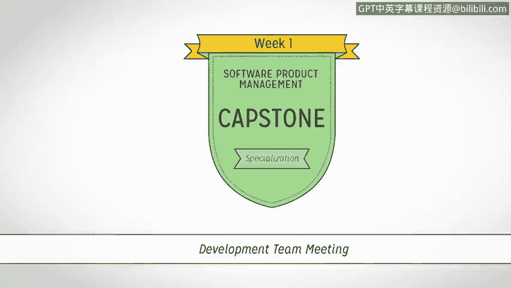

# 艾伯塔大学软件产品管理课程6：《软件产品管理毕业项目》｜software-product-management-capstone｜ - P5：4_第1.7节 视频模拟开发团队会议 星期一.zh - GPT中英字幕课程资源 - BV1Su411T7fE

🎼。😊。

🎼不是一不。😊，🎼Theふ。

So based on what you've told us， most of this project seems pretty straightforward。 I mean。

 brow search features are pretty standard， for example。

 So let's take some time to talk about some of the features that are a little bit more ambiguous。

 First of all， I'm personally a little confused around how users are going to talk to one another through the app。

 What sets this apart from a straightforward reading app。 Couldn't it just be a messaging feature。

Yeah， I don't know that kind of defeats the purpose of reading to someone else That's true Josh。

 you raised a good point What if we did like something like a video chat instead of text messaging Yeah。

 that makes sense but I don't think we should rely on that because for one video is going to eat through people's data plans like nobody's business so I think we're going to need a fallback I think we can design an audio only option。

I mean， I can do that up in no time Great， good idea。

 good thinking Daniel did mention that they should also be able to see a list of friends that they can connect to as well。

 is that like a friends list Yeah that's what I was thinking my only worry is that we're going to have to create accounts for all this stuff。

😊，I can see why you wouldn't want to do that but it's actually going to be necessary for this project if we're going to be storing any sort of user history I mean we're going to need accounts for more than just storing books they've already read if we're going to be tracking reading comprehension that's going to be per user too so we're going need accounts and all of the features that go along with that like logging in and resetting passwords I really don't like what Daniel was thinking about reading comprehension I mean。

Yeah， it would be useful but couldn't we just get them to fill out quizzes or something instead of trying to figure out voice recognition What do you mean to figure out Okay we get it。

 you're so good at programming voice recognition is just something that I've never done before Okay you two how about we put it down as something we can do but perhaps we raise it as a concern before we actually start to design for that feature？

Does anyone else have any concerns about the project。Well。

 they said that there should be a pass and play feature。Why couldn't we do both。

 But isn't pass and play just read a book like a normal E reader， What's cool about that。

 There has to be some kind of interactive technology integrated in order to add value。

H what about Bluetooth？We could connect two devices together wirelessly and then display the same content on each Okay that sounds like something we can handle although we need to have the user able to read on their own too so there is still some value having the app function as an e readerer at times what is this product being built for because I know Lisa said that she wanted it to be portable and accessible maybe it could be a web app because that's going to need wi-fi so it could be a smartphone app No Daniel said that this device has to look like a book and I don't think using a smartphone is going to replicate a book nearly as easily as a tablet would I think we should design this specifically for tablets we can also restrict online downloads to tablets only to I've done that before Yeah you're right reading a book off of a smartphone would be kind of hard。

So are we creating this for Android or iOS or both I think they want both。

 but we should double check with Lisa and C， doing both is going to be a lot of work。

 but perhaps they just want one for now， hopefully we just one doing both would be a nightmare。

So should they be able to use this in portrait and landscape mode I picture reading a book in portrait mode what about both we can do portrait and landscape mode in landscape you'd have two pages side by side and then in portrait mode you would have one but everything would be bigger Oh。

 it would also be awesome if you could have the pages animated to look like they're actually turning too。

Yeah， that makes sense。Yeah， that would be cool。 Are we going to do that。

 I think so what does everyone else think Yeah Okay， cool。😊。

Lisa said that she was they were going to be providing us with a database of material Are we going to be pulling that information from the database and I know Lisa said that she wanted the material to be used anywhere but storing all of that material on the app just seems unrealistic Wow yeah。

 that would be horrible Can you imagine how much space that would take up on people's devices there is。

No way we can do that。If we just pulled the titles of the books from the database。

 that would free up memory usage a lot。Yeah， and then when they begin reading a book。

 then we would store it onto the tablet so they don't have to access the database every time they want to read good ideas。

 you too。 Yeah， I mean， I don't think the user would expect to be able to browse content when they're not connected to the Internet anyway。

 Now， do you think that would be the same for the favorites and to read lists。

I think that those lists should be saved locally onto the device so that they can choose to read those books whether they're connected or not Okay that makes sense Let's just drop down that the user should also be able to delete items from their device as well I just think it would be irritating if adding an item to the list was irreversible and that will need to be connected to the accounts as well。

Are we also doing that definition thing is there going to be a dictionary in the app that they can use？

 No， remember that wouldn't be useful for kids。 Daniel said he wanted the kids to be able to get definitions right away。

Like by asking the person they're reading with， Yeah。

 what if they're reading alone or the other person doesn't know the definition。

 That's what I was thinking。 Well， couldn't we just have the definition pop up when the user selects a word？

Yeah， yeah， no， I've seen that。 Yeah， okay， awesome， I can totally see it， okay。😊。

Things seem pretty good。 I think we have enough information to move forward with design。

 What is everyone else like。 Yeah， I think so Yeah， Okay， great。 perfect。 Thank you all so much。

 And let's get going on this。😊。