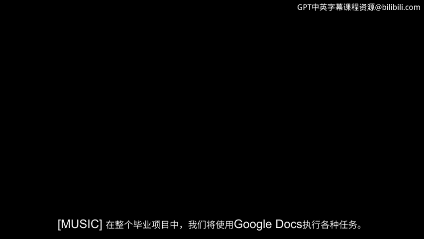
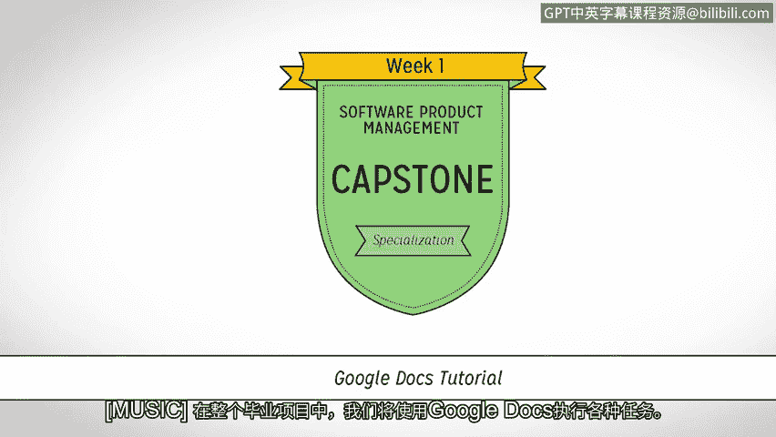
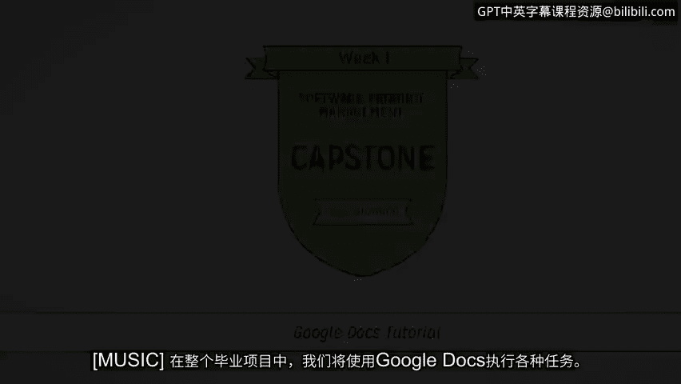
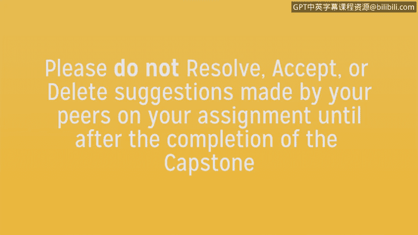

# 软件产品管理毕业项目：1.8：Google文档使用教程 🗂️

在本节课中，我们将学习如何在毕业项目中正确使用Google文档。我们将涵盖创建文档、分享设置以及如何与同伴协作进行评论和审阅。

## 概述

我们将使用Google文档来完成毕业项目中的各项任务。要访问Google文档，你需要一个Google账户。如果你还没有账户，请立即注册一个。我们建议你完整学习本教程，即使你之前使用过Google文档，因为其中包含提交作业所必需的重要步骤。

## 创建文档

上一节我们介绍了准备工作，本节中我们来看看如何创建你的第一个文档。

创建Google账户后，请访问Google文档主页：`Docs.google.com`。

接着，你需要通过点击“空白文档”选项来创建一个新文档。这是你应该看到的页面。

你应该做的第一件事是为文档命名。你在Google文档中创建的第一个文档将是你的需求文档，因此请为其取一个合适的名称。

要重命名文档，你也可以点击显示“未命名文档”的地方。

现在，你可以开始根据从客户和专家互动中获取的信息来创建你的需求文档。

## 分享与协作设置

下一步非常重要。你的工作会在Google文档中自动保存，但我们需要能够与同伴分享我们的工作。我们不希望同伴更改你的工作，但希望他们能够提出建议。

例如，你的同伴将对此文档进行需求技术评审，他们需要发表评论。

要分享你的工作，请点击屏幕右上角的“共享”按钮。此时会出现一个对话框。

点击“高级”。这是你将看到的高级共享设置对话框。你需要点击“更改”。你需要选择“知道链接的任何人”。

这一点很重要。你需要将访问权限从“知道链接的任何人可以查看”更改为“知道链接的任何人可以评论”。

你的链接共享对话框应该看起来像这样。请仔细检查此对话框是否显示“知道链接的任何人可以访问”以及“可以评论”。如果是，请点击“保存”，这将返回到共享设置对话框。

你将使用此链接来提交作业。现在，当你的同伴评审通过Coursera上的作业页面访问你的作业时，他们将能够添加建议和评论。

## 如何进行评论与建议

让我们现在来看看具体如何操作。

当我使用另一个Google账户访问该链接时，文档看起来是这样的。你会注意到绿色的“建议”模式。现在，当我在文档中输入时，它会显示为一条建议。

你也可以通过高亮想要评论的文本，然后点击此处找到的“评论”按钮来发表评论。

在毕业项目完成之前，请不要解决、接受或删除同伴在你的作业中提出的建议。

你将在第二周的需求技术评审作业中，对你的同伴的需求文档发表评论。

## 总结

本节课中我们一起学习了在毕业项目中设置和使用Google文档的核心步骤。我们了解了如何创建并命名需求文档，如何通过调整分享设置允许同伴进行评论，以及评论和建议功能的具体操作方法。正确使用这些协作功能对于顺利完成同伴评审至关重要。