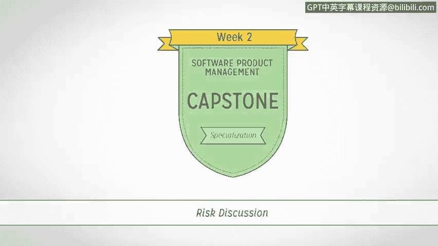

# 软件产品管理毕业项目：2.3：模拟风险讨论 🎬

在本节中，我们将通过一个模拟的团队讨论场景，学习如何识别一个软件项目中可能存在的各类风险。我们将看到团队成员如何从不同角度提出潜在问题，并理解风险识别在项目规划中的重要性。

---

上一节我们介绍了风险的基本概念，本节中我们来看看在一个具体的项目讨论中，团队成员是如何识别风险的。

以下是模拟讨论中团队成员提出的主要风险点：

*   **功能实现风险**：部分建议的功能（如**语音识别**和**远程用户连接**）在实现上可能存在较高风险。团队需要在开发前充分评估这些功能的价值，确保其必要性。
*   **技术平台风险**：计划同时为 **Android** 和 **iOS** 两个平台开发应用，这可能导致工作量倍增和不同操作系统间的兼容性问题。
*   **利益相关者变更风险**：关键利益相关者（如产品负责人Lisa）可能频繁改变想法，这会给项目范围和需求稳定性带来挑战。
*   **团队资源风险**：团队规模较小，任何一名成员生病或离开都可能对项目进度造成重大影响。
*   **外部依赖风险**：项目所依赖的数据库系统近期有过更新，其稳定性和易用性未知。如果它像旧版本一样存在故障，项目将面临极高风险。

---

在本次模拟讨论中，我们一起学习了如何从功能、技术、人员、依赖等多个维度识别软件项目风险。有效的风险识别是制定应对计划、确保项目顺利推进的第一步。接下来，团队将基于这些识别出的风险制定具体的风险计划。