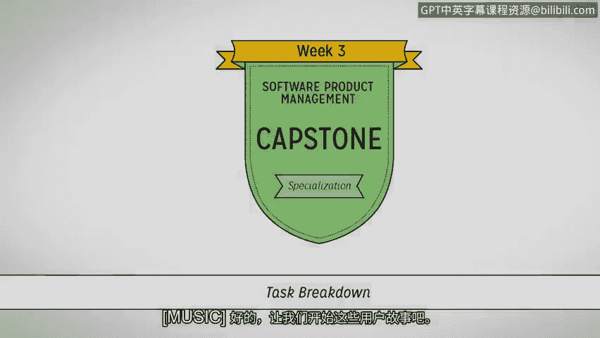

# 软件产品管理毕业项目：3.10：视频模拟任务分解会议

在本节课中，我们将通过一个视频模拟会议，学习如何将用户故事分解为具体的开发任务。我们将跟随一个团队的讨论，了解他们如何规划一个关于平板电脑应用和数据库连接功能的开发工作。

---

## 会议开始

会议开始，团队决定从关于平板电脑的用户故事入手，因为这个故事相对简单。

## 分解第一个用户故事

以下是针对“平板电脑应用”用户故事分解出的任务。

*   **设计应用线框图**：需要为应用程序设计视觉布局和交互流程的草图。
*   **搭建iOS开发环境**：需要配置好用于开发iOS应用的软件和工具。

团队确认数据库已经存在，无需新建。因此，核心任务是建立与现有数据库的连接。

*   **建立数据库连接**：需要配置应用程序，使其能够与已有的数据库进行通信和数据交换。
*   **编写数据获取源代码**：需要编写从数据库中提取所需材料的具体程序代码。

## 讨论开发与审查流程

上一节我们列出了具体的开发任务，本节中我们来看看团队如何规划代码开发和审查的流程。

团队讨论了代码审查的方式。有人提议采用结对编程，但存在效率争议。最终达成妥协方案：在特定时间进行结对编程，或当成员遇到困难时主动寻求结对帮助。

因此，如果代码不是通过结对编程完成的，则需要单独的任务进行代码审查。

*   **代码审查**：对于非结对编程编写的代码，需要由其他成员进行审查，以确保代码质量。

团队决定遵循良好的编码标准，并采用测试驱动开发方法。

*   **编写与执行单元测试**：在编写功能代码之前或同时，需要编写并运行测试最小代码单元的测试。
*   **编写验收标准与测试**：需要根据用户故事定义具体的验收条件，并编写相应的测试来验证功能是否满足这些条件。
*   **执行验收测试**：运行验收测试，确认功能符合预期。

## 讨论文档需求

在确定了开发和测试任务后，团队接下来讨论了项目所需的文档。

关于是否需要内部文档存在分歧。一方引用敏捷宣言认为文档不重要，另一方则指出数据库是复杂组件，未来维护或其他项目复用都需要文档说明。最终团队达成共识，需要为数据库编写内部文档。

*   **编写数据库内部文档**：需要创建文档，说明数据库的结构、连接方式和工作原理。

对于用户手册，团队认为数据库连接对用户是自动的，因此无需为此功能单独编写用户手册。

## 分解第二个用户故事

基于第一个用户故事建立起的流程，团队开始分解另一个关于“播放列表”功能的用户故事。

这个功能看似直接，但同样需要遵循已建立的流程。以下是分解出的任务列表。

*   **功能设计**：需要设计播放列表功能的用户界面和交互逻辑。
*   **编写源代码**：需要根据设计实现播放列表功能的程序代码。
*   **代码审查**：需要对编写的代码进行审查。
*   **编写与执行单元测试**：需要为播放列表功能编写并运行单元测试。
*   **编写验收标准与测试**：需要定义播放列表功能的验收条件并编写测试。
*   **执行验收测试**：需要运行验收测试来验证功能。
*   **编写内部文档**：需要为播放列表功能编写说明其技术实现的内部文档。
*   **编写用户手册**：需要为用户编写介绍如何使用播放列表功能的手册。

---

## 总结

本节课中，我们一起学习了一个模拟的任务分解会议。团队通过讨论，成功地将用户故事转化为具体的、可执行的任务，涵盖了**设计**、**开发**、**测试**和**文档**等多个方面。会议还确立了**代码审查**和**测试驱动开发**的流程，并强调了为复杂组件（如数据库）编写**内部文档**的重要性。这个过程为后续有条不紊地开发软件产品奠定了基础。