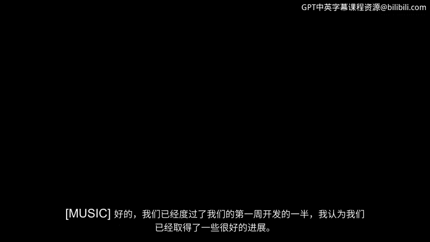
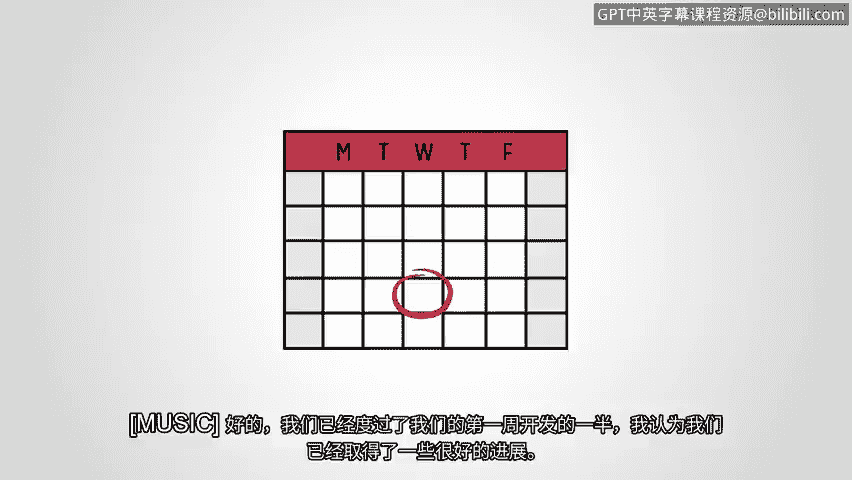

# 艾伯塔大学软件产品管理课程6：《软件产品管理毕业项目》｜software-product-management-capstone｜ - P9：8_第4.1节 视频模拟站立会议 星期三.zh - GPT中英字幕课程资源 - BV1Su411T7fE

🎼。😊。

🎼不是一不。😊，🎼不不知。

Okay， so we're halfway through our first week of development and I think we've made some great progress。

 who wants to start off our standup today。I could， I guess so yesterday I started working on the reader connection。

So that feature is pretty much done。 I mean， I can just probably finish that up today。

 and then I'll be adding audio。Yeah I got nothing blocking me right now。 Okay， Well。

 yesterday I was working on the page formatting。It's proving to be a little difficult。

Some of the features just， they're not， things just aren't lining up the way that I want them to。

I have it set up to work in portrait and landscape mode。

 but like the pictures are throwing things off so I'm going to keep working on that today and as for blockers。

 yeah it's taking a little longer than I thought it would okay Yesday I set up the iOS dev tools so those are good to go Today I'm going to write acceptance tests and criteria for the features in progress so that you can run those when we're done coding for those features。

We really should have started with that but no worries I'm sure we'll get it done so yeah I don't have anything blocking me so let me know if you'd like some help with that page layout I could swap in with someone and help with pair programming you know maybe all we need is a fresh set of eyes I feel like I'm pretty close to getting it but yeah if i'm still struggling this afternoon and maybe we can mix things up。

I wouldn't mind working on the acceptance stuff。All right， well let me know either way。

 I think we can wrap things up and let's all get to work。

