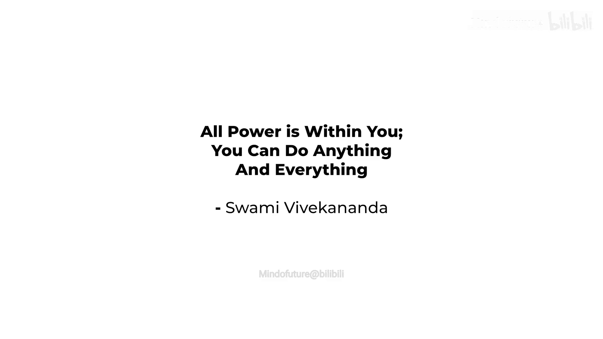
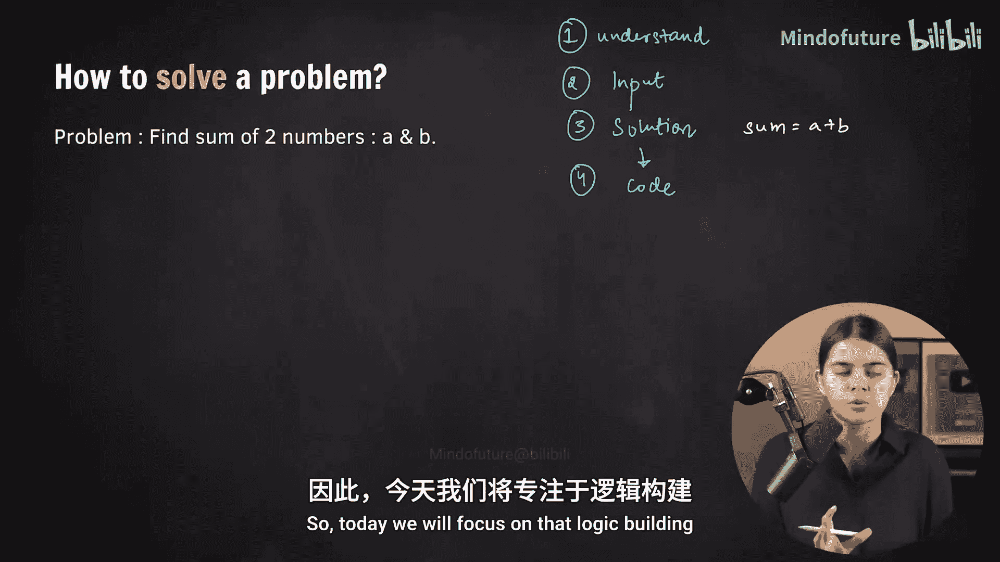
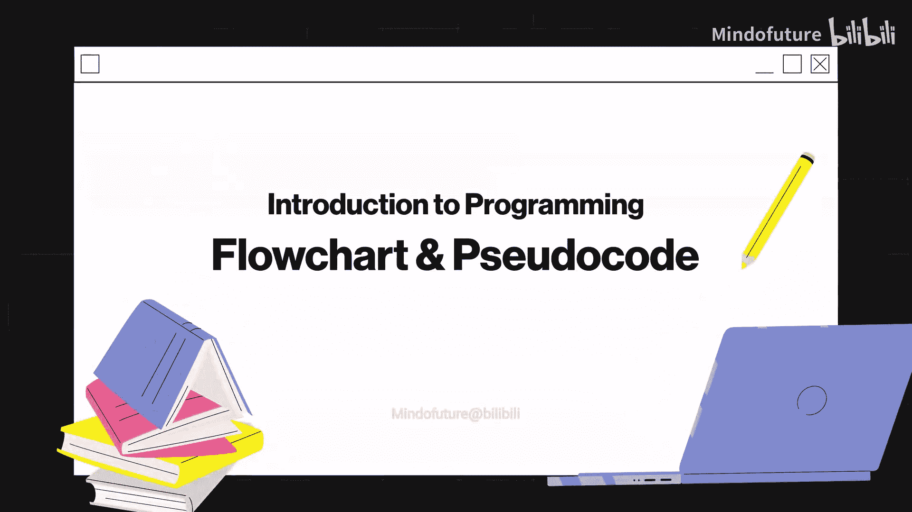
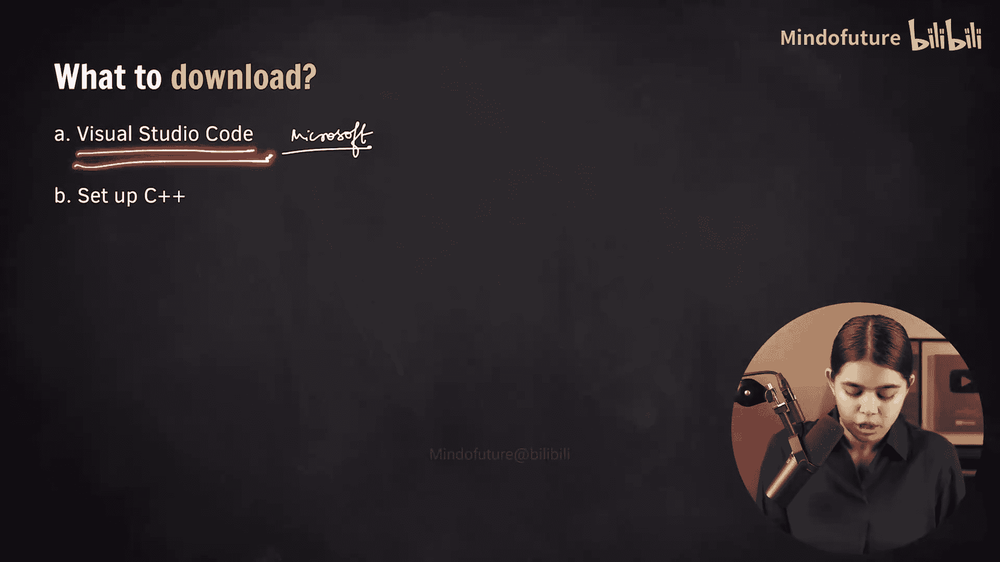
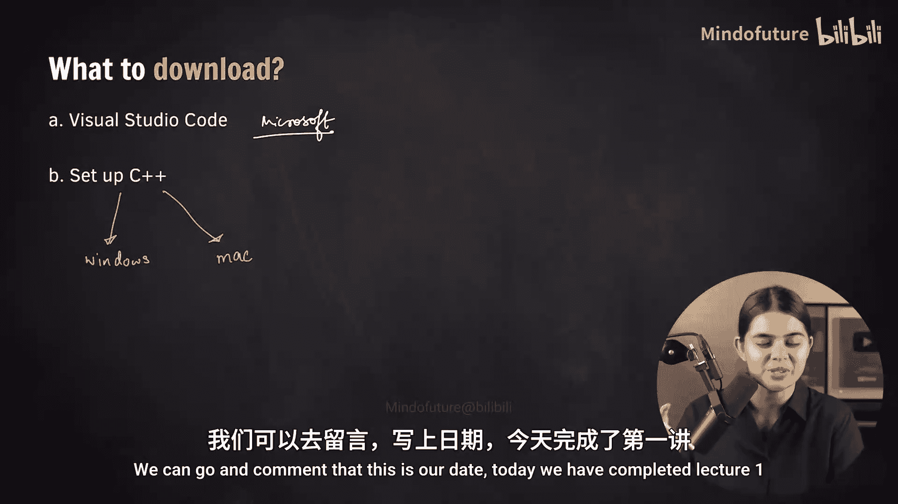

# C++-DSA课程-｜-数据结构-｜-leetcode-｜-Apna-College-｜--Complete-C++-Dsa-Course-p01-P01_第一讲_-流程图_伪代码_+_安装-DSA系列_由Shradha_Khapra老师讲解-C++语言--BV18oUGBkEmV_p1-

simple second sponsoredd third are trying to。😊。

practice。Interview according and ands solve or。Da，basically。

which is to which is to convert programme。paper pen solution pen logic problem pen solution in the form of flow charts and。

，and diagram。sum is equal to a plus B sum S lets suppose next step to print this sum or finally I can end。

😊，programming terms logical solution。Sse sub easy component componentm basically or or exit and solution shape output Jo programme companies basically。

😊，Cd go you input later。Or Uki U Koku operations perform Kteg or Koch output data。😊。

Condition number a a greater than B answer Sirai， for example。

 mepa sum0 to greater than equal to0 satai。😊，depending upon decision。First。

 step Hojaga input A and B。O about next step， ojaga sum Niallo， which is going to be a plus v。

 The next step may humm looking is sum is equal to a plus v。

Third stepja sumco Privau to Yahava sumco。ari， small S in case anybody had confusion small Silm same for。

😊，And fourth step。To exit。Understanding equal multiplied。

E bar Hamipas Agaam Arian Kal area kote area is equal to a square a squareriani a multiplied by a to Ise cuki calculation current to rectangle can Liing。

 And for finally， Hams Ariaco print Kbaak。😊，To print and and finally。😊。

Agaham convert curry flowchar isham convert cur to the pseudo code。

The in interesting cheese Ili English like， basically first step input cur。😊。

Many k many input here aco Second step from Arian Gallinggi to the area is going to be a into a。

Third step from print Kne Iku to print Kdiya Manne。4 step minimum of。A minimum of two numbers。

 Yri problem no numbers come minimum number Jokova orki input me input mevo numberja A or B。

 no problem， clear he input clear he solution dictate them manlo no numbers， E 4 or 5。

C or minimum basically4 less than54 greater than5。😊，gar less than or4 greater than than4 or。😊。

Give4 less than5 hega， Yatoy Yes Hoga。Yin nohoga Agar 4 less than 5 F those case M Ho number konhoga 4 or agar 4 less than 5 Ne heh those case M Ho number konhoga 5。

 A bus is 4 or 5 comb a replace place Kdu Agar A or B C。solution or 4 or512， 4，1010 or5， no。

To beach hotel number a Po straightforward solution a to Ica flowchar guessa kga sub star。

Start Mu numbers comparison number to numbers in no numbers input a and。😊。

We go to Sc a upner input block Manli there。Next step Po that Kab inham compare Guringgi up compare Kne Kle Jom block use Kbi Ame。

 Yes， no valley cheese Pe to kle Jom block use cur。

 This is called a decision block or a diamond block。

 This came Dmon Jesse Koibi shape at is kanaak or Joby cheese， I may check Kneia。😊，Jubic condition。

I Jomes D tome A less than B he。To yato is cancer。 Yes， Hosai。 Yare is cancer。 No， Hosai， do y Hoai。

 or， in fact， all simplicity can gaggerte。Yat is concert。No hoakai。

 though he answers Ho Agar A less than B， he， Yes， to Chote value， Akihu a minimum Moia。

 Those case may print Car Eco。Sa herta there。 and is cheese kyaha there。

 though whose case mayam print Kaani。Eco Nahito hamprint Kvange Bco to Yahamra a output Bhoge。

 Yahamra Dura output Bhoge。Torime Yahabic decision Liaki answer Yes Me noque base output de。

 Ag output printga to Muna Muna exit。😊，direction right direction 10 or。To a1。

Or B 5 to Ptom 10 or 5 co input Kliia A K at 10 less than 5 He must A less than B is Kthan no 10 less than5 n to no Aliarrowta ofangge or imprint Kvaing B B 5 cohamra answerjaga5 to donor numbers may say minimum con minimum hama 5 to straightforward solution is Ka pseudo code like pseudo code k start Koham ignore K to ignore Kia first step input A and B。

😊，To input Carlingm E and。逼谷。Second step her decision block Kiham Poreki A less than B he to isco English make Sse Bolingay Ico English make Ese Bolingay is。

A less than B， whoge English whoga to ktogaga to yes， yme of Genam Ca y omni condition li thee。Yes。

ba answerm th orcarddo E to me Ya Pricarddo Eco。😊，And fill Lim El。

 El come Agarehihu Agarhihuji Bva Tosko Bham， Thor D C space short there。And for print curvatium Bco。

To and third for the minimum of two numbers and secondly。😊，A kra chapter。

 Ia called conditional statements。Or conditional statements， v chapter kander。

 basicallyels Mula Dec Ban yes or no v tokielelki p Ii for。

 And this is how we completed a flowchar and pseudo up next birthday。😊。

Next question's call this number n n357911， which46，81012。

Agarsriari numbers2 k table meathe to coibhijo number N he w even number tabhoga。

 w even number tabhoga Jabi N2 say divide cur they。

Or completely divide Kja Mula remainder may0 the of common logic with Atium。 Let's suppose Mi N H 10。

😊，Program。2 set divide divide remainder ni2 set divide remainder a modo B。😊。

value0 is this value equal to0 equal to programming equal or equal equal equal equal。😊。

To co number in him。equal。I'm next step， Poga。Kham n modular2 Nigali or check I value equal to 0 H。

Tomyche Kanakiki and Moilo， too。Is this equal to 0。

To yes no Chi diamond Bku diamond Bjori he I Yato Ia Yes， Iga Yes， No Iga， Let's suppose Ik yato。

 Yes atai。Y is cancer。 No Yes， v， Yes， vam， even print Kva to Yaha print Kva even。

Or do threeta of humprint Carvaingi or youki odd number Pierrimnikia Hamni upne flochar co D earlier。

And iscooros or complete carddire， print Carva dubarrai Naogram use Kringgi And finally， Donno misi。

😊，Could be Bto， Hamme to finally Kna exit。Do don know he flow school。

Arokoam Jordanneat to yehamra Fchar Hutahe。For the solution to find if a number is order even is cobar run B Kle solution Calm K and Era。

 Let's suppose mepa number n is equal to 1，50。 This is my number。 to sub to many n in input 1。

50ganeki 1，50 code up2 say divide K to answer1，502 say completely divide oja ask me 0 R completely divide oja answer 0ga Yes。

 meang。😊，Print carva even， though maypa 1，50 K， even print Jaga because 1，50 is an even number。

 Thetoflowcharga solution will Ka。U Ike is Kahamsdo cord there。

S do first step to input n input K second step y condition already if Ca the arm if is is if donno same。

If n modular 2 will call math heatthera operation like is this equal to 0。😊。

Agar even printvai to 30 space Le or print carva even。

Or no atyato Mula El El Valley Cameuja print Kvani here。Or value， or finally Moji Carvai。

for particular problem n。A confusion of their students go， students collected D mathhi， D mathnihi。

 Loai。😊，ly logic logic。😊，The logic515。😊，You made a variable value K variable madam。

 dutiescis change O， change ka Sie and change Oa Shi what Tomishsha oncese to fix it。

To inputvaku capitalhan calculate sum calculate kne logicalriki8 number lo1 losku2ku3ku4s to Qi variable lily placeholder lily placeholder container typemen number li Let's suppose is number count。

😊，Me 가운데 one3。Me account or sum variable sum0 number some0。😊，❓ programme。overall logic variable or。😊。

Dorame。Haami input Cha， to muja subseovna input Lena Pera N。

 the number input N Lena Para is scello grameellia。

Uke A Qki mu sum calculate K should write me sum key value 0 to mu variable define Khanna。

 basically sum naga。Math variables to sum define0 define is equal to1 or sum is equal to 0 input output to straightforward。

😊，Programming gender Iteco initialization， Cat。Initialization starting values sum starting value 0 calculate to value 0ization initializeneization value。

😊，Some plus count Kky value or ye statement many us aside me Mu Ki Mua。

S is equal to sum count process ynab less than equal to en greater than en or less than equal to en。

sub value I it less than equal to n value less than equal n。

Agar Tana tomeo Agarji to Yahase Iize Kco subsenegi count less than equal to enhena and Ise Igbar tham。

Resize carquet， Cholaium。equal Yes， yes or Jese。三谷。And Ikile upn， perloogram。

 any output block le or last mate Ham ks and Yuki Kaina Kabi Ea point to Aga Jamara count Enseja。

Up yet too many some calculate Klia or count quad G。But count Ki Shira Kti count Pat have won。

To many one3 the art。Ajas count co2 bananadiga Mazais countse Bhanga or kissbi variable cosete basically count Ko count is equal to count plus1。

 He count Jovini valuea。😊，To make。J concept concept。😊，Is equal to count plus 1。

EBM process blockku Jaigerkikuu input output name。Or basically I overall logic is。😊，Mlo N millai3。

 N3 milli devalue li Choda solution lilia。Input K and go。count调嘅 강 one。

To me I count he count is equal to1。 some he shouldar me。equal equal equal。

The dubarraring2 less than 3。 Yes， the2 co King fair2 co dua increase K count increase count key value of 3 O Fring at 3 less than equal to3 he。

 Yes， less than n but equal to to he。😊，To3 k Ko count Ijak count key value less than equal to n less than equal to 3 a is Kajagan no no k Loharkiho1 plus 2 plus 3。

 This is equal to 6 final answer 6ja or or A1 say。😊。

3 tech numbers Casam nial wasmbbiiota1 plus 2 plus 3。 that is equal to 6。

 Why he same answer a Mariippa， logically Pritoge， logical niel G This theri is I married no problem here。

 Uscom solution， Nial Ab is poor solution， Gee。😊，Suro called B Asan with problem here of numbers first time problem Luba first time Lichbo difficult。

 in fact， interesting。😊，Fromya input K and。Second step here。

 which variables go initialize Kdo count1 leo， sum0 leo the a leum count1 leia is equal to1。

 and some go initialize Kiaia is 0。😊，For third step K。

 third step may basically hum condition check per self condition check。

 hum self condition checking H loop my condition go check。😊，Aroroerue。😊。

T loop quo the kni ham hapa while hamif if ne Lie if klaboai if else come atlaboai condition a v che lickin vi klabo v condition bar bar che Kci condition have v condition ye condition kki ye condition bar bar bar bar bar bar che or y poora loopai ye condition job y they theea to lu chtae condition job no they the to loop na gelta to y bo important condition to is condition co hum with the help of。

This word called wile while cometh of English Cananderoota jabtuk jabtak ye condition such he tu tuk mera Lo chalega Jese he condition falses Hogie ham Loe Baharraja boim she to w condition k。

Jbta account key value。Less than equal to N H。아그가 예비가 동거함 라。Space liquorricktte。

 Lo Kenander Pela cahoga is sum canander。Hm count k orho count kander。함 Val count plus。

이 bar bar bar barse。fourth for this particular problem is equal equal equal operator equal。

Ho y cheese comb use curte to basically flowchar carumdostate lire or pseudo code maydo statement lire you see sum is equal to sum plus count sum plus equal to count。

😊，Is a do three case electronic a count plus equal to 1。Same way Yahaper。

Is lying goham likeac here sum plus equal to。Count or is La Goham Lexre。

Count plus equal to1  D C G yea ana appreciate paper pen cheese per message li to orza betterlect codeza readable。

 So I hope is sum of n numbers whoa in the form of a flow chart and a pseudo next a core coffee multi juty sake problem solve k fine K。

 If a number is a prime number or not。Mat Kendall。Prime numbers per prime numbers Joseph。example。

3 is a prime number7 or7 in the form of13。Prime numbers， obviously。

 I2 to say bud numbers prime numbers， though prime k example me。Jsera 2 Ho， Jimra 3 Hoge。

 Je a 5 x prime number a 7 I prime number a 11 I prime number a 13 a prime number A bath captain non prime O income non prime composite numbers Cat perfectly importantly Jeimala 4 Ho。

😊，For one or  four k table meant other year， but2 key table mean be other。😊。

Just 61 key table or 6 key table23 key is k or1 key or in prime numbers out prime number。😊。

Basic condition came me backkimanlo Kobi number N Mujigim。 Let's suppose I am given a number 7。

7 Muji up 7 kaggar Muologically theychna is 7 prime Ha to Mujay deni 7。

Sf 1 or7 key table me and E in table meme 7 bar number said table and E1 said7。

1 key table for2 if3 if 4，5，6。😊，Ca 7，7， he mega 7 he A 8 he 7， No， because 7 is smaller than 8。

 just say 7，8 he tableta is in 9 kaba，10 kaba to basically Uquezaru。😊，77 mathematical 7 factor 7。😊。

Or 7 multi 7 or multip 77 multi or is。😊，N1 n6 7 completelyki7 mod 3，07 mod3 73 completely。7，4。

 shall be completely divided Ne the 5 shall be completely divided Ne the 6 shall be completely divided Ne the to cam caseic take is 7。

 Ser 1 or 7， say completely divided o the。 And that is y 7 is a prime number。😊。

Up 6 kilo di6 kilo Yakihibi number kilomoji Ki contact di now2 cilire n minus-1 do。😊，The 6 kmoji，2，3。

4 or 5 kg kna diagram。Ks2 divide， yes，62 divide 6 modulo 2，0。

62 say divide O I Ka 6 non prime number6 prime number to basically upper logically logically Mu。😊。

Logically， Mujak number theja n Muja is number quote 2 Cre n1 tu sorryri number C is mod Agarinsri number variable Lets suppose I Cho to I。

😊，Pelium 2 Raingcom 3， Racom 4 Ra Aco n minus1 click to bar bar Muji upon N。😊。

Is logic pseudo convert k Also one more additional thing prime number logic This is not the most optimal solution to find prime numbers is optimize solutions per beginner solutions solution Jo。

😊，Though prime number kilocase check is subsequently to start curving it。 Very simple。U number non。

For next step k next step variables define Kna Mujabarto define Kna I basically is I2at2 n1 numbers quo。

😊，The process block up next step basically I value n1 k less than equal to a I less than equal to n-1。

😊，Mab n agggar6 to I maximum 5 ja6 neta to v condition Mujigi condition here key agar I less than equal to n1 he mu n mod to n mod I y diamond blockky condition Agi Ya I。

Dismatoyky condition Agi Ya no condition Agi， in fact， isjakour th Raa Riaiis。不欠。To subela。

 I value heya， I less than equal to n -1 hea， Yato I K， No Aa。Yes， it's cancer。 Yes， I go。No I valid。

😊，Valid canny command club。 I limit my hair to say n1 key。Toamikna， Tohammi and mod 아이kna。

Agar I valid， to Abu Mu and modullo I K K value equal to 0 he。😊。

Y a core decision block Moja Ya value equal to 0， Ya value equal to 0。or or or。Saay ya。

I coberakar ke， I coberakar Muja I plus equal to1 Kai。n1 equal or n is equal to 7。😊。

Let me remove all of this。N is equal to 7 k I value 2，3，4。

5 or 6 thep i value valid or n mod I 0 no mod number be prime or62 non prime number non prime number。

Noan。Priring。You mean in non prime b Carvaia。To this is my diamond block。

 saysling to y condition number n is equal to 72 or finally is I 7 case me。😊，한 프 가 게。プラ임。

And I say B aneic output block Stle， or finally kjaga。

 finallyjaga exit last me or hamsari kssari print Valley statements go is exit kssat combined good thing T I hope y logicmeioga I logic make by repeat her theium。

😊，Basically， overall， hamkak and Nikgi Go k。I number here just code2 cre n minus1 sorryri numbers that come divide Carneki kher k。

😊，To i valuep2 n-1 range modgarp I 7gar I7 to primehi divide non prime number is n。

's suppose my n is equal to5。😊，And 5 m to Iq value K C Shirogi。

 Iq value 2 says startogi I is equal to 2 he suba A， they can a k less than equal to 4 he。😊。

n2 value less than equal4 Yes， yes5 mod20 mod mod equal。😊， mod equal less equal equal equal equal。

Iswar I Ahaya， Abdu vrajaringgi5 less than equal to 4 he。

Uki I less than equal to n -1 nu G Kf5 less than equal to4 he。No， Icon。 No Jse。

 No who Weie Mujaa number prime number to Muja Kari Kvaner Mujaki print Kvana that this number is a prime number。

 And now I am going to exit my programme。To ye overall logic up my homework problem de。

Or n is equal to8 is equal or。Sudo cord is also going to be very easy。

 Su cord sub input Ka Du I initializedo。These condition condition mu y condition muji bar bar bar barki condition Ka condition loop main conditioner condition falls condition main conditioner main condition。

I less than equal to n-1 is score bracket case I will accept them Bna bracket will accept them。

 It will not make a difference while I is。But clarityically， I like the brackets。

 While I is less than equal to n -1 Muge ye don no K Gne。😊。

Sub n mod I equal to equal to0e main condition main condition。N modular I equal to equal to 0。

Okay module i equal to equal to 0 k 게。Yes， Wal Ca me。 Ham me print Carvana he。Non brain。Yes。

 v case meniva non prime or a car non prime print mu non a exit my non prime exit。😊。

Or else Val Mi init Asam， minimizeto v。😊，equal equal4。😊，Prime number or non to see if number is not。

Loops Johan were generally flowchar in Su mu Permeum。

 theyclaimavni cheese or y paper pen withraavna for Jese C calledro， Jesesa Los v chapterro。😊。

You interview assure。His simple interest is equal to P into R into T。 a simples a formula。

 though aco simple interest calculate Kiquet print Kvai first problem A second problem is just a minimum of two numbers of nikiatha vsappco maximum of two numbers Kna。

 Third problem here。 you have to calculate the factorial of a number n。

 of n factorial Gaotta is co math Kderham。Exlamation Silliium Ico Parhaja Pertheammico and effectial getamisco。

Nial1 into 2 into 3 into 4 into 5ial multi easy concept。

for a given person's age find if they should get a driving or not basically than equal。

problem problem understand input analyze solution or languages basically notebook notebook digital notebook editor editor famous editor also call it for digital notebook。

Yekis per computer signal signal basically signal or to or who make。😊。

To basically 0 or1 k Hami is C plus convert Kija Firi computer The computer cap Bech translatore I translatorna Hindi English and Kia translation Kia Gujarahi English convert K Bngal English convert Kil convert Kia be translatorhogaris translators Bee。

😊，Joy C plus less code co0 or1 v code Gennder convert k or fill U code co computer codeja is 0 or1 v code computer cojate or 0 or1 v code is co executable k。

😊，Toari C file Ho executable file can convert executable file computer or output print translator is translatorco installlator basically compiler compilerlator or compiler that it converts toecutable internallyecutable convert system use visual studio visual studio code microof free software name will system。

😊，Or mapab development visual Studio download important In fact。

 mapku studio com link which is basically do visual studio dot com download。😊。

I website per ja options download depending upontel Apple Silham system download visual studio download description and second is setting compiler in compiler user。

😊。

。internet software by step step by。based website laptop laptop。😊，complete of achievement as progress。

😊。

is basically called public concept follow for consistency next lecture number。

Studio code and C plus for sari system can the set up4 ask8 9 Mil the next lecture can the till and keep learning and keep exploring。

😊。