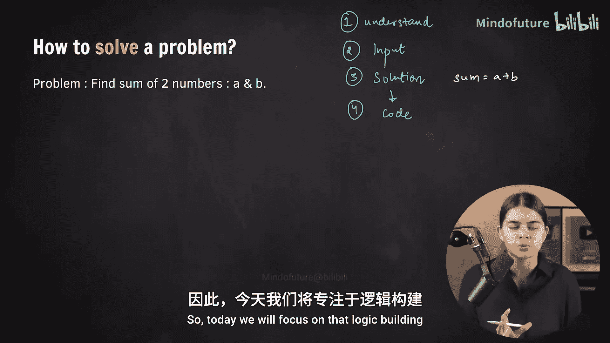
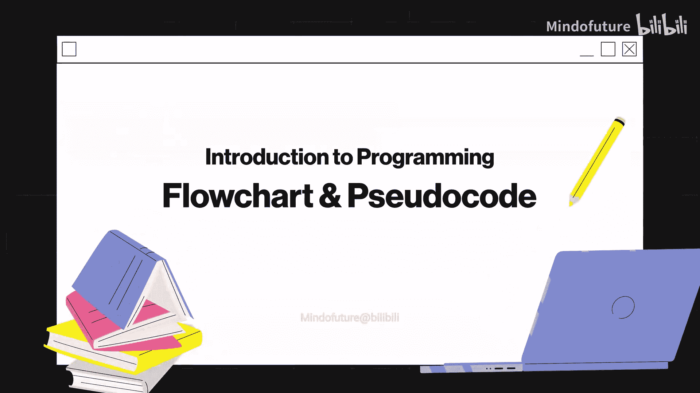
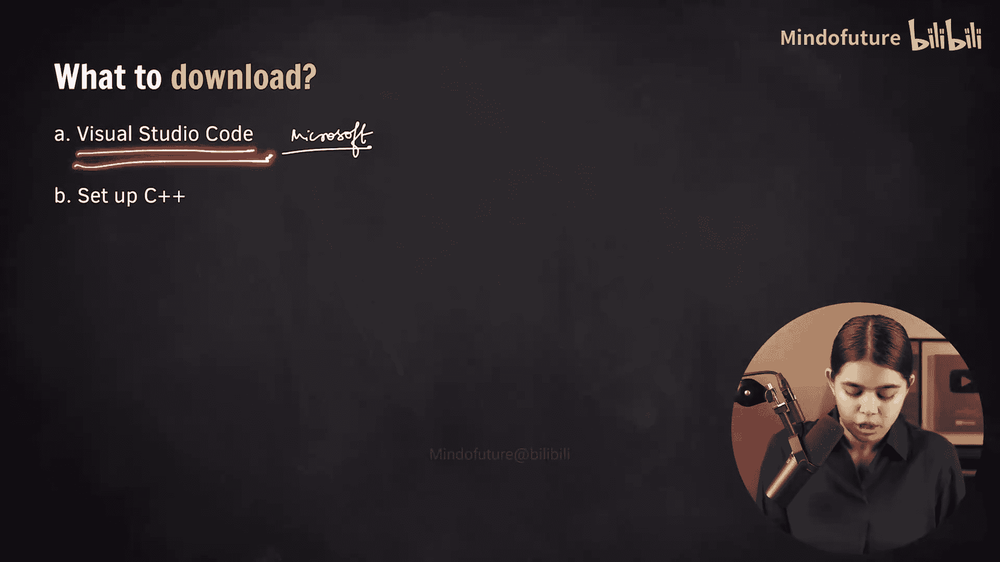
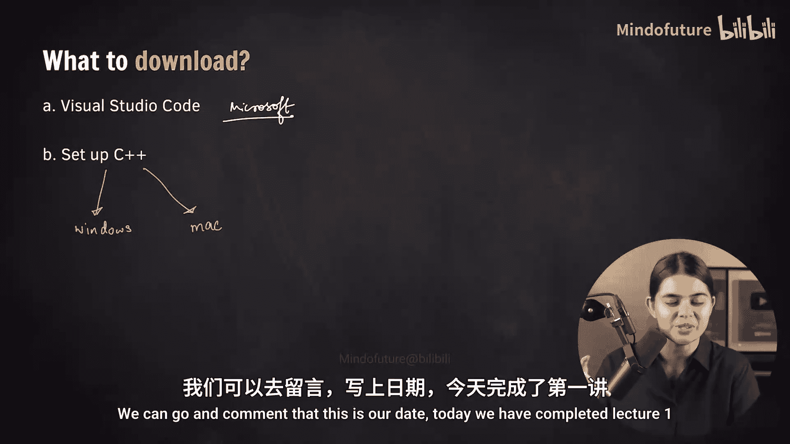

# C++ DSA课程：P01：流程图、伪代码与安装 🚀






在本节课中，我们将要学习编程和数据结构与算法（DSA）的基础。我们将从理解如何将问题逻辑转化为流程图和伪代码开始，这是编写任何程序的第一步。最后，我们将介绍如何为C++编程设置开发环境。

---

## 概述：从逻辑到代码

在编写实际代码之前，清晰地规划解决方案至关重要。这通常涉及两个步骤：绘制**流程图**和编写**伪代码**。流程图使用图形符号直观地展示程序的流程，而伪代码则用类似英语的语句描述逻辑步骤。掌握这两种工具，能帮助我们更系统、更清晰地思考和设计程序。

---

## 什么是流程图？ 📊

流程图是一种使用标准图形符号来表示算法或过程步骤的图表。它帮助我们可视化程序的逻辑流，从开始到结束，包括所有的决策和操作。

以下是流程图中常用的基本符号：
*   **起止框（椭圆形）**：表示程序的开始或结束。
*   **输入/输出框（平行四边形）**：表示输入或输出操作。
*   **处理框（矩形）**：表示计算或数据处理步骤。
*   **决策框（菱形）**：表示一个条件判断，程序流会根据判断结果（是/否）走向不同的分支。
*   **流程线（箭头）**：表示步骤之间的执行顺序和方向。

---

## 示例1：计算两数之和

让我们通过一个简单的例子来理解流程图：计算两个数字A和B的和。

**逻辑步骤：**
1.  开始。
2.  输入两个数字 A 和 B。
3.  计算和：`sum = A + B`。
4.  输出 `sum`。
5.  结束。

对应的流程图清晰地展示了这个线性过程。

---

## 示例2：找出两个数中的较小值

上一个例子是线性流程。现在，我们来看一个包含决策的例子：找出两个数中的最小值。

**逻辑步骤：**
1.  开始。
2.  输入两个数字 A 和 B。
3.  判断条件：**A < B** 是否成立？
    *   如果 **是**，则最小值为 A。
    *   如果 **否**，则最小值为 B。
4.  输出找到的最小值。
5.  结束。

在这个流程图中，**决策框（菱形）** 引入了分支，这是编程中 **条件语句（if-else）** 的图形化表示。

---

## 什么是伪代码？ 📝

伪代码是一种用类似普通英语的语句来描述算法逻辑的方法。它没有严格的语法规则，重点是让逻辑易于被人理解，然后再翻译成具体的编程语言。

以下是上述“找最小值”问题的伪代码：
```
开始
输入 A 和 B
如果 A < B 则
    打印 A
否则
    打印 B
结束
```

可以看到，伪代码读起来就像一个简化的程序大纲。

---

## 示例3：判断奇偶数

为了巩固概念，我们解决另一个问题：判断一个数字 N 是奇数还是偶数。

**核心逻辑：** 如果一个数能被2整除（即 `N % 2 == 0`），那么它是偶数，否则是奇数。

**流程图与伪代码要点：**
1.  输入数字 N。
2.  计算 `N % 2` 并检查结果是否等于 0。
3.  使用决策框：如果等于0，打印“偶数”；否则，打印“奇数”。
4.  这个例子再次使用了条件判断。

---

## 示例4：计算前N个自然数的和

现在我们来处理一个需要重复执行（循环）的问题：计算 1 + 2 + 3 + ... + N 的和。

**核心概念：变量与循环**
*   我们需要一个变量（例如 `sum`）来存储不断累加的和，初始值为0。
*   我们需要一个计数器变量（例如 `count`）从1递增到N。
*   我们需要一个循环来重复执行 `sum = sum + count` 这个操作。

**逻辑步骤：**
1.  输入 N。
2.  初始化 `count = 1`， `sum = 0`。
3.  只要 `count <= N`，就重复执行以下步骤：
    *   `sum = sum + count`
    *   `count = count + 1`
4.  循环结束后，输出 `sum`。
5.  结束。

在流程图中，循环是通过返回到决策框之前的一个步骤来实现的，这代表了 **while 循环** 的逻辑。

---

## 示例5：判断一个数是否为质数（基础方法）

让我们尝试一个更复杂的问题：判断数字 N 是否为质数。

**基础逻辑：** 质数是大于1的自然数，且除了1和它自身外，不能被其他自然数整除。我们可以检查从2到 N-1 的所有整数，看它们是否能整除 N。

**算法步骤：**
1.  输入数字 N（假设 N > 1）。
2.  初始化一个除数 `i = 2`。
3.  只要 `i <= N-1`，就重复执行：
    *   如果 `N % i == 0`，那么 N 能被 i 整除，N **不是质数**，程序可以结束。
    *   否则，`i = i + 1`，继续检查下一个数。
4.  如果循环完整结束（即没有找到能整除 N 的数），那么 N **是质数**。

**注意：** 这是判断质数最直观但并非最优的方法。我们将在后续课程中学习更高效的算法。

---

## 从逻辑到机器：为什么需要编程语言和编译器？ 💻

到目前为止，我们一直在用流程图和伪代码描述逻辑。但计算机无法直接理解这些。计算机只能执行由 **0 和 1** 组成的机器码。

这就需要：
1.  **编程语言（如 C++）**：一种人类能相对容易读写，同时结构足够严谨，能被转化为机器码的语言。
2.  **编译器**：一个特殊的程序（翻译器），它的工作就是将我们写的 C++ 代码（源代码）翻译成计算机能执行的 **可执行文件**（机器码）。

过程类比：伪代码/流程图 -> C++ 代码 ->（编译器）-> 可执行文件 -> 计算机运行并输出结果。

---

## 设置 C++ 开发环境 ⚙️

为了开始编写和运行 C++ 代码，我们需要安装两个主要工具：
1.  **编译器**：例如 GCC (MinGW)。
2.  **代码编辑器/集成开发环境 (IDE)**：一个方便我们写代码、管理项目和调试的程序。

一个流行且功能强大的选择是 **Visual Studio**（注意不是 Visual Studio Code）。它是由微软提供的免费 IDE，集成了编译器和许多开发工具。

**安装步骤简述：**
1.  访问 Visual Studio 官方网站。
2.  下载 Visual Studio Community（免费版本）。
3.  运行安装程序。在“工作负载”选择界面，**务必勾选“使用 C++ 的桌面开发”**。
4.  跟随安装向导完成安装。这个过程可能需要一些时间，因为它会下载并安装所有必要的组件，包括编译器。
5.  安装完成后，你就可以启动 Visual Studio，创建新的 C++ 项目，开始你的编程之旅了！

---

## 总结与练习 🎯

本节课中我们一起学习了：
*   **流程图和伪代码**的重要性，它们是设计程序逻辑的蓝图。
*   如何使用**决策框**表示条件（if-else），以及如何用**循环逻辑**解决重复性问题。
*   编程的基本概念：**变量**、**初始化**、**条件判断**和**循环**。
*   从逻辑到可执行代码的流程，以及**编译器**的关键作用。
*   如何设置 **Visual Studio** 作为我们的 C++ 开发环境。




**练习题目（请先尝试画出流程图或写出伪代码）：**
1.  编写一个程序计算单利：`Simple Interest = P * R * T / 100`。
2.  找出三个数字中的最大值。
3.  计算一个数字 N 的阶乘（`N! = 1 * 2 * 3 * ... * N`）。
4.  根据一个人的年龄判断他/她是否有资格获得驾照。



请确保你已经成功安装了开发环境。在下一讲中，我们将在 Visual Studio 中编写我们的第一个 C++ 程序。继续学习，不断探索！