# C++-DSA课程-｜-数据结构-｜-leetcode-｜-Apna-College-｜--Complete-C++-Dsa-Course-p02-P02_第二讲_-变量_数据类型_运算符-DSA系列_由Shradha老师讲解-C++语言--BV18oUGBkEmV_p2-

Hi， everyone。 And today， we' are going to start with our next chapter。

 which is going to be about variables， data types and operators。 Now， apartpart from this chapter。

ham concept all concept playlist available series regarding description progress。😊。

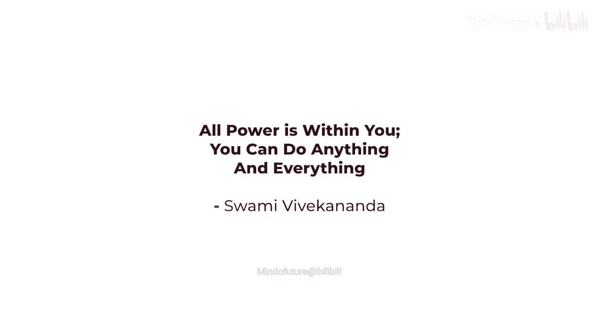

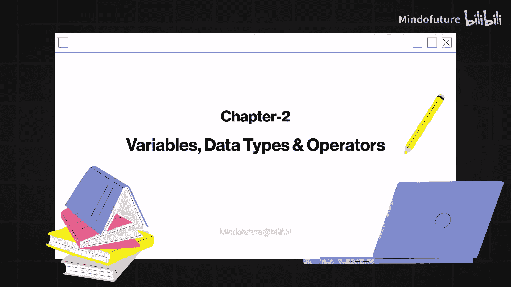

Hi， everyone in welcome toja lecture2 in series programming is to write our first which is。😊。

laptop en。I have Mac perhch， I have Windows perhn， you can create a new folder and you can open this folder。

folder welcome clicking am。😊，J text files extension do Java extensiontyth extensiont p h extension h and I have created I am going to write out or ormin。

😊，U termminator， but semi in is very similar to full stop in English English or in declaration has no or。

😊，is our main function is main function main function。😊，Min。

Bch Me Uskibahamari parenthesis and Uskiba Hamari Curly braces or Jobi Kamvanaham in Curly bracesky Beach mea main function code。

 Let us write the main function， Maigia into Ma。😊，And is there say。

 is you see how Wal line here is cook cut curque。ya paste curing。😊。

art function main function called objective compile execution starting all additional。😊。

Or in lines goham Li up in a code G up a programme G me file kit topper sub Ali line withier hash include。

Aos streamam， Avi hassh include aos streamam Gaota Bohahi technical Bame Makobaam tohash include aio streamam Gohamab Nari processor。

Diirective pre processor directive basically statement Jo compileil plus second using。😊。

Name name name。

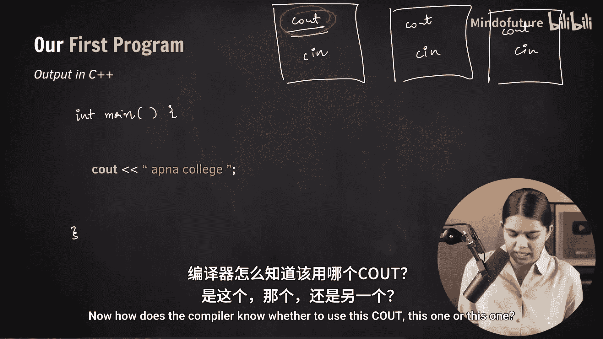

。

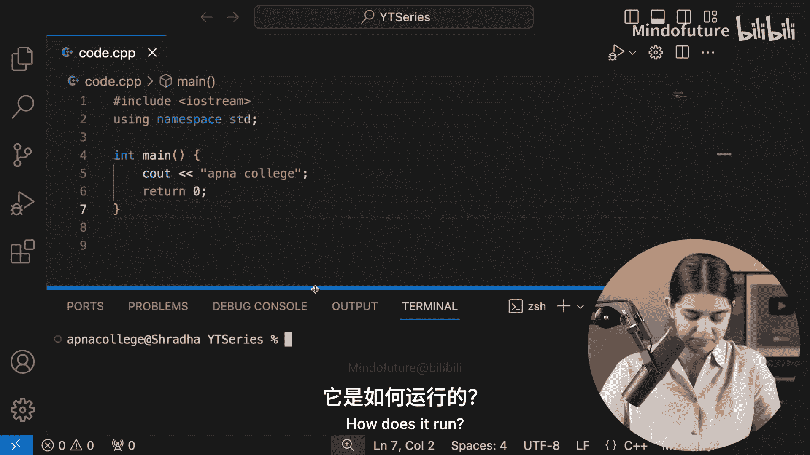

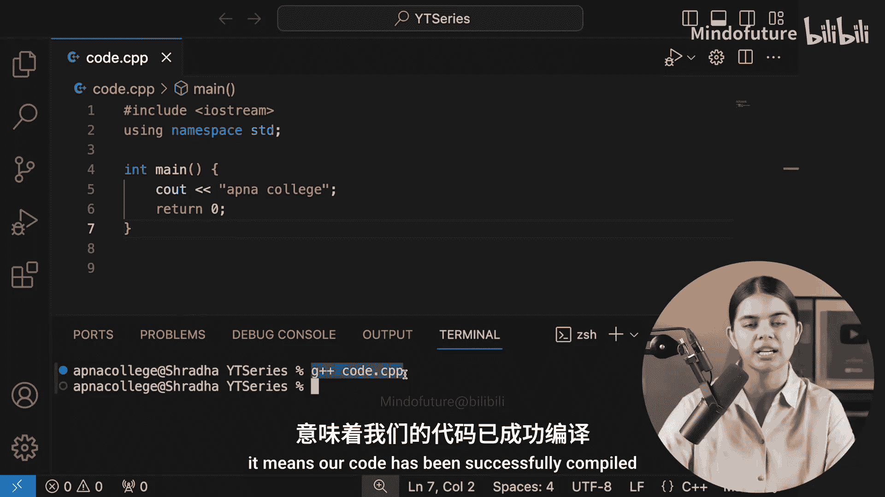

Executable file is logic of lecture1 may be discussed computer co C plus Comp co0 or1 binary0 or binary programming or binary binary file executable file convert or convert compile folder executable fileer click dot outpa most do something do dot E file Windows user。

😊。

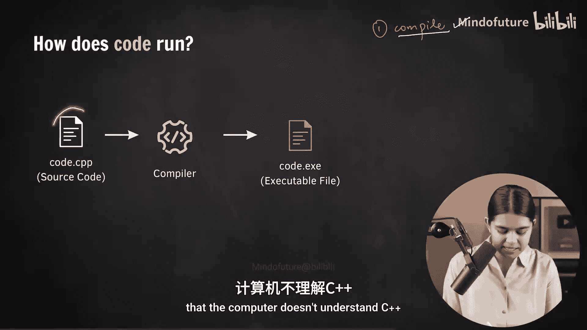

Or dot out file Mac uses Kvania though depending upon the system。

 Hamipas Al extensionki file bun yogi per eventually Ch E X Evo I outic executable file heran Gi to Agar A muge is file Kurran Gnai。

Hranni executable fileoilna。😊，t s a dot system as。😊，swards。😊。

To many Sava I ando world print or completeva completely output。😊。

Last make endline character media endline character Ken Google docs use Microsoft Word use in fact。

 next line print or print next line。😊。

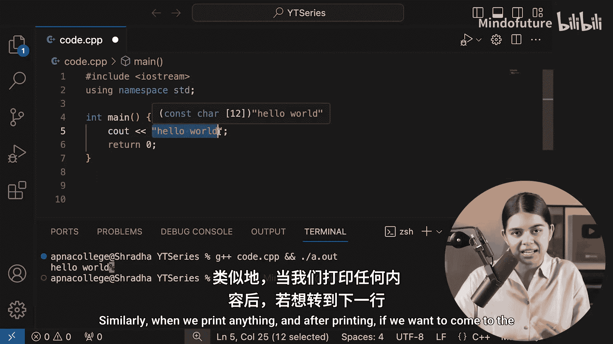

Or let's suppose or set of Le character E N D or end of or end let and。😊。

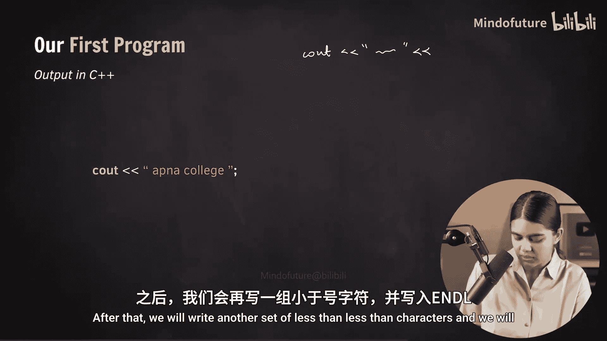

backlash and compared to programming prefer back compared to or majority times。😊，Its。

Outam outputva Ruba backlash andyajo output here。Will completely say Mu v， A get back slash N Kbad。

Kch print Kvati， let's suppose Manilika from Aar College。E fromnalash print。😊。

Let's check it to hello world Pri back or sign to trailing characterhamga。😊，Also multipleee。😊。

See out Manica Abna College， Uskebad， many X thea or next gme cheese print Carraanaatu。

 That is hello world and Uskba end of line to is saari Kiari cheeseese same line per printtoki kkimenna end of line Naya Namima back slash ennaya。

And is it clear curinggi the Peli Abna college Iga space for hell world daga。 And then next line。

 Ab yaigbar pause Knai。 And what do you have to do， Aoppnaj of first name here。😊。

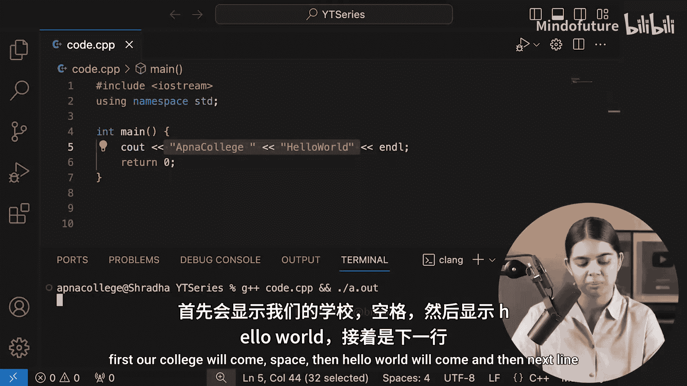

Whatever your first name， Mapna Am lier example， they can better with you。

K me a first name， many eight line per printer car wire， or next name。Last name。

 next line per printvaa or aco out statement Aki a single statement say Ari say。

 though line my output li I Po Kne， or could say I thene first and last name could printvani Also jabovne first program giba Kne to a cheese v discus Kle。

😊，Basically， agrim isura is special nam Ham boiler plate boiler generallyer Also is programming。😊。

compile compile or starting。😊，Point of。Execution to write in editor。😊。

Comment next important cheese to variables important programming equal to is equal to 10 is equal or2 equal 252 basically2。

grade is equal to a single character convention。This is the re say hammni variables co create curam Aja B hammniab be code can liha。

 just say， let's suppose this is my code is code canander Menelika age is equal to 25。😊。

Yemeic variable could create here Abbise canander errorly Q variable cut type nebaai。

 But let's suppose many variable Van age is equal to 25。 Jese licking canander。

 Verse hehoga computer key memory can 25jaga。😊。

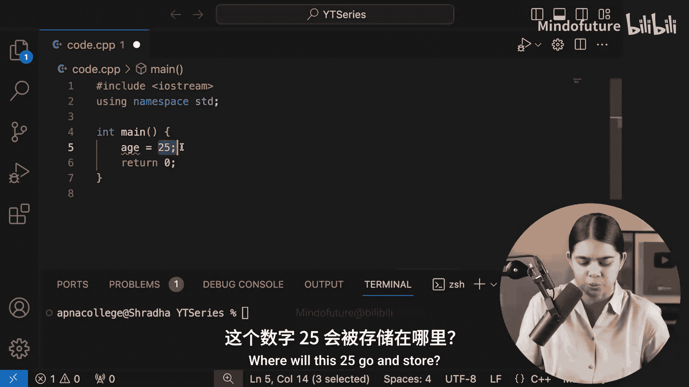

Basically， computer gives your memory here。Any computer 기 Ram 해。

Usehamic boxkita I Kakem is box kander different， different slots So different different spaces。

 Ohiium Yafese imagine Kakam， bodyis Jakander Kiip plots。😊，B， So is canander multiple containers O。

 let's suppose Aike containeria，ike containeriaike containeria。

ri memory canander or a physically exist Kier computer key memory to J Manelika age is equal to 25 E Hogi H na k variable co H K variable can allocate togi or o per 25 value value Jaer stja。

😊，J grade is equal to a and full name full name。😊。

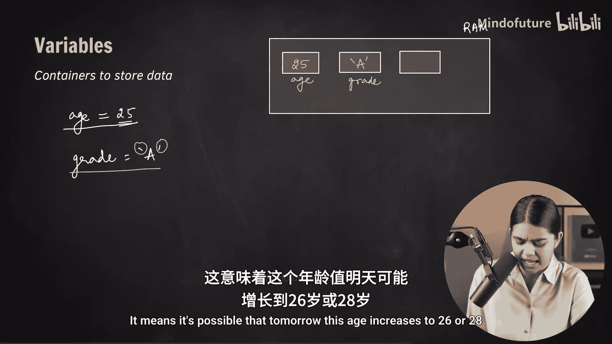

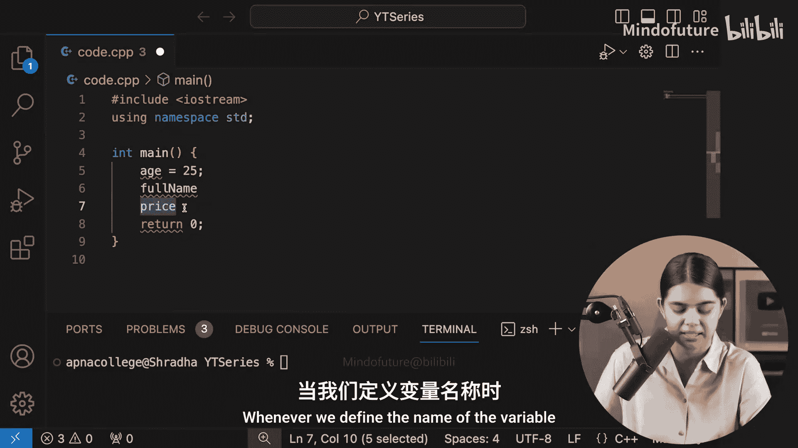

which is calledentifier programmer programmer。

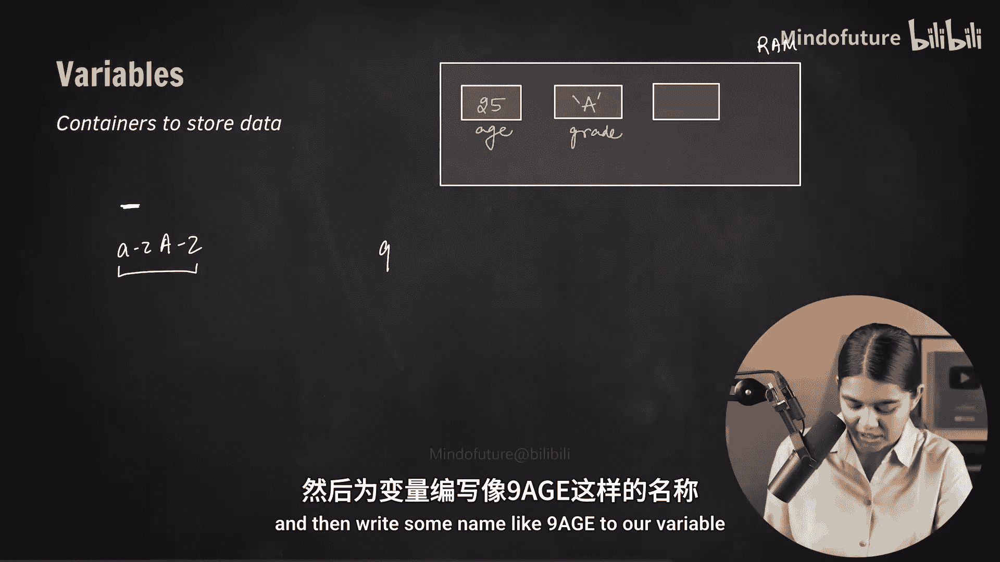

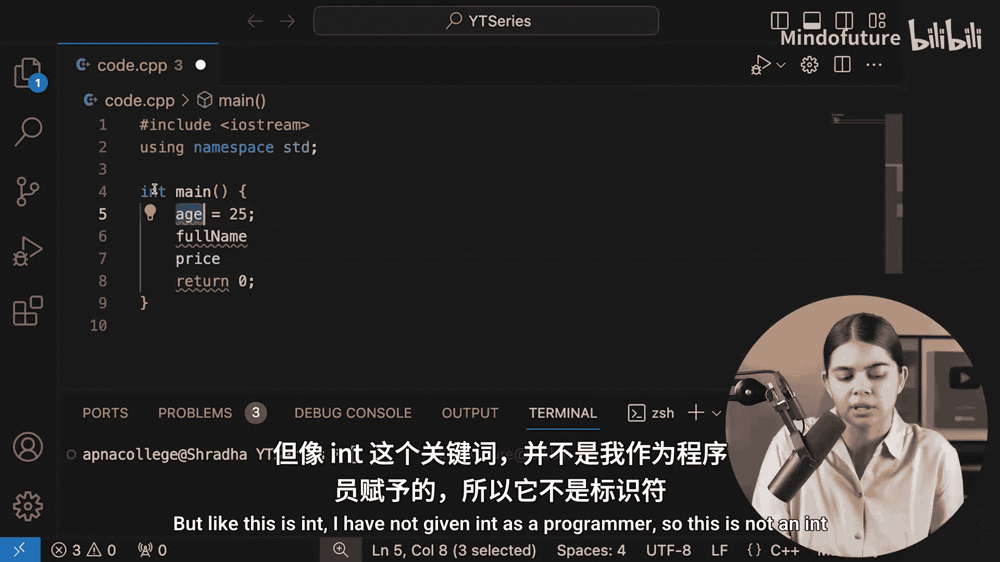

252 is what2im equal2 complete。😊。

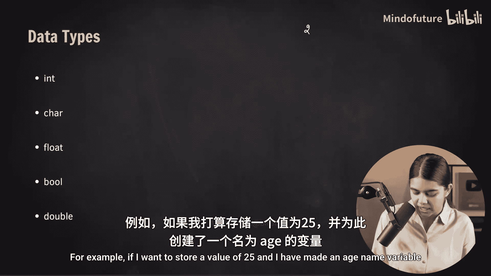

To compiler value2 let us save it again and run the output25ger internally memory。😊。

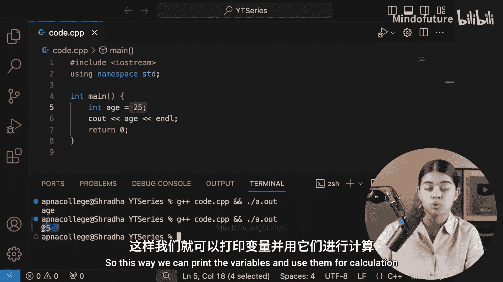

Cha 바이키jate。E cha by its。Basically。Computers thus computers 0。

1 number system per Comp electrical signal 0，1 to computerjoham computer binary number system number system。

😊，Computers binary number system go follow at them or binary number system may。

Iju single digit yvo or is single digitkoni bit。Single digitco bit kja y Agerham art bit lily。

The Usehamniekem artzmlabgi andchvi ch or artb artska collection Liium Matlabipas Iri binary number dismiss0 I chalahamipas Iri。

😊，Chahar sets Mulaipas 8 into 4，32 Bsky a in teacherja number binary number system putting all detail means are topics quo in teacheras in teacherja declareai。

😊，Maabniiapa integer variable age undervalue 25 to me Me under is3 Biky32 spaces reservejaun subqua reserveja or phme 25 kva in the form of0。

25 as 250 or1 k form me 25 convert exactly 25 cab binary formja now 1，1，0，0，1。😊。

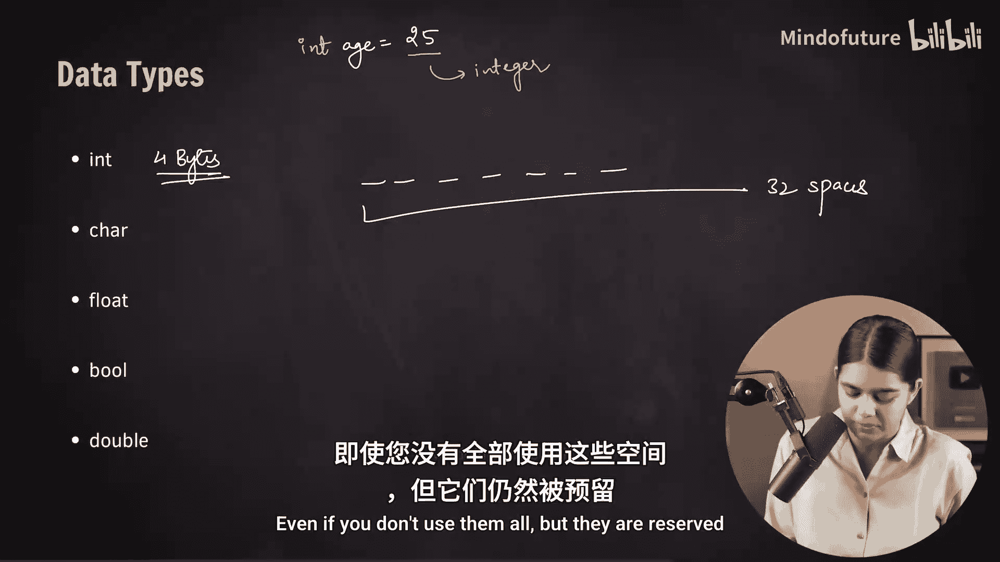

In 25 Ca binary formte number system memory 25 store 1，1，0，0，1arijolalache is。 In fact，com。😊。

Let us clear this to checkva Li they has size of and fairne parenthesis the size of function Jo B value size printva by scanander is cheese printva function。

😊，And I say a may print K topa's value print4，4 in in Ivapa's different different data types So them。

😊。

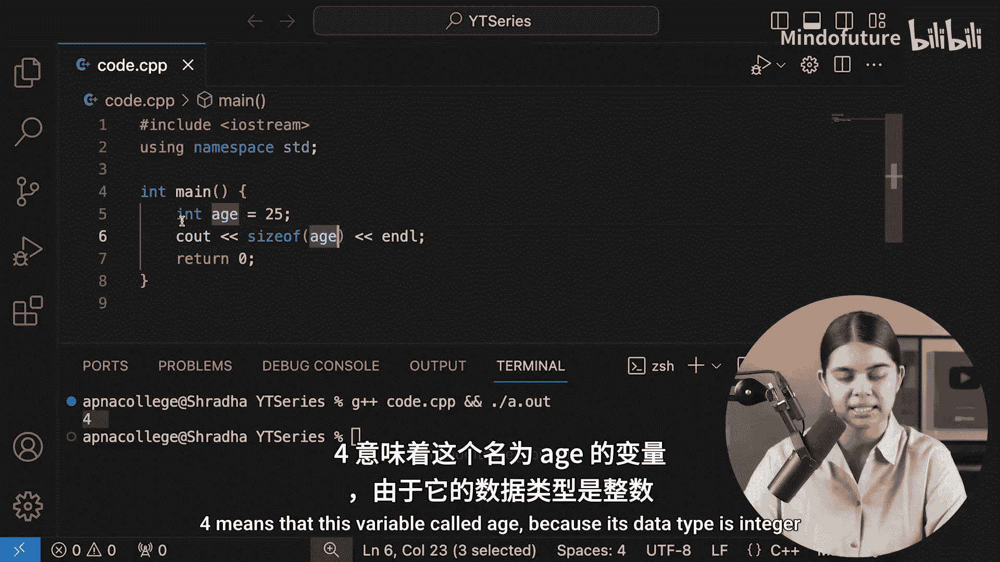

Next， Johamas data type Boai Bohota heck character K data type， K data type karham single characters。

 Coto Kvathe， yjo memory kar j Occup K That is equal to 1 by character Costo kva。 simply lick them。

 Let's suppose。😊。

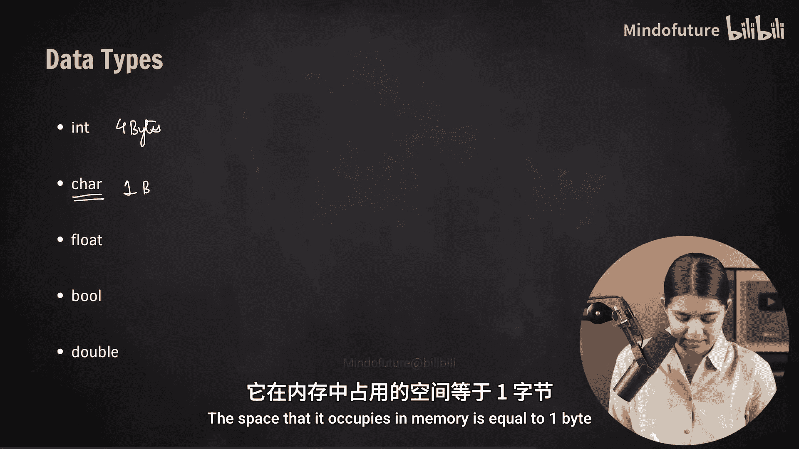

Mic character， grade sttoervana to grade or first single quotes。

 Let's suppose my grade is equal to a。 The many K grade is equal to a co stervaia。

 Hamchhit is grade Kobyham print Kvaak to Mariippa Samra grade a print hooker Rajaga。😊。

clear and run00 basically interchange。😊。

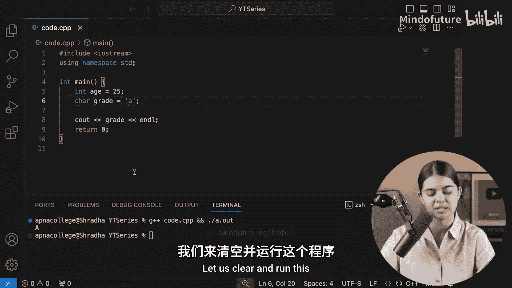

6667，ham small A D in 979899 and so compiler is 65 or dedicated operations in using Also。😊。

Positive numbers and negative numbers store binary number system next data that is float data type teacher 250ham variable banana price value100。

99imal value topa floating values floating valuesimal values to floating values called float。

 for example， I want to create。😊。

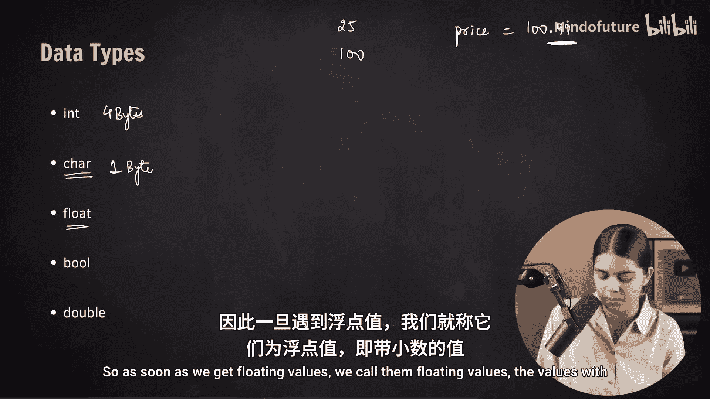

Float by。P3。1 basically compile。😊。

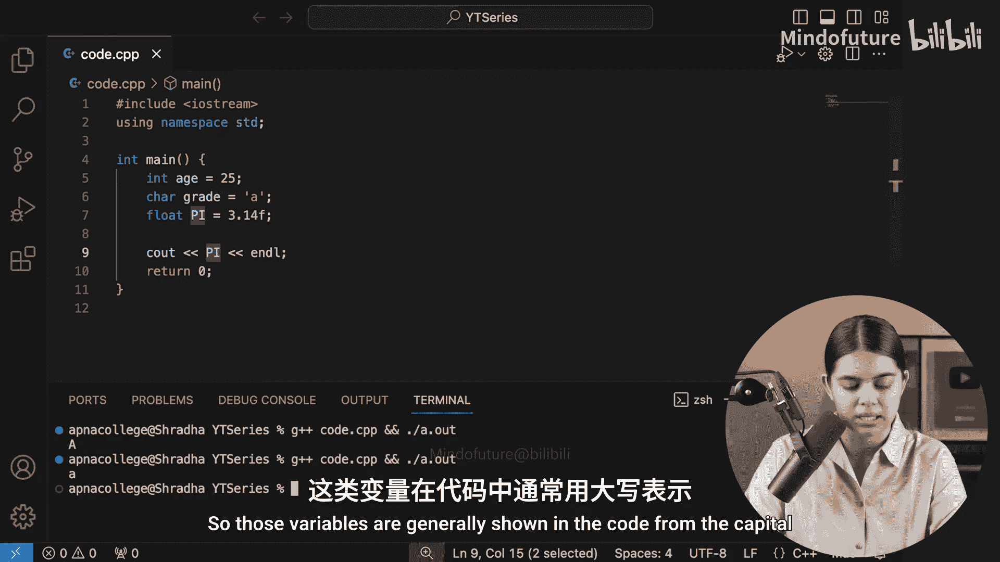

S O our time America。 Next have bull。Bul is going to be something interesting。

 Kki Shihi programming kand bullla Boolean data type Boan Kalatoe truega falsega I kary values true false or memory let we a by memory Jese。

 for example， many boolean variable be bull and Iligia is safe。 I it safe。😊。

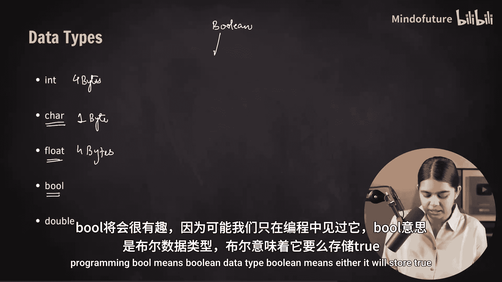

Is it safe k Yato value true Hoeak am small T say truelig y value false Ho Acha jobb Bham boolean variables co printium。

 Let's suppose my is safe coam to mypa trueya false print hota internally， your true value oier。😊。

It translates to one。And of false valueier， it translates to 0。

 Matlajaham falses quo A B a false I safe I cojaam print Kvagi to mypa0 print Hoga Yafiriskogam true kque print kvai。

😊，Toip false false false that is true false0 or value values use or art。

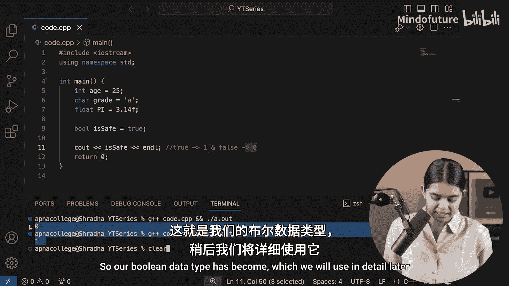

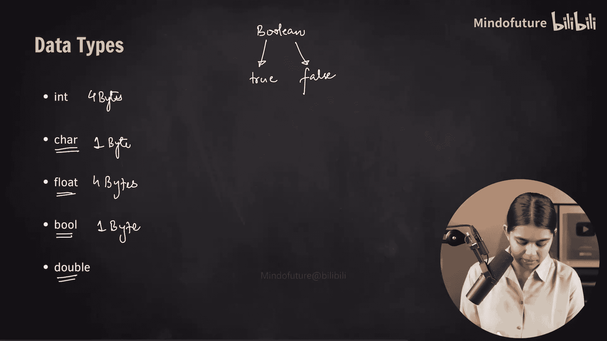

Or risk can there be a floating point any decimal valley numbers could to them by default。

Kibbi number Agraham Liing it Jesemanligia，1。99。jo number he y by default double number double price is equal to0。

99 double variable the majority types use or types term primitive types nonitive data types and types all about variables and data types is casting types typeing concept who use casting type。

Or those throughout had type casting。Conversion conversion implicit implicit programme compile automatically automatically process3。

licit compile。😊，integer8 example。😊，Let's create two variables。In fact。

 a single variable create curtheme Menlia of no grade or abihama grade here a equal a is a cohammic integer can convert kernel at them to integer value liliium。

😊，Or simply licking a integer value is equal to grade C plus right sidese rightippa integer value。😊。

you'll see something interesting and656 equal small97 am97 in implicit conversion conversion implicitit programmer programmer4。

😊。

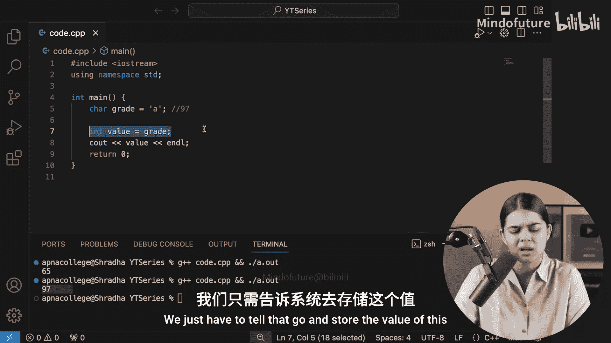

compiler generally type casting big data types says small data type convert for example double variable called price price。

99 in variable price in type basically value type is typene type out price。

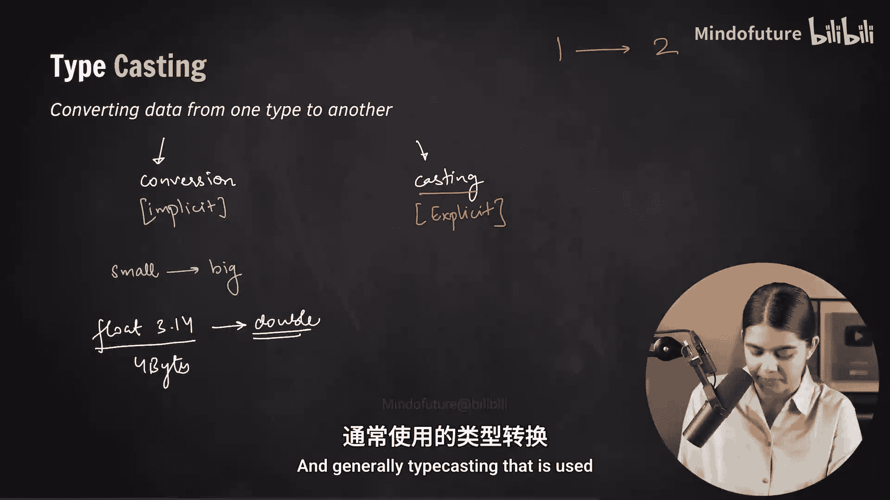

Without the space Maripa Samari， knife Rky valueoc tojagi。

 which is0 up unlike math math Hender to Kote， Ma Hender， Ugar Cassino likeia0。99。1。

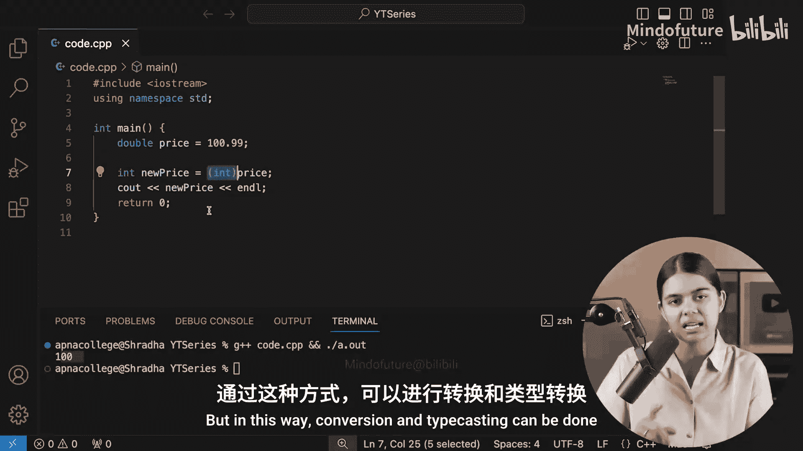

Next from Parni， he cases C plus theander from input Le write me first lecture programmeander Uk logical or is logicgi I input Uch operation perform Gne or output return Gnet。

😊，To output return about logicna type input values values input output C in for input or obtain greater than greater than value symbol or for variable variable。

😊。

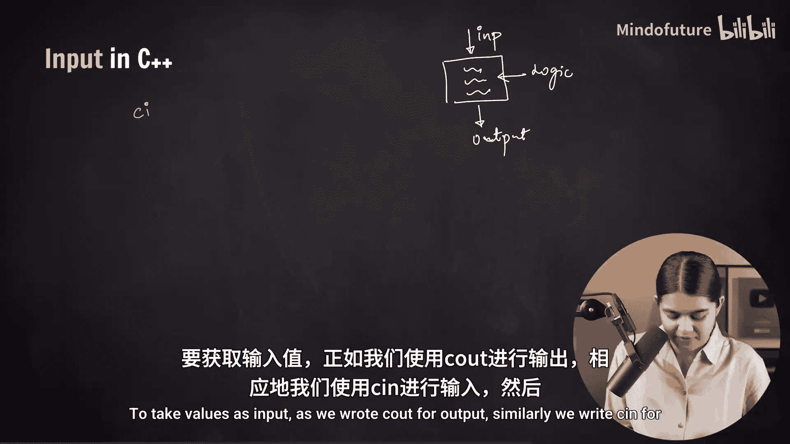

For example， Hamariic age variable perbias age K vhamhi semiia orkoki agek integer variable exist Abi is age k cobiander k garbage value。

 In fact， I key valuebi may print be G。😊，So if I do see out age to random value printer random garbage value random garbage value value user user value Chrome search search plus coding Chrome as software as program input program user input user input value input。

😊，Let's suppose Manippolis out here enter the age。 I there Ri a Manisi out hereia。And in fact。

 the upper， your next line ne。And Yahapperhami in k age to basically see out Cur Baari Yjiu。

 or see in Mayus Jovi deku Nava or first outva， your age is。😊，And Ya Ho。 I。

Me equal 25 your age is 25 output and price。😊，Though Yabra Maripas Pri centre Rojaga or Pri ki floating y quick double value Sa the or phm kar ham y。

Yeah， you entered。Price equal to。And yeahm price key value Co curve， let's save it， clear it and run。

😊，Haara price， let's suppose how many 99。99 enter here。

The entered price is equal to 999loadload object functions object。

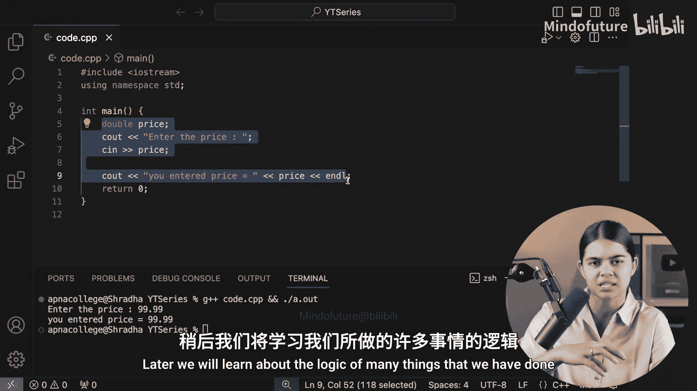

input to next equal call important concept cover operators operators operation perform operators a plus。

😊，Tomi plusta plus egg operator Luta。Hlic a minus B to a minus x operator plus caca Kna minus a value subtract operators C plus underbi operators dismiss a first type of operator arithmetic operators arithmetic operators Kaca mathematical calculations could perform Kna arithmetic operators make plusja minusja I multiply star v symbol star symbol。

😊。

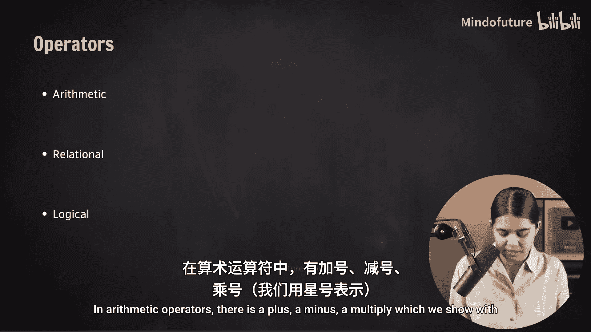

K or a quo divide ym in。 In fact， Jdi say a demonstration be lili them。

 Let's suppose hamipas though values in teacher a is equal to 5。And in t B equal to 10。 In fact。

 in values coham yhi per x them B equal to 10， a single line may co separate her have multiple variables defined cur the same type K。

😊，To a muji C out Kna subseelo a plus me to my is a parent， this is me。Y。

 simple the re attheium P int sum is equal to a plus B mania a plus B。

 though variables the ora sum calculate kia or up me is sum co printer vium。😊。

Let's run this code to Mipa 15 aka Prento Apa sum create Kaneki Baja directly Yahapa a plus B parentat。

 to directly a plus Miki Val Mipa Printo。😊，So y paleto printer validity sum is equal to。

And for a plus B， let's clear it， let's run。The sum is equal to 15。

 plus soia S minus cur minus coang minus coang difference is equal to a minus B。Yeah。

 a equal 10 kly then， B equal 5 kla then to fair value positive agi。10-5 k Uga，5 k equallogga。

The sum is bar 15 oga different saippa Phiia S A M donno co multiply bectam。

 multiply carnicle multiplication co product cae， a into B excam， Chinato space B de accept。

 Chinato be space k acceptam。😊，The asterisks star symbol the Jome Donukka multiplication theta the product Oga 5 into 1010 into 5。

50 k equal S hum divide vi sec name。Divide jaam Karingi to Maripa quo ti。

Yeah division Kle are the complic Ni a divided by B Kham simply slash to 10 divided by 5ipas2 Prito through divisionas 2 basic mathematical operation Iva。

😊。

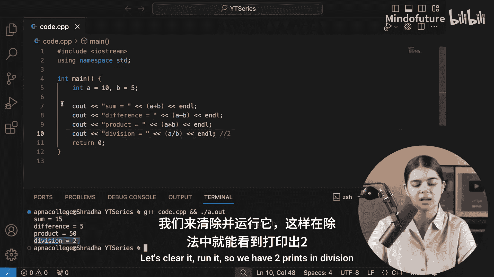

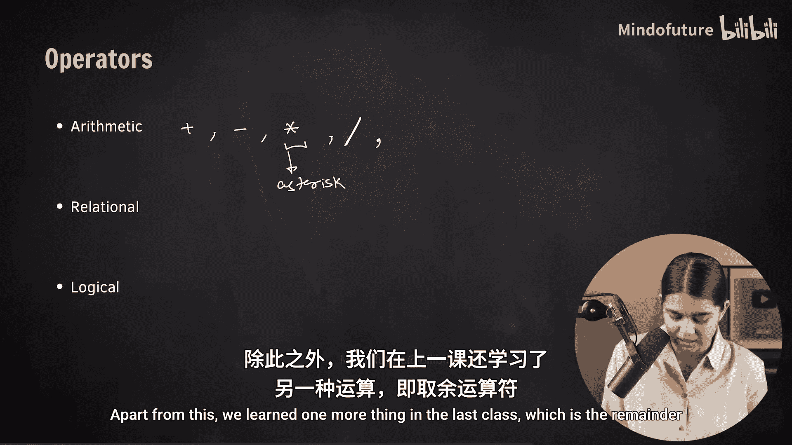

Which is the remainder operator， remainder operator。

 coham modem to agarham a modo B liium to ye a co B divideip remainder by value toham 10 co5 divide remainder 0 modga。

This is supposed to be。Moulo， mod lolia humlic a modo B， divide v operation O。

 or is cancer energy is equal。110 11 divided by arithmetic operators arithmetic。3。

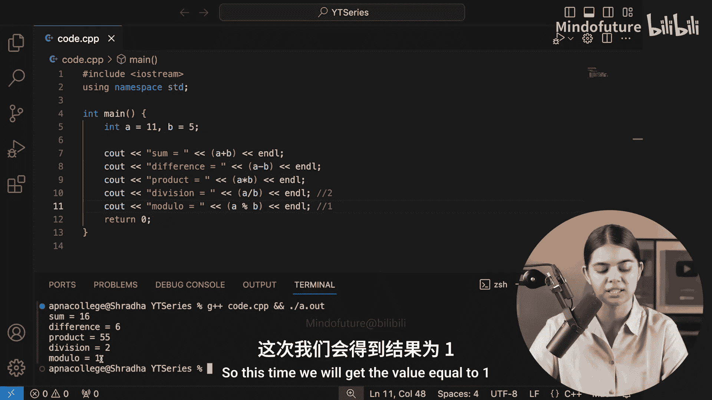

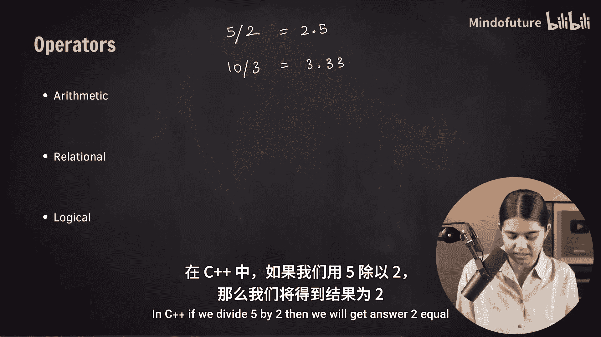

H see out Kaana Chaem。 We want to see out。5 divided by 2。answer in。😊。

So we are going to get a value of2， not 2。5。 Like， let's suppose aramic E casement 2。5 Chiyota，2。

5 Lani k。😊，A is equal to 5 and。It double K theta double B is equal to。

2 yato is thea silicon for A or B co divided query to x to y theika answer k the 2。5 lanica。

 a divided by B。😊，T answer is about 2。5 a ch therikaki Agar kbipas direct values only a 5 divided by two to Ki a value Co hum type cast is much my agar type casting Q important。

 This selects a pos of float float k agaium double。😊，or。In teacher。

Answer is equal to I E value coithium or answer corenicalpathium。Let's save it and run it。

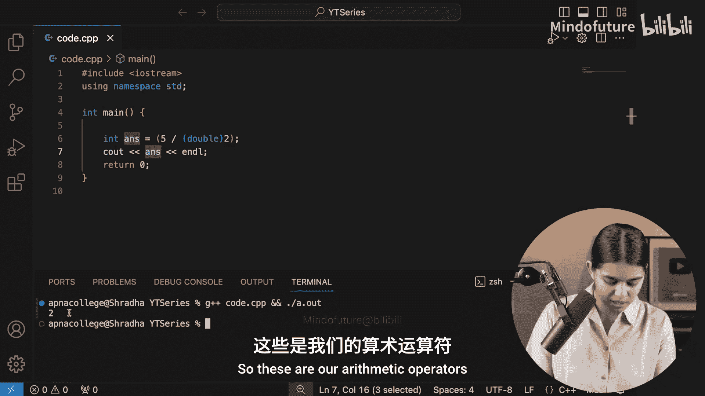

They can 게。Relational operator may a less than a less than equal to a greater than a greater than equal to equal to equal plus the a B equal double equal to single equal to assignment value assign right values suppose answer value side assign to equal to a relation operator equal or not equal to not equallamation or equal to exclamation or equal different relational operator and relational operator。

😊。

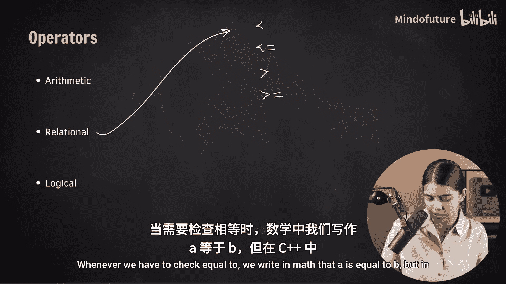

True return Go， y for false return Go。 you fix with them。Just say for example。

 relational operators codeigbar use circuiticum。😊，무제 아을 print 가va him。3 less than 5。

Though is statementja 3 less than 5 he obviously，3 less than 5 answer answere true。

Answerchi true or true。No matterpa。不토今만。But I seeika， a gham opposite liname。Get3 greater than5。

 obviously three greater than5ning is cancer falls on not or false Ca print Okkuayga false print Okkuayga is 0。

😊，Toispa value print Oragi as 0 theri less than or greater than Gte Jese less than greater than o v less than equal to a greater than equal to O Jese Agar makes statement lium 3。

😊，Less than equal to3， less than 2 per equal to to last megi true value Je say less than equal to o S say greater than equal to o up double equal to the。

Agamey out kon，3 K 3 K equal him。W case my true Btoanaji in her comment out callde them get 3。

3 k equal。 He。 Yes，3 is equal to 3。 the1 Iga true Iga。😊，But here 3，5 k equal have5 k equalta。

 case my false sa。Kia 3，5 can equal here。K3 or5 yes。

3 or535 k equal Yes such print33 k equal0as0 equal relational operatorsm operators operatorsolean returned relation operators logical operators。

😊。

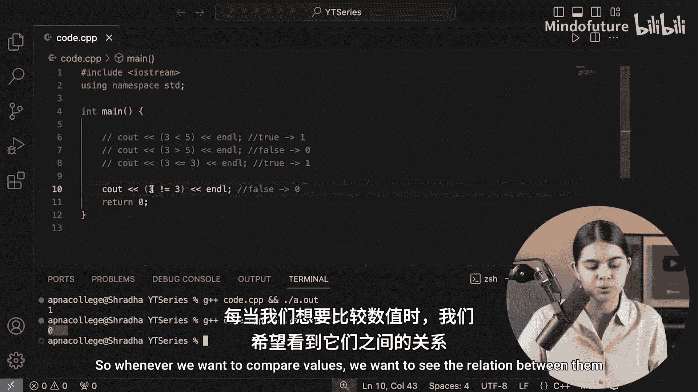

Logical operators may Hamabas the logical operator with a E com Catn logical or E com Kan。

 logical and E com Kan logical not logical or Hutahe ye， though C D line iscomm logical or ke。

Isco technical bahaashmim pipe operator Katheem， Kki straight liner。

 we call it a pipe to double pipe Jem use Katheem through logical orruai， double ampers cent。

Cabboola， many Anco， many Ancola Amperscent Ico Amperscent symbol both parrisco andvite to double and jam Lite Toskoological and k or jaamic single exclamation Li is called logical not k Ab logical not sub anko dese logical not logical not k Jo Agar a K true he。

😊。

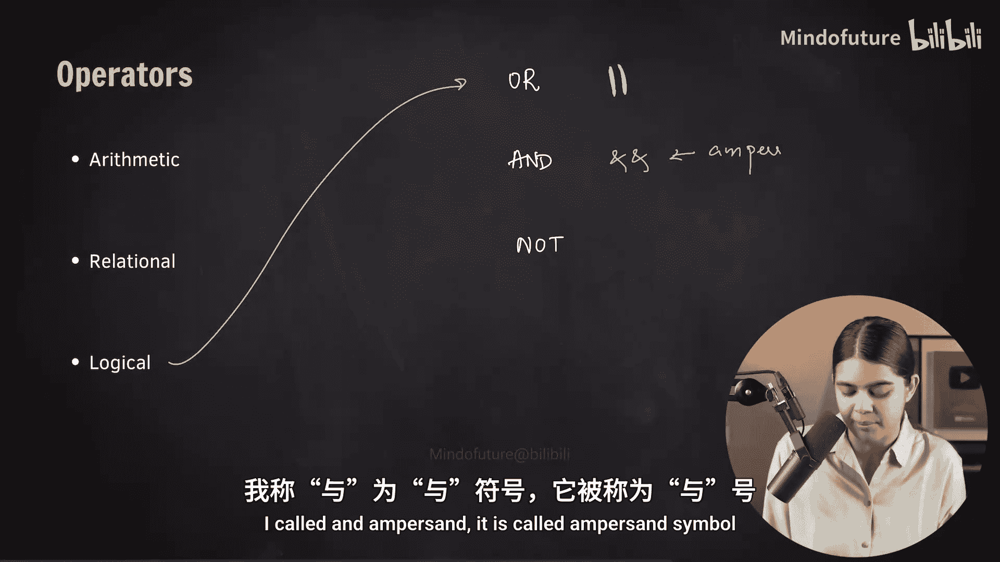

Tomeco falseals Kunga Raancer false he Tommesco true Kunga， Jese， for example， Muje Patta keep 3。

Greater than one whoai。Moji Patki3 greater than1 uis concert true Hoji。😊，Jo Bo opposite or。

야설 무제 바다 이 three。Less than one I falseic I logicalip logical or logical or in logical and in conditional statement。

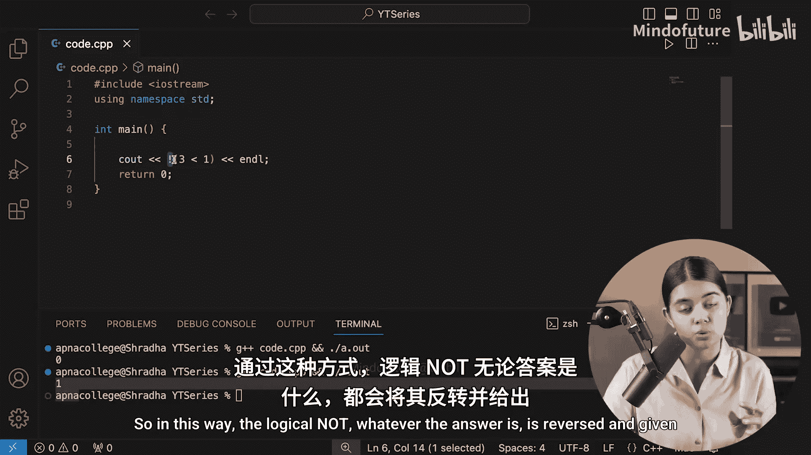

Conditional statements， Pahi Tbhamme Clga Kiq incomm usethe， Abibo theoretical ojaga。

 Parmeska basic logic A logical orcu Q use。Basically。

 let's suppose Aga Boha sarimapa statement E meippa year statement egg statement carry 3 by greater than one nuam。

😊，Do three statements carry5 greater than3 ye Apa Meogar statementjapas final answerja falseoja final answer Agar is3 situation the case may logical or3 greater than greater than answer。

😊，Or a 3 greater than5 B， Lets supposepo3 greater than3 greater than Ph final answeragga Ph answer mipa to multiple statements or multiple me a final answer or。

😊。

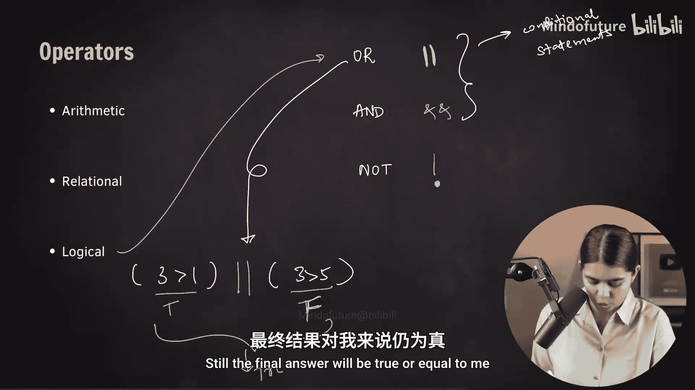

It called then Ca use them There a man 3 less than one of them to。

 obviously a false statement here and or or。Meneligia，3， less than5 foot time。

And in subco E body parentheesis can likeide them to three less than1 y false here3 less than 5 here truee a false a truee to me a final answer。

 k Iga me a final answer， true k Iga oraggar donno y false Soge be less than1 oa T final answer。

0 I false Iga like in dono me be such to final answer true Iga and is co opposite toai。😊。

Logical and k key Sari Kasari statements judgeb such Hoy T be final answer to unna。

Left be such or right be such a just a three greater than1 oga and three greater than two oga。

 though no statement。 such a though may pass。Final answer。

 Ampersent Ampersent made truehi true Ia Liaggar a Konijut Kthia，3 greater than4 Liia。

Those case may answer case me answer false tari different different operators， In fact。

 or or and make say or en detail me next chapter lets suppose or a statement1 a input1 input1 input a statement1 he statement a false a false false answer false or and logic and agar。

😊，and and operators arithmetic relational logical operator operator operator operator the majority operator basically。

Gham input carrying a A and B ofne door numbers。 Second step Hoga。

You have some calculate carrying a8 plus me。Third step4va， in fact though variables define A or B。

Pli Eco input link。Enter it。都 c或者が诶。Fill is equalcoco later。Fham B엔 to B엔ga。

Feric variable lelineiness sum is equal to a plus B。

 Kniyaba Su gold visual line et the as it is but C plus La scale logic Mac convert carja。😊，P logic。

Senttaxic the job barbar Soingham would say syntax come by rules of programming。

 rules of C plus plus， but also C plus the scale rules K according Mi。And finally， see out Kingi。

Some。Is equal to sum and finally in line。 Let's save it。 Let's run it。

 though enter a A may menu entergia 3， enter B， B， May Men enter gearia 10。

Though sum is equal to 13 13 operation performne or overall problem orhihi or next level advanced operator type operator we call it operator。

😊，Uary operators k， unary operators appel binary operators sub them。Bineary may buy Kala both at too。

 unary may you commentla both every one。Binary operator Wu operator Oan should those numbers who use Kqueo operation perform Kthe Jes Mu add Knai。

😊，operator。The unary operators unary operators go A A number name。Basically。

 jaam programming Car andjaam loops v a concept loopsamh next chapter can。😊。

ToJa loop to a operation head barbar or v operation Hu a is equal to a plus1ga。

 Ya I is equal to I plus1。 Ya something co variable here。😊。

Is equal to variable plus bar bar plus barbar plusb like。Bber plus 1 Gnathe， tohamku shortcut up Na。

 which。We call a plus plus the plus plus k Xem to a plus k aander plus1negiem to a plus y plus Mira increment uni operatorai is plus pluska second to yeamch plusi operator a plus plus Johe。

😊，또 데리게에 계 감 같。😊，E tohamlicectta a plus plus or a hum leecttahe plus plus a。Do told uste。

A plus plus lick alaic ykis me plus plus bathdmarath。Is Koicnicka Matlabeki Peliham Gering it。

Bd may him up cutting him。Isco Mabi kque kgi logically Ki or detail me or kki Im plus Peai to I Ka labo Peham update Karinggi Kki plus plus one update kai or Badmihamm k Karinggi。

😊，Just say， for example， code can victim。 Let's suppose man variable when I a is equal to 10。You see。

 you Liium。A manila in teacherger B is equal to a plus plus。statement is rightri。😊。

To is barhampa 11 printto k B may 10 printhoga a may 11 printtoga is in fact。

 humprint kvarbi de a is equal to。😊，And。B is equal to。 Let's save it。 Let's run。

To B to 10 he a 11 I hope Icapme logicoga in B is equal to a plussecan akii akii thus。

Ani1 plus plus a to B equal to plus B is equal to plus plus a。😊，Those kiss me yoga。

Agar meippa in teacher A is equal to 10 he。 Y may reme he。This is a is skin the 10 here。

 Menelika in teacherger B is equal to plus plus a to yae Kaam kra Cal Hura Kim a be variable C Kanarum。

 update his Kooarne update a Koarnegi go kne to plus plus a kta Pe update ku。😊。

Eco update Kna to Eraru Ukeangarru Kna memoryja or value I to B 11 value I。

 or say vermin plus plus a。😊，To Pe update Hoga。update B11 or B11 to plus plus a and a plus in a plus I post increment operator。

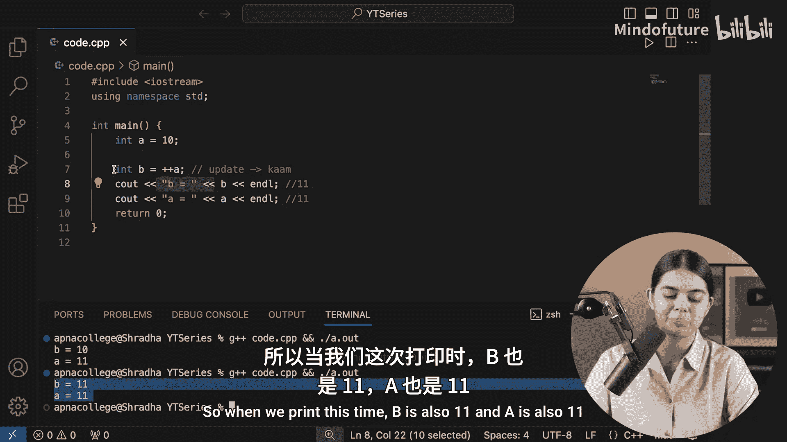

Orduplla Aota iscom kem pri。Increment operator postmeki pki to post and p increment operatorse increment operator decrement operator inca1 in Jesepa post decrement to operatorho a a a is equal to a1 or deccrment operator is a a a is equal to a1 o statement to。

😊，F come with them Y difference who be badly them。Or Ibar print Carnese Paap output quo prene。

 let's suppose a 10 him in aium， A A B，10 M， A co agarmenicia minus minus a。

S is oppositely a plus a minus minus B value9 run is about 10 and 9。😊，upon situationcr second output。

😊，Ks Jaak Ham Parahamari variables， Caseam ktheem， Hamari data types， kstheem Hamari operators。

 Cassethe variables data types who use kem to memory canar kshamra store Saat operators Cabalham uni operators Ko。

😊，Cover different plus complete programme input output operations complete lecture。😊。

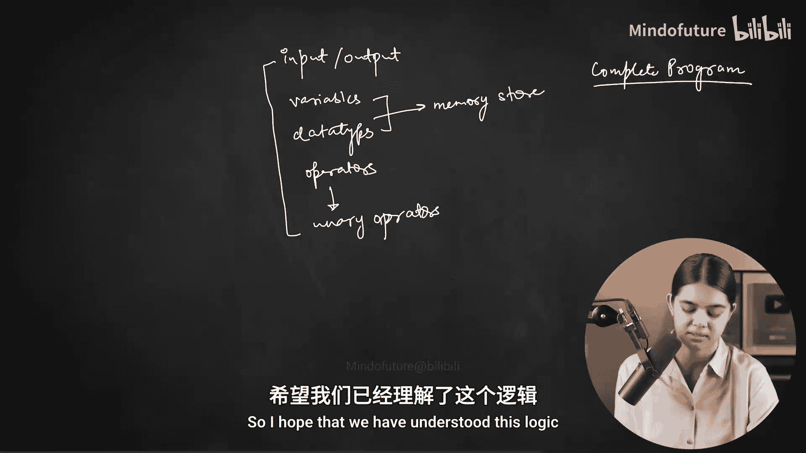

Ap kill a homework problem。 He，ki， you have to build。A calculator program E say Joe。Diffence bip。

 Jo productp multiplication division or sum operators arithmetic operators use。

 you have to write a calculator like programri operations perform lecture to if you have successfully completed lecture to or successfully complete also let me lecture to what was our biggest learning from this lecture you can also tag me on Twitter and you can let me know about your progress for this series class tell keep learning and keep exploring。

😊。