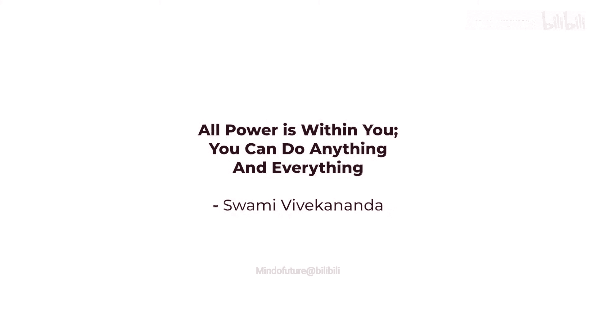
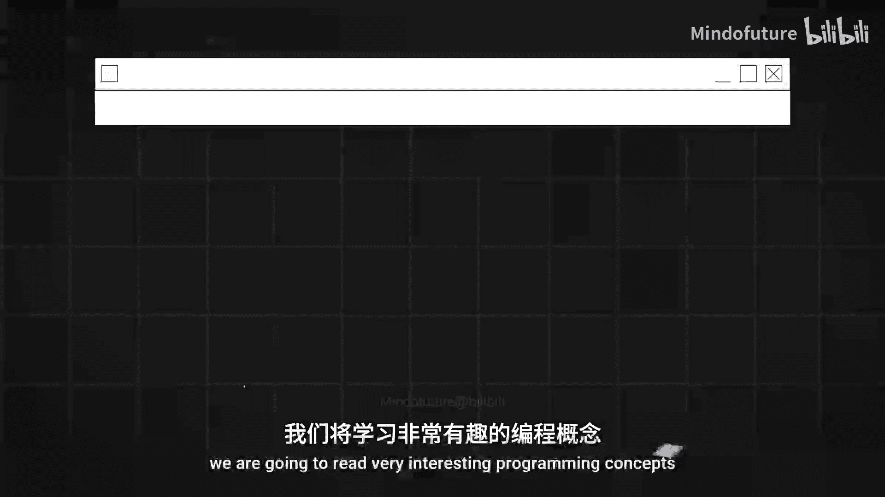
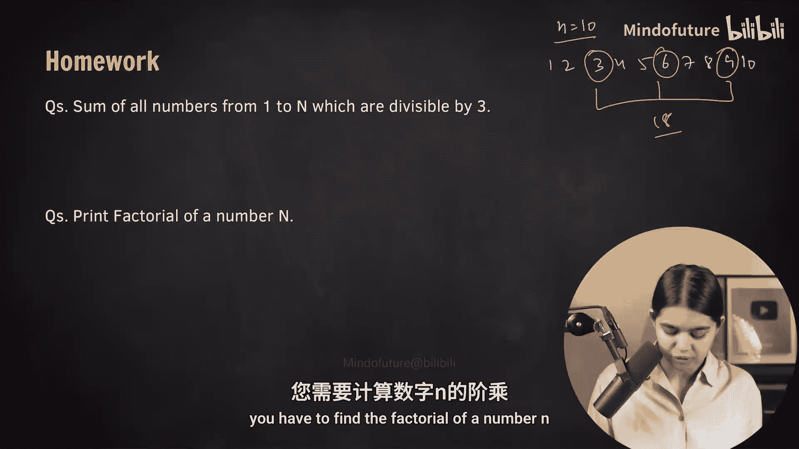

# C++-DSA课程-｜-数据结构-｜-leetcode-｜-Apna-College-｜--Complete-C++-Dsa-Course-p03-P03_第三讲-条件语句_循环-DSA系列_由Shradha老师讲解-C++语言--BV18oUGBkEmV_p3-

🎼Hi， everyone and welcome to the complete series chapter， which is conditional statements and loops。

 Now，part from this chapter concept interesting programming concept。😊。

conditional statements conditional statements realalal。Stments go CP for scan use cut if。Ens。

S rules basicallyels suppose or positive for the sake of simplicity equal or or ye or。

greater than equal basically is greater than equal to0 or brace brace。😊，Positive。

The yaric if statement Hogi， to if statement Kakarthier yejo condition Ohiyacochartheier Agar is condition key value true he。

Yes， Matab too Agar is condition value true he the B print Ho nehi printne statement Alne dot P P file lecture canchaor file by going to this new file iconer plate lick hash include。

😊，Are you stream。Using namespace， SD。Int mean。And return 0。

 Yamara boiler plate called Jobi Kahamarae subic inteia end de en which will accept。 Now。

 Let's suppose n is equal to 45。😊，A Mu checkeri， if n is greater than equal to 0。Say Zm in Gallera。

 if n is greater than equal to 0， whose case may harm C out carryinginggi N is。😊。

Positive statement greater than equal0 relation operator true return and terminal terminal4 or if statement basically。

😊，programming programme false is。With a back slash n for next line。

 Tucose Kliier clear K Ivain-45 F to mypas negative printerraia I aham positive 15 Kia to Ibar positive printrajaga Ikohamne-5 Kdiia to I devapas negative printorajaga。

 to basically， if else conditions is condition get true via false Ho work Ktier Avi showed us example。

 O， I'm trying to a core example is。 Let's suppose Agarham Eak system banana。😊。

Jmaham user saveus key age put them or user key age are greater than equal to 18 he。😊。

Tto vote Kam those case me cannot vote I theri system Manai Bome k conditionme age greater than equal to 18 conditionri。

Yea vat pua Kaura， let us clear this。And lets create a variable age H I'm trying to use a input laname of me H com input layer and U poch v link see out。

😊，Enter it。Uhamche K Iug if age greater than equal to 18h。😊，Do out。You can vote。

Blash in Nahi took else valley Ca me see out Knaja。 You can't vote backslash in。

programme age greater than equal to 18 condition2 you vote 17 can' vote conditional statements which is the example of and even。

😊，Hne Ui float at first chami Bakiti Kikobi number n oddd he y even he Im Case find out K Hamni Kataki Kobi number n even tabbo。

Jvo2 key table may though Matla Cobi number n agggar2 say completely divide or Matlabu said divide kque agarvo remainder modulo0 the weak even number of time to agar n modo 2。

Equal to equal to0 or basically ordergar n to say divide hook mod me0 to number n or equal chapter my operators single equal to equal to not equal to。

😊，Exclamation equal to lacern， So I'm basically looking if Yaari condition ojagi or Agaace Jaies。😊。

Those case may' see out Kingi even。Yess。Amer。Od。+ ismic variableing let us call it n or n cobi input K them。

😊，See out cur the enter number。See in King en condition K Agarhamari in modillo2 equal to0 those k even number case mahem even print her ving or else v Ca maym C out Kne v here。

😊，Or go， let's go save cur them。and2 the number is an odd number。 but if our number is 16。

 then is going to be an even number is the magic of programming。again。Which is the。

 to those statements manuallyhi。😊，Numberme enteru 30 k equal to it though no statements may execute only in curly bracejo of code sequentially to generally have multiple statements Curly brace。

 and it is a good convention that we follow even for a single statement The nextelpacor statement。😊。

If or else multiple conditions or next or or graing system grading system。😊。

Agar greater than equal to 90 grade aprongar ks 80 or 90 k maa or 80gar come here k grading system basis conditiongi variable change subgar marks greater than equal to 90 a gradelog simple in fact。

 say。😊，Is Kaag bo simple a humley kge if。Mars greater than equal to 90 orto straightforward nextb second time second time next than equal and and。

Gia marks less than 90。Yea's statement li is called called kgi per ye basically8 or 90 case。😊。

Or may be quite condition the 7 say80 v or less than 70 valgrade or is were conditions and Ill explain this to you basically。

😊，더 말이파 말이 막 게。U subsequentlyively looking at me Beli's statement。

 Agarhamari marks greater than equal to 90 him。😊，W case me Mujapa grade konji。

 grade Aonaji to aco print Caria next space else space if Eel foggia。

 or is if Mim me second statement of time。 Second statement mayam check Carringgi marks 80 or 90 k B makeica camel level。

😊，value greater than equal to or9s less than 9 equal to equal to true whom final answer true logical operator。

 which is the and logical operator lecture greater than equal to。😊。

And and marks less than 90g equal a3 ail logical operator who use canna be Cia。

 whose case mayam see out carrying a be。😊，Alas Hamra final case， but outnai， C the A C， B C。

 C C and is theara logic banner。95 case me we are going to get an a 82。

 we are going to a B 7 logical or or So this is how conditional statements work in if character is lower case or。

😊，Basically， Hammi characterlingi K C H or Iham enter Ganval Grannival character agar lower case he。

 Those case may have a lower case print Kvae lower case Matla small A small Z or character a upper case he those case may upper case print Kvae upper case of that capital A capital Z to sub eopy character go input Carneju what does a basic logic。

😊，A character when a C。See out K enter character。A seeing gudling up me。

Character lower case or upper character Also character basically character greater than equal small or less than equal to small。

😊，A or Z key range may character co a equal is logical and basically palomhama greater than equal to small。

😊，And and C less than equal to small or。😊，Upper kiss him。

What simple logic a this logic quick by implement curme？😊。

Character Kly subche agarhamas C is greater than equal to small e。😊，And and C。

 H less than equal to small Z，W case me， Cajaga， excuse me Hamipas， lower case character， Ajaga。

 or else v kiss me， Ham see out Kingi。Upper case save correctly and run correctly。😊。

Let's suppose subsehammni enter Kia small T， the lower case Aa。

Next time capital D iss upperto sub simple sub straightforward is oppositela C Ha greater than equal to capital A and N C H less than equal to small Z to upper pause。

😊，Upper case upper v and lower that is something that you can do on your or interesting remember last lecture about values American standard code of information interchange97 equal9 equal and plus Similarlyly669 are 26 numbers26 letters represent97。

😊，ju character。To Mujapa marry uppercase key range ky。

 marry uppercase key range with 65 to 90 k range， to me simply check curu if C H is greater than equal to 65 and and C H is less than equal to 90 Moab65 kla Cahi capital a。

😊，90 Ka Ca capital Z， Those case may me a character。

 Kojaga upper case or else Valley case may me a character Ojaga lower case。

 T theri in numbers his comparison Kque B character Kg by K。😊，Let us clear this。

 Andyaer is bar small achija Mujachi Kne for 65。And 90， Ya iskiaja， Ya is Maas。Ler savethe run cur。

Let's suppose many enter Turkey are small be。Lowercase Aga and is by enter K mini capital M to uppercase Aga。

programming6。😊，Capital M K equal to jm is M K A checkar rank K greater than equal to 65 F to Yahape implicit。

😊，Type conversion who type。Cona conversion with the implicit type conversion。

 Joon Ktju compiler Ktminabberta per compiler implicit type conversion Ktai Case veju character Hena is a convert Kti to its Askaai value。

 Jobi M Aska value Ogi。😊，numerical convert implicit conversion explicit programming theoreticallicit conversion this was all about conditional statements conditional which。

😊，Jse binaryary Kamentla Boai 2 Eri Kala Boai 1 last lecture Mia Ve Turnri Kamentlaboai。

3 up3 Ka Kala， basically Jobiham Ielka Sai， Hamlick if。😊，Some condition。Curdly braces else。

Curly braces I int quo a single line can convert up generallyernary statements simple multiple lines preferary example number n greater than equal to0 or question says the question mark such。

😊，Agary condition true O Jaeato's statement1 execute Ogi or Agarri condition falls O Jahi's statement to execute Ogi。

 although no statements goham separate Carthehe with colon， though dots in coham colon Gae。

Let's suppose aggregate true Ojaem， Ttohamprint Kamanana Jaem positive。Nhito。

 Col Mulam Nehiva negative may readary statementary statement made Jom positiveva Jokmvaander。

Lets suppose I have a number in teacher n is equal to 45。Say clear card did them。U iska。

 ifelka turnernary versionrg Uga came directly see out cur them directly see out may be turnernary statement curect name giant a normal statement will accept them Ypper parent。

 this is kder mache kungyni condition key n other greater than equal to 0 he。

 Netomi condition Ogi question mark question mark ato true they are false theyga Tru theyga the positive printtoge。

😊，Else。Negative print。Semiolon， Ya amer end of lying girlli there。To say Iqbar rungar them。

The Q Q 45， to positive printtoga45 curving here。😊。

The negative simpleel statement convert convert important one of the most important。😊。

Jesie Ane flowchar kander，ne I theriquefi be， just make condition Ohi or is condition k basis but good statement Otihi Jobarbar Iri a repeat repeat Ho repeat Hoge executehi So Iseo Ame kander convert Kneto convert ke with the help of loops。

😊，The programming which majority。2，5。Aisika sea out statements Eriori15 andrio yesekose500o 500 sea out statementskome la printvao la out statementsri situation loops basically。

😊，And Ukeba Perthus kanderham I condition lite Jaatakki condition such oier trueuthier Taatak vi cajuuk curly braceske underham come Li vam bar bar。

 bar bar barba Ritoreta Je say， for example， many ca liha。To see out up in our college。To。😊。

Is problem Co Hamney resolve， giathha flowchart and pseudodo code canander with the help of a variable Hamna I Jessa a count to Jesa couek variable liliata。

 So you see that you say hamic variable lilihen。 Let's call this variable count。😊，Hame 1，2，3，4，5。

 print Kna tosera countga count23 to variable in teaja count or print Knacome print Knapra count less than equal to Nireta count are。

😊，p less than equal toarijapari value less than equal to5 if this is countse countarija or。😊。

To Mu Mu countva Mu basically see outva。😊，当度。Yeah， in fact。

 say andba Jesie1 co printva next k kga next count k2 K2 co print Kvin there is count Ko3 K for3 co Kvine to print Kvanibame count co increase Knahe by1 by one increase knege boririke Yatoham count is equal to count plus1。

😊，equal operator use。😊，Tta k Lo gelta loop chlta Mu herbarmeo Kvanane countko andoskybaik space print Kvali there and phni Kko Caringham。

 plus plus， Let's save it or last ma see out Kde a endline character， Jo theanni。😊。

Let's suppose Mugese 15 Taki Pri Kvanoga count less than3th Musse 1，2。

3 print Kvanm to Case Pritongi subse is line per execution， Jaga。Y output output。😊。

Toham Uskeba Jagi count B Ajaki condition Chogi。Condition。

Co value1 is less than equal to3 true is count than equal to3 yes， this is true。😊。

statement or I3 less than equal to3。 Yes， it is less than equal to3 line or equal or or12 and155 from to。

😊，Kis valueme， basically Agar Luko。😊，Or under ise condition basically or less than equal to0 or。😊。

Let's clear this。In fact， I can also change 0。😊，And this is what the magic of loops is Los Borajomina reputation U bo time but programmer kine simple automatically complete。

😊，There is one thing called an infinite loop。In equal。in。😊。

For Curques stop kniodeko and as theri a oneki。 you can see Kim my right。

 Miss Kgar you are a onekiri lair。😊，Miit terminal window。

 though this is how an in loop runs Canojata to up controls here command C press curque say stop k execution per as such in loop interesting cheese loops generallym loops use cur canraic variableky value barba change Jese vi loop case me。

😊，This variable was this count variable。He count variable pair1 or F 2 or F 3 or F 4 or the is a change E theeth。

 The general E of loops like them。 hum is count I counter variableja but simple naus general age of counter variable is co eye bold with them。

😊，I J programme name name name is equal to is equal to is equal meaningful is a convention。

 which is convention。😊，Camel case cannila key agar a single word v a as age。

 T case Arigiri letters hum small millicing， lower case milling per agarhamme。

 let's suppose total sumlin。😊，The total sum variable sum sum is equal to 0 second word first programming。

😊，Age up capital A G E basically conventionsname。 and it is a sign of an experienced programmer to which is to make can meaningful loop loop control。

😊，V I J K I the general So this was all about next。

Okeari T Jo Sokoham Parisander Eth combine cur E to he statements ho statementsander menham。😊。

Jept Iq value less than equal to Nh。Tt Muji Aite， Ttk Muja， see out Carvanahe。Up I or Imer。

Or Shiwa me， many integer I is equal to ones to myset numbers vity Yahi same km Lu to basicallyjo statementnaham I count Koru Ikos statement of initialization Yanegi initializationlaruki initial value the initialov Englishmen the initial value theko。

or within。😊，Subcept variablequiialjo int I is equal to1 He Ya int I is equal to1。😊，Semiコル。

Ukebari Kejujagiki， I care less than equal to N he dubarrain Ukeba appeddation statement。

 Agiki bar barhammi Iko upd Knai。😊，And Jobi Kahammei Bachawa Voabam for Lu and de Yahapa。

 Hamsi out Kingne。I basically is4 loopmi I equal。 Let's suppose en case me I ye second number condition second number condition execute Iang orgi third number plus plus for fourth numberra2 less than3 to。

😊，😊，Let us clear this。Up9 teacher and Lily T， let's suppose as three。😊。

The4 looppoga integer I equals once I start carrying it Jep I is then equal to。😊，N hip。

 herbalardingi I co plus plus。To is the luri conditions go a line me datata。😊。

Andyahapper hum see out Kingypna。哎。With some space end of12 throughs suppose multiple variables is equal multiple and and equal logical basically。

😊，only say， for example， Muja1。😊，Clear curtain them， many once start here。😊。

equal next time equals is equal to which is to calculate sum numbers from1 n plus2 plus3 plus plus basically。

8 variable nextja less than equal。😊，Or plus。I I variablena initialize Ka in teacher variable I initial Ka Kaam kraam Kaamai ember。

😊，To I key value Jeptaak less than equal to Nh， theta kma loopliggaptak statement true thehi Tpta loopega。

 or I coate Carula hamlicia herba I。😊，Plus， less ame herbame herbani sum I value go ana to sumander sum plus I as G last lecture me I plus equal to I。

😊，To S Kenander， I addjaga， barpgaariky Ijaga or J C Lo Kaami print kvak。

S key value co is going about dry and cur I think is see number per。😊，Let us dry on this on。

N is equal to 3。 N is equal to 3 gi Iq value1 K at star O。

Or some key value here0 to sub I v I plus I plus22 less than equal to3 Yes，2 I I plus。😊。

Ad condition less than equal to i4 than equal to or1 plus 2 plus 3 this value is equal to6 calculate convert。

😊，Let us clear this and value Co be teeny later。And should we select them for loop。

For in teacherger I equals1， I j thes than equal to n here I co her bar plus less Kineme aors some variable banana I。

😊，In teacher sum is equal to 0。Some plus equal to herbar is my I quad girlingi。Last May。

 I'm see out Carraingehamas。 some is equal to。Some let's save it。

 let's run I n is equal to n is equal to 105 n equal12s wrote s1275 understand formula So this was an example of。

😊，How we use for loops， Yaigbar Poke， or could say is he same logicco vi loop k through execute Kanegie goher K Agara vi loop k through kpaim mulaam logic completely samajare for loop vi loop donno Sam honeyche。

 Acor cheese， hum cha him。😊，T A Lu Namki statement Yu。

 basically programmingander Namka kwa to Kahiham Jabi Luse。B라쟁。Jsse， for example。

 may I loop agar1ga 50 Trabi toki N 50 to loop 1ga50 Tgra lick jse he I k value Phi Fuja。😊。

Vse Mujine Agar Iki value Phi， Mania Lo kder he a statement Li jie Iki value Phi， Ma is Lo Knaum B。😊。

The of or1 plus 2 plus 3 plus 4 plus 5。 This sum is going to be equal to 15 5 is  even though ending5 with the help of。

프로그밍 게죽 key。Keywords are special reserved words。 special reserved words Mula compiler keywords specialla dictionary Je break Jeword next interesting question some of all odd de numbers from one to end。

😊，Basically， for example，12，3，4，😊，Entalu Chilate herbar Ikocurti plusus。barbar or。😊。

A girl kbi number come modlo2 k at muja0 they to ake even number ofjaga or two k hat0 na they th odd number ojaga。

2 equal equal equal to equal to replace I is not equal to。case licking it， you clear correctly them。

😊，And Yahaper， let's suppose n key value here 5 k equal。

When a loop July in teacher I equals 1 i less than equal to n plus less。😊，Muja Herbaneki camera。

 I modo 2， not equal to 0 He， not equal to 0 kka I od him Agar I od he toham Iko printki Mujine Muja self。

😊，Od numbers go print Carva to Ya may I code here Joseph oddd numbers go print Carvata from1 to n。

 This Sirrun going it to1 select 5 tu 3 space they print Carvaa and last me see out her they end of line。

😊，So is where made plus1 print oa，3 print oa，5 print oa， teeny odd number they1 say，5。

Agerm 10 tu Ya change， aham en value10 girlhi there。To1se10，1，3，5，7，9， yhi odd numbersem。

 hamar value 50 tu B150 tu odd numbersbato， you can even pause and checkari odd numbersena 1，50。😊。

To numbers equal to equal to 0 even numbersari even numbers problem odd numbers。😊，U next step， Mioga。

 next step， Mirioga Ma Muji Usari or numbers As。To make variable when all it。

 let's call this variable or sum。 just go initialize cudling a0 kssatth。😊。

O J say he Iike value Hamri or doy。Yea condition true oium of Iki value or do thee si yea conditions of such hogi odd value condition T B hammne or sum candleander plus equal to Icoing saypa or numberskaajaga or last meham C out kne。

al andal。😊，Moaic variable banana here called odd sum initialized with0。

Jesse number ordoga odd someander。Plus equal to Kinggipne， Ico or last may print Kvainggina。Adsome。

that the odd sum is equal to。Let us save it and run。So1 se 50 tu R numbers scoredd sum 625。

 which I said they cl thenme Al per1 se 5 T odd numbers co sum 9 the odd sum is equal to 9 Hoga1 se 10 T is sum Iga 25 k equall Cas say Iga 25 will be they。

😊，Haippa 1 had，2 he 3，4，5，6，7，8，9 and 10 in mese ye Hamari Sarikisre odd number a in Caama 4。

4 plus 5 is 9，9 plus 1616 plus 9 is25， to theri Hamra finalaga 25 k A bieto Hamme is a kliah with the help of a for loop。

 though j A home problem subse Pto Yaigbarpakm。😊，Apco I same Luco。

Convert Kane to a vi loop or yhi same logic Rachnaar same gum vi loop aer ki。😊。

Second homework problem，4 loop， C Sariari， even numbers kamapku calculate Ki within the range 1 to n to do problems areimvaari4 loop and whileoki understanding of So this was about for loopna type of loop dei。

 which is a do loop do syntax do。😊，Frisky Curli Bra Ajahi。

 Jobiamiam Kavao Yahate or isme last Mehammni Viky condition Lero Yahari K Ajaya or Phhamathek Semi Colon Abdul viloop and viillo make difference with I。

😊，Chahe vi may Agriham condition li crime or manlo ye condition falls away。도 loopビ인。Yes say。

 for example。Yhaper， many ach vi luia， just my many condition liy 3 is greater than5。

Or a scandal mayy out Ka you， hello。What。😔，ABeemin condition likeni Muja Patta 3 greater than5。

 Kabinita， a condition of I Alragi toe hello world kbi print Ho Serranringga。😊。

L in du luna agar aisco falls voe at least a barki do me condition barmi condition to y difference with a major difference whilein do saygar my same cornaang to me do。

😊，F。It's a copyalthium。Mera come here hellello old print carvana。

 Fair menelica vile or vile can the condition like。 Let's suppose my condition is 3，5。

3 greater than 5。😊，mi condition condition to printvana with the help of du。s call it 10。😊，Do。

Muji herbarakna a variable be liing gave 1 to his barak single line Gni Jea format whileuttha Alexi variable couldine Kaa Vee to herbar Muja sea out Kavana Ane I with some space。

😊，Or kpta K and I while Gendder K condition I Jepak I less than equal to n reai full stop。

Alas maamm see out Kvaingig end of line。Also is or second is a very important question which is to check number is or not。

😊，1。A non prime prime number mus suppose n is equal to 7 prime number1 1，2，3，4，5，6。

7 in numbers say1 or 7 prime n-1。😊，2 n1。😊，Kbi number Agar 7 co completely divide I 7 non prime numberbia7 non prime number 7 prime numberse 7 k the4 co I is equal to2 mod4 mod24 mod20ta。

😊，non number condition derived derived n n or n I less than equal to n plus。😊。

K condition to suchri Y condition such Ho Ka kbi we may a number。

 Mary I say completely dividega modulu I This Ka number numberic non prime number he number prime number y to marry non prime condition Ajagi or agar is said divide ne prime numbers 77 Co2 divide in for3 securing in for4 securing for5 sauring in for securing in agar number divide Ne Ka prime number to in fact。

 isco track ni boolean variable， let's call it is prime。😊。

Is prime Matla numberic prime number by default may assume number prime number he byp divide number a7p divide divide case mera is prime false is false logic come follow。

😊，Let's suppose made bus a。N is equal to 9 hempa。The n is equal to 9 kilo Sringgi n is equal to 9 k is prime kojaga Shiwame is prime Shiwame true k equal is lucom Shiru kanggi I is equal to2。

😊，I is equal to2 looptogaph k I less than equal to 8 and1 mula I less than2 less than equal to 8。

 Yes，am9 mod2 k9 mod2 k9 of2 to remainder me 1 value Ila non number non primeni updatering3 king。😊。

less equal equal equal false。Stment normal case non logic number prime number or answer answer is is prime variable boolean variable logic can convert。

Let us clear this。And kss be number casat start Kail。 let's suppose the number is equal to 7。

7 kmnic booleion Lalia is prime isqueialized Kthheni true kssat。😊。

Fect4 loop Chianggi in teacher i is equal to 2 say i less than equal to n minus1。

 i co everythinging a plus plus。😊，Herbaring Agar mera en modullo I equal to equal to 0 Vikamatlam number k numberic non prime number non prime kkala heki is prime co hamapur Kingi false and is luiarjagi B This loop kbad Agar is prime kander。

😊，True value기。T numberga agar is primeander false value vga non prime number to y answer is prime to aor if condition li。

 if condition agar is prime P he。A girl is prime Boolean。 variable is prime true he。답터。Prime number。

Or else will it kiss me。c。Non prime。Number。😔，2a overall logic is prime k basis check aggregate true deta to prime number。

 false theta to non prime number。😊，The upper print carvaing a kisssV N kilo give a prime number here the in key value starting with 7 he to 7 is a prime number。

😊，N key value a 9 knows Shagi to 9 is a non prime number。 N key value a 11 garden G。

Though 11 is a prime number N G value over 14 147 G table me The 14 is a non prime number。

 is3 K logic co to loop conditional statements He combined here bos are different concepts quo use A B value approach with a prime number conegi you basically normal approach with the is a better approach here to exist kier better approach K kier better approach A kier K co be number Lu n。

 Let's suppose me n6 k equal。😊，To make a groom at 6 k but factors theythium。

6 k factors key 6 con con numbers could multiply are given 6 com 1 into 6 B except。

6 co 2 into3 will except6 co 3 into2 Bill，6 co 6 into1 Bill to 6 k kga is 6 k factors O I he3 ma chahu is he prime number k be example lithium。

 Let's suppose manyel liia n is equal to 7，7 k factors k1 into 7。😊，7 non or basically。To 1。

6 already ajugaha y second time I 2，3 Al ajugaha 3 to y second time I to basically kisssbi number kg factors Niallingi to8。

 Hi repeat Kneja I kle core example Li n is equal to 12。😊。

N is equal to 12 kgme factors liqu It's  one in 12。😊，wo into6，3 and24， fit four and3，6 into2。

 fit 12 into one is a a a factor。A notice kki Ya but Ya repeatvan22，kiura12。

5 said divide hoketo modo 0 degani。1224 number n or。Let or sub。

Subside a factor of the root n into root n。Root n into root n Ken come as under root n。😊。

Or under root encode a multiply kjata to inca answer uta and K equall。

 basically root encode roots a multiply herea to root kcalileia square all to root say square kjata final answer marpa N is score us as a core example in 25。

Let's suppose N 25 k equal Men1 into 25 into5 25 into1 side right basically n root222 I understand exampleski repeat2。

😊，6。Munjak basically12 k2 root 12 thek， or Ro 12 k root 12，3 points something。😊。

repeated3 something something completely basically less equal less equal equal value。

maximum value root condition change I into than equal to repeated I is less than equal to n B 14 non non。

😊，A my 11 k example to a marpa stuga。😊，Prime numbera prime numberologic if it is a prime number or not a prime number。

 I hope strong understandinggi loops may he a level upipgi loops may a level。😊。

Jkoham kapni nested loops， N Kaatlaboa Gosla， though nested loop， basically programmingganander。

 Agarham Lo k under he。A cor loop like them Tiscomm get their nesting。Y， nested loop。 Jesse。

 if statement came under he am Cha， though， a or if statement he accept them。

 give be possible em I com Ka he nested。If statement。Ad nest still loop time。Simpleles are example。

 you think。We know it is loop inside a loop。For example， Muja Aic ch say parch lineinoganander 1，2，3。

4，5。Pch lineo Genander， part star printical name Y starroga， do starroga， T starroga， cha starroga。

 Par starroga， do you marry part starroga。Is he Thereri Case many aor line of star print Kia。

 I he Thereri say， many aor line of star print cardea。

 I he There a many aor line of star print cardia。 I he There a many aor line of star print cardthia The parts starky line here。

 just come in a print cardia to each is Cass carrying a himmly chor say Mue basically。😊，K，2，3，4。

54 in teacher I equals 1 I less than equal to 5。And Uskiba。

 the hraab Lo kander may see out Kavaage at you Par stars， Tuyatome Pa starsco，1，2，3，4，5。

 S M andeligia and Uskiba manipprint Carraia end of line。😊，T theriki said meippa mera output Ajaga。

 These are five lines with five stars。 A busy problem comes through a update carrying here。

 Mujab her line me parts star nature here。Muji her me co M number of star chain Yaquii X number of star chain v X X v X 50 Ki star Par Mu me X star A mepa E problem kpa a single line oris mu X star print。

Let's suppose this is equal to x to Macyaarti make count Letijutase， Phvo2 otavo3， Otavo4。

 otavo ktjata， O basically Xtjata。😊，Ibar is a comment out Klee Agar mera kuk single line Gander X stars s print Kna to make lu Banathti in teacherger I Xq value Llethan Kbi。

 That's suppose Xq value had thus Muja thus star s K my Lelehi in teacherger I is equal to 0 I is than equal to x I is equal to 1。

😊，And I plusless or herbaris Y Kvati a stuff。Sa 이vao。

I hopemiji X printva X print print is the I'll be able to print X stars。 The 10 stars Case print on。

😊，Emer Luem 10 star sprintto or Iba Muji a。😊，End of line J。Though end of lying be Aja。

 you mi attend starchprint Oga Ikijaga or a 50 starprint Carvani with it。

Tomiri 50 star printprint to Xna mera printprintvadi is Xkyme M Car I a M Caium。😊。

So let clear or is equal。😊，1，2，3，4，5， lines Zgi about her line memoji。

M number of is Xhui M guardia M number of stars J to make your hard line me fixed number of stars Ni Chi Muji to M number of stars Chi M number of star Sclog M number of star Sclog here to me p logicco is loop candleium。

😊，To gini Barbi me Lye Raringgi Uni Bar me Ulaander M number of stars Priojagi say save Car and clear cur Wesbar mepa Parchni Ajagi or her line Genander。

 thus star Amans M Co change Carier 2 50。 To Bder Pacha Ajagi。😊，그들이 있겠す。

basicallyhar orhar number of or。or me logic。Or out would we say a but some nested loop aky icon come。

Though Ibar a girl may decide here， I need to have 10 lines or 10 lines or her line me pass star only tree。

 The output Caa dega output of Esa dekega to marry 10 lines Z。

 Her line can the pass star Par Mue her line me thus stars to。😊，thus。😊。

Though Ibar overall logiciava Merak outerlu Poa Baharvallu basically control Kata Kianny number of lines on eachhi。

😊，Or overall number of。To Bahar Valley Lu me Iikajatjare。Bhar Valley loop me I Kse Kjare。

1 s entjare to jobb I k value1 he T J K value K Kja1 s Mtjari J is equal to 1 to m。😊。

Jb I value 2jagi Bke， Dubarra Luan Kaigga Dubarra J value1， Tjagi。4。😊，Aari nested loops。

 Jo cur nested loops use cur Bosri creative patternss veron print to next year lecture Bori Patri Pats study K。

😊，Andal sum of all numbers。1 to n， which are divisible by 3， j say。

 let's suppose n G value agar 10 to 1，2，3，4，5，6，7，8，9。

10 is May 3 divisible by 36 divisible by 3 a9 divisible by3 n is equal to10 kju answer1 G18 equal4 lu you have to find the factorial of a number n is scheduleologicga sum of number n number pass me almost same factorial ndura factorial n1 nariari numbers co multiplyju。

😊。

n solve😊，The next lecture can we study about patterns we study about nest loops or nest loops or other detail study lecture lecture also for consistency you can write the date on which you completed this lecture you can write the lecture name lecture learning exploring。

😊。