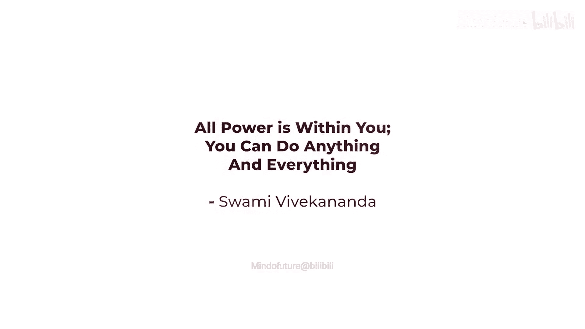
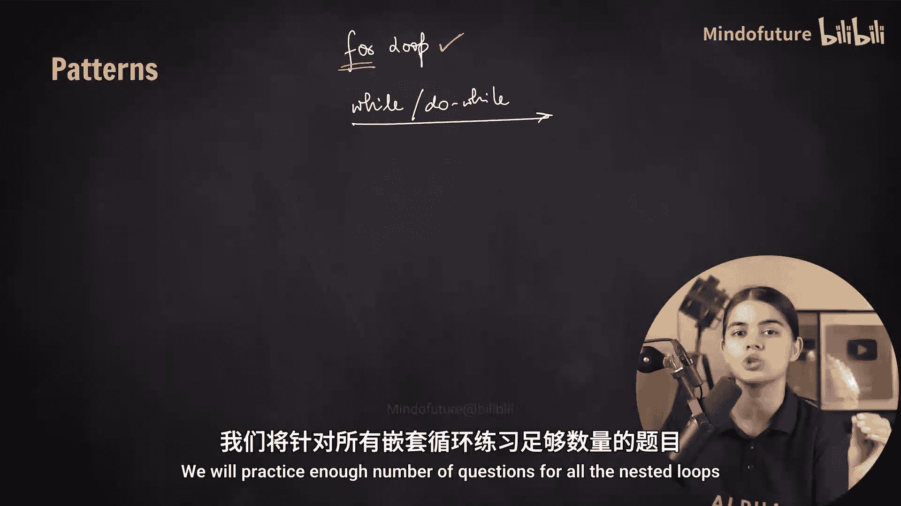
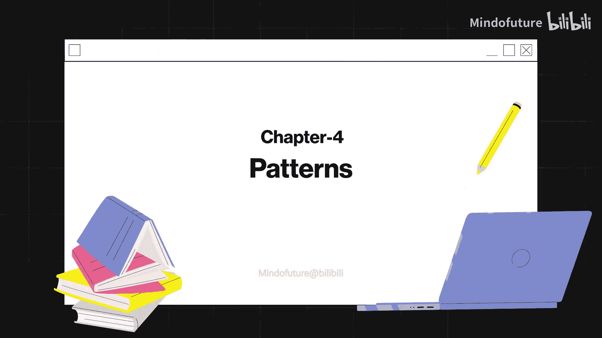
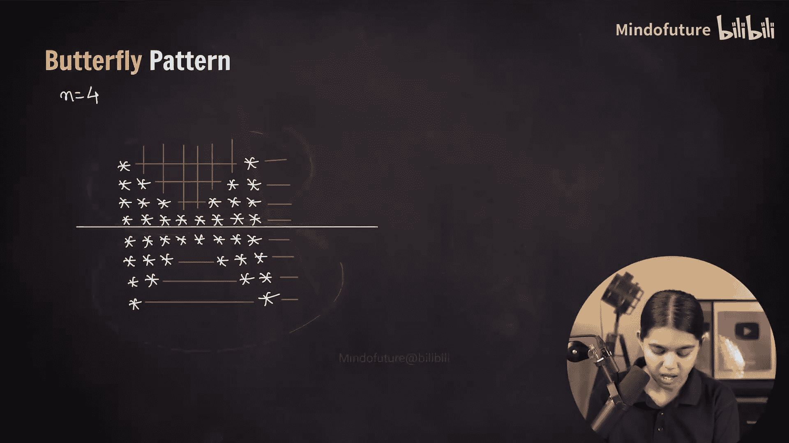

# C++-DSA课程-｜-数据结构-｜-leetcode-｜-Apna-College-｜--Complete-C++-Dsa-Course-p04-P04_第四讲-模式-DSA系列_由Shradha_Khapra老师讲解-C++语言--BV18oUGBkEmV_p4-

Hi， everyone and welcome to the complete series， which is all about。😊。

。interview。

To This is pattern。 Basically， easy。😊，To a square pattern h just called rock ur is co many rock here for n is equal to4 nla basically the total number of lines to a aco n key value 4 the to aco is pattern code draw pattern call logic S C outdo 1。

2，3，4 orvo C out Pats call logic generic3 generic3 logic N key value A to K co we different pattern print say n is equal to3 K。

😊，I he same pattern print is equal to 4 n is equal to 5 k what is the trick trick is logical n is equal to 4。

😊，N out。basically。Or%。A singleva U logic。Inner lu Bahaai， Jese， for example， Yahaa。

Ik genericneki 3030 them， Yahaa Mujaki Mias Charna，1，2，3，4。

out equals than equal n or second third equal equal equal equal。Inner loop example loo1，2。

341 printed logic given loop。😊，Print kvana Jovi Val her line can the number energy to agar mu simply x4 loop May1 ent numbers co printvaana auto autoomic make4 loop highlight make4 loop click。

So basically this is what is this pattern is overall logic or。😊。

but generally classes can discuss very similar to plus logic converter n equal4。

도hamra loop 계키 아이키value1。Less than equal to ngi。I plus， plus。And J K value 1 ailire。En탑ja。

J or hamharba out Je， or Jese he inner loop Ka Baharra outer and vahakamva。

 Jese In Kaja next vah output next laang to Yaha ham out K end of line say and run Kthe。😊。

So this is what the output is going to look like pattern the same pattern。一。equal12，34 out。

So inner loopiaga， equal loopga from。In tger J equals 1 j less than equal to n J plus plus。

Or Jari fill next from C out end off line， let's save it。

 Let's run star pattern star pattern may be space they to per spacename。😊。

Amaripas is theri say square pattern Ajaga with the help of stars A we our interesting cheese loops k。

 General， each of themel algorithm scale loops licking1 algorithm schedule loops So there v I is equal to 0。

 J is equal to 0 say start agar Miraju loop here just my， let's suppose Iq value 0。

 Iq value 1 say nja。😊，To Y loop Co ame I is equal to 0 S Karun to beval Kaha Janihi。

Agar I Lukoouja n times Ra Knaha， or Ikoby N times Ra Kna。The value is value n。😊。

N less than equal to n1 simply less than n I n I n is equal to 0 to n less than equal to n pattern or y same pattern Q n or0 n1 same number of times count is3。

😊，Abihijoim pattern square pattern Iayam solve Gse in the form of characters。s class12 replace A。😊。

ABCD。AB D and A D basically is same，2，3，4 out 4 in fact44 second12，3，4 or。😊，my number number of。😊。

Up inner loop， behimea n times chalega J is equal to 0 s J less than n J plus plus Yameruri serume loopki added perja。

second mu character character many character is I。😊。

To C H Co print Carvaba A A Muji B banana a Muji Patai character koe internally store Ho in the form of Aska values is con lectures a Perar M Asky values can come at thebeki capital a memory kander。

65 K form Mitro to cua Miss character kander。😊，Plus1dujaga 66。

 Ojaga or J B 66 value value Edubarra character kgivo type conversionjaga or type conversion O 66。

barra capital Bga orga C Hdu C H plus1。😊，또 예 하면 라인리 행 게。conversionit。or in。1，2，3，4 ugly12，31。

3 number is number n is equal outer loop n。To outer loop k App B mejo outer loop mebo simple Tari。

 outer loop 0acre。I less than N I plus plus Yada Jaiggo。0。A line example8 line 1，2，3。

 Prentore ugly 4，56to 7，8，9tore numberratoto。😊，Ugggar N key value 4 ro T to pattern kta pattern Noa 1。

2，3，4，5，6，7，8。😊，91111314116 equal4。😊，Or inner loop n times run cup curmic。

In our loop can variable L n j is equal0 to start carrying a and is could be less than nj plus plus。

😊，To out Lune， basicallymedi， In Luneme ache line Mac characters in Uya Aam Lo de logic Pewacardo number1。

😊，F2，3，4， Jahabi number print herrvaoannibi number printvao is same number printmanic number。

 let's call this number nu。😊，is equal0 equal equal equal。😊，Alivaia， Avadu， the number 2 Benega。

2 co Ka， number 3 Bega，3 coa up Jse line Ka movie next line per next line per， Yaju Lupe。😊。

Is my inner loopkiba Mus see out Carvanahe。End of。Next time， 4，5。

6 number variable continuous manner generally continuous manner extra variable or output number original values is equal to1。

😊，The first 12，3，3 out。😊，Outju logic number variablealing。😊。

Outer looplig0 se nt youki say n times run kami Phham0 nt loop my the numbers co for next loop the numbers co printer loop the numbers coe the numbers con nu plus yra overall logic to print this particular square pattern a bar is logic ch can convert The ch can subs in teacherger n is equal to3。

😊，Or Apna x number variable being I is going initialize k 1 kat Apna loop Chiangge outer loop I is equal to 0 s star toga。

😊，I less than intraligga I+ less。Inner loop。In tger J equals 0 statoga j less than n the Cheligga。

J plus plus her barham C out Kingne number。S I with some space C out Se or haban number co Kingi plus less and first C out King hamna end of line。

😊，We sayran Kan， and this is our pattern，1，2，3，4，5，6，7，89。 Agar I Hamran K Naja for any equal to 4。😊。

To same patternja 1，2，3，4，5，6，7，8，9111213141516jugi。😊。

Number value i value0 i value0 i value less than3 here obviously n is equal to 3 k。😊。

Thebrahamja Inme J Valgiat， J Valrui J as then N， the number Pritoga number printla Choi output window Benal。

 Let's suppose this is my output window。Numb。L deep understandingky already。is equal to。

U output next2 I value22 less than3 J 0 is less than3 number7。😊，7。😊。

will call exact or verify last my number value print output the last number value1 last me。😊。

After all the pattern a grama C out k after pattern up number key value go。

Number key value co to each of value H， e value print O R each 10 k equal or y will equal 10 k equal he print O Ig square n is equal to 3 kiloangthe。

😊，Youura pattern Boga or after pattern number key value 1 equalla Joni dryer and vaura process k。

 That is the most accurate process。 or Irihamra Pat worker。 In fact。

 Sariri Pat's major nested loop hum Erier， her outer lu iteration k her a bar Hamra inner loop Ra egg Jo problem here。

😊，problem character version which is going to be A D E F G n is equal to。😊。

Next pattern guitar of birthday。😊，And it is a triangle pattern， and it is an easy pattern。

 They give first time students quora musll accept that per Vesebo easy pattern here。

 Hammi theriki triangle Yawe in the form of stars。😊。

N is equal to 4 kpa3s logic outer outer outer n is equal to 4 k1，2，3，4 Z n is equal to 33 outer loop。

😊，V one silica。En， in fact， is outer loop 0re n1 same logic in teacher Iq value 0gi。

0togi and less than njagi or herba I K plus plus。😊。

Remember outer loop poga of second step Otaki inner loop delo， inner loop mulam， I declo。

 Kito character， sururing， kuri G Genander。😊，Agarmiri I is equal to 0 value line。

You i equal to1 value line， y I is equal to2 value line， y I is equal to 3 value line。

Cam case a first line genderander。A character print second line can though character must of those stars third line stars fourth line4 stars number number23。

😊，1。😊，Ylilethanki marry inner loop cannder I plus one characters。Yes， stars quo Muje print Carva。

 yout fix it。Her kmenco calculate Ki Agar her line I plus1 star Iike value changehammi I plus1 tuu basically I plus1 characters lu I plus1 charactersaic I luko Yatohamki I plus1 T。

😊，Ya Phham me says0 silire。 I text laak。1 n n or。😊，For in teacher。

Is what J 11 J K value M0 start carrying it or I the clicker J the J is equal to 0 s start toga is co acting J less than i plus1 j plus plus。

😊，Less than I plus1 last value k J last value J I J J I plus1jaga I plus1 less than I plus1 false0。

 say I many decide a number of lines。😊，Or her end of line print or men values her plus1 star So this is what the logic is going to look like forangle。

😊，Is my Kaiva students host stage at your last valley space here。😊。

Icho printing your last v print par last valley spaces printneru jse control next line last line to spaces print curtain of Matthew examples a agar printva bo printingberta simply next line orgi is logicbar convert cur。

 Let's start with n is equal to4。😊，Arajo outer loop here n times run Kaga Kiki nline printprint Tonyj to I less than n i plus less。

😊，Inner loop Kai Gr Kariga inner loop Hamamia I plus1 star scope print kva to 0， say。😊。

I plus1ga J is equal to 0 J less than I plus1 J pluse or。

And her loopey iteration may him print curvaing xt， ext print O。😊。

An y havepper print the gamock next line， give me Pana Chi lineabb andvalier。

 Lets go save Carlete and rungarier。 So this is our triangle pattern。 In fact。

 let me run it for n equal to 6。😊，T orraa n is equal to 6。We are going to get a pattern。

 which is going to be correct。10 lines vala or last met 10 stars va pattern of Maripaagga。

Outer loop mehambae， Kiny barhamari Lyin Zi， Kineyin Zgi， y line he， y second line he。

 third line he y fourth line， tomapa Sen value4，ippa chainzgi。

 tomarjo outer loopga basically onese ent， y end times run Ka。😊。

The4 I is equal to0 I less than n I plus less outer loop n times rang here up second step with to decide key inner loop Kiany bar run kri or Kin Kvaa。

😊，A girl first line giveba first line me。 Ie value 0 ohi Ie value 1 oti， yeah， Ie value 2 oti yeah。

 Iike value 3 o。😊，S the number of characters theykini characters a printni loop I plus1 times I plus1 starse loopish n timeski n characters n。

😊，The ya line me8 number second line may do number。

 third line number fourth line me cha number number。Up is number go case I relatedname。😊。

Cam kta 1 is nothing but I plus1。 This two is also I plus1。 This three is also I plus 1。

 This 4 is also I plus 1， very straightforward， very similar。 Kkiaiki value 1 he to I plus 1。

2jagaru numbersku muji printva to Yaha Bby is triangle。

 maybe caam Catehamra inner loop I plus 1 times the R Kanajie Kki Muji I plus1 number score。😊。

second third。To ca as a duki a girl may I per whom to my I plus1 cor Herval。

A I per I plus1co print value ame I value2ander to I plus 3 k equal or I plus1 loop out I plus1 he number barbar or last me out。

😊，End this is how we are going to print this particular triangle pattern。

triangle pattern numbername I am going to get the pattern with spaces。

 So this is how we print a triangle pattern character while pattern map problem character triangle pattern numbers is line B or n is equal to。

😊，Ca triangle pattern here say printva for。Characus time procrastinate which is yet tri。

Next pattern equal4 is equal n。😊，first is what the pattern is。

To n equal to 5 k pattern next pattern perja and it is called a reverse triangle pattern Bill print triangle bus reverse triangle k numbers of reversemen numbers of reverse men numbers of reverse men。

😊，The logic y sub outer loop n is equal to 412，344 where outer loop i is equal to 0 n minus loop character second line third loop basically i backwards backwards loop basically forward loop。

😊，greater than0 and minus this what logic。😊，Let's clear this。4 n is equal to 4。

In teacherger i equals 0， i less than ni plus plus。

For integer j co can recording it backward loop heteroto i plus1 say j up the greater than0。

 jco Kingham minus minus and C out Kingham now J with some space。😊，And。😊。

And this is what the pattern is going to look like。

 This is a complete backward triangle pattern j greater than j greater than equal to equal to last value0 equal number of times greater than or equal and this pattern is called Fys triangle patternangle triangle。

😊，I can there be dec the n is equal to 4 kilo boh straight forward n lines sporium。

 the outer loop kidney bar and krega， outer loop mirror I is equal to0 say。😊。

I than n I plus n times inner loop1 basically out which will start from1 and inner1 for j is equal to0211 and。

😊，Is number co print Carvae update kernel print update kernel print Carva update kernel print Carva update kernel to y come K。

Is inner loop cander from C out King a none number and fill number co King a update number plus us。

So this is what the outer loop is going to look like this is what the inner loop is going to look like number k loop defineki number see same number co bar So this is the technique this is the trick to print Fy triangle is Kobi Bren outer loop pen times run kga outer loop number create curling is equal to1。

😊，In a loop， i plus1 times run k backwards in a loop number。😊，And yapa number goardinggi plus less。

 in fact， number quick Spacekiai out Karalta， yea inner loop。 Balehi backward z。😊。

Butranto Ybi I1 times Z Hammedto Kini Bar Luranki J Vallu as kvaki used to Knire。

To backward inner loopy strangle print forward backward logic。

 So this is how we print our Fyd triangle pattern ors rules use process solve what you can do as a problem I character version Fyangle character version H Iangle print as a problem Also Jo triangle I character version you can try to solve as a home problem I character version D print as a problem。

😊，And is pattern guqua print kva is a problem Next up pattern birthday。

 This is an inverted triangle pattern inverted triangle pattern logic n is equal4 outer loop outer loop I equal to0 star less than plus outer loop print is equal0 is equal1 I is equal to2。

 and this is I equal to3 her to each line is a combination of space plus number。😊。

This is also space plus number her。😊，Orja Come I is equal to 08 B to give first number。😊。

This is the starting number that I am going to print to I is equal to 0 is 0 space A or numbers Ki jar number。

😊，I is equal to1 May a space here Y want k direct Ntzsche value the number， a space here the number。

😊，I is equal to twomate those spaces and no number。😊，I is equal to 3 May 1，2，3。

 x 1 can you check 2 can you check 3 can each check the spaces here。😊。

Or a number a Yahase moic pattern thicknessna staruhi merit a number of spaces。

 Yes as a line Bur here made number of spaces， Bur Caki Jobi marryrry Iki Val here merry spaces。😊。

The muji kidney spaces print kvae， Muji I spaces co print Kvae。😊。

To subseella cahoki spaces to subse in I spaces cova or I spaces coaci print carvaakte I spaces co print Kvaic loop J is equal to0 seca J less than I。

😊，J plus， plus， or is lu me cackering is Lo mayhu。loop equal equal equal。😊。

Basically 4 is n minus I is3 co is n minus I2 minus I1 minus a i0 n4 n I40 n4 equal a24 n numbers n i second minus second that is going to be for n I。

😊，T naya as J 0 stoga J less than n minus I J co Kheni plus plus the ymer a second loop Chega n minus I times Cheligga or marry number co printga a concern number print Kvai I equal to0 kilo1 print Kvana I equal to1 kilo2 print kvaana to herbar muji I plus1 value number equal print Kvani to herbar second loop can c out Kinggi I plus1 co。

😊，And up sub basically So this is what logic is to look like forverted triangle multiple set second。

😊，Though outer loopmepahama I is equal to n times1 kga inner loopki v subsseelium spaces co print kvaange spaces k I spaces print kvaia to j is equal to0 J less than i j plus less her bar muis C out kvahe x single space baham up numbers co print kvaange to numbers co print kva4 in t j is equal to0 n minus i numbers co print kvaange J plus less or con number print kvaanahe n minus i times muji I plus1 co print kva。

😊，With some space and fact So this is whatver triangle looksver now we are going to。😊。

Skip problem andver triangle to printramidmraid。Up is pattern co overall muji on Ipathtaki line me 1。

 1，2，1， ya 1，2，3，2，1， Cas print Kva mugene， Ke the Ika sequence B logic patternni horizontally per vertically they came to ca as a key pattern co。

 we can break it into two parts。😊，P 함。tri。Deli them n is equal to 4 km pattern Gander cha linening Preorium to mujapaammera outer loop to by cha times 0 0 sre I less than n I plus less of inner loop heva them inner loop may hurry line Genander Hamari pass。

 which spaces him。😊，Then which numbers then。Or then or which number them many to Muja sub Mujuva second loop Muju numbers printvi or third loop Muju a second set of numbers loopja in of numbers of second set of numbers spaces analyzele Ki or。

😊，S to to basically her number U number。😊，Toer y， Mary I is equal to 0 value line I is equal to1 v line。

 y is equal to 2 v line， y is equal to 3 v line much dena Mary her line make spaces R I is equal to 0 kilo T spaces I is equal to 1 kilo those spaces and I is equal to 2 kilo x space。

😊，a number of spaces and the total number of spaces。 This value is equal to n I1。

 or is formula is equal or or n is equal to。😊，Is co I equal to 2 k， for example。

 I is equal to 2 n I-1 k 4-2-1。 This is equal to1。 That is why we only have one space。

 The space is k loop n I1 times mu loopjo n I-1 times or her loop spaceco print curve is co directly code can。

 but this is what the logic is going to look like。 n I1 commme print The spaces co print。😊。

Should Wa valley spaces come print vervaier Ba vukqua ignore nor K could give Ba Valley spaces I may as such printervagi next line。

 I be a first set of characters could print herva spaces are a first set of character Any triangle either of thename。

😊，I triangle may first line me one print or second line may1， say twoth， third line may1， say3， tu。

 fourth line me one， say fourth the。The chemical is a duky hard line。

The second set of numbers her line1 a acre i plus1 tujari。😊，i or2。

34223 So this is solve for this triangle。😊，third second。

Iita Grand Knaji love I times I times B Malium I times lu Grandgannaci。lu，0 knini12。

3 times her I mys。😊，I。😊，Y confusion it is a very simple statement was the J is equal to I and second loop。

 This is a。😊，Backward loop。都。Subseni spaces covari using this loop F numbersvari using this loop for is triangle killni backwards loop number set to print or yeainogiinotoinoino simple straightforward logic here is logic bar convert convertne I already know。

😊，M outer loop n times run 그。U inner loop miss subseelli Mujiku spaces print Kvani Uskiba muin numbers cassette。

1 print Kvae Uskid mu numbers cassette，2 print Kvae spaces Muji Ki spaces print Kvani Muja n minus I 1 spaces print Kvaia4 integer J equals 0 J less than n I-1 J plus plus C out Kva single space。

😊，The spaces k loophoga numbers1 me muji me loop1 say i plus1 i plus1 timesar jco printga i plus1 times me loop v4 in teacherger J equals1 J less than i plus1 j plus plus in fact。

 equal to Hoga kky agar iq value2 the loop 3 tuga to iq value2 to i plus1 loop ch ya c out j you are not going to give any space cuki spaces v printva and up a numbers cap set 3 print。

😊，Yea， backward loop， Johamme， I say one T clicker， the4 integer J equals。ig。

Greatter than equal to 1 j minus minus or yeah but weham Hamisha C out King j。😊。

Y greater than equal to1 or y greater than0no logic value1 k equal outer combination of milk of line So let us print our pattern for n equal4 n is equal4 k pyramid pattern n is equal to 8 k。

😊，this is the pattern that we are going to get logic andna value logic So this is the beauty。

 This is the magic ofsest or important concept diamond pattern。😊。

parts is I right bottom we are going to break this into two parts toply。equal equal。😊。

Top part kilo measure of outer looppe Mujipata nines run kga I less than n I plus less Nines run kriga。

😊，A hurry line me deadly the cab。 hurry line me pale good spaces eh F good star here。

 fair good spaces， e。😊，Pliut space is Fer star， space he star。Space star， space star。

 a motamoti maye some gibu me first line canander， a single star A bakiari line candander those star y muja ma or her line canander G her line caner Pe took good spaces eh。

😊，1，2，3 is star in fact star star X star X star second star I equal to0。😊，Agar I is equal to 0。

 I is equal to 1 I is equal to2 I equal to 3 to I is equal to 0。

 can the single star condition I is not equal to 0。 X starco。😊。

second overall is logic star star set number equal come。😊。

Ui spaces called the re a printicularvari to n  I -1 k loopligga Iqvalue of 1， L， let's suppose。

 So n  I -1 kgga 4 -1-1 is equal to 2。 That is why we have two spaces in this line。

 Quick loop Cheligga。😊，Yeah but。For spaceki n  I -1 times or yahabaka C Ka Yhabarak single space quo C out Kvala。

 which3 a n I1 spaces mu print Kvadi to in spaces conilia。😊，In stars cova。

 a B valley spaces kba her lineander valley spaces a Ki a girlmet I is equal to0 valley line k example Lu to yaha0 spaces and I is equal to1 k example Lu to x space I is equal to2 example Lu to T spaces I is equal to3 k example Lu to part spaces 1。

2，3，4，51，23 B interesting pattern Bai， and I hopemico par。😊，Jb I 0 a up to 0 space a 1 heto1 spacee。

2 Heto 3 space，5 heto5 spaces e camque a tuki Iike valueag 4 oti the mepa 7 spaces。

 nickel krati cuki herbar mera number kre herbar mera number or de times in Grement tore odd times barre next time。

9 oti Okle times 11 oti to Kis be given aikeili。😊，My total number odd a i value1 formula just the number of spaces or i value a formula number of spaces basically the formula is going to be2 into I1 or formula i1 is equal to2 into1 value is be second value loop this is going to run2 into i1 times or or number multi number number Also one more thing I is equal to020 number ofs basically。

What can I do is hes 0 kilo I is equal to 0 kilo M Lo Coina Muja B valley spaces to Mojivanti Beach mekoy space He0 spaces and to cua yja spaces va Lope。

😊，Ye second star I not equal to 0bb is equal to first star non logic in mathematical terms top。😊。

The top part kilo。This is the top part basically n is equal to 4 kb。

Outer loop mujiai me n times run kriga inner loop may subipalium good pieces print wi Firupna star print w star k。

😊，Y print herva Uskevas second Joe Vo non0 Iran Kaga， I a not equal to 0 a。

 I a not equal to 0 a fair good spaces could print her w。😊，F me up。

Second star Btojaga or yapper Hu C out Kinge end off line to me a line whichs the heavy。

 If should write me get the number of spaces。 print Carvae should write me n  I -1 spaces to make loop gel laing J equals 0。

😊，J S than n I-1 j plus thus Her barham C out Kvanival a single space。

Emaaspas Callupogia is thecy outcalgia。In navaa， thenon0 valley spaces at 2 into2 I -1 odd spaces the Yahi same loop。

 Chahitoham copypi kectang upper。😊，And 예。2 and 2， I minus1 times。

We looplegaari spaces printvaga or Fi secondna print I。 In fact。

 this is the overall logic just to print the top part。😊，And I sayran Kainggi。또오라마르카바라로 베르미터。

Meagejo outer looppoga that is going to run from 0 to I less than n minus1 I plus less。To0。

 say n tu less than n Jata to n times1 kti， less than n 1 tu Jaga to n -1 times1 Kgo update。

 they hardline me hardline me y same combination。 A pale good space as him。😊。

Beair liquidqui species in。Fja。Ukeba ors and ya ya。 This is also a space。

 Ukeba order number of spaces bar or fi or would star would last value of I kilo the second time maybe Marypa number of spaces and I am going to print a last star y Iki valueb N1 k equal print time printdo last line kill a second star printdo。

😊，Top first set of spaces kigbar analyze Kle first set of spaces may subip x space a Ya。

 those spaces A Ya T spaces A to I key value 0 x I value1 I value2 T spaces can make a marriage of four spaces loop I plus1 times1 K Bo Jobi I value plus1 total number of spaces to y spaces v loop figure out K U star printjari up undervalue spaces Dick I is equal to 0 k。

😊，I have three spaces。 I is equal to1。 I have one space。 I is equal to20 space。 In fact。

 non opposite proportion。😊，Od number kota oddd number whoai2 into something1 is the recal odd number humberathium the2 into something1 mirror odd number vinegar。

Forly can the extra additional mea Kdu kmera P called logic as Tucal I is equal to 0 v logic on the exact aim。

😊，Jb Iq value 0 here to emit a total number of spaces the energy。

 the S aage 2 co multiply carrying it2 kssth -1。😊，Or i is equal to 1 multip i is equal equal equal n2 is equal equal value equal。

V2 n minus I minus5 Overall Muji kney number of spaces print Kvaia herba。

 mu 2 into n minus I minus5 number of spaces print hervae or U say hamlig Bne you a total number of Joe spaces energy2 into n minus I minus5 number of spaces energy to your bottom part whileura outer loop inner a loopca combination is code by code caner convert k。

Let us clear this。Bottom part kura top out bottom part or out just by n minus1 times1 k i is equal to 0 kilo I is than n minus1 i plus plus。

😊，Sipami species printva，ke mutco。Oskiba， a girl may last line pering U Iq value is not equal to n -1。

Those case， me Muji dubarak could spaces print Carvae or print carvanahe Starku to y bottom partka overall logic M spaces kle Muji Pattaya meippa I plus1 space is only cheap to loop Chia。

 in fact， trying to a copy be curecte。😊，Y spaces casual loop here say paste mera loop I plus1 times to0 say I plus1 T spaces Bard inner loop kidney spaces B togi inner loop may 2 and2 n-1-5 to ya0 acre。

😊，2 in2。N I5 number of spaces。 Abbipri corcomm save kecar save Knyipel E important cheeseszo Zuria Reniki her line co print Carmanickiba a end of the line dina and Nto cheese exprint name Let us save it and run our quote。

 though is theri a Hamara diamond printerora a diamond k underier last。😊。

second star basically out n n1 n us clear it。 This is how we print majority of the So this was the logic of printing going be very very。

😊，K， I call it the butterfly pattern a bico Ca print her a hint they review for homework problems subna。

😊，Y top well apart him。 Y bottom him well apart him Ab her part me theyna， her part co。

Apco vertically as a divide Ki yek vertical division O yek vertical division Oia。

 basically her part may pale to Muja's simple triangle print Knai。😊。

F Mu which number of spaces print colour。F much a core simple triangle print。

triangleangleangle draw butterf pattern what is。In you can let me know about that you can also let me know on Twitter or homework problem app K VoB update Kai let's see con homework problems called sub a complete K time so askate 9 multi next lecture can them keep learning and keep exploring。

😊。