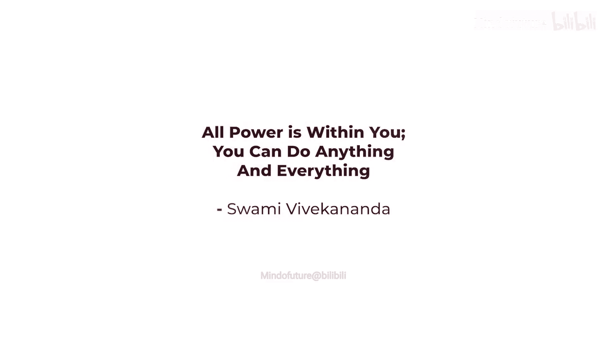
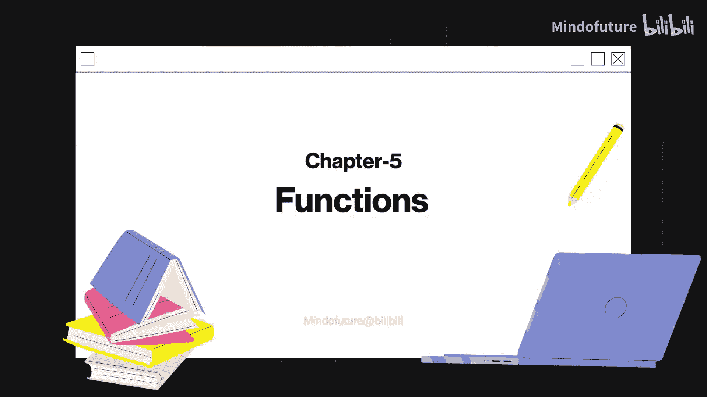
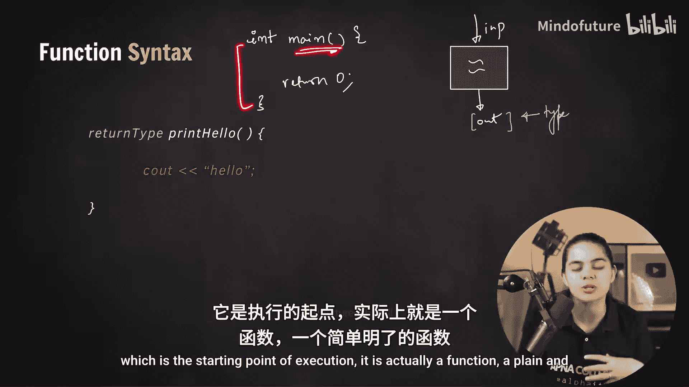
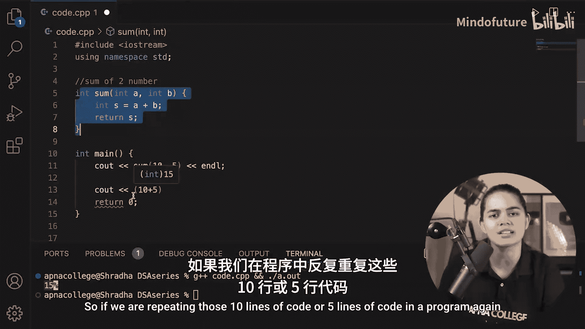
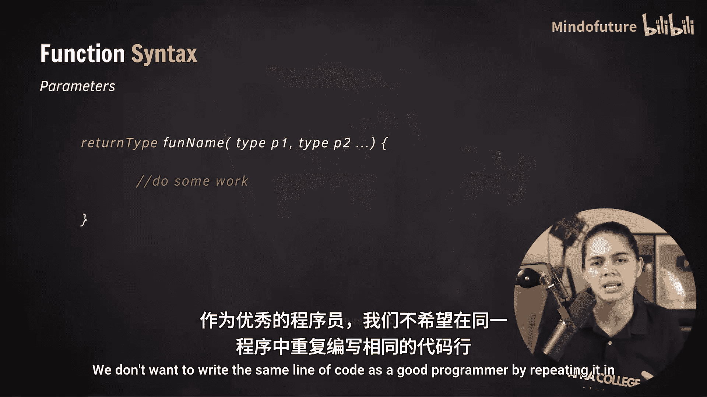
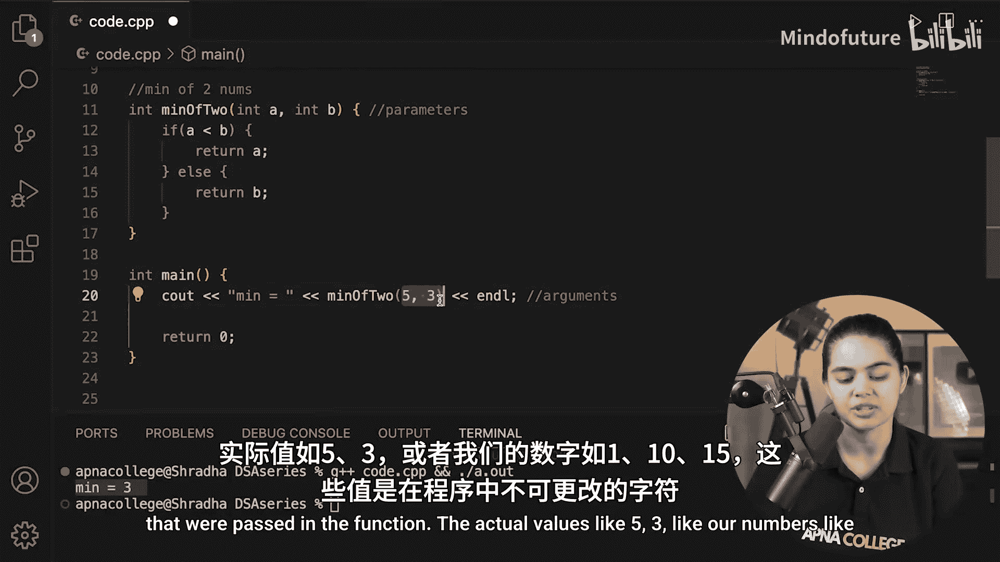
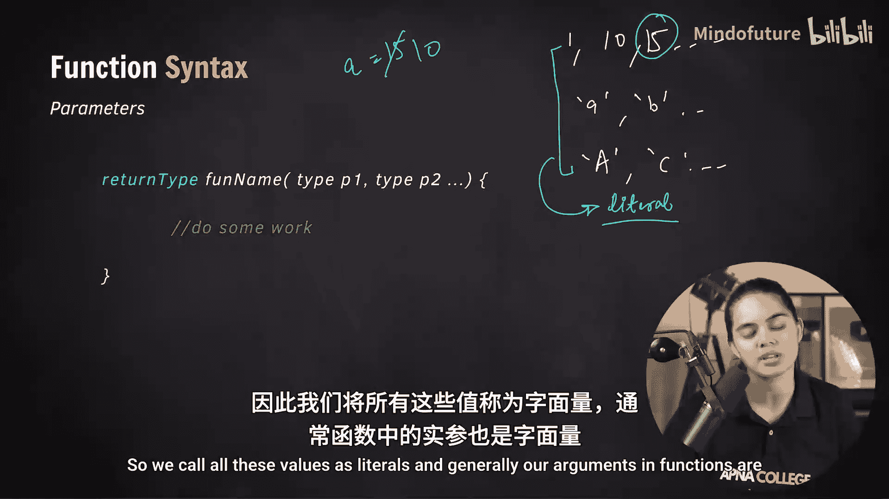
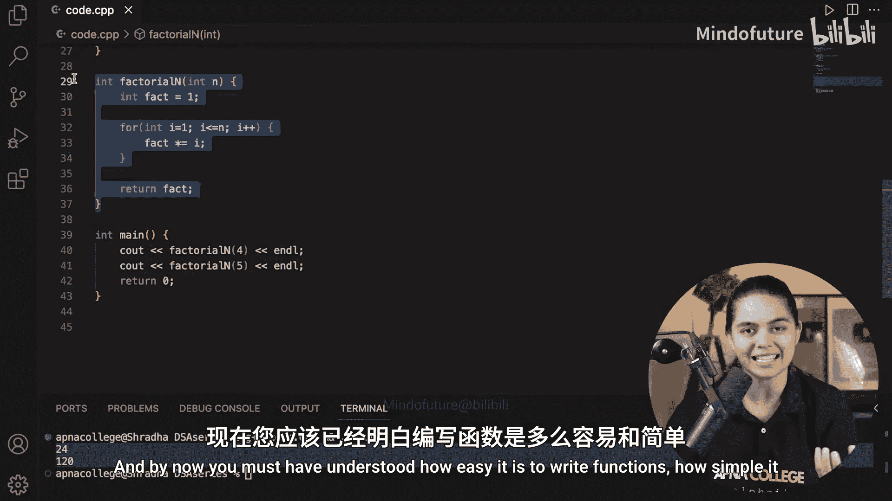
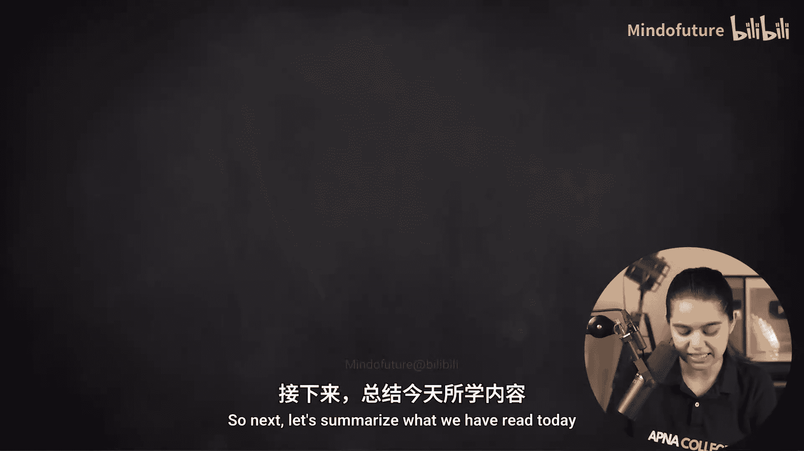

# C++-DSA课程-｜-数据结构-｜-leetcode-｜-Apna-College-｜--Complete-C++-Dsa-Course-p05-P05_第五讲-函数-DSA系列_由Shradha_Khapra老师讲解-C++语言--BV18oUGBkEmV_p5-

Hi， everyone。 and welcome to the complete D A series Justander Arjune X lecture。

 which is going to be about functions。 D I availableja。😊。

So when we talk about functions， functions are a rarely simple concept。

 Functions basically give life to programming， and everything in the coding world is majorly done using functions。

 The functions come as a chapter Oga。 It is going to be a very simple chapter。😊。

Subse Shiwa definey knek function exactly。 So basically in our program。

 if we want to do some work again and again， again and again。

 So we write that work in the form of function and how does a function look like a function looks like this。

 For example， we want to create a functiono printvana hello old printvanaham subse function return function inherently function black box inputt or output return output return output for example。

 if there is a function which returns in valuet function li return return value0 main function class and。

 which is the starting point of execution。 It is actually。😊。

A function， a plain and simple function， which has int as its return type function k function print function and our curly braces curly brace once again Ya of Jo functiontan function function for example。

 to print a。😊，Integer B andbarra Hlo kri Kana， let's supposeona inja。

 what do we do We convert this statement into a function or function Ca integer main function to escape Baharra function。

 let's suppose mi functionb printlo。😊，Though jsse variables can define functions can define print functiono print complete or her function casemus return type A function in teacher value returnza return type in functions value return return type This function does not return anything。

😊，The kky is the functions of printva A print hellobivai。😊。

Toham Yapa simply upne function kams at there。😊，And Use called to Yejo Yari function called logical。

Is logic couete have function key。Definition， Maabhamia function co defininging G liing。

A garme simply is theri code go save Guu and run guu。example， name name。

program function function or function So this is how we create a simple function function for example。

 functions3 So it has to return inte。😊，Int value is equal to this。 The Jese print Ho klogga。

 Pelizo hello print Hoga， then3 return Hoga， And this returned3 is going to get stored in this value variable。

 Or Im chato is Valluo print to B Kakam Val Hamippa return， Ho Ie V A L。😊，Let's see it。And John。

Hrini Kaiari Hoco print here for value3 I value return Kham variable Can the store ki。

 And now we can use this value in any way above trying to function your value return。

 Kium directly we print Kva。 just say yahier， instead of storing it in a variable。😊。

We can write a sea statement。 function function return or print functions functions use functions important concept also write in function function function black or with function or。

😊，If you want to create a function。That calculates the sum of two numbers。

 though scleum function coasically at Kange function hemipath is a though numbersca sum calculate Kna to Im na isac sum or I scanander。

 though parameter， though values input is sec in Tger A and in teacherger B。

 Any function karga y a variable bea S is equal to a plus B。😊，And it is going to。Return this S。

are we going to call this function will basically write the function names function and and15。😊。

10 plus 5 complex synt basically functions 10 lines of 10 lines of lines of and。😊。

Programming kander， which is called redundancy redundancy in the form of function which is a sign of a bad programmer redundancy reputation in the function of as programmer。

😊。

Uai returnju values him in a float in double type。또 예就 function가。Yi。😔。

Double sum Jo return Karaga to Kko aham 10。99 and 5。65 kssam calculate Kanaai， thevohamas Pretoga 16。

642 numbers Kaam calculatene function man Veham may function menos1 to calculate the minimum of two numbers。

 Ya Pa K origberse is function calledgi。To basically。

 Hamra function Joe would return K in teacherger value Jobi minimum Hogi is function coium minimum of2 minimum of2 kanderom in teacherger A a in teacherger B Jobi Cho0 value Hogi say Hams functions the return grana to minimum check。

 if a is less than。😊，Or less than equal to Dono mehikoga Agar A B say come here T to a minimum H else。

Hm return Kingibico， the donno may say Jobi minimum Ho voice functions。

 said return Ozaga or hum C out Kinggi minimum is equal to。Yapelex a minimum of two。

 and I scandalander pass cardingm 5 and 3。which is going to bevo whereas but。

With numbersge 10 15 is k value character to basically change the programmeander。😊。

To Je1515 variable any andky 15co de technical terms up lital litallaai。😊。

S C Jubil1ri values lit or generally argument So function can。

 they are also litals functions basic question Joi in the form of our function subse to calculate the sum of numbers from1 to n simply function Man sum calculate N value fix to n as R parameter function。

😊。

Let us create a function。Its return type is going to be void because we don't really need to return anything。

 I in Namham deect some n。 and I scanander integer n Hamas as a parameter aeroga up Cabibi a1ze entaca。

 some calculate can to process already other some variable Laing a。

 which is going to start from 0 phramic4lu bealinge in teacherger I equals1 is startca sec less than equal to n I plus plus。

😊，And herb sum k plus equal to King I and Ya has return King return B。

 If we don't really want to print it inside the function。

 Im in teacher car case return B a return Kle let's suppose sum calculate Kna sum n K through from 1 to 5。

😊，or calculate from1 to 1 is easy to write functions redundund In fact。

 majority of in the form of functions which is to calculate n。😊。

nial solveialial is multiplying all the numbers1 through npial is going to be1234 this value is to equal to2 is very similar to sumialialp multiplicationial multiplication basicial loop。

😊，Then just my i key value1 is staror1 less than equal to n i plus thus herbarial herial mehamari i value multiply o the factorial n equal to I or last maham returnial key value in teacherger valueial value return logic convert bo simple logicial x functionial nial n value n subial variable loop I is equal to n i plus thus herbarial is going to be factorial into n is equalial into equal to n not n I。

😊，Uer be。I hum lick them to Ico short meam Necle。 And last。

 maybe we are going to return our factorial value。 So this is the entire function to calculate n factorial hum Cha to calculate cur factorial n for4。

😊，And factorial infer。Let's suppose，5。Clear it unsafe。 The factorial of 4 hai 24 factorial of 5120。

 They will call Sahi valuespa and ya functionsna Ki Ki as a difficultyman nextki function。

 What actually happens in the computer's memory。😊。

Basically， a beta company is the rekek format de kkihammni in teacher main function man。😊。

Is therikeka or his main function Gkuush Kamva， Abed S Iklava let us create a function。😊。

Called sum sum krum in teacherger A and in teacherger B in valuespa or directly return a plus B sum sum main function main functionari sum function co or is a values 3 and 5 0 functions functions memory specifically C plus we have two types of memory is is a really important data structure。

😊，orap system static function main function automatically compile internally function time。

Ca or is or frame main function logic functionju at for example。

 simple function main function or function x is equal to 25 is function x is equal to 25 function main function function program program function。

😊，function function function function and is equal to and is equal to function stored in in ofs function call and third important。

disc current function K under a B Hamari top of the stack me v he current function of them Jse。

 though numbers Ka sum calculateulator Toia 8 or Jse Hamney return Kthea。

 the return Kique control kriga return Kique control vpa Yahaajaga or Jse control Yahapa vpa I V Koga stack frame k yea function。

 main function Co，8 value return Kdiga or could is stack。😊。

Bahar toam v upper main function karja main function k khi variable the Mariipas available main function kar a in teacher A in teacher Bkiki values I a variable A dega Tuko main function k axis main function is exists in k I example Just say for example。

 many function man， let's call it wide wide function k variableya in teacherger X is equal to 25。😊。

To 25 25 co out。X。Am K kringgi main function C is fun function go call kringgi or fun function go call Kneba Ane Xo print kvanegi goher kanggi。

😊，So let's do it。 use of unclared identifier ident variables and functionsm function function functions function for example。

 function or function be called A。😊，Or some function G the Ramgati return Carnese Peli。Agar A，B。

C cocal。Tora sum function call framera A function The function is the to occupy functions of value return return or finally main function of return0ta frameju。

😊，Whaja also functions Generju return statement Uek that he is a final statementhi Koibi can'tju return statement Ki Ba Haja function Generabbi Pra。

 just say if this is my fun function and Yahaa， if Ive returned value 2。😊。

Said to Kare and his katton type in teaja ragre or Yahaur， Ame print Karaniki Ko karum hello。

Though yjo hell y A gra fun function。The function return value or is statement function return in fact。

KB I mu next， a core important concept pattern related to functions， which is pass by value。

Pass by value Klabeki Agarhamnikui function Manya。 Let's suppose Hamni I function manayya Yaniurai functionic。

Which was the sum function。 let's suppose ye Puranni functions at aithium。

 Let's suppose a Nick function Man I sum。Some function can thenpa those variables are integer A and integer B or Phham K curtheem Phhams A or Bca sum Jove were return is the sum function G Kthe be sum function G value pass curef 5 and 4。

😊，T to me pattai 5 is a and the Jatro Rojaga 4 is B and the Ja Str Rojaga Ba straightforward they let's suppose Yahaer main function can the amni variable defined y x is equal to 5 and y is equal to4。

😊，Tk X or y co Ypas。sum function internally main function values x is equal to y is equal to4 and function function and x which is function sum function main function and with value。

😊，for example， A or B X A or。To yjo A R B， Pa orjo A R B。

 you dont know A A R B Knina said X or Ykija。Agerham Liney， A and B。

a is equal to5 b is equal to a function。Is key value butakka ame 15 Gdu。

 B K value butakar ame 14 Kdu。The original cander co change Nega mean function just say Yahaa Saman Kneipelli。

 Agar a Kobaakka make herdu a plus 10。And B Kobaaker make her do B plus 10 or fair edge of values。

Samko Prenigaem， but simply。Some of A weco calleding。

Tkai they say a Agar5 Arm5 Pa k to Abhamari a value 15 Ojaniche B he value 14 ojaniche to Jem return Karinggi。

 some of a plus B the Mariipasam returnjiipas sum to return over 29 G equal。 y， in fact。

 is sum cobi Gval theham confirmationfi ojaga， sum to return over 29 G equall sum is going to be 29。

 Lein Agar is a Koham print Kvagiher Karinggi。😊，And B to values 1514 valueshi value values function a value value or by argumentspa by value or by pass by original pass by pass by to a copy of the which is passed function function calling function function。

😊，Escale I or I am going to give you a question。 Jese， for example， Hammnk function mania in Tea fun。

In Tea fund a variable later x here is Q has change x。😊。

Ybi Kham X Q value could change K they 1 to 2 into x or Yahaham C out Kne X。Is equal to up x K value。

 main function canar kare main function canar I K teacher x sum Bang x K value of 5 k equal。And。

Yim change k。Xco using this function， or du bar sayham main function G under V X value or output。😊。

Though output kaggar Bari X K and5 a value to y main function X B equal to 5 to y main function key memory mijajas tojaga is K could beak。

 a main function of call kigne Fun function go。 yet change x function go。

 This function is change X to change X K kga change X X k a core copy Bengi Add some other address address could beak Panni value Jo Yagar copy Ujagi。

😊，Copiqki normal variables kippa pass by Val the valueas copy or x valuejab2 x x is equal to 2 x a x10 k equal or subseas print10 second number pay ja main function main function k x value5 f to second line me x value5 k equal10 print5 printga ver。

😊，In know。😔，Wite function top。Though x is equal to 10 and x is equal to 5 by value General variable normal variables pass by value or generallyham is calculate sum ofit for is equal to。

😊，calculate in the form of function dig14 plus5 this is to be equal to10 and that process44。answer。

 answer next concern next the Q number co。4 or44 logical。

Moja patya 14510 kat dividequeque quo dega 14 or remainder me dega 5 to kbibii numbers say a B number core last digit co。

😊，Last。Tscal logic is gig。Logic basically Sa dega a to up now digit sum laname let's call it digit sum just going initialize kak name0 ka。

😊，greater than0 basically45。😊，1，24，ja12，4，5，1224 basically greater thanit isit。

Then for a particular number。Take example K through is quo test we。😊，J say， for example。

 many numberia，2，3，5，6，23，5，6 kilo subto remainderligga remainder niligga to6 coma6 adoia。😊，Yeah。

 in fact， is some then。Y sum can6 add up6 add twist number 10 divide to 2，3，5ga 5 ni5 sum2。

3 say 33 sum2 sum last mepa0 So the final answer is going to be 16 t is convert code k。

 we are going to write a function。 Let's call it in tger sum of digits。😊。

Some of digit kner mepaic number A come some of digit in teacherger digit sum Katptaa number greater than 0pta sub last digit ni the last digit is going to be number mod 10ba number cohi。

 the number is equal to I say K number。😊，Divide equal to 10。And finally。

 upne digit sum Genander add Carcene hammne last digitku。 and ya return Guingapna。Digit sum。

 let's save it main function Gander，mei out Kana。S is equal to sum of digits。

Dis scan from up the same number past cur，2，3，5，6， disc scan Ipath 16 k equall energy。😊。

So say checkring， the sum is going to be equal to 16。

 This that a kiss B number K Sa deiska sum nia possible Next， we call question Im solveem。

 The question is to calculate binomial coefficient for given N and R values。

 A binomial coefficient of the math can the perdo of binomial coefficientient exactly gives a mathematical concept of the Ukimabis other detailed minijanggi。

 Hammi Ss value co calculate Kim。😊，Basically， binomial coefficient colicth N C R key formage R P n or R co be number of time。

 Let's suppose n is equal to 8， and R is equal to 2。

 So N C R kta binomial coefficient N C R is equal to n factorial divided by n minus R factorial to y Maripa formula O there is sc allan Je say Agarhamid y 8 C2 N value 8 R value2 H。

😊，To case I calculate kringi from 8 factorial co divide kringgi up 2 factorial and 8-2 factorial cassat。

 This is going to be 8 factorial divided by two factorial into 6 factorial。😊。

U 88 is 8 into7 into6 factorial factorials isial24 into7。

 this is going to be equal to 2 N n2 suppose 6 calculate or is to beial divided by factorial divided byial into4 divided by factorialial2ial co N calculateial n xialialialial n minus。

😊，Aectial orba simplymi divide top giant on upper pause could say he is Kaa called。

 it is going to be very simple。😊，The code k， the subial functiondiial。😊，Of in teacher N。

factorial initialize K1 k for in teacher I equals1 I less than equal to n I plus plus Hamme factorial into equal to I last me returnial value function number of factorial given N8 k equal。

😊，And hamra R2 equal to case calculate K basically teen terms calculate y termari numerator termari denominator the subial of n calculate Kial of n is equal to factorial function G N value Pa calculate or functionus In fact。

 biomial coefficient kic function called N R N R n pass R pass or is function G N R function k basically。

😊，Upna N C， R calculate K n or R past king or y function y a function here is function go U K function x U cur to y bellyial n calculate cur I C factorial R calculate curkuna must R value Pa and I C Ta。

😊，A factorial n minus n minus R NM S Mcr， which means n minus R is a calculate K to is coium me calculate Kia the final value kojagi final valuejagi factorial of n divided by factorial of R。

Into factorial of。N minus R and gauge of value I say Ki has return Bo simple pal Nische of denominator may dono terms multiplygi or Uper values say divideddocal value。

😊，use main function or and in fact， concept function programming function。😊，See out our。

Final answer to Hamabas answer I get 28 k equal8 c2 N key value 6 ojahi， R key value3 ojahi。

straightforward。 have write a function to print all。😊。

Numbers from1 to a given n。 There say n K value over 5 D to 1，2，3，4，5 Me Muta， in fact。

 is a one ni a cuki，1， a prime， a composer to that the2 to N C。😊。

Though2 prime prime And the third question is to write a function to print nbonbonbonbon1，1，2358。

13 andbon Similarlyly。😊，for example， n01，234bon equal given value is to。n complete completed。

Read this lecture successfully and homework problems complete complete lecture what was your favorite part You can let me know in the comments Also you can let me know on Twitter just description box keep learning and keep exploring。

😊。