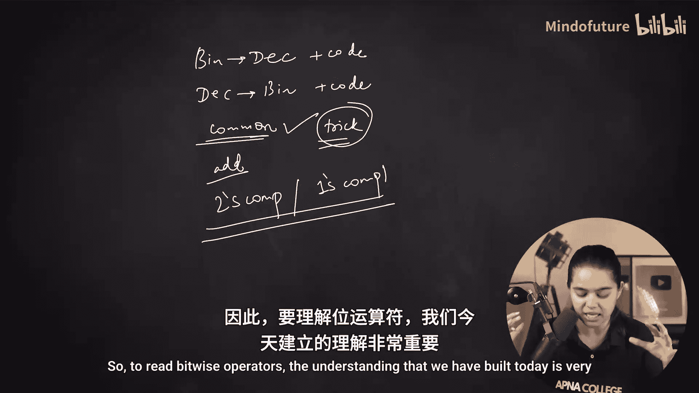

# C++-DSA课程-｜-数据结构-｜-leetcode-｜-Apna-College-｜--Complete-C++-Dsa-Course-p06-P06_二进制数系统-DSA系列_由Shradha_Khapra老师讲解-C++语言--BV18oUGBkEmV_p6-

🎼Hi， everyone， and welcome to the complete D series where we are going to cover our next chapter。

 which will be regarding binary number system。 Now。

 this is a really important chapter because itll teach us a lot about how data stored inside a computer's memory because we have already learned that data is stored in the form of binary numbers to numbers derivedlist。

😊，Well let's start learning about a binary number system to Azeelic Jo number system Hamme deha already Bo Ma Kal deam。

 Jo Hamara deimal。Number systemda。A big number system number system basically digits who use calculationit use are all formed using these 10 digits10 digit1 and that is the name of systemim systemjoematics and is binary system systemju system number systemim。

Systemxarimalla 16 hex 6 de106 plus 10 is 16 a copa ocal number system octal to jseraimal number system math the usethe is base 10 v number system B base 10 Qqis can the 10 digits say binary number system co base 2 v number systemtheiumxarimal co base 16 v number systemocal co base 8 v number systemxarimal and ocs are the detailed manager binary number system co detailthe so that we understand that how are our numbers actually treated inside a computer's memory。

😊，binary number system binary number system for example，110，10，01 binary number1，2，39。

6imal difference binary andimal and system to this entire chapter is going to be this binary convert vices learn about how to convertimal numbers to binary2。

34 converts suppose we start with a number 4242 binary convert。The Muja Icar repeated。

Division Gnapertiga。With2 j me base my convert Knaja repeatedly divide Knaku Caseringgiseel similar process Jese 422 divide kgi remainder right side remainder0ga and422 divide answerga 21。

2 divide remainder1 and answer k equal2 is0 ti 5 k equal21 ti2 equal2 divide 0 and k equal and last time or2 divide1 and ti 0 equal is number backward job is number number 10。

1，0，1，0， and this number is the binary form of42。😊，Or the Sha S S42 base 10 is equal to。This number。

Base 2， to 42 in which base in 10 base Decimalca 42 is equivalent to this number of binary。

 This theri hum Kisibi decimal number co convert kant to its binary form。 a core examples algorithm。

Let's suppose now our number is equal to 50 Hamippa 50 h iscom convert K binary can 50 K at staria 50 co2 say divide king remainder aga0 k equaljaga 252 repeated division remainder aga1 quojaga 2 repeated2 division remainder ajaga 0ja 6。

 bar divide k2 remainder 0 quot 3ra divide k2 say remainder 1 quot 1 du divide k2 say remainder aip1。

 quot tiga 0， see number jump backwards licking a any1ja1 0ja 0jaga1 Aga。😊，And Fercor0jaga。

 So this number in binary is equal to 50 of decimal。

 Theer A Kisbi decimal number Kohammski binary form Gennder convert curte。

 And it's very simple to Yahapaigbar Po Kan。And You have to convert 2 to 10 all of these numbers into their binary form convertimal converts this number is basicallyimal number。

😊，Yeah， in fact， I if not decimal number we k them Ki decimal number khammi binary number can convert K。

😊，Upne answer Lilie y answer Gaoga yanarrabin numberga is answer kham Iized kstan，0 kat。

To basically conversion conversion number bar22。😊，To is theque process already they howeverbme last functions while chapter makes to calculate the sum of digits of a number。

 So sum of digits of a number may bar basically make loopimmal number greater than0 orse。

Hmy up a number code decimal number code2 set of wideker remainder nial。

 the su remainder nially the remainder is going to be my decimal number。😊。

Modulo2 Ukevas second step Oe gives number quo actually to say divide girl a question ni not the remainder to ask a question withche toist decimal number quo reset cur they to decimal number divided by two y the only steps boha simple。

😊，A remainder straightforward process number backward backwards suppose number。

5 core algorithmham convert content to binary。second。Bha simple that게根。

Is this number not1 into1 plus0 into 10 plus1 into 10 to the number position10eth position position equal1 original value basically10 multi unit basically to third v to。

10 key powers I existingit1 multi mu mu。U remainder is remainder power multiply to10 total answer1。

01， which is the correct answer to mu power multiply variable li。😊。

Jiskoham carrying y not power variable。 disco initialize carrying a one kssat。

Is k dry and k process theium for a very simple number。

 Let's suppose n is equal to 6 accordingem according n is equal to 6 to which is0 right now or power equal to1 k remainderja626 equal or n update n k equal to0 n1 answer3 second remainder k equal or power update power equal co powers multip n10 answer1 equal10 answer。

😊，And Encho Orham divide Kingi to ye final Ajagavan Keul。Power be a me update O 00 away。 Next time。

 the remainder。1 could use say divide remainder I1 k equal or quo toja 0 third remainder is multi 110 or 1。

1，0。😊，Equivalent totahe for6 of binary。 This is the re Aju conversion a logicos co code again the remni convert Kthium This P logic co Ibar C plus Sus code again the convert Ktheium。

 Let's take our decimal number equal to 50。😊，And like function Mane。

 let's call this convert deimal to binary， decimal to binary meicimal subserara0 Sariing se。😊。

Ferk Lu Chaangi Jepta kmara decimal number is greater than 0。Subiptome remainder nii。

 the remainder vjaar decimal number  co。Orduuluing it to kath， fairham decimal number coach。

Ukebarme answer a Knair。A remainder into power。And for next iteration key power co King update power co multiply King10 kat to put a process for ja up numberco calculate Knea and ya said return up answer y answer k Yer binary formham numberki。

😊，Tyai out Casham decimal to binary。C answer for our decimal number。Let's save it。 And let's run。

To hamra 50 k aia 1，1，0，0，1，0， Yani calculate kra 1，1，0，0，1，0。 In fact。

 hum 2 c10t sorry numbersca calculate kcate。Yeah， once aor 10 the i is equal to 1 i less than equal to 10 i plus this。

Harbarham sea out Kana deimal。To binary for this eye。

The1 numbersjo binary version is bo simple straightforward logic and I logic going to talk about binary2imal conversion example binary number 10。

1，0，1，0imal convert binary numberimal convert I2 power multily right is direction multily2 I I or I or sub multiply basically add020 multi12 multi0。

😊，12021232 the answer is to32 plus42211 rightim10011632。32 plus 16 plus 2。

Value k value50 k equal 50 G binary form last time me calculate and 11，0，0，1。

01 is numberimal form here calculate next binaryimal number convert trying to example let's suppose binary number binary number can be anything。

😊，Ahammna answer calculate carrying itmi answerimal numberga and Same Hammeki Iic s multily Ii Ira powers of2 sply powers of two tohamic power variable liing it just initialized culting in one kth 1 k la2 to the power 0。

😊，process basicallys suppose101 which is to second step second。

Multipliied by2 k equall y we Abdation oga to those step mirror adation k them or y donno step me last time last function mill them or in donno stepam upna can perform Gium to me function Caa de kga。

Jpttuck， my binary number。Is greater than 0。 Tat muji Ydo come garne subo remainder Neallo remainder ojaga binary number。

Modulo，10。Or fair answer can the muie add cardina a no binary number。Multipliied by power。

For update kring ato binary number update King binary number divide equal to 10 and scaleva powerja power into equal to 2 update step or last mehamjo answer is answer k return to overall logic binary number code deimal can convertnega Bo simple bo straightforward logic isbar can converttheem code make functional in teacherger。

😊，Let's call it binary。2 decimal binary2 decimal Mehamipasic binary number Iga subalethovna answer def curlingge and a company power Def curlingge。

Jt my binary number is greater than 0。Ttmiacine， Tt sub paloomy remainder nialine。

 which is binary number mod 10。Up answer candander。

 Hume add cardina here remainder into power Fairhamme update K update Carringgi to kga update Carringgi to binary number。

Is going to get divided by 10， and power is going to get multiplied by 2。

 Last maamm return Kingyapne answerko， which is the final。Deimal form。Of the number。

 say save card them。And has see out wearing game。Basically， binary to decimal。 Let's suppose Moja 1。

0，1。Cardesimal convery， so this is going to be equal to 5。2マ5 a mu10，1，02 10 who。

number binary to decimal conversion common numbers1 binary inus 00 binary form0 at binary numbers can the chi 0 chi am double0 chi triple0 chi 0 0。

😊，Jesse math and the chim 25 li chim 0，2，5 li chim 0，0，0。

25 li subcommatla eventually 25 y to v say binary numbers measure Shi w me0 there W kit the name he hadectam could be mining erect。

😊，2，0 Ca binary form of T 0，1 Ca form T 1。0，0，0，12 binary 1，0，3 1，1，4 1，0，0，5 10，1，6，1，0，71，80910，0。

1，1010，1，0010 forms example Mu25。25 binary basically1 value position position equal662 222225 25。😊。

11 equal。positions1。374 with edition。or or。Up next。

 Hamba can vary about a special concept called two complements complement collect number example lets suppose me number equal to 10 many define here I integer equal to 10 Ab integer equal to 10 he per y memory can Cajaga10 Ca form the 1。

0，10， to memory can Mujita Ki chasja allocatetegersla 32 B。😊，To 32 Jo number total 32gi 10，1010，10。

32。Aari pass with a minus10 to is store isme storemik special form calculate kte。

 which is called toolss complement k number complement k calculate sub number2s complement calculate subseme binary form can convert number 10 binary form kga number 10 first step。

 binary form 10，1，0。😊，Am last 1，0，1，0， to subse 10，1。

0 may calculate Carringgi second stepjo binary formpa same prefix carta with a0。😊，They say。

 for example， Ye 1，0，1，0 to Iske， or Yejo leftmost Biuier I Kohamni most significant。B short M S。

 And this is the most important bit of a binary number。

 Why is it most importantki positive number negativegar M S number positive M number5 or plus5 value number positive binary number M number positive prefix positive number M third step number Now what is this ones complements complement。

😊，jaga02 second step。Yeahamara first stepta dismamni simply number calculate kathha。 second step。

 Mahamari number kagahamni 0 qua theatta to is 0，1，0，1，0，gaha。

 third number miska of once complement Nialingi。and fourth fourth step answer11 ofim is equal00 is。

Of a number k once complement o may directly reverse Sojam plus1 complement。

 or yhi put a process for Jabii negative number called memory binary me let's supposeipas already quite given numbers opposite k。

Let's suppose Aipas already quite given number H binary number。

 which is equal to this Muja Aipic binary number he。😊。

Or already negative number original number k y negative number k processimal binary can conversion cur。

😊，A process jam binary saidimal conversion or conversion negative number negative number negative numbersim convert complement complement。

😊，Is number of1s complement kjaga is number1s complement0ga 0，1，0，01？

And second step me plus1 equal plus1 k is plus1 k to number kjaga number of Jaga 0。Y 1 kiojaga 1，0，1。

0， and y number Kta 10，1，0 is basically 10。Of decimal。

Or Q mu Alic negative number a to mu mepa10 this value is equal to10 number co binary decimal and decimal binary convert twist basic questions all Let's suppose we have to convert8 to binary and the reverse of it subse minus8 co binary convert kgi8 Al is number co binary convert kal sub binary formgi8 is binary form1 triple0 second step is binary form M coringgi to M B a to yogaga 01 triple0 third step complementgi once complement is 101。

😊，one。Fourth otaic is canrum plus 1 garden plus1 jsia 0， carry forward 1 Hoga dubara 0。

 carry forward 1， dubara0 carry forward1 and yehoa 1， the final jo answer Hoga Vohoga1，1。

 triple0 in binary is equal to minus8 of decimal。Abi Mu value Mu1 man， triple0。😊。

Or number negative number complement， which is 01 plus110 carry1，0， carry1，0， carry1 and y 0。😊。

1 triple0108 original numberal numbers complement complement complement complement plus complement concept12 complement12。

😊，Though Yahitara binary number systems collect basically binary said decimal conversionikaimal binary conversionika common。

 which decimal numbers with binary conversionshi， plus I also taught you a trick。

 Y how to easily convert without actually using theelium like technique simple trick add binary numbersika complement。

😊，And once complement logic logic mark。

