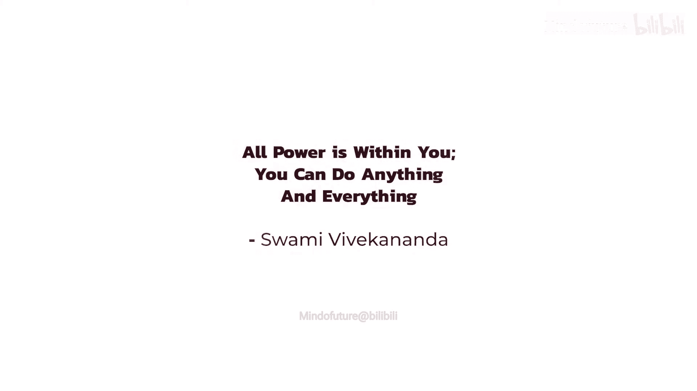
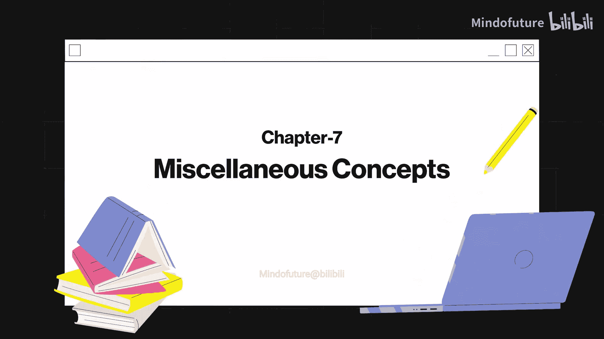
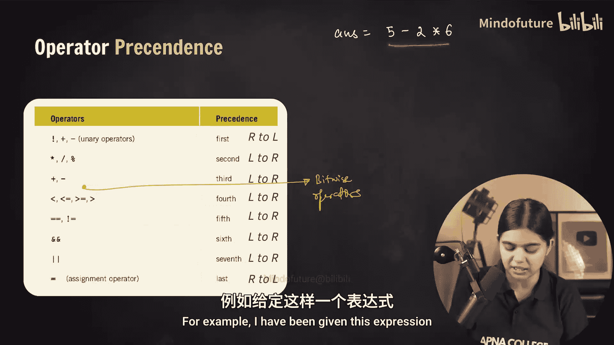
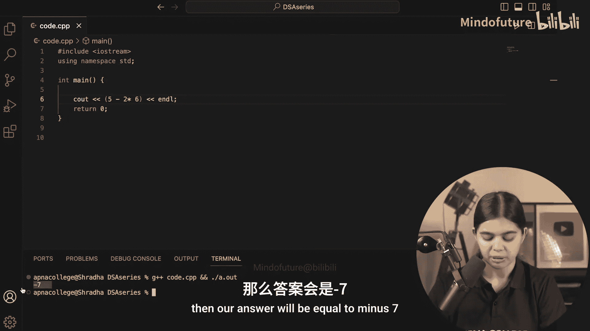
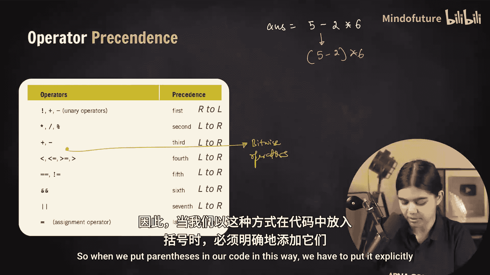
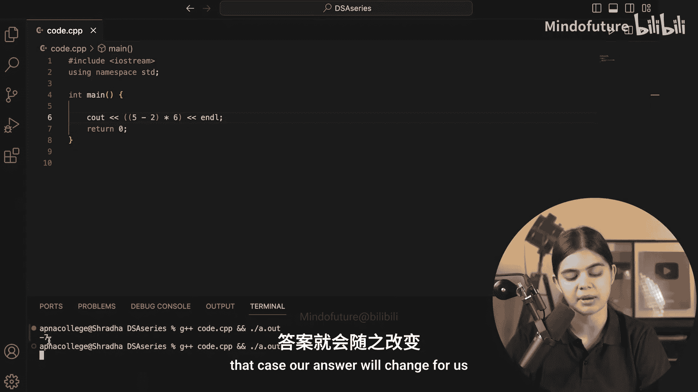
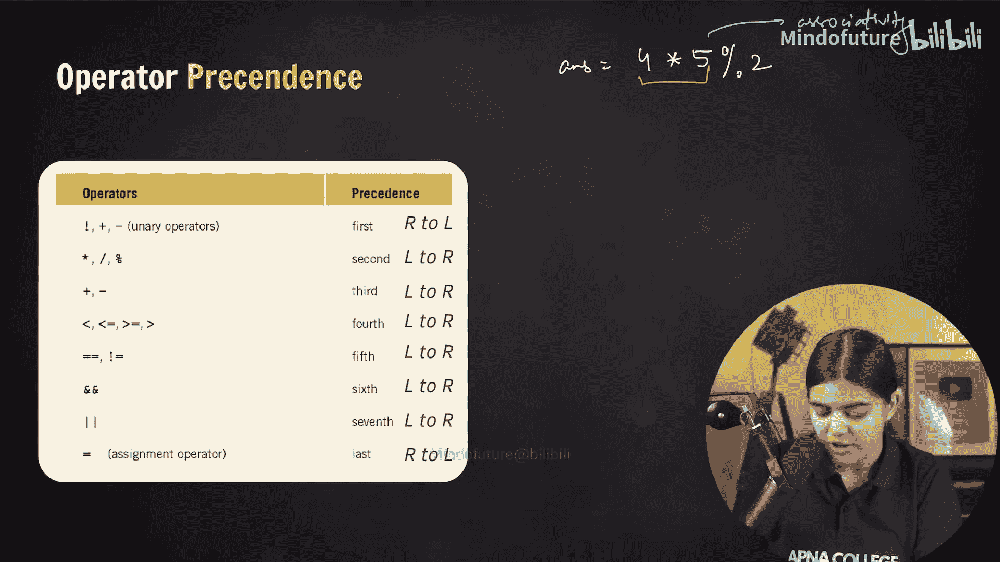
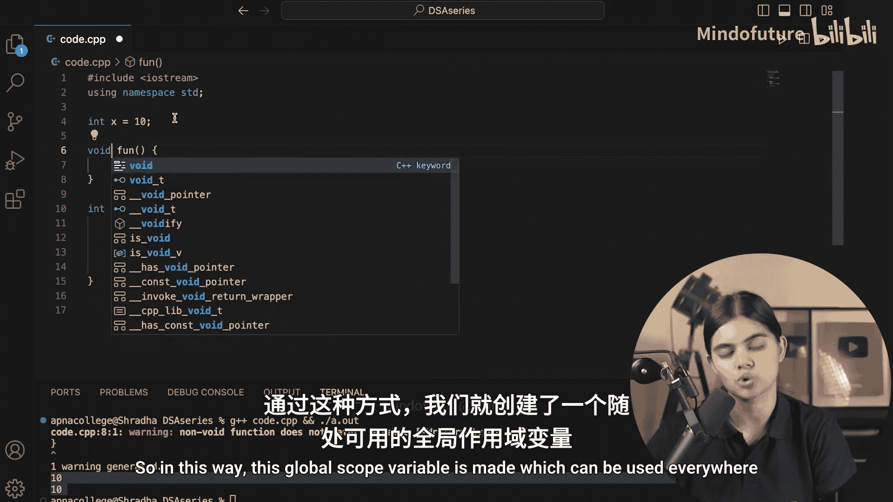
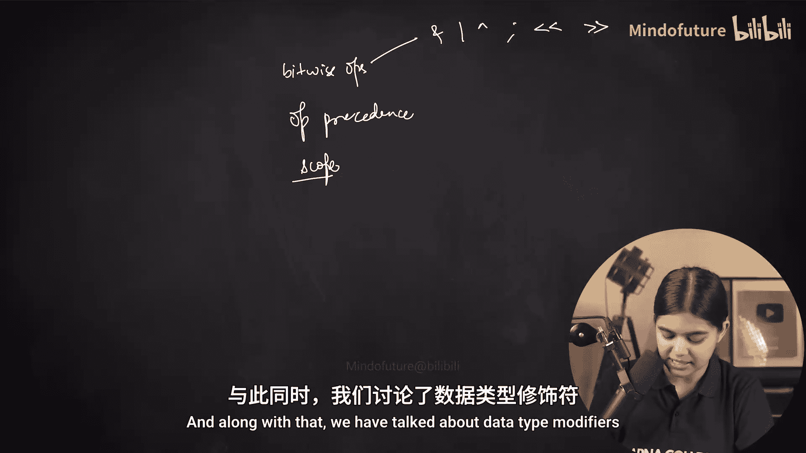

# C++-DSA课程-｜-数据结构-｜-leetcode-｜-Apna-College-｜--Complete-C++-Dsa-Course-p07-P07_位运算符_数据类型修饰符及其他-DSA系列_由Shradha_Khapra老师讲解-C++语言--BV18oUGBkEmV_p7-

🎼Hi everyone， and welcome to the complete series lecture lecture important concept cover。😊。

The Shi chapter key， we are basically going to cover a lot of miscellaneous concepts in this chapter。

 dismissmiss a sub concept bitwise operators come binary number system lecture bitwise operators Jori number numbers key binary U operators Je for example。

se bitwe and operator key Iwe and operator bitwe and logical and similar example andham and vham are0ka and So this is also going to be01 and1ka andju is very similar to logical and operators already cover。

😊，Example kliham though numbers later， let us suppose a is equal to 4 and B is equal to 8 or hum calculate Kana are they A and B。

😊，To is jaas8 key binary form4 key binary form 100。

8 key binary form1 triple0gi and number of bits mismat equal by adding these zeros in the front of the number andgi0 and00 0 and100 and is going to be0 ofimal and and equal with the help if we2 numbers a equal to4 and b is equal to8 or out a and B。

😊，To answer Hamipas Aga is the Ri say0 equal Jeipas bitwise and uai。

 We sayingipas bitwise orruai bitwise or logical or Ca， similarai bitwise or me Ym 0 and0 k Or。

 So this is going to be 0，0，1 k Or to E1 Hoga 1，0 k or to E V1 Ho 1，1 or to E V1 Hoga， Just say。

 for example， Agarham 4。😊，And 8。or to answer Mariipas Iga 00 co 0，0，0，0，1，1 co 1 I 0 and1ip1。

 So this is equal to 12 of decimal is a to 12 k equal 12 k equal yoga2 to the 0。

2 to the 12 to the 22 to the 3 to Ya basically 8 mem 4 qua。

 So the answer is going to be 12 of decimal is go verify Ble ya andham or Mariipas answer I 12 of decimal。

😊，We see that E case say Je say logical and logical or similar withha bitweis and and bitweor。

 But a core operator Bikerra Maripauer， which is Biweis ex operator exor Kala Bota exclusive。😊。

Or Parisi Hamamia ex ex operation， ex Svoa deriraga to exul the U Hamari bit same he。😊。

T to answer 0 Iga or agarhamari bits different He whose case may answer 1 Iga Jesse Agarham 0 ex 0 to answer Hoga0 yfi Aham1 ex one to be answerga0。

 they Agaham 0 ex one to answer 1 Hoga y1 ex 0 Li to be answer 1 oga， Jese， for example。

 Agarham 4 come。😊，Exorly 8 kat to exhor me 0，0， Yame0 dega Ybi0 dega Yame1 dega and yme1 dega topa 12 of decimal ni Karaga I couldka later。

 exhorringgi。😊，Though whose case may be we are going to get our answer as 12。

 Intino operations quoam China Okis or though numbers per be trierectam。 I he that Riki。

 let's suppose Agerham 3 and 7 k orna at them。 save Carly then。😊。

Though exhor 4 k equal3 and 73 k binary7 k binary Abor111111，0。

0 is equivalent to4 ofimal and4 4 k equalimal numbers operator final answer by converting them into their binary I or operator a shift operator I shift operator orwe right shift operator。

😊，Among Ya Casseak Kil leftshift here Ks rightshift。

 basically Agrim is operator to Ya pointed end leftja operator。 was a right hiter of k。

 So that is why this is right shift。 And this is the left shift operator Case right shift and left shift operator worker the。

 Basically Agaraham Ko number。 Let's supposeia N4 Agarham N left shift left shift I。😊。

To Hamara Jobi binary form Moier would left thequitaf I places Shi Kjaier Yakalabe Jese。

 let's suppose Man liha N left shift left shift 1。😊。

boga Iboga Jobi n agar4 to 4 wta 100 Mas to ye leftjagi by one placelaejae0jae0jaari placeseahhajaeahja andeah ek orjagaha toja U with0s to basically agar Shi's final number。

ga， and this is equal to 8 of deimal Agar simplyha。😊，Am me y out here 4 left shift， left shift，1。

To answer Hamriass Anival， E equal a core example， Ethankili。 Let's suppose I barhamm Shi Carthian。

10 left shift。 Left shift 2。to1 ham리파소대1010。Ye char places him S E char places Niiesjagi are left hitta of the worst places a her number co。

 though places s Knaieva Yahabar Kna Iga to1 Yahaga yeze Yahaga ye Yahaga ye yaga to places in upper kdijacom Phil K with0s Tuky kgi。

 This is 1，2，4，8，16 and 32。 So the answer is going to be 32 plus 8 equal to 40 of decimal。😊。

The Jse hum 10 left shift left shift2 carryinging Mariippa answer Ia 40 G equal I Kobe he verified Carlyia Im Ggi 10 left shift。

 left shift 2。places operator concept and operator right right。010 and this number is101 which。N 10。

Right shift， Right shift 1。To this case， may Hamra answer Niel Kranniala 5 ku a core example， eium。

 Let's suppose I barraham Cur 8 right shift， right shift 2 to 8 Huai Hamripa 1， triple 0。😊。

To Iriippa cha spaces only number kander Y1，2 places Shi Kaigga to Yahaga ye 0。

2 places Shi Kaga Yahaga， ye，2 places shift Kaigga Bajaga。

 Ybi Bajaga left valley Jagkofi Kingi with0s to ye Valti2 of decimal Javan Karinggi 8。😊，Right shift。

 Right shift2。Mypa answer， I got two k。 A cuki upper left shift and right shift k bath。

 can a coffee in interesting cheese napku they kfu。😊，Basically。

 Ja leftshift operator Roai ye internally memory can a operation performed G。

 Let's suppose Ks V number a co am left shift left shift B G thosekulabe a marriage of final answer Honi v a into22 to the par B Honi v or iscon verify B sec Je say 8 co ame left shift left shift 1 here。

😊，1， triple0， toka answerpaga1。I equal and 16 equal is equal to 16 ofimal and answer into2 this would have been 16ham places right operatorham right right divided by right right100 which is equal intoim divided by and this is going to equal to4 and。

😊，write which I am going to give you in all of these we need to verify to perform these two lets move on to the next concept which operator precede basically is equal to2 into subtract multiplication。

😊，compile such rulepl multi relation equal equal and logical。

least priority assignment is equal operator basically priority operator operators operator termsnshipme logical than what is。

for overall chi logic is the implement here say， for example， Ive been given this expression。

 is expression can mujaki multiply y precedeceenceia precedeence loia expression。

 it will turn into 5 into 2 multiplied by 6。 The parent this is Ka y operation Palega to operation y Palega it will be equal to 5-12。

 which is equal to-7 to answer Hama-7 k equala is come very because If we write5-2 in 212 y2 into6。😊。

To answer-7。 but kbi is precedes overrides suppose if this is our given expression or expression operation performse I explicitly case answerja368 tobim rules override operations case Also kbibi situation Agi singleander。

😊。

Will have operators of similar priority just， for example。

as expression just say let's supposeipas expression 4 into5 mod2 equal expression multiply multiplication20 mod2 which is to equal to0 mod into1 which is going to equal to basically equal operators equal operators rules of asci associivity operators order performciivity order multiplication division modci right perform from to right direction。

😊，Heither of buding it to pair a multiplication performga for modo perga to multiplication performoga so it is going to be 20 to 20 modo to answer Mariipas Iga 0 equal answer 4hia to a B verify Yaha。

 agarham Liname。😊。

4 into5 modular2。And lets run it to answer Mariippa Aja0 equal to kbi situationthe Ja equal precedeence K operators to associivity rules scope likena assignment operator K associivity right to left here right to left is Qki assignment operator Hamish right key value co left and assign cur plus unary operator K A generally associivity right to left Bki subcomham compute cur going from left to right direction So this was all about operator precedes next important concept k which we call scope scope generally hum variable K check curthe。

😊，Scope come at levele。K， Ja variable。As， for example。

ari variables pervo variable function functions Jese function some function some functions or A or variables B is function main function concept A a global。

😊，Local scopelaham local variables wereim Local variables Ca Jo variablesmel deth Jo variablem functions scan definethe Jo variablesm block of code block ofla curander de Yesriari Ip I see local schar accessible I exampleel。

😊，Jse lets suppose and Samis Eelky Same loops Kabique saigga。

Just say let's suppose many Kia if3 is greater than one。😊，T muic variable J x is equal to 10。

The Amen Exo C Caria， like Ugar， if B k Bahar， may Exo print kvagi khi kongi。😊，Those case me。

 I am going to get an error that undeclared identifier X Q x Y is if block K similarly upper L block clickte or else K xza to be apa errorta to basically is F L block variables have over under the key Baus Similarlyly。

 Jeam loops k variable one of them。4 loopu in teacherger I is equal to 0， I less than 10。😊。

I plus less isri Agarman in I variable Agar is I variable k Yahaa access Kanegiru Those case Miga。

 I am going to get an error。kiejo Iju variables Yaha initialization k， in fact， is Bja。😊。

To Yebe Bahar accessiblelinger and Yebe Bahar accessiblelingya Yuki in Sabuka Irique a local scosai Tani noticed Gawga in the Pats chapter。

 when we were writing inner loops。😊，So， just， for example， Yehamra first in a Lupoga and Yaehammara。

Second， inner loop poga the Jem in inner loops calltheto。

 though no inner loops Mehi J variable use kakam Umahamri Koko confusionga。

 And the reason wasky Jesie first v inner loop Kamoga J memory Baharjaga J exists higa。

 because it was a local variable。 So Yahajom second time， J Niize K。 It is a brand new variable。

 It is not the old J。 It is a completely different， completely new jjo。😊。

S am of simply ofha de ofha same is the case for functions。 Agar function deha de is function meri。

Let us save it。 Andra， this case may bemapaakiro casesku local scope cases。

 local variable purchase a local variablepa's global variables view them。

 global variables generally on Chaki Purri file canja accessible global variableg real life example。

 So for example， website build when we are building a website， Generalari websitea front end。😊。

application programming interface generally real。😊，For example， Yahaper。Main function k Bahar。

 and file canander per main function k。 And in fact。

 Sarisri functions Khar Ahammnii variable mania X to a is Xju access main function k Ho X sum print 10 printa。

 in fact， Agarhamkui function manay。😊，To is function K pass B is X key axis Hoe Valley head。F except。

global scope variable so that is why scope is really important next concept to change the meaning of the existing example in x。

😊。

Abijo in teacherger X Ki dataletga in teachergerga examplemitaya in teacherger kas char byki memory char bys kme Al pat 32 bit 32 bit canny k is3 saypa different different different different。

32。😊，number。D bar 31 choices multiply only to negative number key current to negative number minus2 thepar 31 thes that there positive numbers。

😊，Positive2 311ki positive numbers023 perki2 31 number0 range in range basic summary in32 by32 by is in minus231。

😊，Plus311 number。L than equal minimum4 depending upon than equal。

Jesse example gia agar Hamic in teacherger variable， in fact， directly see out Kaat's size of itt。😊。

A the size of intamaippa soga， which is going to be equal to 4。

 like in size of intus South agaham long in storekaai。To Iba number kga， numberki capacity， Bri yogi。

8 B equal equal，8 B can a Matler hey。 He drove Hamil long into Bannaah he， Imaabmaippa 64 B Sojagi。

64 B Matla， asky Ra yogi，-200 63 cacre。Positive2 D 63-1 to Aham is kand number in teacher numberra long size increase K deta just long size increase Kta versus say short size decrease Kta A the mag aerogahams decrease Kjagi capacity decrease Kjagi。

😊，This say， for example， Muja age Historai in Pir H variable banana。😊。

A Szame but 150 maximum122 on record 150 bozame。😊，print。😊，Short int。

Those case may Hamipas value equal to2 by Jespa long in short oiumipas I or modifier ota。

 which is called long long long long cogenium intus， and we write it as long。

 long intari in teacherju capacity haveier， depending upon the system。

 the capacity can be variable Jese for example， Yaha per agarham the long。

 long int the vo Mac system canar it is going to be equal to 8 byta window system can capacity or different a long。

 long intiham long， longhi will be more than implicitly long， long long。

 long in those can 8 byki memory Jo occupy k Iava though or importantipas's data type modifiers oium。

😊，Dismiss the a quohi signed E quo the unsed General Johamra inai double Luha flow tohi y by default。

 s Lue。A majority cases made in teacher example is lay La Q majority data type modifiers in teacher kati generally use of them。

 so in teacher Kaggarbakni to buy default Kamaju inthe who signed signed in Kka Matlabeki in teacher data type。

😊，Positive numbers could be store or negative numbers could be already in teacher range key negative numbersipas positive numbers B signed data type giant data type unsigned unsigned say for example plus use system buildas and we want to store customer I in integer。

😊，customer I customer I value minus I account。😊，To unsigned in teacher Kenne Kala Boai key is in teacher variable kander Jo Behe。

 let's call it customer I D to his customer I D Kander Sariri values Naishsha positivenival Abbijo Jge Hamari Bk Yaniazju32 Buri。

😊，32。is equal to10。😊，Well see the change。 We' will see the difference。 And the difference is this。

 Hamariipas -10 print yoga Haipas ye Val Pritogi or Ucapchega reason Ukechega reason ye。😊，complement。

the difference between，have talked about data type modifiers existing data types to give number upon operators。

Majority students could send solution to to external problem you can try to figure this thing out on your own second that is to write a function to reverse and inte I of the studentsinko some of the digits concept basicallyji in number is equal to125 number。

😊，print which is5 to or print original and exploring。😊。

