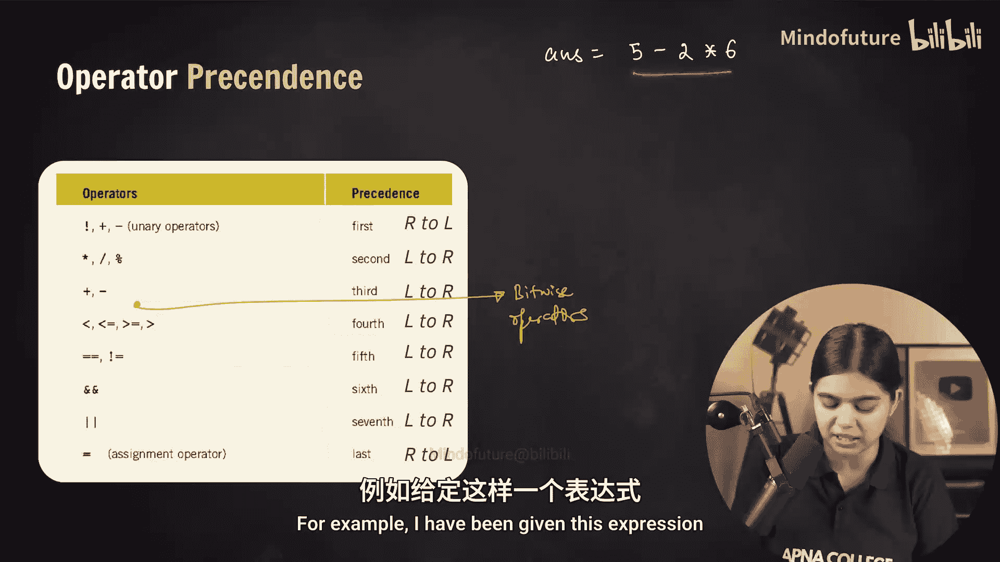
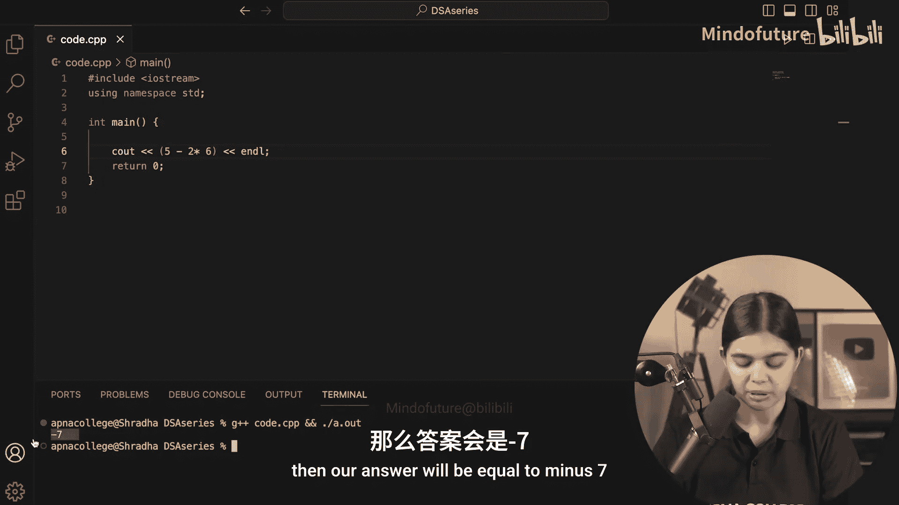
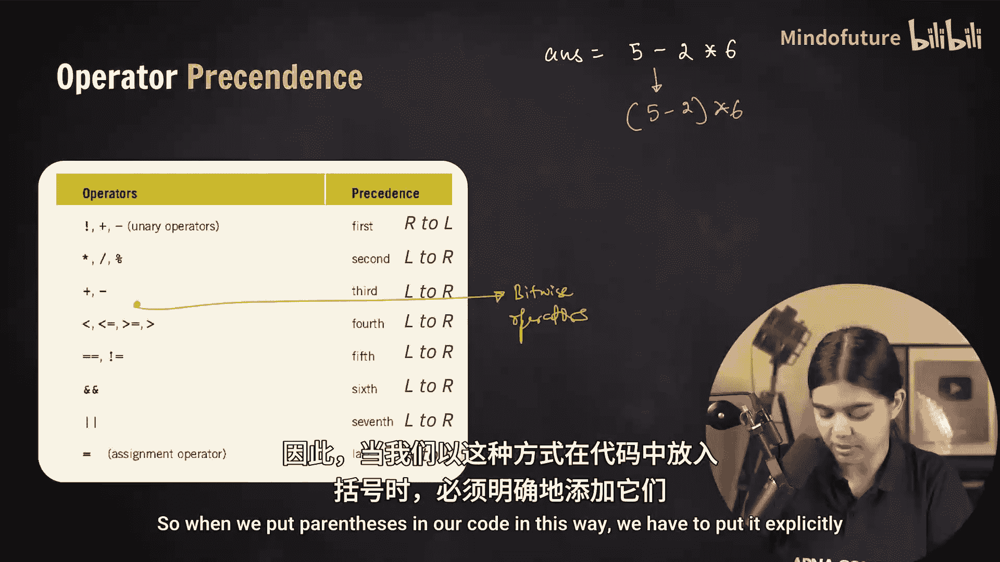
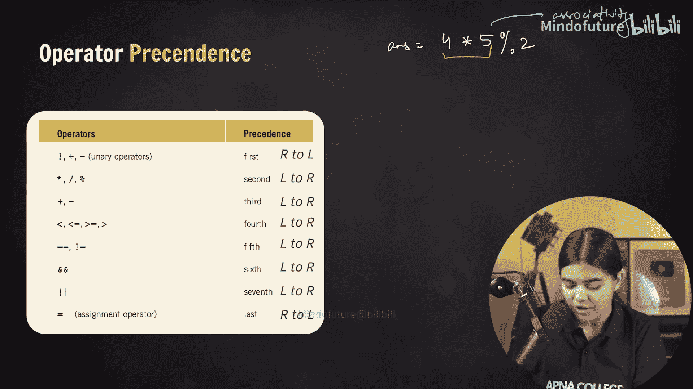
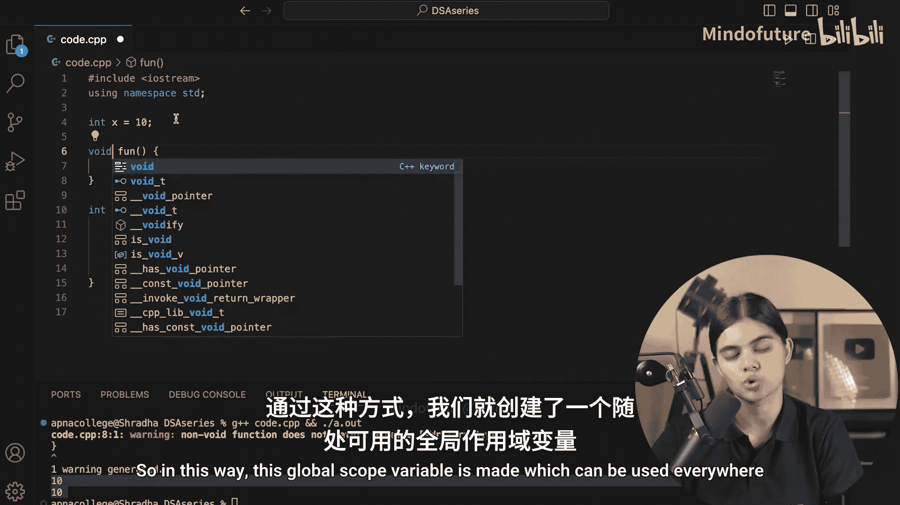
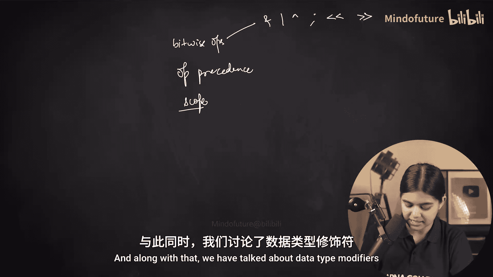

# C++ 数据结构与算法课程：P07：位运算符、数据类型修饰符及其他


在本节课中，我们将学习C++中一些重要的杂项概念，包括位运算符、运算符优先级、变量作用域以及数据类型修饰符。这些知识是理解更复杂程序和控制数据存储的基础。

## 位运算符

上一节我们介绍了逻辑运算符，本节中我们来看看位运算符。位运算符直接对整数的二进制位进行操作。它们包括与（`&`）、或（`|`）、异或（`^`）以及位移运算符（`<<` 和 `>>`）。

### 位与运算符（`&`）

位与运算符对两个操作数的每一个二进制位执行逻辑与操作。规则是：只有两个位都是1时，结果才是1。

**公式：**
`1 & 1 = 1`
`1 & 0 = 0`
`0 & 1 = 0`
`0 & 0 = 0`

**代码示例：**
```cpp
int a = 4; // 二进制：0100
int b = 8; // 二进制：1000
int result = a & b; // 结果为 0 (0000)
```

### 位或运算符（`|`）

位或运算符对两个操作数的每一个二进制位执行逻辑或操作。规则是：只要有一个位是1，结果就是1。

**公式：**
`1 | 1 = 1`
`1 | 0 = 1`
`0 | 1 = 1`
`0 | 0 = 0`

**代码示例：**
```cpp
int a = 4; // 二进制：0100
int b = 8; // 二进制：1000
int result = a | b; // 结果为 12 (1100)
```

### 位异或运算符（`^`）

位异或运算符对两个操作数的每一个二进制位执行异或操作。规则是：当两个位不同时，结果为1；相同时，结果为0。

**公式：**
`1 ^ 1 = 0`
`1 ^ 0 = 1`
`0 ^ 1 = 1`
`0 ^ 0 = 0`

**代码示例：**
```cpp
int a = 4; // 二进制：0100
int b = 8; // 二进制：1000
int result = a ^ b; // 结果为 12 (1100)
```

### 位移运算符

位移运算符将整数的所有二进制位向左或向右移动指定的位数。

**左移运算符（`<<`）：** 将二进制位向左移动，右侧空出的位用0填充。左移一位相当于乘以2。

**代码示例：**
```cpp
int num = 4; // 二进制：0100
int result = num << 1; // 结果为 8 (1000)，相当于 4 * 2
int result2 = 10 << 2; // 结果为 40，相当于 10 * 4
```



**右移运算符（`>>`）：** 将二进制位向右移动，左侧空出的位根据符号位填充（对于有符号数，通常用符号位填充；对于无符号数，用0填充）。右移一位相当于除以2（向下取整）。






**代码示例：**
```cpp
int num = 8; // 二进制：1000
int result = num >> 2; // 结果为 2 (0010)，相当于 8 / 4
int result2 = 10 >> 1; // 结果为 5，相当于 10 / 2
```

## 运算符优先级与结合性



理解了位运算后，我们需要知道表达式中各种运算符的执行顺序，这由运算符的优先级和结合性决定。

运算符优先级决定了在没有括号的情况下，哪个运算符先被计算。例如，乘法和除法的优先级高于加法和减法。

结合性决定了当表达式中有多个相同优先级的运算符时，它们的计算方向。大多数运算符是左结合的（从左到右计算），但赋值运算符（`=`）是右结合的（从右到左计算）。

以下是常见运算符的优先级（从高到低）：
1.  括号 `()`
2.  乘、除、取模 `*`， `/`， `%`
3.  加、减 `+`， `-`
4.  位移 `<<`， `>>`
5.  关系运算符 `<`， `<=`， `>`， `>=`
6.  相等性运算符 `==`， `!=`
7.  位与 `&`
8.  位异或 `^`
9.  位或 `|`
10. 逻辑与 `&&`
11. 逻辑或 `||`
12. 赋值运算符 `=`

**代码示例：**
```cpp
int result = 5 - 2 * 6; // 先计算 2 * 6 = 12，再计算 5 - 12 = -7
int result2 = (5 - 2) * 6; // 括号改变优先级，先计算 5 - 2 = 3，再计算 3 * 6 = 18
int result3 = 4 * 5 % 2; // 乘法和取模优先级相同，左结合，先计算 4 * 5 = 20，再计算 20 % 2 = 0
```

## 变量作用域

在编写使用多个运算符的复杂表达式时，理解变量的可见范围——即作用域——至关重要。作用域决定了在程序的哪些部分可以访问一个变量。

### 局部作用域

在函数或代码块（如`if`语句、`for`循环内部）内声明的变量具有局部作用域。它们只能在其被声明的块内被访问。

以下是局部变量的几个例子：
*   在`if`块内声明的变量，在`if`块外无法访问。
*   在`for`循环初始化部分声明的计数器变量（如`int i=0`），在循环外部无法访问。
*   函数内部声明的形参和变量，在其他函数中无法直接访问。

### 全局作用域



在所有函数（包括`main`函数）之外声明的变量具有全局作用域。它们可以在整个程序文件的任何地方被访问。

**代码示例：**
```cpp
#include <iostream>
using namespace std;

int globalVar = 100; // 全局变量

void someFunction() {
    cout << globalVar << endl; // 可以访问全局变量
}

int main() {
    cout << globalVar << endl; // 可以访问全局变量
    someFunction();
    return 0;
}
```

## 数据类型修饰符

最后，我们来探讨如何改变基本数据类型（如`int`）的含义和存储能力，这通过数据类型修饰符实现。

数据类型修饰符用于改变基本数据类型的存储大小和取值范围。常见的修饰符有：
*   `short`：减小存储大小和取值范围。
*   `long`：增大存储大小和取值范围。
*   `signed`（默认）：表示该类型可以存储正数和负数。
*   `unsigned`：表示该类型仅能存储非负数（0和正数），从而将负数的范围用于扩大正数的最大值。

**代码示例：**
```cpp
#include <iostream>
using namespace std;

int main() {
    short int smallNumber = 32767; // 短整型，范围较小
    long int bigNumber = 2147483647L; // 长整型，范围较大
    long long int veryBigNumber = 9223372036854775807LL; // 长长整型，范围更大

    signed int normalInt = -10; // 有符号整型，可存负数
    unsigned int positiveOnly = 10; // 无符号整型，只能存非负数
    // unsigned int errorVar = -10; // 错误：尝试将负数存入无符号变量

    cout << "Size of short int: " << sizeof(smallNumber) << " bytes" << endl;
    cout << "Size of long int: " << sizeof(bigNumber) << " bytes" << endl;
    cout << "Size of long long int: " << sizeof(veryBigNumber) << " bytes" << endl;

    cout << "Signed int with -10: " << normalInt << endl;
    cout << "Unsigned int with 10: " << positiveOnly << endl;

    return 0;
}
```



## 总结

本节课中我们一起学习了C++中几个核心的杂项概念。我们首先了解了位运算符（`&`， `|`， `^`， `<<`， `>>`），它们允许我们在二进制级别上操作数据。接着，我们探讨了运算符优先级和结合性的规则，这对于正确理解和编写复杂表达式必不可少。然后，我们区分了局部作用域和全局作用域，明确了变量的生命周期和可访问性。最后，我们介绍了数据类型修饰符（`short`， `long`， `signed`， `unsigned`），它们让我们能够更精细地控制数据的存储空间和取值范围。掌握这些概念将为学习更复杂的数据结构和算法打下坚实的基础。