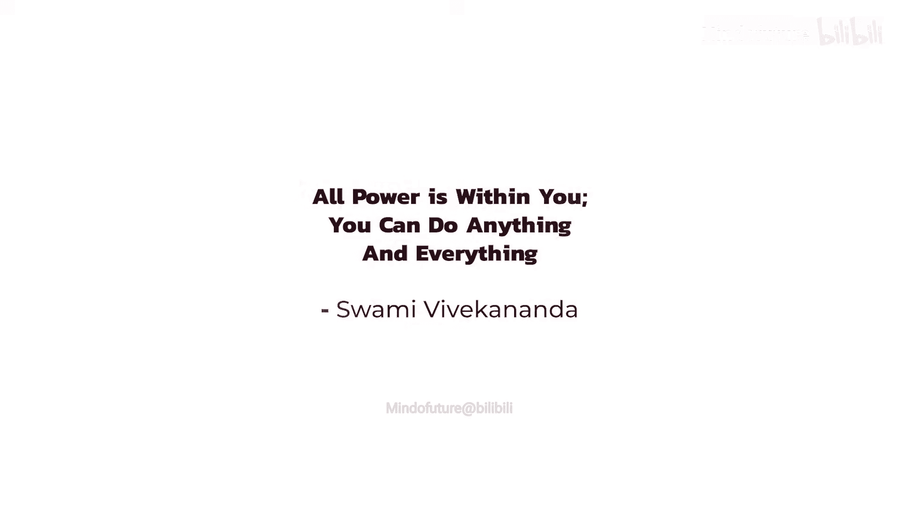
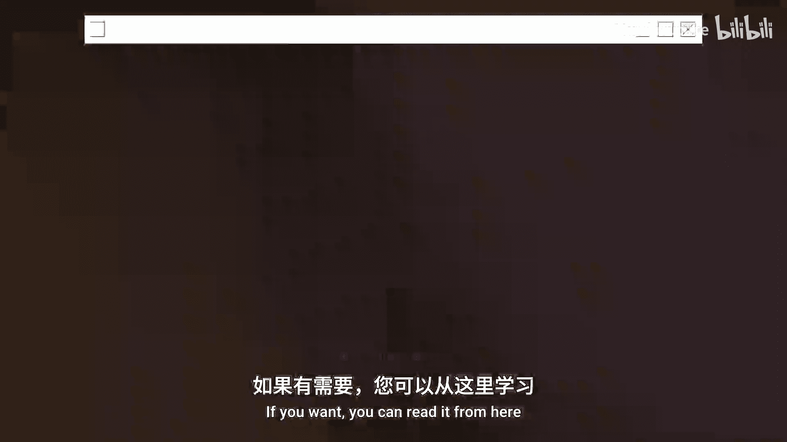
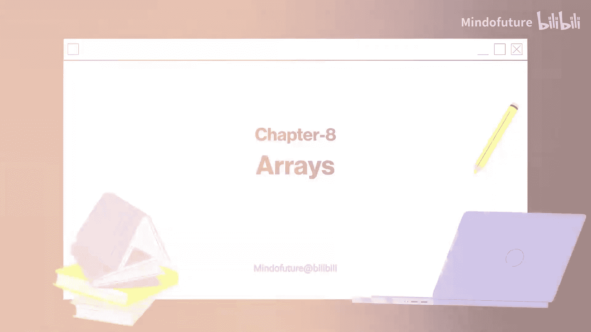
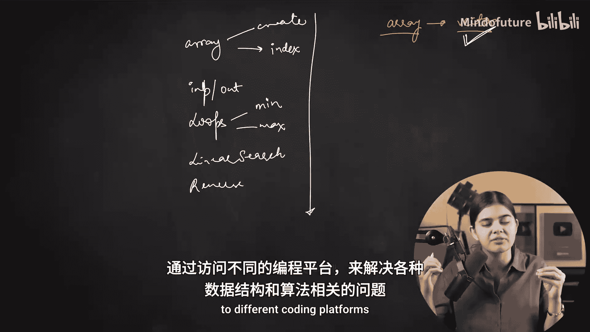

# C++-DSA课程-｜-数据结构-｜-leetcode-｜-Apna-College-｜--Complete-C++-Dsa-Course-p08-P08_数组数据结构-第一部分-DSA系列_由Shradha_Khapra老师讲解-C++语言--BV18oUGBkEmV_p8-

🎼Hi， everyone， and welcome to the complete D A series Juster Arju Kni of Nex chapter。

 which will be regarding Ees D A concepts May Ilavakuko Yobi topic V C Cha Cooperer is playlessra May availableja。

 Im trying to Yasi ja but set。😊。

Now， when we talk about arrays， it is basically the first data structure that we are going to study the J data structures and algorithms called value to sub John later what exactly are data structures and algorithm。

😊。

So when we talk about data structures。Data structures are basically structures in our code when we are programming。

 which are used to store data coding programming we will be able to build real systems real systems on is development coding programming basically coding programming in the form of。

😊，data structures can the store graph the the throughout the series。

 we are going to discover a lot of different types of data and also different types of data structures。

 I case me a core word Eme barbar Sunniga， which is algorithms。

Algorithms basically data U operations efficient operation perform Gne say， for example。

 see data structure saygarham data out Kna search Kna to search Kne processcom algorithm k Aga dataham sort Kna you say ascending a descending order may arrange Knapa algorithm different operations perform any operations go。

 we call our algorithms or throughout this series we are going to study a lot of different data structures and algorithms to。

 let's talk about what an array is， let's suppose par students。😊。

Marax store twin marks a existing C knowledge his at casesang obviously。

 variables could create carryingma marks1 variableja marks2 variable Ya marks three variable。

 and similarly， we are going to create five different variables that are going to store marks of five students perco situationari class and the studentsari class0 students took10 students can mark are going to create0 different variables10 different variables and problemse is going to be very hectic for a programmer to create hundred different variables。

 and secondly， it's going to be very difficult to track hundred different variables in a code。

 and that is why yeah numbers of0 pen for example， I Instagram Instagramari pass millions of users took user datam variable can storeang called problem resolve。

😊，ari pass E data structure E get giamkuch is the a structure build name。

 A quo is3 a visualizedtheme Gimku is3 structure build name。

 just because we imagine like a block of data。😊，And information and single Additionally in memory。😊。

plus also straight line structures。😊，Mox。Of size5 square bracketander。

 I need to convey the size of my to's very similar to creating a variable variable。😊。

single marks number of111 and similarly from 16。😊，or conuous continuous manner Then we need to convey and students students withs65 to65 with is equal to。

😊，And cur braces par values Sos suppose99， then hundred5436 and88 a box 990536 and 88s equal suppose price or 98。

995。7s make it of type double and a。😊，30。00 thin items automaticallyju price me sizeize 550 values already defined we can give a size。

 or if the size is equivalent into the data on the right side。

 then we don't really need to give a or initialize change K K use something。😊，Called every index。

Index position assigned fixed position position position par e first position par second par third fourth or logic4 loop0ki string position index0 in structure we need to start that loop from this index value0 us simpler loop。

😊，At index 0， a Mr a square bracket lacate or under index value Lith them to Matlaham is position gibakaam Ahamniligium marks at index 3。

😊，To Matlaham is position kba K E Cajo index him Hamishsha 0 sre size1 Tja This Eika s a5 k equal and last due index Oga。

 that is equal to 4an size -1 t by indexco use Caque code can in our marks E。

 we have created this mark E just may patch Hampas different different marks M。

 Im trying to C out Kect and K B position K marks。 Let's suppose Im0th position K mark C out K。😊。

An operaic and line be them。This case add me， I'm trying to sari positions K marks different。

 different index values go access curquet， print kva。😊，Tni upper Pri Karasriari Hamipas。

 Marx Ptoragi and Gijohama Mars bracket indexer is a basically ahamic single variable 기erate wheat them。

😊，Jil， let's suppose Mujijaar value change Ki mark 099 kjaga Ham Karijaar 101。😊。

s case warning is the end are to the error is before the beginning of writing。

Uber operations perform Carneula Hum。Loops k orus ham loop e index 0re index size1 to 0re size1 krua eikato generallyme already given ota in a variable called sizese calculate calculate kgi Let's suppose Mujis calculate。

😊，By writing size of to Isehamme pu Ea seizeeljaga。

 size of Mariaue Agahamipas ye Eem to ye E total Kianine bys of memory Occup Kt Hammeuska told sizeizeel Jaga。

 They say， for example， yejohama Eem is made 8 box，4 Bs of memory Occup ormaipas 5 indices him。😊。

To 4 into 5 Yaite 20 B ski memory Occup curai to Johama a size of mark say， a size of E。

 He basically hum 20 Bs printvaer bega is come veryfi We said them Agerham see out Kim。😊，Sa思。O。Mox。

Those case may we are going to get 202 to of， which is equal to5 divided by of generally equal to0 I less than plus or index number1 of2。

😊，And if we try to print to outputriri in the form loop。 lets suppose equal in fact。

 andriari input is equal to or of marks of basically variable input。😊。

Let's suppose ammjo value enter， it is 12，13，14，15 and 16。

 a branch value am enter key to yhi branch values a Marpa Ptoaragi is the ham E U loop or ak E Cajo index ak Eicajo index Bahanjaarm required operations could perform of next loops could use kta all based on Eries we have to find out the smallest and the largest number in an E。

😊，Example， Kiish Shiard myself from smallest number。 Find out Carringgi。

 just say let's suppose Hamippa yea hamak E you given her Just canander 5。 We have 15。 We have 22。

 We have1。😊，We have-15， and we have 24， different different values smallest value of smallest value smallest value smallest value index smallest value smallest。

😊，And is variable k initialize k with plus infinity plus infinity largest possible value largest possible in teacher values infin smallest smallest obviously comparison largest possibleri plusfinity programming underscore or plusfinfin。

😊，Lrgest possible value for any inteure number，um plus Infinity Kaanggi to Shiva Mahoni at the in maxi aip first index byjagi5 co compare Kaanggi5 Kojaam compare Kaanggi plus infinity obviously。

5 Choga oramitaga Yatoham Fel H ke Yani Agarhamra Jobiari numbers。 Then， let's call this E nums。😊。

Agar nus of Iq value is see be index by nus of Iq value， Agar Chotija。Smallest say。

 smallest nany Ju Tomi smallest co up date Kique Ki nus of I， I hopese plus infinity。

 the smallest Mja smallest mi Choja Jesehaari passja5。😊。

p next time 15 or1 1 less than14 which is to equal to。😊，Subseto。

 let's create an array called nus numky under Hamipas different， different numbers you havevo stored。

5，15，22，1，-15 and 24。😊，In numbers， the Mariipas told him is because size B south meiththium。

 size is going to be equal to 6。Agaham smallest niali。

 T say Kahiberggisi variable Gandarrum store Kaanggi。

 the smallest coham initialize Kaa with in to max。 Any positive infinity。

 Toic loop gelanga 4 in teacherer I equals 0， I less than size I plus less。😊。

Harbaram compared calling a U nus of Iq value less than Ha Hamari's mal。

Marav donno misss Jovi Shotagers smallest Sho chain mena nus of I Shoga T smallest key value update Hojagi to nus off I。

 and last mejaar Lu Kaharmononickibaam print kvaakte smallest。Is equal to。Smallest value end of line。

Sranpa-15 equal-15 k-24 those kme answer would-24。 So this is how we calculate the smallest value with the help of loop in and e or the smallest trying to large to sum of all values product of values basically Also a that is the min function basically called min and max numbers minimum min for example。

 Mu ins of I and smallest me Cho make min function implicit functionpa available the min function nu and smallest。

😊，minimum of these two values return。Triika Yame same answer Jovo return Kquedega。

 So this was the logic for finding the smallest value。

 Agahamil largest value Find out Kaya to Sari Tiizzogoba River Ki， basically。

 Ibarhamic variable laying it in teacherger largest。😊。

Js smallest co plus infinity initial Irajuse initializering up initializering with minus infinitykiham largest the sub0 possible value。

😊，Jb comparison Zio and minus infinity is int min in C plusness Yaer。

 we are going to write int min up int min Jo Ikem comparisons Kringgi。

 the Yaer Jem comparisons K for loopmi。 The smallest case are largest find out as max of。😊。

Numbs of I and largest。A last may smallest and largest donno cohan printer was。To basically largest。

 find out Kne Ki Mujiko Alex Loni Lavana， My single loop can there don no values could find out Ku。

Yuki eventually try smallest nial nowo Chi largest nikal now Ham Jto aic index for Rayna。

 though is particular Ale smallest value，-24gi， largest value of mypas 22 niel karagi。

 This thats smallest and largest values can find out kect。

 Yaberpa carque homework problem upku solve kia。😊，Basically， what you have to do is up smallest。😊。

And largest values。 This index per him。 whose index co print Carvai。

 So this is one thing that you have to do。 Key is value Je-15 smallest to muja-15 index J。

 which is equal to 4 to mujas 4 cova-15 covana y Ca values initialize carrying comparison to y problem there next study I pass by reference。

😊，A pass by value k already functions value pass by value per or pass by value primitive data types argument functions suppose main function x value 10 or main function a function co call which is change x is x highlight or value10 15 change main function pass by value I opposite which is pass by reference reference address。

😊，Or addresses you reference Kaura concept or other detail me pointas Viga。

 So when we talk about pass by reference， what do we exactly do pass by reference Maam pass by reference meuraurarajo data structure I M non primitive data type scale use Ktheem say E Jo。

😊，E non primitive dataitive programming original implic automatically。😊，Justse。

 lets take an example of a simple array in teacher E here Mariippa of size 3 g scan their values and 1。

2， 3。A Agahammni function Man am。Lets call it void change E change E canar Hamapas Ikinteger E Aga orcinteger Ehamassi Ia or hamkaingius function canar I equals 0 silire I less than s I plus plus ham upni E K index per value equal double King Sam King a2 into area  I。

😊，The Yaseham function called gettinggi up na change。Jage， Eddieddy。

Just can the Eri pass Kding in size past King S 3 and Yahaur am I it therikiai G Chalangi is a Eriki values Co K the Yahaur hum sea out Kraam。

😊，Yinmin。And。In function， the upper size Uja 3 k equal and the upper hum C out Kangna area of。I。

And ofkoamgi the interestingri original elements1，2。

3 for change e change element for a function valuesi main function pass byri original valueshi1，23。

 values update2，4 and 6， Ya change ei function main function reflect and I pass by referenceki internally internally。

😊，lic。😊，or function or functions change。😊，address。Ma Bki pass by reference go addresses pointers or other detail mapping pointers Valgi Next is concept came carrying it。

 This is called linearar search Linear search Iri Hamara Ielgo the Muai。😊。

I fixedel go of the linear serko Knega theriika fixed to them。 For example。

 Hamipas y Em I Ericho visualized because they the memory Eririgaander， we have different elements。😊。

8，1，2 and 5。 So the repa different different elements。😊，A디 you hub but。index values0，1，2，3，4。

56 that is equal to 7 value or operation co perform search operations suppose。😊。

1 basically is search search search。😊，overall linearp Bo simple logic， in fact， linear search Jo。😊。

Linear search， one of the most simple algorithms sub say easy algorithm programming key linearar search。

 Kutni Knahamm Luchelanna，4 integer I equals 0 I less than size I plus plus it loop Chii Abharban Mujazeek Knet Jahaper B mera area of I Ya Yahaper mera target exists Ktai。

😊，The check eagerly looking if my array of I。Equals my target。for example， if am on this amr。

Called integer。Lage。Search linear search may Ito Mariasar E plus Uerika Marips Saanle toham Ani Ericho create Car upper integer E is going to be equal to 4。

2，7。😊，E one。😔，2 n，5。 and is ca size n that is going to be equal to 2。

 The Yaham linearar search algorithmm Co call Kringgi ismna Eri andna S andpa Kringgi a visualm he is Sciahamic loop gelathium。

4 in teacherger I equals 0， I less than size。😊，I plus less。Kbi V Agahamara array of Iq value。

 Hamari target equal linear searchhammet target B， S Kna perdiga。😊，To a in teacher。Target B vanilla。

 which is going to be equal to 8 oripas called parameter target A area of I value target equalge value we have found the value and ask if we are going to return the index。

 which is equal to I， but poorluga Ph value Those case may return-1-1 indicates that we have not found the value the Jovi answer return Oga say linear search Koja callgi directly C out end of line Also size update K K K 7 I2ga 7 k equal is toippa index print to 3 k equal Similarlyly。

 let's suppose we want to search for this5。😊，The5 co search target those case we are going to get index。

 which is the last index of this array If we try to search for 50 case the students were already familiar with the concept of time complexity complexity and search complexityov complexity binary binary search complexity。

😊，this was all about we are going to talk about have given。😊，Uham visualize。

In the form of our structurene are to use something called In fact。

 logic In fact logic basically last position last position position similar second position second position。

😊，V a second position pageagei， similarly your third number per element time the third last position pageage。

 third last position v Aa to Ca。😊，ham and last element and and last and second third and third last and state。

😊，after swapping the pairs notice5，2，1，8，7，2，4， similar 5，2，1，8，7，2。

4ari problem positions position starting position8 position ending position third position fourth position。

Iing basically starting index starting index update starting index update to start variable variable to start variable Similarlyly last variable is end。

😊，Start or end basically in positions for track kne use Kgi or mayra Jo ending variable here。

 Uki value Gutilijagi。 Last May， ending value Cahe。 This is index 0，1，2，3，4，5， and 6。

 to ending value 6， A Ukeba next iteration May ending value 5 Ojagi Uskeba next iteration Ma ending value 4 Ojagi to mera end Johe W basically。

😊，Mi is size minus-1 a startto mu last index it。😊，Her mu plus plus or mu or。😊。

With array of and operation disbarba perform K swapping values at two different positions。

 E see2 pointer approach2 pointer and end a forward backward or swapneri the values swap start or end no same position pargi。

😊，Mla Etohamic， even Eika example Lily， even Sika example E orserika example。

 Let's suppose Maripa I Ejeander， char values him。 Mariipasic Ejeander， the values him。😊，Yap Yamiho。

 Yamiraho next iteration Mioga start Ya Rajaga and Yajaga next iteration Mioga， start to Ya Rajaga。

And Indiaya haajaga， to basically next iteration we start Job。

 Mumerri end Sebi Argonical Jaga Etoe Soai， Dua So Yeme。😊。

next iteration or even greater than equal greater than equal。

My start is less than my endp star value end Nato values original meeri overall approach to reverse an In fact。

 Iam dry and on an array is theriham1，2，3 and 4。😊，with value 0 with value equal to starting less than n less than per value and minus less than n is less n。

😊，minus j minus value value equal。😊，23，44，32 with this logic I same logicari。😊，Go candle。

 let's create a function。😊，White and I sayam k them river。Eri Res Eric Kra。

 we are going to pass our E。Along with the size of the area。

The two pointer approach here a sub hamic start when Anapera。

 The start is going to be 0 and end is going to be size -1 hamic loop shallang it Jep the kari start key value less than size Z。

😊，Do기。Equal to equal。😊，hammebna swana him。Aray of start go with array of end。Y。

 but start less than n ， not less than size。And start Ko herbaham Kinggi plus less in coham herba Karinggi minus minus the Yaapural logic who get to reverse scenario is function Kojam call Kringgi。

😊，Lets call reverse array， this scan now array past ring a and the size。

And Ferm print Gvani vne Eque elements function co call Kanekeba。😊。

Size I plus plus C out array of eye with some space。 An A， sea out calythium and of length。

originalita。😊，values23，4 and this particular logic time complexity is。😊，output。

majoritys use use chapter and different coding platform different data structures and Also at the end of this chapter I would like to give you some homework problems write a function to calculate sum and product of all numbers in write a function to swap the maximum and minimum number of write a function to print all the unique values in。

😊。

unique1，2，31，2，3 and basically Similarly and logical function to print of for example，😊，1，2，3，4，5。

 and Ura Arabia has 6，7，3，1。To Mu but1 comment scandal。

 you can also share your progress on Twitter discing weku description box scandal mi Jaga。

 ask your late Mil next lecture can tell them keep learning and keep exploring。😊。

