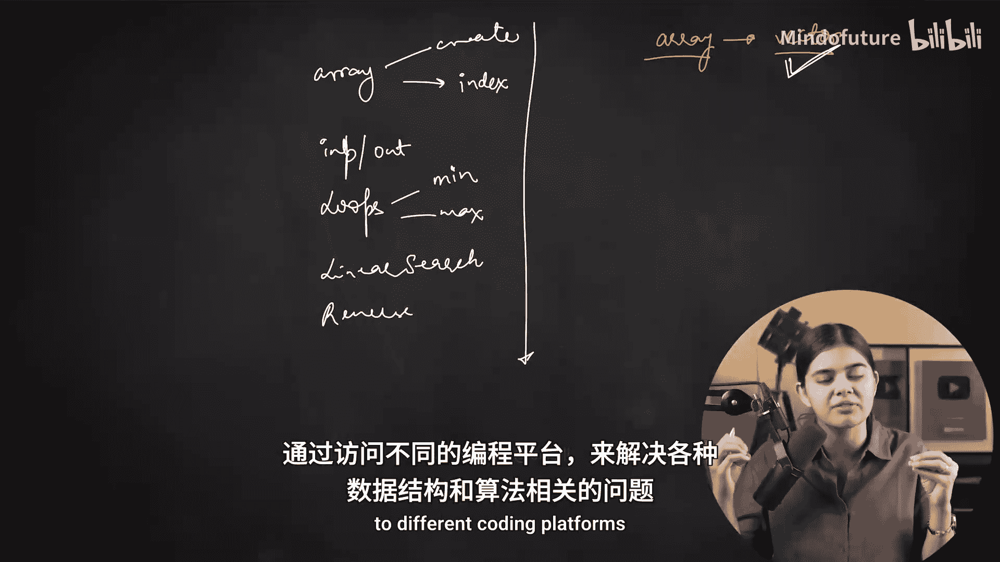

# C++ DSA课程：P08：数组数据结构 - 第一部分


## 概述


在本节课中，我们将要学习数据结构与算法的基本概念，并重点探讨第一种数据结构——数组。我们将了解数组的定义、创建、初始化、访问元素的方法，以及如何通过数组执行一些基本操作，例如查找最小/最大值、线性搜索和反转数组。

---

## 数据结构与算法简介

上一节我们介绍了本系列课程，本节中我们来看看什么是数据结构与算法。

数据结构本质上是我们在编程时用来存储数据的代码结构。通过使用数据结构，我们能够构建真实的系统。在本系列中，我们将探索许多不同类型的数据和数据结构。

与数据结构紧密相关的另一个核心概念是算法。算法用于对数据结构中的数据执行高效的操作。例如，在数据结构中搜索、排序数据（按升序或降序排列）等过程都依赖于算法。在本系列中，我们将学习许多不同的数据结构和算法。

---

## 什么是数组？🤔

现在，让我们谈谈数组是什么。假设我们需要存储五个学生的分数。利用现有的C++知识，我们显然可以创建变量：`marks1`、`marks2`、`marks3`……以此类推，为五个学生创建五个不同的变量。

然而，如果班级有100名学生，问题就会变得非常繁琐。程序员需要创建100个不同的变量，并且在代码中跟踪这100个变量也会非常困难。这就是为什么当数据量很大时（例如，Instagram拥有数百万用户，其用户数据无法用单个变量存储），我们需要一种名为“数组”的数据结构来解决这个问题。

数组可以被可视化为一个连续的数据块。它在内存中连续存储信息。我们可以将其想象为一条直线上的多个“盒子”。

---

## 创建与初始化数组

以下是创建数组的方法。

**语法：**
```cpp
数据类型 数组名[大小];
```
这与创建变量非常相似，但我们需要在方括号中指明数组的大小。

例如，创建一个存储5个学生分数的整型数组：
```cpp
int marks[5];
```

我们也可以在创建时直接初始化数组的值。

**示例：**
```cpp
int marks[5] = {99, 100, 54, 36, 88};
```
这样，五个“盒子”里就分别存储了值99、100、54、36和88。

如果我们在初始化时提供了所有值，并且值的数量与数组大小匹配，那么可以省略指定大小，编译器会自动计算。

**示例：**
```cpp
double prices[] = {99.5, 30.00, 45.5}; // 编译器会推断大小为3
```

---

## 访问与修改数组元素

数组中的每个位置都有一个固定的索引。第一个位置的索引是0，第二个是1，依此类推。要访问或修改特定位置的元素，我们使用方括号和索引值。

**语法：**
```cpp
数组名[索引]
```
例如，`marks[3]` 访问的是数组中第4个元素（因为索引从0开始）。

**重要规则：**
*   有效索引范围是从 `0` 到 `(数组大小 - 1)`。
*   尝试访问此范围之外的索引（例如 `marks[5]` 对于一个大小为5的数组）会导致错误。

我们可以使用循环来方便地访问所有元素。由于索引从0开始，循环通常也从0开始。

**示例：打印所有分数**
```cpp
for(int i = 0; i < 5; i++) {
    cout << marks[i] << " ";
}
```
这个循环将遍历索引0到4，并打印每个位置的分数。

我们也可以使用同样的方式修改数组元素。

**示例：修改第一个分数**
```cpp
marks[0] = 101; // 将第一个分数从99改为101
```

---

## 计算数组大小

有时我们需要知道数组中有多少个元素。我们可以使用 `sizeof` 运算符来计算数组占用的总内存字节数，然后除以单个元素的大小来得到元素数量。

**公式：**
```cpp
int size = sizeof(数组名) / sizeof(数据类型);
```
例如，一个包含5个整数的数组，每个整数通常占4字节，总内存为20字节。`sizeof(marks) / sizeof(int)` 将得到 `20 / 4 = 5`。

**代码示例：**
```cpp
int size = sizeof(marks) / sizeof(int);
cout << "数组大小为: " << size << endl; // 输出 5
```

---

## 数组输入与遍历

我们可以使用循环从用户那里获取输入来填充数组。

以下是使用循环获取数组输入的示例。
```cpp
int marks[5];
cout << "请输入5个分数: ";
for(int i = 0; i < 5; i++) {
    cin >> marks[i];
}
```
用户输入的值（例如12, 13, 14, 15, 16）将被依次存储到 `marks[0]` 到 `marks[4]` 中。

---

## 在数组中查找最小值与最大值 🎯

上一节我们学习了如何遍历数组，本节中我们来看看如何利用遍历查找数组中的最小值和最大值。

**查找最小值的逻辑：**
1.  假设第一个元素就是最小值。
2.  遍历数组，将每个元素与当前最小值比较。
3.  如果找到更小的元素，就更新最小值。

**代码示例：查找最小值**
```cpp
int nums[] = {5, 15, 22, 1, -15, 24};
int size = 6;
int smallest = INT_MAX; // 初始化为最大整数值

for(int i = 0; i < size; i++) {
    if(nums[i] < smallest) {
        smallest = nums[i];
    }
}
cout << "最小值是: " << smallest << endl; // 输出 -15
```
这里，`INT_MAX` 是C++中表示最大整数的常量。

**查找最大值的逻辑：**
逻辑类似，但我们将变量初始化为最小整数值 `INT_MIN`，并在遍历中寻找更大的值。

**代码示例：同时查找最小值和最大值**
```cpp
int nums[] = {5, 15, 22, 1, -15, 24};
int size = 6;
int smallest = INT_MAX;
int largest = INT_MIN;

for(int i = 0; i < size; i++) {
    smallest = min(smallest, nums[i]); // 使用 min 函数
    largest = max(largest, nums[i]);   // 使用 max 函数
}
cout << "最小值: " << smallest << ", 最大值: " << largest << endl;
// 输出 最小值: -15, 最大值: 24
```
`min` 和 `max` 是C++标准库中的函数，分别返回两个值中的较小者和较大者。

**课后练习：**
修改上述代码，使其不仅能找到最小值和最大值，还能打印出它们所在的索引位置。

---

## 按引用传递数组 🔄

在C++中，将基本数据类型（如`int`）传递给函数时是“按值传递”，函数内对参数的修改不会影响原始变量。然而，数组传递给函数时是“按引用传递”。这意味着函数内部对数组元素的修改会直接影响原始数组。

**代码示例：按引用传递数组**
```cpp
#include <iostream>
using namespace std;

// 函数接收一个整型数组
void changeArray(int arr[], int size) {
    for(int i = 0; i < size; i++) {
        arr[i] = arr[i] * 2; // 修改数组元素
    }
}

int main() {
    int myArray[] = {1, 2, 3};
    int size = 3;

    changeArray(myArray, size); // 传递数组

    // 打印修改后的数组
    for(int i = 0; i < size; i++) {
        cout << myArray[i] << " "; // 输出: 2 4 6
    }
    return 0;
}
```
可以看到，`changeArray` 函数内部对数组的加倍操作，直接反映在了 `main` 函数中的原始数组 `myArray` 上。这是因为数组名实际上代表数组在内存中的首地址。

---

## 线性搜索算法 🔍

线性搜索是最简单的搜索算法之一。它的逻辑是：从数组的第一个元素开始，逐个与目标值比较，直到找到匹配项或遍历完整个数组。

**算法步骤：**
1.  从索引 `i = 0` 开始。
2.  检查 `arr[i]` 是否等于目标值 `target`。
3.  如果相等，返回当前索引 `i`。
4.  如果不相等，`i` 增加1，重复步骤2。
5.  如果遍历结束仍未找到，返回 `-1` 表示未找到。

**代码示例：实现线性搜索**
```cpp
#include <iostream>
using namespace std;

int linearSearch(int arr[], int size, int target) {
    for(int i = 0; i < size; i++) {
        if(arr[i] == target) {
            return i; // 找到，返回索引
        }
    }
    return -1; // 未找到
}

int main() {
    int numbers[] = {4, 2, 7, 1, 9, 5, 2};
    int size = 7;
    int target = 7;

    int result = linearSearch(numbers, size, target);
    if(result != -1) {
        cout << "元素 " << target << " 在索引 " << result << " 处找到。" << endl;
    } else {
        cout << "元素 " << target << " 未在数组中找到。" << endl;
    }
    // 输出: 元素 7 在索引 2 处找到。
    return 0;
}
```

---

## 反转数组 ↩️

反转数组意味着将数组元素的顺序完全颠倒。我们可以使用“双指针”方法高效地完成这个操作。

**算法思路（双指针法）：**
1.  初始化两个指针：`start` 指向数组开头（索引0），`end` 指向数组末尾（索引 `size-1`）。
2.  交换 `arr[start]` 和 `arr[end]` 的值。
3.  `start` 指针向后移动一位（`start++`），`end` 指针向前移动一位（`end--`）。
4.  重复步骤2和3，直到 `start` 不再小于 `end`。

**代码示例：反转数组**
```cpp
#include <iostream>
using namespace std;

void reverseArray(int arr[], int size) {
    int start = 0;
    int end = size - 1;

    while(start < end) {
        // 交换 start 和 end 位置的值
        int temp = arr[start];
        arr[start] = arr[end];
        arr[end] = temp;

        // 移动指针
        start++;
        end--;
    }
}

int main() {
    int myArray[] = {1, 2, 3, 4, 5};
    int size = 5;

    cout << "原始数组: ";
    for(int i = 0; i < size; i++) {
        cout << myArray[i] << " ";
    }
    cout << endl;

    reverseArray(myArray, size);

    cout << "反转后数组: ";
    for(int i = 0; i < size; i++) {
        cout << myArray[i] << " ";
    }
    // 输出: 原始数组: 1 2 3 4 5
    //       反转后数组: 5 4 3 2 1
    return 0;
}
```
这种方法的时间复杂度是 O(n/2)，可以简化为 O(n)，是一种高效的反转方法。

---

## 总结与课后练习 📚

本节课中我们一起学习了数组这一基础数据结构。我们涵盖了数组的创建、初始化、访问、遍历，以及基于数组的几种基本操作：查找极值、线性搜索和反转数组。我们还理解了数组在函数中按引用传递的特性。

为了巩固知识，请尝试完成以下练习：



**课后练习题目：**
1.  **计算和与积**：编写一个函数，计算数组中所有数字的总和与乘积。
2.  **交换极值**：编写一个函数，找到数组中的最大值和最小值，并交换它们的位置。
3.  **打印唯一值**：编写一个函数，打印数组中所有不重复（唯一）的值。例如，对于数组 `{1, 2, 3, 1, 2}`，应打印 `3`。
4.  **查找第二大的数**：编写一个函数，找出数组中的第二大元素。

你可以将你的解答和进展分享到Twitter或课程讨论区。继续学习和探索，我们下节课再见！