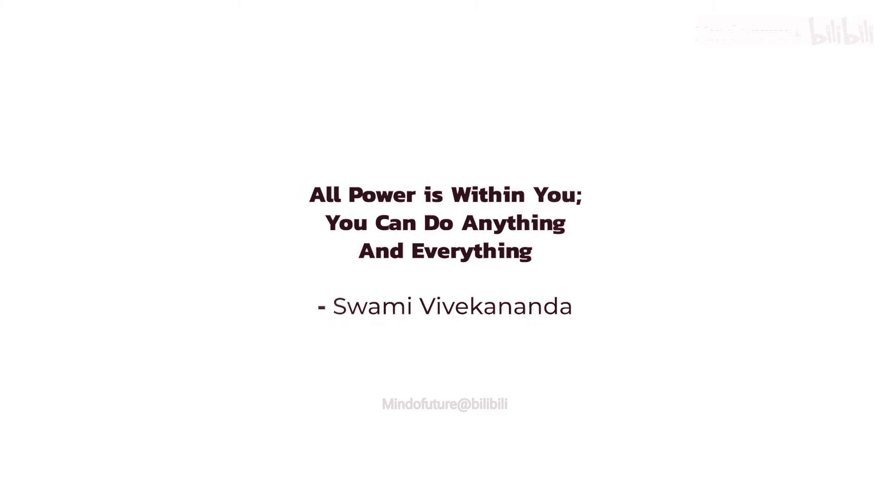
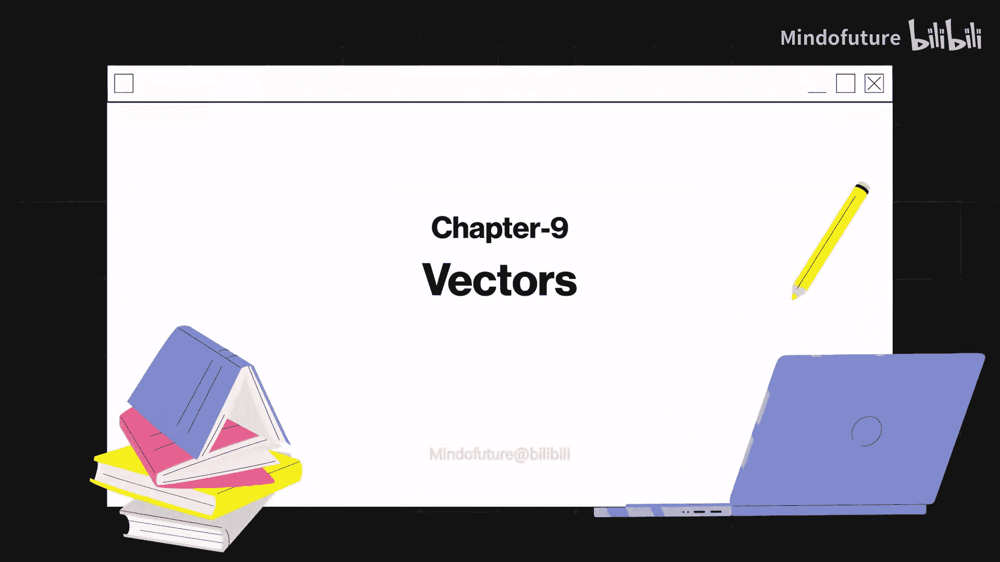
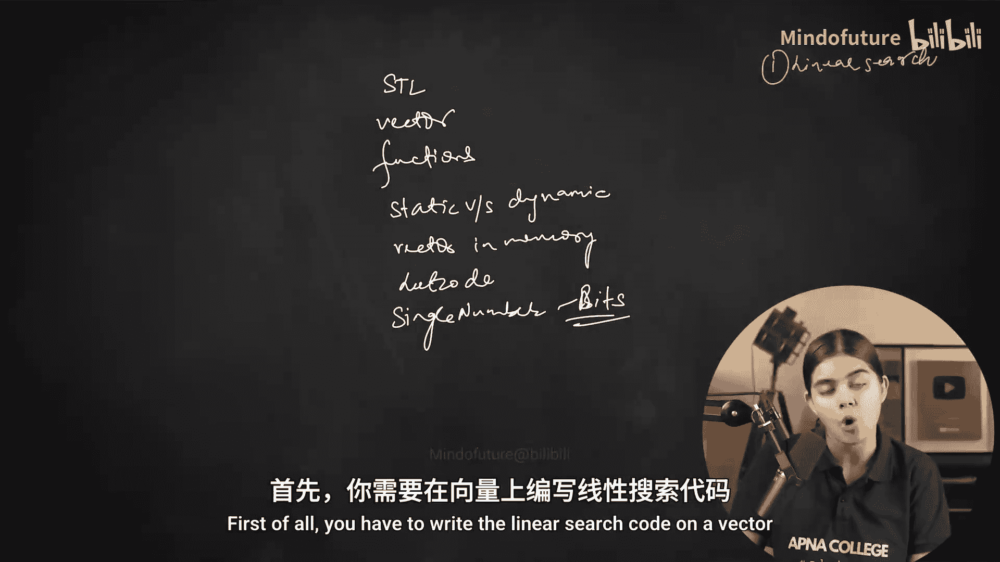

# C++-DSA课程-｜-数据结构-｜-leetcode-｜-Apna-College-｜--Complete-C++-Dsa-Course-p09-P09_C++中的向量-数组第二部分-DSA系列_由Shradha老师讲解-第九讲--BV18oUGBkEmV_p9-

🎼Hi everyone and welcome to the complete D series to。😊。

So let's start talking about vectors。Vectctors basically hamra next data structureium detail megi and this data structure is very array like B call E is visualize ktheea to visualize kul is made different different blocks withparum data toium and Ume we also have inices or indexes like arrays vector co visualizetheium but vectorium vectors a dynamic in nature dynamic in nature in fixed size ne incas change y major differencei between arrays in vectors vector importme which isest。

😊，Esteel Hohi has standard template， library of C plusless。

implementation usage is important placement interviews。😊，Containers So sub first Et Con kbarrime。

 which is a vi。😊，A vector Gner already discussed Kaco Bill Colham Ericrigiar imagined Car。

 but Ericganander。😊，implementation default。are starting to learn error。😊，Vectctor of。

 let's suppose 0。 those case， ma'am。Haip is thega， which is called segmentation fault segmentationneki vectorne or equals123 y of print1 print。

😊，This is equal to one。 Also one more thing you might be noticing k command can many additional cheese extra。

 which is hyphen standard is equal to c plus 11 important terminal 11 Ive written this flag in my command equal1232 equal value of vector。

😊，And second value would take her a index per K value each to jam is the R sne vector co defined carryinga to hamak T sizeika vector vinegarga。

😊，And her a index per valuejas tojagi0 k equal。 Ham is saidte me Garakam。

 If we create a vector of size 5 or S me harm values initialized current toham C out kasak vector of 0 and similarly。

😊，This will be vector 1，2，3， and4。The Marpa Sarigiari values to torangi was 0 equal vectorky U from generally special type car loop hence is a create curtain。

 which we call a4 each loop。😊，How does it work， Hamlik 4 And for can the Hammni vector Kaamkte。

 Let's suppose Hamari vector Kaam have V E C and left side may hammic iterator like for Ibarhamraju iterator He。

 If we use an iterator like I R G to I index value sing Karaam Ibar Ierator。

 Hamari vector K a K index produced stored value H who the value co Karaa Ya Ibar I is not the index。

 but the value on the index itself。 Just say， for example， Ya per Agarhammli de int I。😊。

To I canander Hamishsha， whose index per stored。Value anval is a testium。You say， for example。

 Yahaur， if we decide to use a for each loop， tokeogramm like the in I Ham andkybane Vector Kam and her bar sea out Kvane Iko。

And。AMipasari values 0 equal aqua printertojangi。 in fact。

 a core example Li is but let's create a character vector This scan from which characters goes through grani valueium。

 Mariipas A Ajaga will get B。😊，C。😊，D and E。😊，Size print carvaana toham simply carrying a C out。

Size equal to。I'm Li to vector dot size。😊，hamah function cocal this sayapasas I B tojaga。

 which is equal to 5 Ya per Ugar a character， Kohamia。😊，Toaris seism might change ajaga。

 and size is going to be equal to 4。 You see thatri is aapas a call function with a called pushback。

 Let's suppose hownic empty vector create Kia。😊，Yhaa， is the E we have created this empty vector。😊。

is equal to 0t。😊，Push underscore back function。 just say Hamari vector can last my aka element push overjaai just say initially vector ca sizes 0 to Jse hamku element push carrying a Hamra vector1 size carbonbojaga or just scan。

 let's suppose how many values to key 25 to 25 value a tojagi。

 So let's push back 25 andkeba a a a core bar me size comp after push back。😊，Ymaraai Oga。

 let's clear this and run。is after push type in2 to elements235 and 45 is equal22 function called programming。

😊，4。😊，Let's print this Sras size 3 the Ligan 25 and 35 print2 I be 45 internalary memory said detoa。

😊，Ikvapa call function， which is called front front klaki vector K starting any front page of value here Bjase loopcoga and C out Kaim。

😊，Victor dot front。The Hamipas front value was Igi。Which is going to be 25。

 I C3ica say Hamip pass back quota domain in last value return calculatedta to last value a 35 last value 35 is I Q45 co delete the other。

 and Hamrias E core function with there， which is called at function。

 at is basically another syntax for accessing a value of a particular index。 They say， for example。

 li vectors of some index I， we are going to get I index value。

 E equal co alternate threeika vector dot at。😊，In diie。

So this is going to give us the same value vector dot at 0 those say0 with index he value minuspa printtojagi which is equal to 25 if we want to look at the value at index 1 it is going to be 35 if we want to look at the value of index 2。

It is going to give us an error Why the error， because index number two vector or additional functions we are talking about and in fact its not relevant for us now might make plus one shot for all the functions。

😊，Next， we are going to talk about static versus dynamic allocation of memory。

 Basically is section canderam vki is theriz a vectors internally memory can implement to them Jb memory them Aas dorikiki memory E static memory。

 static memory allocate Hojaier compile time。😊，To in of size compile time stagesil stage compiler run checks for syntical errors properly included compile second stage static of memory is basically compile time dynamic of memory。

😊，R execution basically compile run function and generally。😊。

see logic we are to reim in the vectors call in static and dynamic allocation static allocation functionap。

😊，Static allocation stack memoryri， it is getting created inside the stack itself。

 Li in dynamic allocationap memory In fact Jovi memory dynamic to interview and dynamic the differences compile exampless dynamic memory exactly vectors memorys of in。

😊，To Hamippa x0 s vector creator Matas kander， Jaham is vector canander first time pushback curingi co element。

 Let's suppose Hamme pushback y value 0。😊，To Hamari pass a vector0 value jaju a object next time。

 Hammi E element pushback cur。 Let's suppose pushback here。😊，internal second。

pushback2 co I is said double is or basically property property number of。property and。😊。

The canander co elementing Ukiba vector canander， we are going to push back some values sub0 co push back here from Ne one co here and。

Yga Iba outaiis。Which is going to be equal to 3。And capacity function of capacity print and vector first second internally or do and2 and。

😊，The y don line Lineogram， size co kangi sizeius is going to be equal to 5 capacity is going to be equal to 8 could be verify cur name but though or humm name。

😊，Pushback statements， thee for3 and4。To is ver size aus 5 k equalligigga capacity， aus 8 k equal。

The same values So this is how vector works internally in the memory magical magical internally automatically which is。

😊，Online platforms practice important practice you are going to get better at concept3。

hard level problems given a nonemp area of integer writes or coding this is very normal every element appears twice except except for one element that。

1，2，1，2。😊，To see Eric Co Erogarham， array is 4，1，2，1，2。be equal。basically Jo+ containers with them。😊。

C plusus container muam Jse vectoria vector X C plusus container He Jabiamminko functions may pass herthe Ihamisha by default。

 pass by value them。😊，Liham changes is function meho reflect pass by value pass by reference。

 said Pa or pass by referencejo original。Original copy copy스코jo original vectorctor。

I basically alias name name ori original is why thispers is used to pass with reference main function we start solving I would advise is about time and space complexity for interviews。

😊，number equal。😊，problem problem and-4 plus basically or plus1 plus212。😊，😊。

W could duplicate me the hour。But ache he number head do unique him。

numbers operator operator operator and operator。10 plus2 and11。

Uus see number k at exling it to Hamishsha value0 equalli to Agarham Ericriander stored in numberkybakaring。

in，for example， the numbers have4。 we have1。14001 equal0 equal and100 is equal to unique element0。😊。

Numkaander her a vector per lulangi or herbar answerkajaga answer Miujiharri index exorna to answer will be equal to answer k exoringge next index per next index Matla yjo Val to her a value k。

😊，Exor Finally you answer isari valuesgi last unique value say return return loop is linear runtime complexity value condition follow constant single answer constant this is our function basically initial4 loop in teacher ins。

😊，Answer is going to be answer， ex value， and finally return Caringham of answer saysel quo quo run Carnegie quotius Carhen。

😊，What is a vector different functions static versus dynamic internal solve question。

Second key is a reverse co code linay on a vector or use reverse cocoana if function millignni。😊。

function solve。😊。