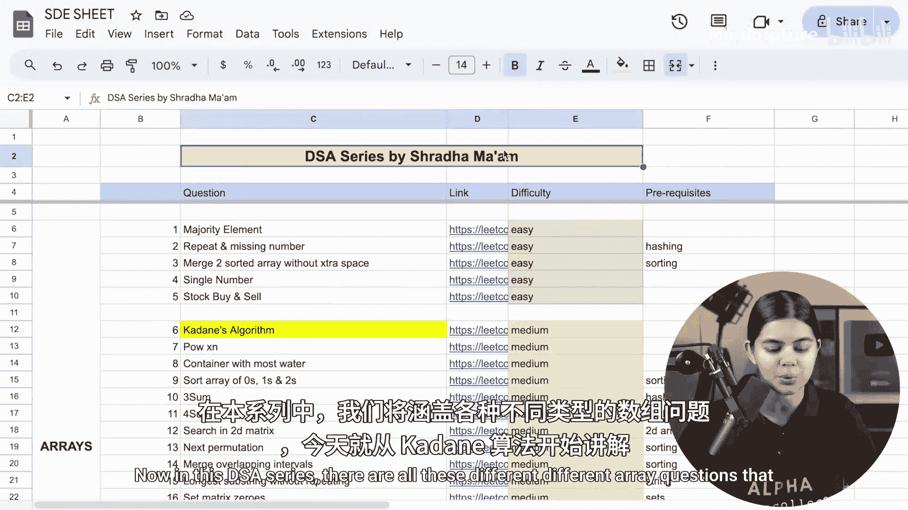
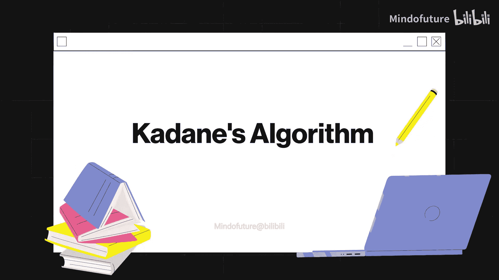
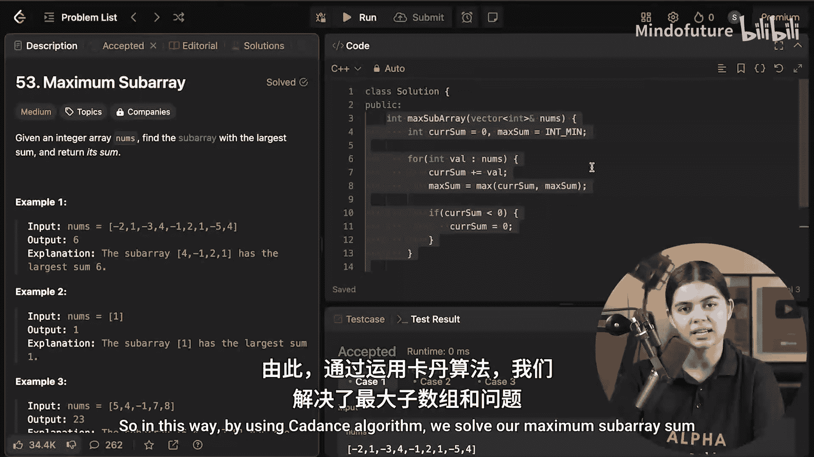
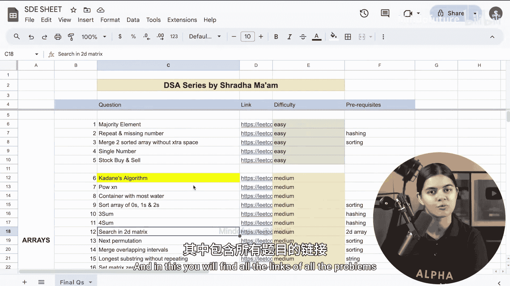

# C++-DSA课程-｜-数据结构-｜-leetcode-｜-Apna-College-｜--Complete-C++-Dsa-Course-p10-P10_Kadane算法-最大子数组和-DSA系列_由Shradha老师讲解--BV18oUGBkEmV_p10-

Hi， everyone， and welcome to the complete DSA series。 And today。

 we are going to solve the question of maximum sub sum using caan algorithm Ab is DS series can a different different e question cover me seriesju algorithm structures and is going to be very inep concept playlist available。

😊。

maximum is question the exactly brute and then we are going to solve the same question using algorithm。

 which is the most optimized approach brute when we talk about is continuous part given continuous for example。

 this element is also set of three elements is also is also a continuous part continuous elements。😊。

1，2，ja 2，3，3，4ja，45，4，5，3 elements 1，2，3ja，2，3，4ja，3，4 inja4 elements， 2，3，4，5ja and5 elementsuraja。

 all possible Sa。😊，Is particular， a mathematically is nai thosek total number of sub arrays n into n plus1 divided by25 k equal to the total number of sub arrays should be 5 into6 by2。

 which is equal to 155 plus 4 plus 3 plus 2 plus1 this number is also equal to 15 given basically。

 when we talk about， we know it's a continuous part of is starting and ending is starting an endingja for example。

 Mu。 this index is equal to1 or this index is equal to3 given sub Muja her possible start or possible n。

😊，0 x sub0 0 Matrus start 0 k equal to0 single element8 sa1 to0 or1。n12 n-1 to basically n。😊。

This loop is going to start from start。And Juta class than N he herbaram kterani and Co plus plus。

Toari and simply loop dismissari elements print is particular loop convert to print all of our print start is less than n in teacher our end is going to start from start n less than n plus and a nest I is equal to start。

😊，Sty。I less than equal to n I plus plus。And Herbarham Kval E of Iou， which is part of our sub。

In fact， in upperquei space Bni them。Yab X space print。

And end of lineariva we run thisari first lineari second index index second index third indexari concept originalgi。

 which is maximum sum basically given is particularari。😊。

is equal equal Similarlyly we obviously knowju15 equal total number1 right could8ari。😊。

maximum simple simple programming brute or。😊，Q equal under core optimization to bring this time complexity from n cube to n square time complexity concept on students time in the brute force approach itself starting point。

😊，different ending points basically is next for example。

 is next time basically or basically the approach is third is。😊。

Hum simply upn start mealling start a bathroomam upne variable banassene called current sum。😊。

Sid 3 or-4 Ca sum with already calculated M J5 qua35 aga to total 4 k equal3 say J J start same Helic endjaja andja to sum E of N value of current sum or J current call variable called max sum final answer called to max sum will be。

😊，Maximum of k sum and maxim。 or finally， Jobiim is last me as our final answer toari brute force brute force approach changes nikijo calculate or some calculate additional optimization third loopi values already calculated brute force approach let us clear this。

😊，And these。Tohamic variable to variable is going to be maxum maxim Koham China to intimency initialized k。

😊，Yjagaippa cur sum K sum startoga0 upcur sumko hambar0， say yaur under Ki initialize Kse Naya。

 Let's suppose Ya to Jesegabar initialnaga0 and Yahambar sumki v E of en。😊。

And max sum is equal to maximum of current sum。And maximum。The last mehem Pri Kvaingi， Jobi Hamri。

Maximum。So very is some기 value here。Equal to max sum。

Safe andra the maximum 15 equal and calculate basically is core optimized which is called next to solve the problem of using given orantu intuitiontu answer。

😊，negative logic。less example equal to and or。equal n。😊。

Haami Ar Gali Abna Eriov Iko and for Max some say。Compare B Gnai maxam say compare k kringgi Jobi max of current sum and maximga answered kjajaga and a girl made a cur sum less than 0 Ho tobar cur sum kringa 0。

😊，Eri initialization Qura Yukiurani value k be answer can the Arinioka overall answer negative A to current sumcom0 initialized curcee and max sumco initialized curum with int min。

😊，exactlyfin equal equal sum equal equal。U add to valueja9 k equal9 equal compare a max say to max Bja 9 k equal we value negative ne for minus1 per minus1 per to8ja 8 equal compare a all but I。

😊，Next index update， Karinggi 7 Ajaga 7 add Kringgi to8 plus 7。

15 ojaga 15 go9 C compare Karinggi to Yahaperipas value Ajagi 15 k equal。😊。

Next index51 answer logic0 sum calculate basically1 calculate。😊，at reason。😊，Yval。

 given an integer E nus， find the sub with the largest sum and return its sum。 tomii upperhamme。

 instead of vector given here toqueanelgom Kissimi current sumlini equal to 0 andme max sum Lichni equal to integer men。

😊，Where hammock loop shall sec vector per hammock 4 each loop sheange in teacherger value。In nums。

Lop can the subs eium of a current sum go calculate current it。 The current sum is equal to。

This value is given about the maximum who calculate carrying a is equal to maximum of current sum and max sum。

And Uskebaham reset vakam agarhamari current some key value less than 0 here。

 Those case may current sum Korea re initialize carate 2 0。😊，And finally。

 last mayamm return Guingevne Mac Sam quaazar final answer。

 Yahamara overall codehoia or his code ca time complexity here。

 that is equal to big of n Y a linear time complexity And the Savallore， which is most optd。😊。

Say I run。submit can also analyze complexity which is equal to a type of programming programming programming。

structure overlap，access。

