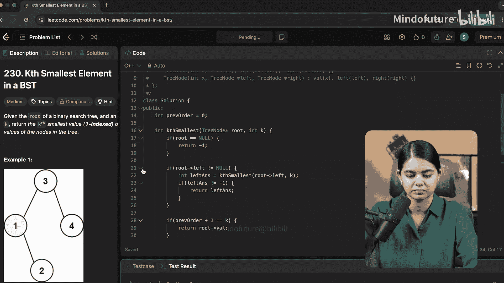

# C++-DSA课程-｜-数据结构-｜-leetcode-｜-Apna-College-｜--Complete-C++-Dsa-Course-p100-P102_二叉搜索树中第K小的元素-DSA系列_-L.100--BV18oUGBkEmV_p100-

Hi everyone and welcome to the complete D series。 And today we are going to solve one more BS problem。

 which is called K smallest in a BSslist scanner available。

 Also there is a link for a company in the description box。

 This problem is called Ks smallest in a B This is also problem 230 on lead。

 and this is very similar to one more problem which is called K largestku solve similar strategy。

 this is how we are going to solve the problem。 Basically given k smallest value could returnna from this function。

 This is the function that we have to complete。 For example， Yaha。

 lets suppose Kki value4 equal within our BS we know that this is the first smallest element。

 This is the second smallest element。 This is the third smallest element and this is the fourth smallest element。

 for K is equal to4 returnna that is equal to4 B K smallest。😊，Imentco calculate curect。

Kunnaham imagine Kariki Kisi Terriki say Agarhamipasi saari Kisari Betijo knows him for sorted order me ajai to Jbi data sorted order mayutai。

 It is very easy to find the smallest or the largest value。 Basically。

 Agarham Iirika sorted order li So that will be 1，2，3。😊，4。

5 and6 and we know fourth number per traverse that is going to be smallest can count which tra traverse basically in like traverseverse。

😊，but it is also essential to no order order is equal to second order equal basically what we is use global global and basically will equal。

of my order variable co create to track the order of all of the notes。 Uski asked me。

 how exactly are we going to track the order， Basically。

 agramm sorted Yeah in order to veral gibakaim Tos me is theippa notes arrangement Iga Cam case thanky Ko B note。

 Let us suppose Yvaljo No is order。😊，If this is equal to some value x next value node order x plus this will always be x plus2。

 and this will always x plus3 root node sequence plusement first of us look for。😊。

basically should be this is basically storing order previous order equal is value equal is equal4 this value is equal one。

order update by we can call it order， or we can call it previous order The next iteration is equal previous order is1 plus1 this is not equal to is equal to case iteration is equal to is not equal to iteration writes previous order is3 plus is equal to4 j which is the root or。

😊，we are going to return -1 to indicate that the solution hasn't been found yet。

 The upper final order mi， which was equal to 44 return 3 per right sub U4 return U level4 return order perform sub agar sub valid answer we are going to return the valid answer。

 because we don't need to check further root or right sub after up the previous order。

 So how is the entire pseudo going to look like basically pseudo canme simply in order。

Tversal Kelly Klikn。Tkti I variable Banasne， let's call it previous order。

 disque initialize King Zequeat Ukimi Hamriasik function Hoga in teacherger。

 Let's call it kith smallestcaanderipasari Roe and Ukiami， we have the key value。😊。

Up in order k sub Hamra base caseja agar kbibi root key value is equal to null。

 T case meham answer exists Niraham returni -1-1 indicatesna answeripas left sri node exists Ka we are going to make the call for the left Sri left Sriki callgi to k smallest call for root k andkam kbi pass left sayas left answer value Agi Agar left answer key value。

😊，Is not equal to -1。 Justka Matla here， for example。

 in 5 per caium left sayippaio answer value Igi that is equal to 44laki 4 I answer left K mich Matla k smallest already michai So Hammiko has such extraper kneru Hamhi say he return upneil left answer key Val go。

 So this is the。Entire logic for traversing the left sub。

 Uskeba Ham upni current value K checking it A previous order plus 1 becomes equal to k。

 Those case may Hammi Hamari ye condition Johe Voyragi to let us remove this line。😊。

And put this condition here。Tohamme subse Ani Kran node Kekaai。

 and next iteration Ke hammne previous order， Kouaringge previous order plus 1 k equal。

 to yvo Kmhead Johamne root level per kin。 This is the cam for the left su in in order toveral。

 This is the work that we are doing for the root node。 Let us try and minimize this a bit。😊。

And finally， last mejaar， yim Kahammeru k right K Kna Agarruka right upri exist Ktai。

 Those case Mahamm right， answer co calculate Karingi right answer Kli kith smallest khamm callgani by passing routeka right。

😊，And Ukia me Hammaari K value。Ugar right answer canander。Hame-1 Nahiilta。

 Those case may Yahi sayhiham return Guheni Ane right answerque Valluo。 So this is the logic for the。

Rights up to。A sub valid answer。 we are going to return thisme valid answer value return right say valid answer right answer return per valid answer Milta。

 which is the K smallest value Those case may at the end。

 We are just going to return minus1 to indicate that we haven't found the answer yet。

 So this is the entire logic of finding the K smallest in a time complexity Ho that will be the time complexity of in traersal which is big of an any linear time complexity solution Now。

 let us convert the pseudo code into C plus sub variable create。 let's call this previous order K0。😊。

Agarari root key value Nll。 This is the base case。 Those case may be are going to return-1 to indicate that K smallest W and-1 value here is usebme already given heari value negative in case negative values allowed answer global variable can in the form of a pointer B are going to make the call for the left sub root key left。

Note is not equal to null。 Those case may will get the left answer by calling kith smallest。

This is the same function that we have to call。For root car left and the K value。

If left answer is not equal to -1， whose case may hum return Kdingi left answer go as the final answer。

 Now though Hamm me root value K checking a root valueki check Kala agar previous order plus1。

 becomes equal to K。 Those case may be found the answer at root level。

 and we are going to return root key value。 Nahito previous order。

 Koham update Kingi to previous order。Plus one for the next iteration。

 and Yahi same come Hamab me writes upre occurring。 we are going to make the call for root car right。

😊，Jassese Hamipas， write answer Aa and Isebi compare Kique Hamasi Cha to return k。 And at the end。

 if we don't find the answer， we are going to return a -1 value。

 So this is the entire logic for solving the problem。 Let us run our code。We can just update。

In teacherger。Values。Let us readrun the code。And submit it。

So this is how we solve the problem of finding the case smallest in a B S D。

 If you have successfully completed today's lecture， you can mark your tennis down in the comments。

 I case Ha me can also share your DSA progress with me on Twitter justcu Kakunische description box。

 can their mill Ja Ask 89 Mil next lecture can tell them keep learning and keep exploring。😊。

