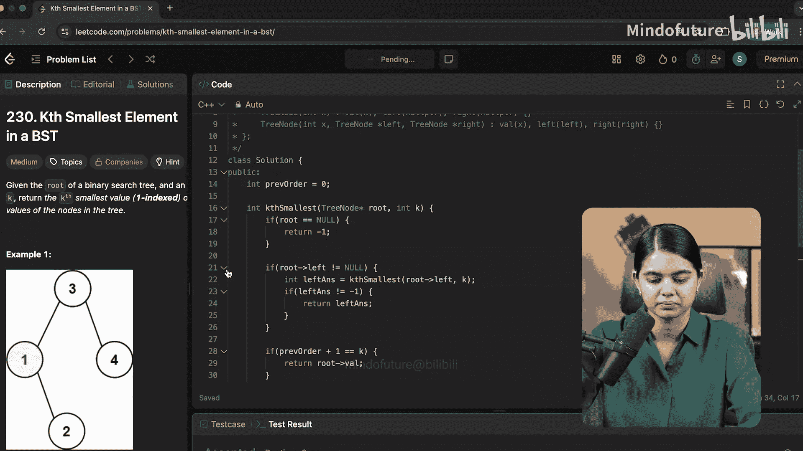

# C++ DSA课程：100：二叉搜索树中第K小的元素 🎯


在本节课中，我们将学习如何在一个二叉搜索树（BST）中找到第K小的元素。这是一个常见的数据结构问题，我们将通过中序遍历的策略来解决它。

## 概述

给定一个二叉搜索树的根节点和一个整数K，我们的目标是找到树中第K小的元素值。二叉搜索树的性质是，对其中序遍历（左-根-右）会得到一个升序排列的节点值序列。因此，第K小的元素就是中序遍历序列中的第K个节点。

## 解决方案思路

上一节我们介绍了二叉搜索树的性质，本节中我们来看看如何利用中序遍历来定位第K小的元素。

核心思路是执行中序遍历，并在遍历过程中计数。当我们访问到第K个节点时，返回该节点的值。

以下是实现此逻辑的关键步骤：

1.  定义一个全局或引用传递的计数器，用于记录当前访问的节点是第几个节点。
2.  递归地进行中序遍历：
    *   首先递归遍历左子树。
    *   然后访问当前根节点。计数器加1，并检查计数器是否等于K。如果等于，则当前节点值就是答案。
    *   最后递归遍历右子树。
3.  如果遍历完整棵树仍未找到第K个节点，则返回一个表示未找到的值（例如-1）。

## 伪代码与实现

以下是上述思路的伪代码描述：

```cpp
// 全局变量或通过引用传递，用于记录中序遍历的次序
int count = 0;

int kthSmallest(TreeNode* root, int k) {
    // 基准情况：如果节点为空，返回-1表示未找到
    if (root == nullptr) {
        return -1;
    }

    // 1. 遍历左子树
    int leftResult = kthSmallest(root->left, k);
    // 如果在左子树中找到了答案，直接返回
    if (leftResult != -1) {
        return leftResult;
    }

    // 2. 访问根节点
    count++; // 计数器增加
    if (count == k) {
        return root->val; // 找到第K小的元素
    }

    // 3. 遍历右子树
    int rightResult = kthSmallest(root->right, k);
    // 如果在右子树中找到了答案，直接返回
    if (rightResult != -1) {
        return rightResult;
    }

    // 如果左右子树和当前节点都没有找到，返回-1
    return -1;
}
```

## 代码解析与优化

让我们将伪代码转换为实际的C++代码。为了不使用全局变量，我们可以通过引用传递计数器。

```cpp
class Solution {
public:
    int kthSmallest(TreeNode* root, int k) {
        int count = 0;
        int result = -1;
        inorder(root, k, count, result);
        return result;
    }

private:
    void inorder(TreeNode* node, int k, int& count, int& result) {
        if (node == nullptr || result != -1) {
            return; // 节点为空或已找到结果，则返回
        }

        // 遍历左子树
        inorder(node->left, k, count, result);

        // 访问当前节点
        count++;
        if (count == k) {
            result = node->val; // 找到第K小的元素
            return;
        }

        // 遍历右子树
        inorder(node->right, k, count, result);
    }
};
```

**代码说明：**
*   我们定义了一个辅助函数 `inorder` 来执行中序遍历。
*   参数 `count` 和 `result` 通过引用传递，以便在递归调用中共享和修改它们的值。
*   一旦 `result` 被赋值（即找到了答案），递归函数会提前返回，避免不必要的遍历。
*   时间复杂度为 **O(N)**，在最坏情况下需要遍历树中的所有节点（当K等于节点总数N时）。空间复杂度为 **O(H)**，其中H是树的高度，由递归调用栈的深度决定。



## 总结

本节课中我们一起学习了如何在二叉搜索树中寻找第K小的元素。我们利用了BST中序遍历得到有序序列的特性，通过一个计数器在遍历过程中定位目标节点。这种方法直观且高效，是解决此类问题的标准思路。理解并掌握这个算法，将帮助你更好地处理与二叉搜索树相关的查询问题。