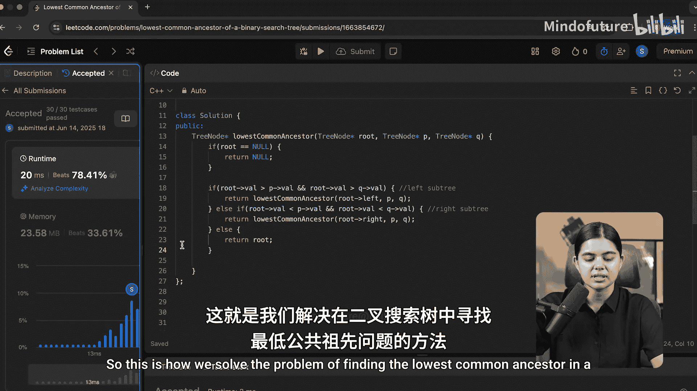

# C++-DSA课程-｜-数据结构-｜-leetcode-｜-Apna-College-｜--Complete-C++-Dsa-Course-p101-P103_二叉搜索树中的最低公共祖先-DSA系列_-L.101--BV18oUGBkEmV_p101-

Hi， everyone， and welcome to the complete D A series。

 And today we are going to solve an important DA problem。

 which is called lowest common ancestor in a B S D。

 Abiscal Avameval K ofham' playlist canar available in Nojaga。 Also。

 there is a link for a company by D sheet in the description box to start Catepni Savalath is Saval Kriic binary search Any B S T given him and will also be given two notes。

 P and Q。😊，Jph， for example， Ya P Hamme given her as 2 and Q given her as 8。

 tohamme in don no notess Ka up near B S T K and the lowest common ancestorianni El Si co find out her name。

This is also problem 2，35 on function complete will two node lowest common ancestor exactlycestors selfcestorcestorcescestorcestors fromcestor were studying about is already covered in a lecture use and different approach。

😊，Just say， for example， a different example Let them。

 Let us suppose is where P Hamap pass has 0 k equal and  Q Hamip pass a 5 k equal。A P and cucuum。

If this is P and this is Q Ham common ancestors made2ga toha2 is going to be L。

 because this is the common incestor at the lowest level。

 So this is the lowest common ancestor for these two nodes binaryary search a lowest common incestor outne properties who use basicallykiri lesser values P and commoncestor out basically or will have to track all of the ancestors of those nodes example pt ancestors through is a hierarchical structure。

 we cannot directly find the ancestors。cestor that the lowest common ancestor is going to be the first node。

Haari Dono k dono P and Q Valley Nordes exist Ka Hamraelsie， basically Wahi Nortohogi。

 justca subre canander P and Q dona exist Kem left and right， subre canander A P and Q exist Kgi。

 That means this is the first nodejo Un ancestral level per common Ben。

 and this is going to be the answer。 I come China to a core example， Lete。

 Let us suppose Agarhamrili， this is P。 and this is Q。😊，U S node k sub P and Q don exist cur。

 So6 is that node k left subme p K right sume Q exist LC B LC problem basically first node do sub P and Q don exist cur。

I core examplerisco subject let us suppose P7 Q9 S node scan P Q dont exist。

 but it is not the first node。 The first node from the leaf level is this8 node left and right node exist basically we have to find that first note。

 just scan P and Q values S nodeja P Q properties P Q node we can compare these values with the root note。

Let us suppose Agarani S kia Tohamme Pathammi P and Qai Mala 0 and 5 Q to 0 and 5 co subs compare Klingi k0 and 5 Qki donoki value 6 Le he。

 smaller head。 Tohamme guaranteed Paki P and Q left subpriche under he exists Kringkalae writes subriki Jo a completely discard Kect。

 So this is the first case to answer exist Kkala Q Agar root key value is greater than Py value。😊。

And root key value。Is also greater than Qki value。 whose caseme guaranteed Abnajo An Wne left Sche undermega。

 to basically asm left Sriche recursive call Sri Jo answerme returnquega。

 That is the answer that we have to return back。 So this is the first case。 And in fact。

 Iika opposite case， we exist K Mala Pki value 7 and 9 those caseme though no values greater than Rujagi Malahamjo An guaranteedme right Sriche underga So Iika second case hejaga。

😊，Else， if the root。The root value becomes less than peaky value。

And the root value becomes less than cuki value。 Those case may Hamrajo answer here， that will。

Exist in the right sri call。 and the right Sriki returnedgi same for the call to6 P and first caserikimriki Q first case。

hi second basically this will be a third case third case， ja。

hamra P Uke left side may exist Kta and Hamra Q Uk right side may exist Kta Kahi Agarham first node Sja Jaha Hamari E node left sume exist Korea E node right supri may exist Korea。

 This is the exact condition for being an L C lowest common incestor Wahi just node a Spri andari E node exist Kagi Sri second node exists K to Kabi Agahampa third case Atai。

 which is basically the L case to Yahaham return K directly up knee root co as the。😊，L C。

 so this is the final answer that we have to return to 18 cases and basis per hammne LC C equal find out K basically2 becomes the L C to Yhi say I2 value return King。

6 Kne left sub set2 I to 6 B upne main function code to return Kigga and 2 is our final answer is come China to a core example。

 the exact。 Let us suppose。😊，That p is equal to 3 and  Q is equal to 5。

 Those case may will start with 6，6， saym3 and5 co compare values2 say3 and5gi second case Sa Then we are going to make the call for the right4 say3 and compare case second case4 is going to and return return8 exceptional case。

😊，Which is the case。 Ja P Q may say a L。 For example， if p 6 and Q is 9。

 9 k ancestors may 6 is the first commontor existcestors which is given in the question。

 Those case may co return as an answer。 O is already handled in our conditionsm  co So this is not lesser in value6 equal and greater6 compare condition which is equal to6 So this particular case P Q that is already handled by our else。

 So to convert these conditions in a simply function complete let us call this function node pointer return root。

😊，mipas P value here， Herapas Q value here。 So these are the three cases。 Ginkoham handle， Kna Chate。

 let us resize this。To basically the first cases， the Ugar Hamari values lesserhem。

 toham A Srikii will callelsie forrukaha P and cukupa Ki and Jobias left Sri returnaikoham functions return Ki same cheese ham writes Sriki El。

 if Ugar writesriki call Hamid Jobis returndegi。L C， A function， say， Hvahi same value。

Upne level say return Girling。 and else Valley case may， we are simply going to return the。

Root as the。Final answer。 Aper obviously base case exists。

 Karigaki Kabi R B S T is an nu value Ya Hukii leave Nor for Ponja。 those case may。😊，Kbibi。

 if the root becomes equal to null。We are also going to return a null value as the final answer。

 So this is the overall function jkohamne Kki is function kar her a level per。

 We are making a call to either go towards the left sri or to go towards the right sri to Yaper。

 the worst case time complexitypari traversekiriju time complexityja that will be big of height。

 And in case of a balanced B S T。 This is going to be big of login to let us convert the pseudo code into C S code。

 So this is the function that we have to complete I canar subse， let us write the base case Kibi。😊。

Root key value， agar Nlojaia， whose case me， we are also going to return null value。 Ne though。

 Ham subary first condition checkering a U root value is greater than。Bs value。

And root value is greater than Q's value。Those case may， we are going to return。

Whatever will be the answer from the left sub call Tommyyapa root Kle Pas K P Pa Ki and Qpas Kgi。

Same conditions。 Sam liy hair upp knee writes uprechelia。

The other root key value becomes less than peak key value and becomes less than Q key value。

 those case me。This is the condition for the left sub。

 and this is the condition for the answer being present in the right sub。

The Yahasam returned Kardingi， lowest common ancestor。

Ju write subreche there exist Keriga for P and Q Neto Hammaarael vlaakeai。

 key lowest common ancestor Hamari root note Hot。 Those case maym rootko return Kinggi。

 This is the overall logic diskky basis bymerigiri Savalgo So ke。 Let us run the court。😊。

And submit it。So this is how we solve the problem of finding the lowest common ancestor in a binary search tree。

 if you have successfully completed today's lecture， you can mark attendance down in the comments。

 I repeatcestor that is also a conceptually very important question can also share a progress with me on Twitter next lecture keep exploring。

😊。

