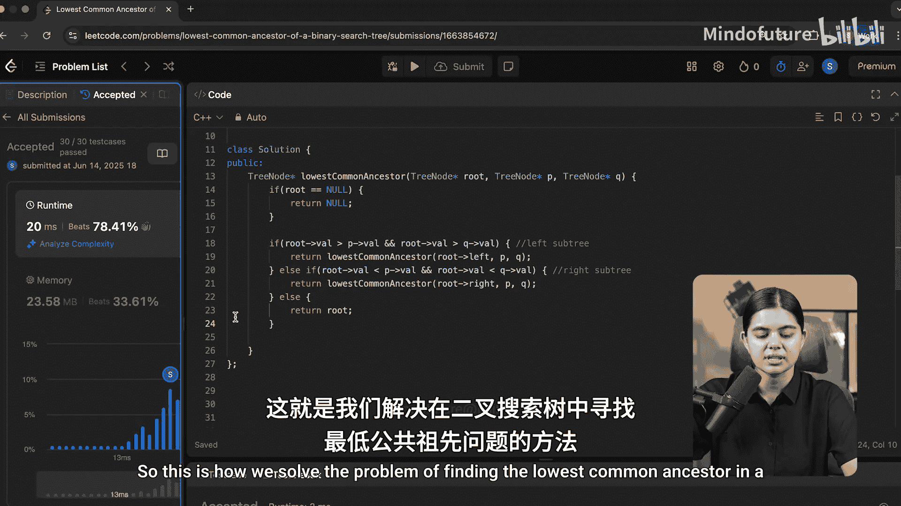

# C++ DSA课程：101：二叉搜索树中的最低公共祖先


在本节课中，我们将学习如何解决一个重要的数据结构与算法问题：在二叉搜索树中寻找两个节点的最低公共祖先。这是LeetCode上的第235题。我们将利用二叉搜索树的特性，以一种高效的方法来解决这个问题。

## 概述

最低公共祖先是指在一个树形结构中，两个指定节点共有的、深度最大的祖先节点。在二叉搜索树中，我们可以利用节点值的大小关系来简化寻找过程，无需遍历所有祖先节点。

## 问题定义

给定一个二叉搜索树的根节点 `root`，以及两个节点 `p` 和 `q`。需要找到 `p` 和 `q` 的最低公共祖先节点。

例如，在下图中，节点 `2` 和节点 `8` 的最低公共祖先是节点 `6`。

## 核心思路

寻找最低公共祖先的关键在于找到第一个节点，使得 `p` 和 `q` 分别位于该节点的左右子树中。在二叉搜索树中，我们可以通过比较节点值来快速判断搜索方向。

以下是判断逻辑：

1.  如果当前根节点的值同时大于 `p` 和 `q` 的值，说明 `p` 和 `q` 都在当前节点的左子树中。因此，最低公共祖先必然在左子树中，我们应递归地在左子树中搜索。
2.  如果当前根节点的值同时小于 `p` 和 `q` 的值，说明 `p` 和 `q` 都在当前节点的右子树中。因此，最低公共祖先必然在右子树中，我们应递归地在右子树中搜索。
3.  如果以上两种情况都不满足，则意味着当前节点恰好是第一个将 `p` 和 `q` 分隔在左右两侧的节点，或者当前节点就是 `p` 或 `q` 之一。此时，当前节点就是我们要找的最低公共祖先。

## 算法实现

根据上述思路，我们可以将其转化为代码。以下是该算法的C++实现。

```cpp
TreeNode* lowestCommonAncestor(TreeNode* root, TreeNode* p, TreeNode* q) {
    // 基础情况：如果根节点为空，返回空指针
    if (root == nullptr) {
        return nullptr;
    }

    // 情况1：p和q的值都小于根节点值，LCA在左子树
    if (root->val > p->val && root->val > q->val) {
        return lowestCommonAncestor(root->left, p, q);
    }
    // 情况2：p和q的值都大于根节点值，LCA在右子树
    else if (root->val < p->val && root->val < q->val) {
        return lowestCommonAncestor(root->right, p, q);
    }
    // 情况3：当前根节点即为LCA
    else {
        return root;
    }
}
```

## 复杂度分析

*   **时间复杂度**：`O(H)`，其中 `H` 是树的高度。在最坏情况下（树退化为链表），复杂度为 `O(N)`。在平衡的二叉搜索树中，复杂度为 `O(log N)`。
*   **空间复杂度**：`O(H)`，主要是递归调用栈的空间消耗。

## 总结

本节课我们一起学习了如何在二叉搜索树中寻找两个节点的最低公共祖先。我们利用了二叉搜索树节点值有序的特性，通过比较节点值与目标值的大小关系，将搜索范围快速缩小到左子树或右子树，从而高效地找到了答案。这是一个概念上非常重要且实用的算法问题。



