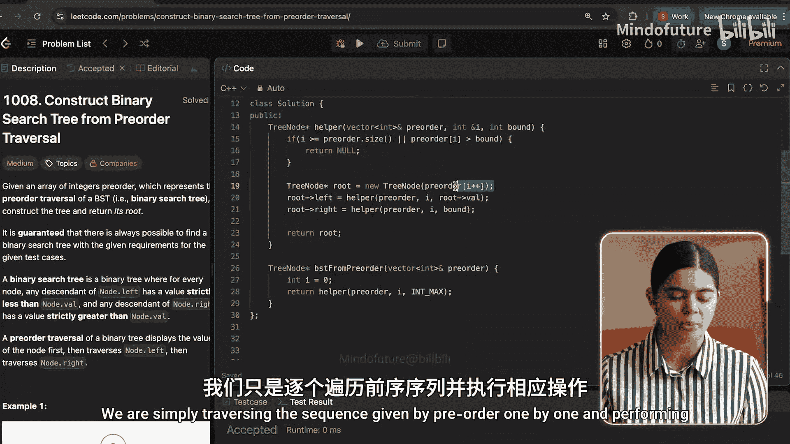

# C++-DSA课程-｜-数据结构-｜-leetcode-｜-Apna-College-｜--Complete-C++-Dsa-Course-p102-P104_根据前序遍历构建二叉搜索树-DSA系列_-L.102--BV18oUGBkEmV_p102-

Hi everyone， and welcome to the complete D series。 And today we are going to solve one more important BST problem。

 which is called construct a BST from preor sequence。

 Abisca avagamy Co Saval Ks play canner available mijaga。 Also。

 there is a link for a company D sheet in the description box。

 The startval This problem is called construct B S T from pre order sequence。

 Saval can Mariic array given him。 just make a binary search treeca pre order sequence given it So we can also visualize our array like this。

😊，Haari numbers is3 we have 6，3，1，4，8 and9 is given sequence complete construct This is also problem 10。

08 on lead code and function complete sequence that is given to us in the form of vector and we have to finally return the root sequence sequence sequence root and write So it is index per value This is going to be the root of the root which is equal to sequence and right as。

😊，Eric k there is no clear boundary Kaariura anda writesrias though different approaches agenium discvalium subli approach is the brute force approach。

😊，Rte force approach， canander。Hame Pattaki y hamipas different different nodes and g BSt kander exist ktier So hamka kringgi。

 brute force kander， Ham akic value score1 by one upni BStander insert Kna start kringgi。😊，Jesse。

 if this is the root of the tree values or a node to insert3 to position is less than 6 to insert are to move on to1 key position insert are going to compare 4 is smaller than greater than3 to are to insert the next node greater than co insert in the right Then we are going to compare  co greater greater to 9。

😊，is brute force complete over exactly we。Basically。

 Hammipaakki Hamappas preorder sequencer is my first node is always going to be the root of the drill。

 A Yahaa problem。 Aipasiki Bakiki notes khamipas bifurcation Niki Kapa left Sri Kara and Kaer right Sristartoura。

 the Yahaa B S T properties for use carrying， basically。😊。

Agarari route B property k left may Sarikiari smaller values Janni and rightari larger values jani and the left and right s though Agar leftri minimum value could be could be minus infiniteity per largest jome6i because6 is the root。

😊，Write subrekiba k to y minimum value，6 body he on and largest value k be it is going to be plus infinitefinity The Jpi B propertykibaname B sub arrangethe Jorange Hamri root kpa dependthe and Ii special property use Kne basically agararipa Pri sequence given him。

 We are going to recursively。😊，B our in the p or the sequence itself。

larisri upper bound pass lower bound pass， whichever we prefer to for the sake of simplicity upper bound pass upper boundhamri maximum value bound for example。

 if we look at the dryran， we are going to start with the root。😊， in fact， a variable lelete。

 let us call this variable I I is equal to0 start kneja start kham pre order sequence preor sequence ktamisemi rootbel。

 the rootbelne， hamni current node coier as the root of the tree and Oskeba ham subse 6 k left subriconegigi。

 we already know that the sequence is going to be root。😊，Left。And right。

The but recur upper which is the maximum possible value given hand are to be that value is going to be equal tori as and less values less basically。

😊，values and conency values3 is definitely less than6 insert we are going is less than what are plus and。

😊，is not less than one and we are going to right is is also is。

Le than three4 is not less than three that is three is less than Similarlyly。

upper bound is generally plusfin similarfin。😊，Max value to 6 k right subpreme8co insert k 8 is less than infinity 8 co k by 8com insert k I plus 8 k left subreco to 8k left subric the upper bound is going to be 8。

😊，Is 9 less than 89 is not less than 8 to back write sub write sub upper bound which is plusfinity to9 cofin9 is and i plus sequence back and back So this is how we are going to build our entire in the pre sequence sequence upper bound for the and sub do we exactly convert this entire logic into function lets call this function build build。

😊，also need an itator I function called incr to basically I value 0 ho value1 ho2345。😊。

I I variablelingi jse initialize Kaneval has0 k par I say by reference pass Kinggi Taki haik function call karham same I iterator value function kar we are also going to have an upper bound value。

😊，G say hum initialize Kname ahem plus infinity kar。

 so this is the function that we are going to build a this function canhammi pre order sequence co follow Knai preor sequence co follow subham me root node co root node co Kbe we are going to create a node star root。

😊，Just scan the hum a new node go build Car game。From pre order。

eration us call this is going pass sequence。😊，pass the same bound and this is the call for right right and finally is。

😊，Upne root key value。 So this is the overall preor logic disk basis army。

 we also have to write the base case base caseari， though sub base casega this case may no。

 That is the case。ari bound key condition Bokey conditionbe Agar pre order。😊。

Of I key value becomes greater than the bound value。

 Those casem simply return kang me call basegari I valuevo updatetetetete complete preor sequence quo cross k Matabari a Iq value becomes greater than。

😊，Or equal to my preor。Size or preor length inno cases k function say return So this is the condition for the case node and right nodene node So this is the situation So this is our base case。

 and this is the entire logic Now let us convert this entire pseudo into is the function that we have to complete function single parameter given we have a lot of different。

😊，It helper function create kav value。😊，With the return type。As this， lets call it helper。

 just candle the Etohamipa Samap pura Prior de sequence Jaga。Oki Ame Hamri pass I integer Hoa I。

 which is going to track the index and will have an integer bound value。

A helper function go call Kgi Prior sequence Pa in teacherger I3 Kle index I just initialize K0 k and for the bound value。

 we are initially going to pass in teacherger max helper functions a Jobi value return Ucom return K as our final answer The upper helper function can logic I kbi B Iq value becomes greater than equal to pre order dot size kbi B pre order of I。

😊，Becomes greater than or equal to our bound value。

 Those case may may ask a simply Kaja return equal to K Kk as such how check is0 Q Q question can are already given hand that the BT nodes are going to be unique The ya but Hurey orderco follow Kway subse A me root node go Kgi。

 which is going to be3 node star root。😊，Just caned。Hamaari 9 mode value coas Kingal。

 which is preorder of I JM preorder of oppasia hami per plus plus kcane anduskebahamma root k left srico build kringgi by calling the helper function。

Just scan hum upne p orpa card here， H up icopa card here and the bound is going to be root key。

Value similarly， root k right who build K help function call just maybe we are going to pass three order I and Ya upper bound returnriki root So this is the overall logic disk basis parameter of build Now before running the code Ya return value。

 Now let us run the code。And submit it。So this is how we solve the problem of building our BS from pre sequence is coordinate time complexity to constant time complexity is function key time complexity overall solution complexity function exactly simply preder sequence traverse operations perform overall time complexity that is going to be this is a linear time complexity solution if you successfully completed today's lecture then you market now in the comments can also share your progress with me on Twitter description learning and keep exploring。

😊。

