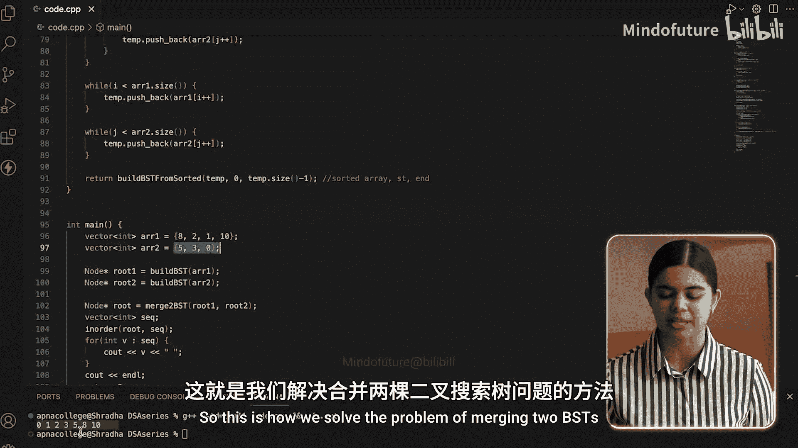

# C++-DSA课程-｜-数据结构-｜-leetcode-｜-Apna-College-｜--Complete-C++-Dsa-Course-p103-P105_合并两棵二叉搜索树-DSA系列_-L.103--BV18oUGBkEmV_p103-

Hi everyone， and welcome to the company D series。 and today we' are going to solve one more classical DSA problem。

 which is called merge2 binary search trees。 Aner availableza Also there is a link for a companyized D in the description box to start at at this problem is called merge to binary searchas though binary search given is given B is given only first three key root given head and second root givenheadand ino combined K to form a single binary search tree Now。

 how exactly are we going to do that Basically Sa goes all binary search properties use Kmiki binary search tree。

😊，Haamaraju in the order sequence Soai。That sequence is always a sorted sequencega root1 in order sequence。

 which is going to be 1，2，8 and 10 to sorted and root 2 order sequence that should be 0。

3 and 5 root 1ham in order sequence sorted here root 2ham in order sequenceed and Qki combine in order sequence properties in order sequence xed sequence a3 combination sorted order sequence finaljo in order sequence that will be01235。

8 and 10 in order sequence。😊，Toari in order sequence and is in order sequence build redeffin using equal basically order and second order sequence order sequence node basically what we are root and write insert。

😊，This that will be able to build a binary search sheet for us Agar Q3 bananaham balanced BSTV banana already BST seriesander we have sortd a questionander sorted E。

😊，Itbal。B convert and basically going to use the same logic as and Similarlylycur root in function So this is how we create a binary after merging two。

😊，overall logic logic and we are going to write the exact code for it。

 Basically function lets call this function merge merge function root and second will be root2 and function order sequence order sequence us suppose function function in order sequence in the form of root order and order。

😊，For root too。And E2 to every1 can then。Mutlaub is Eric Candander。

This is our E1 is kdander Hamipas's first3ca in order sequence Ajaga and second Eri kander。😊。

Hari pass second reka。In order， sequence Al Obali Kame indono Ees merge Kani into a commonary Tamuskle ana temporary vector by ascering a final vector。

 We can call it anything。 We can create a vector。😊，Of integer values。

 it's called this temporary and temporary vector can Pari values those sorted array merge k logic co that that is very simple just commonly already series k k though variables la I variable J variable don values compare k though we are basically going to create a loop y loopp R I is less thanari A1 ca size。

😊，Andp rj is less than Ma 2 k let us minimize all of this2。😊。

H first Akh index and secondk j index per jubi value only compare kgi0 and1 mebi valueri final e So basically0 value tori or smaller value value index plus compare kring1 and3 co to definitely1 is smaller and update I and j compare k to2 and3 me2 is smaller2 co final E and2 index3 and8 co compare k3 and j co plusing5 and8 co compare k5 simply I and j indexco comparea basically check if of I is less than。

😊，A of J。is。😊，Push back Kanaha up the array of I plus plus key valuego。And。

Same loop from JKli Liinge Jeptug J is less than array2。Dot size。This is everyone。

E era 1 key values Z E era 2 key values year era 1 key values Z tap simply temporary under hum push back curl game。

😊，Edie。😊，Do off。G。😊，Plusco This that a Inino whileluco combined curquet Hamdono kdono erarisco Traverse curlling it or a common temporary area nearly build cur it。

 Oskeba， we are simply going to call the function of build BSD Justcaander。😊。

H sorted temporary and is function value i return basically function root So this is the overall logic merge anded let us convert structure existing root and root functions is function complete which is called merge root and root。

😊，BT merge。Ukle sub L2 we are going to get in order sequence for both of the Bsts in order sequence kle do vectors equal create Kogram aappa vectorjaga lets call this a1 andusra vectorjaga a2 in order sequence canander up now root 1 past。

😊，And every1 pass carryinginggi to Maripa first in order sequence ajgon and easy see in order can the root 2 pass carryinging a every2 pass carryinging it to second in order sequence sjagon。

 though now in order sequence Java Mariappa sjaa tokiba we are going to use two variables I is equal to zeros j is equal to 0 and in operate temporary vector co create carrying it。

So vector in teacher， let's call this debris。Temporary vector key under gptech I is less than every1 dot size。

And j is less than carry2 dot size。Tta compare to area of i equal area of G is up if area of i is less than area of G。

😊，Those case may hum simply temporary can push back carding a array of I plus plus score。

And else while case scanander temporary ma。Push back Kanyalahhi， E。This will be a1。

 and this will be a2 of。GPS。So skip about but value scaled though value perign J the I is less than every 1 dot size。

😊，T the committee， everyone oneky values to push back at night。And Jupta G is less than a2 dot size。

Tokmi itdie。uきラ go pushかない。20 while looppaura temporary vectorander final BS in order sequence sorted sequence sorted sequence binary we are going to call the function。

😊，Buildilt BST。From sorted just can sorted sequence topa carrying range forpa basically team parameters and pasttora。

sortted a， Ukimi hama starting index and Hama ending index ending index is going to be temporary dot size minus1 Yapaari root returncom return。

So this is the overall logic all this logic can the hammeripas in order function here and you build BT from sorted functioning just have me complete them。

😊，Subseary let us write the in order function。In order function killer。Haari， Ektori， Kaneal and。

We are going to get a vector of impteger values to send by reference fast kinggi just Cam we are going to have an error upper base cases hereki value those case have simply returned Kne value nato in order sequence k sub in order to call Kringgi for root call left and the E。

Eric。Y root k datahu。And then we are going to call in order for root car。Right sub and very。

 So this is the overall logic， very simple logic for in order function。 Okay add me come up now。

Build BST from sorted function B Li then。To build BSD from sorted function together。

8 to Hamippaara sorted area。Let。Let us pass the E Amusk Almi Hammanpa starting and ending index annual Valley。

KB B of the starting index key value becomes greater than the ending index。

 those case may have null value for return garden game。😊。

Ok are may from sub upname mid go calculate carrying it， the integer mid value is going to be star。😊。

Plus， n minus start。Divide by2。Im successfullyively of need 3 K route to build Kany Valley。

 so we are going to build a new node。Just can from array of mid value who use kringgi Uskeba build BST from sorted candle hum left subri who build kringgi through root k left he called Jgi。

Just name Paul King Eri is by starting value Hujagi。Start and end will be midness month。Similarly。

 root k write sub co build k So this will be root kide sub means starting value will be mid plus1 and ending value is going to n and root So this is the logic for building the entireS from the sorted sequence Ya function this is the merge functions complete merge order sequence which according to R logic should be a sorted sequence is already my main function Q root node merge root sorted sequence Now before saving the code if condition camera this should be and this should be1 and every2 key values compare Now let us run the code。

So this sequence that we are getting is the sorted sequence and this is coming from both of our Bss So donst score combined k final in order sequencega that is going to be this sequence which is going to be sorted so this is we solve the problem of mergging tos we talk about the time complexity the time complexity key terms assume root n n order sequence m plus n order in order sequence traverse is third step kov m plus n and then we are building thest from the sorted sorted traversejaja value is value is function time complexity here。

😊。

That is big of m plus n。 So overall Johari Pue Kodigi time complexity Hovari that will be big of m plus n time complexity。

 So this is how we finally solve our problem。 So if you have successfully completed today's lecture。

 then you can mark it in his down in the comments。 you can also share your progress with me on Twitter just calling upku each description box candagga Askulate 9 will the next lecture can and keep learning and keep exploring。

😊。