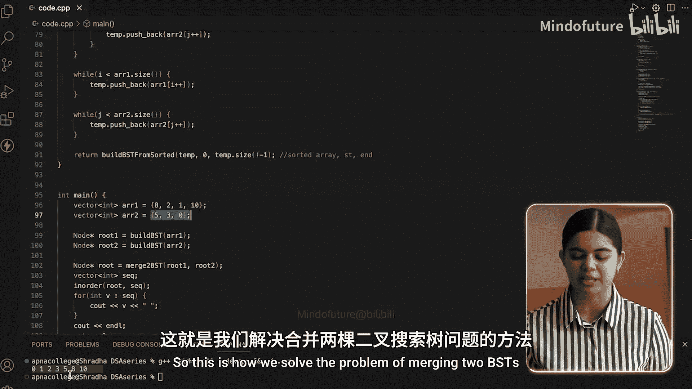

# C++数据结构与算法课程：103：合并两棵二叉搜索树 🌳


在本节课中，我们将学习如何解决一个经典的算法问题：合并两棵二叉搜索树。我们将通过获取两棵树的中序遍历序列，合并它们得到一个有序序列，然后利用这个有序序列重建一棵新的二叉搜索树。

---

## 问题概述

我们有两棵二叉搜索树，分别以 `root1` 和 `root2` 作为根节点。我们的目标是将它们合并成一棵新的、更大的二叉搜索树。

**核心思路**：利用二叉搜索树的中序遍历是有序序列这一性质。

---

## 解决方案步骤

上一节我们介绍了问题的核心思路，本节中我们来看看具体的实现步骤。

以下是合并两棵二叉搜索树的主要步骤：

1.  **获取中序遍历序列**：分别对两棵二叉搜索树进行中序遍历，得到两个有序的整数数组。
2.  **合并有序数组**：将两个有序数组合并成一个更大的有序数组。
3.  **重建二叉搜索树**：利用这个合并后的有序数组，构建一棵新的、平衡的二叉搜索树。

---

## 详细实现

### 步骤一：获取中序遍历序列

我们首先需要一个辅助函数来执行中序遍历，并将节点值存储在一个向量中。

以下是中序遍历函数的代码：

```cpp
void inorderTraversal(TreeNode* root, vector<int>& result) {
    if (root == nullptr) {
        return;
    }
    inorderTraversal(root->left, result);
    result.push_back(root->val);
    inorderTraversal(root->right, result);
}
```

### 步骤二：合并两个有序数组

接下来，我们需要一个函数来合并两个有序向量。这类似于归并排序中的合并步骤。

以下是合并两个有序向量的代码：

```cpp
vector<int> mergeSortedVectors(const vector<int>& vec1, const vector<int>& vec2) {
    vector<int> merged;
    int i = 0, j = 0;
    while (i < vec1.size() && j < vec2.size()) {
        if (vec1[i] < vec2[j]) {
            merged.push_back(vec1[i]);
            i++;
        } else {
            merged.push_back(vec2[j]);
            j++;
        }
    }
    // 添加剩余元素
    while (i < vec1.size()) {
        merged.push_back(vec1[i]);
        i++;
    }
    while (j < vec2.size()) {
        merged.push_back(vec2[j]);
        j++;
    }
    return merged;
}
```

### 步骤三：从有序数组构建二叉搜索树

最后，我们需要一个函数，根据有序数组构建一棵高度平衡的二叉搜索树。我们采用递归的方法，每次取中间元素作为根节点。

以下是从有序数组构建二叉搜索树的代码：

```cpp
TreeNode* sortedArrayToBST(const vector<int>& nums, int start, int end) {
    if (start > end) {
        return nullptr;
    }
    int mid = start + (end - start) / 2;
    TreeNode* root = new TreeNode(nums[mid]);
    root->left = sortedArrayToBST(nums, start, mid - 1);
    root->right = sortedArrayToBST(nums, mid + 1, end);
    return root;
}
```

---

## 整合：合并函数

现在，我们将上述三个步骤整合到一个主函数中。

以下是合并两棵二叉搜索树的完整函数：

```cpp
TreeNode* mergeBSTs(TreeNode* root1, TreeNode* root2) {
    // 步骤1：获取中序遍历序列
    vector<int> inorder1, inorder2;
    inorderTraversal(root1, inorder1);
    inorderTraversal(root2, inorder2);

    // 步骤2：合并两个有序序列
    vector<int> mergedInorder = mergeSortedVectors(inorder1, inorder2);

    // 步骤3：从合并后的有序序列构建新的BST
    return sortedArrayToBST(mergedInorder, 0, mergedInorder.size() - 1);
}
```

---

## 复杂度分析

*   **时间复杂度**：O(m + n)，其中 `m` 和 `n` 分别是两棵树的节点数。我们需要遍历两棵树各一次（O(m+n)），合并两个数组（O(m+n)），以及构建新树（O(m+n)）。
*   **空间复杂度**：O(m + n)，主要用于存储中序遍历序列和递归调用栈。



---

## 总结

本节课中我们一起学习了如何合并两棵二叉搜索树。我们利用了BST中序遍历有序的特性，通过“获取遍历序列 -> 合并序列 -> 重建新树”三步法解决了问题。这个方法思路清晰，代码实现也相对直接，是处理此类问题的有效策略。