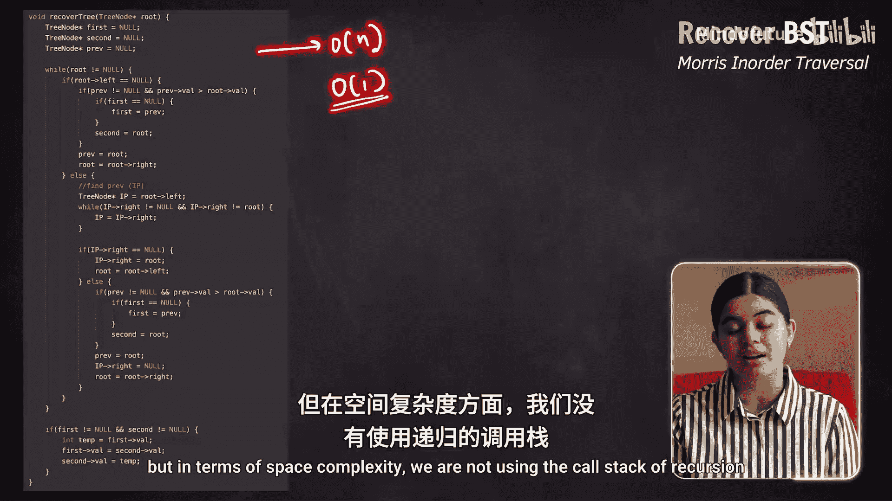

# C++-DSA课程-｜-数据结构-｜-leetcode-｜-Apna-College-｜--Complete-C++-Dsa-Course-p104-P106_恢复二叉搜索树-DSA系列_-L.104--BV18oUGBkEmV_p104-

Hi everyone and welcome to the complete DC series and today we're going to solve one more BS problem which is called recovercover of BS scanga Also there is a link for a company D sheet in the description box to start this problem is called recover Bri binary search given here buses binary search node j swap。

😊，that makes。😊，The original form orja and this is exactly what we have to basically important sequence that is a sort sequence and in order sequence that sequence now is13864 and 9 Now if we look at the sequence this sequence is not sorted situation present。

would have and。Those can the Hamishju next value ho that will always be greater than the previous value rule Dr sorted E follow the sorted in ascending order to Yahi condition basis Peari Eric thei value present they say for example is a me。

😊，A compare carrying to sub1 co compare previous k previous value as such for three co compare carrying a previous k presenter8 who compare carrying a previous to y present here6 co compare carrying a previous k to is problem exist Ma 8 and6 pair here。

 This is a problematic pair。😊，is highlight problem8 and6 and4 is also pair sequence is correct in and basically this is the first value and this is the second value originally。

😊，and and then well be able to restore the sorted sequence sorted sequence recover logic logiced sequence order or exactly logic logic sequence previous node nodeed order variable banana。

😊，Variable pointer previous j initialized King in Na ksar and as previous kdar Hammimi previous node goes over kgi Taki Harik root node kki previous node k again basically Agggar3h to 3 k previous node 1gi Agar9 head to 9 k previous node 4gi Agar6 head to 6 k previous node 8 previous node in in order sequence is basically the last visited node。

😊，In in order function simply in order function and last visited。😊。

her root nodeky value could compare K previous note the conditionbi that previous is not equal to nu。

😊，And Hammaariju rootie value him。If root key value becomes less than previous key value。

Agar the root value greateriipasomaly kba anomaly problematic cheese in order sequenceba root value becomes less than previous key value problem and what is that pair that pair basically is previous and root cap。

😊，Agerham6 and8 is6 value8 in values this is a problematic pair a pair variables a first variable initial in and a second variable is initial in in basicallyno values if we visualize in order sequence。

😊，Of this BST， tohammaipass value scanander。If we visualize it in the form of an array to Mariippa values scanander 1 head。

3 hair，8 hair，6 hair，4 a and 9 hair。 This is the in order sequence that we have Abs in order sequence kander subse pairju problem there that is8 and6 cap to jsena first pair mijaga vm kering it first kander to previous key value to kra previous is case mejaga8 value Mula value and second kander store king y me current key value current mutlerari Jobi root shall Mula key value to yahaper。

😊，Firstari key value secondari root pair anomaly cause problem cause first and second pointer value and second value secondomaly for example。

18 and6 order and。😊，Is BST can， what is the problem is BST can Hume 6 co swap Kna 8 ksth and 8 co swap Kna 6 kssth？

😊，I pairju problem cause which is the8 and pair single pair given pair pair pair second pair pair and second pair secondces pair pair。

😊，can exist first node and second second condition basically condition let us reize this。😊，Amkim。

 Ani payers kim， subham kgi。😊，Kkirilikui first value exists Katim A first value exists Nikim。

 those caseme Hamariju first valuejagi that is going to be a previous value to Kabibi were first exist in Kar Ukime first previous Hoga and Hamriju second value Hogi Voto Hamishaari current value Hogi。

 which is going to be the root。😊，So this is pair key first value and this is pair key second value condition basically first or。

😊，gi first time8 and second time and4 replace8 and4 So this is are to write condition root in order。

😊，He called， justma we are going to pass rootka。rightite and the sayari re functiongaari firstari first value u second second value ugi or inu values could finally in values swapina in order base case simply use abiru value null if root becomes equal to null those case may simply function return return now let us also dry on this once approach basically case。

😊，a first variable second variable equal equal and move on to which is。😊。

travel3 condition previous is not equal to null Yes root key value less than previous key value have root key value have3 previous key value have1 I this less no。

 this is not update update or root right function execute8 is not equal to nu root key value。

 which is8 is less than previous key value， which is3 this is not true execute next right previous update update move on to66 is not equal to null previous is not equal to nu root key value6 is less than。

value8 the condition be true if statement execute pair sorted then what we are going to do is equal yes is equal to nu first which first or second root value second root value which is equal to6 paireration will be6 and we make the call for root previous is not equal to nu Yes root value4 is less than previous key value previous value is 6 yes is less than second anomaly second。

Normallym exist ktier the upper check ring first equal to null here to first nu K equal Matlahammi is statement co execute where hamma may second can the store addingham current root key value which is equal to4 the Yaha per update K 4 value co over again。

😊，And next iteration k previous next iteration k previous will be equal to44 k execute writesco99 previous is not equal to null can9 value less than previous key value execute iteration previous and to9 execute and in order at the end of the in orderal correct value of first and second and4 value node simply or So this is the logic of recovering or restoring our logic plus convert can this is the function that we have to complete solution only sub in order sequence。

😊，up near 3 core travel king and we'll find out the first and second note second step Koga km first and second core。

Swab carnivalne so sb canka cahamop recover B function can the kate in order carry you have make different helper function to cannivalian。

😊，So let us create our helper function。Yeah let's call it in order itself in order Cam。

 Hammi Pattaya Hamripa Samari cheeky root Hobi。And is scan from in order travel carrying in order tover kaba fromri pass the variables in Jinkyium is Zrua there。

😊，Thoughren 게 there。Subse a kra previous ojaga discom initialized selding in nakiha and similar Terriki say。

 though all variables Americaka songgi first is the first variable， second is the second variable。😊。

In order sequence can。Checkabbi B a rootki value is equal to null。

Those case maym simply ask a return na in order call sub root sub about current root check A previous is not equal to null。

And Hamari took previous key value here that becomes greater than Hamari root key value。

Those case may we found the anomaly a the first value is equal to nu。

To Hamakni first go initialize covering a previous ksar and second Hamishha initialize Ugahamari current root value kar。

Okeal up new previous co next iteration kham update date carrying your root and we are going to call in order for root right subject so this is the overall logic for in order sequence rehearsal and the upper recovered in order could call carrying a further route at the endpa first and second don values availablephon swap swap can temporary variable11 just scan the first key value comes to it。

First。Key value mate second key value co overang a and second key value mate you are going to store temporary。

 So this is how you are going to swap both of the values and this is the overall logic。

Is Coco Ibar run cur？And let us submit it。So this is how we solve the problem of recovering our binary search problem complexity constant complexity complexity will be because of order sequence order complexity this is how we solve the problem of。

n complexity solution constant basically。😊，We want to understand this in order traal in detail binary orderve already shown the to second and tra root and second iteration root in order。

Pdecessor a previous co track iteration the upper order predecessor who use thread create order this is all the logic which is already covered in order lecture logic use and second key So this is the overall logic time complexity range complexity keycur So this is how we solve the problem in constant complexity we have successfully completelys lecture then we can mark down the says can also share progress with on lecture and exploring。

😊。

