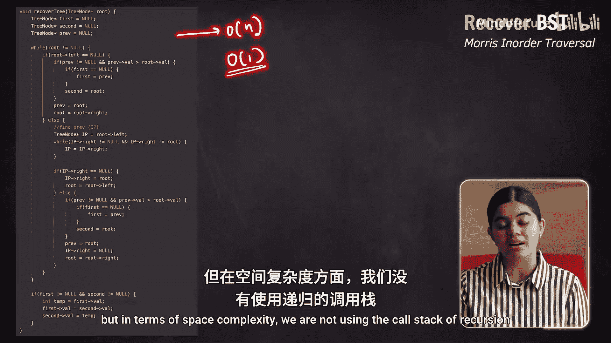

# C++数据结构与算法课程：104：恢复二叉搜索树


在本节课中，我们将学习如何解决一个名为“恢复二叉搜索树”的算法问题。这个问题要求我们找出一个二叉搜索树中被错误交换的两个节点，并将它们恢复，使树重新满足二叉搜索树的性质。

## 问题概述

给定一个二叉搜索树的根节点，其中恰好有两个节点的值被错误地交换了。我们的任务是找出这两个节点，并交换它们的值，以恢复原始的二叉搜索树结构。

## 核心思路

二叉搜索树的中序遍历序列是一个**升序排列**的序列。如果树中有两个节点被错误交换，那么中序遍历得到的序列将不再是完全有序的。我们的目标就是通过分析这个无序的序列，找出被交换的两个节点。

### 关键步骤
1.  对出错的二叉搜索树进行**中序遍历**，得到一个无序的序列。
2.  在这个序列中，找到**破坏升序规则**的“问题对”。
3.  根据找到的问题对，确定需要交换的两个节点。
4.  交换这两个节点的值。

## 算法详解

上一节我们介绍了问题的核心思路，本节中我们来看看如何通过代码实现这个算法。

### 中序遍历与问题检测

我们通过中序遍历来访问树的节点。在遍历过程中，我们维护一个 `prev` 指针，指向**当前访问节点的前一个节点**（按中序遍历顺序）。

以下是检测问题节点的核心逻辑：

```cpp
void inorder(TreeNode* root, TreeNode*& prev, TreeNode*& first, TreeNode*& second) {
    if (root == nullptr) return;

    // 遍历左子树
    inorder(root->left, prev, first, second);

    // 处理当前节点
    if (prev != nullptr && root->val < prev->val) {
        // 找到了破坏升序规则的“问题对”
        if (first == nullptr) {
            first = prev; // 第一个问题节点是前一个节点
        }
        second = root; // 第二个问题节点是当前节点
    }
    prev = root; // 更新前一个节点为当前节点

    // 遍历右子树
    inorder(root->right, prev, first, second);
}
```

### 确定问题节点

在遍历过程中，我们使用两个指针 `first` 和 `second` 来记录需要交换的节点。

以下是确定问题节点的规则：
*   当第一次发现 `root->val < prev->val` 时，`first` 指向 `prev`，`second` 指向 `root`。
*   如果后续又发现了第二个破坏规则的地方，则只更新 `second` 指针为新的 `root`。

### 恢复树结构

遍历结束后，`first` 和 `second` 指针就指向了需要交换的两个节点。我们只需交换它们的值即可。

```cpp
void recoverTree(TreeNode* root) {
    TreeNode *prev = nullptr, *first = nullptr, *second = nullptr;
    inorder(root, prev, first, second);
    // 交换两个错误节点的值
    if (first && second) {
        int temp = first->val;
        first->val = second->val;
        second->val = temp;
    }
}
```

## 复杂度分析

*   **时间复杂度：O(n)**，其中 n 是树中的节点数。我们需要进行一次完整的中序遍历。
*   **空间复杂度：O(h)**，其中 h 是树的高度。这是递归调用栈的空间消耗。在最坏情况（树退化为链表）下为 O(n)。

## 总结



本节课中我们一起学习了如何恢复二叉搜索树。我们利用了二叉搜索树**中序遍历有序**的特性，通过一次遍历找出破坏顺序的两个节点，并进行交换。这个方法思路清晰，代码简洁，是解决此类问题的经典方案。