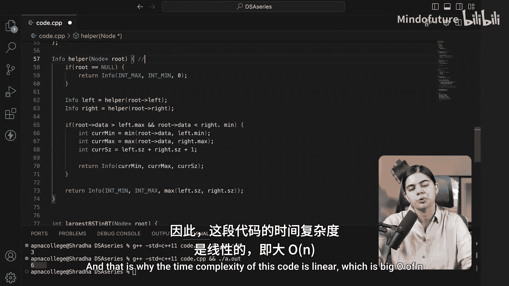

# C++-DSA课程-｜-数据结构-｜-leetcode-｜-Apna-College-｜--Complete-C++-Dsa-Course-p105-P107_二叉树中的最大二叉搜索树-DSA系列_-L.105--BV18oUGBkEmV_p105-

Hi everyone and welcome to the complete B series。 and today we' are going to solve one more B problem。

 which is called largest in a binary tree Also there is a link for company in the description box。

 This problem is called largest in a binary tree and to find out the size of the right node greater node but 15 right is smaller than right side is not a valid1 root node is also not a valid side this sub is a valid。

😊，and that is equal to3 size is valid B exactly Kiany nodes exist。

 So 5 is the root of the B left and right nodes exist Similarlyly right side may be a valid which is just the node 7 equal is obviously this finally returnna as our answer So this is the question binary figure outne What is the largest sized that we can get in this this is very similar to a question which was valid B。

😊，This question is very similar to validate B validate B or validateki and Miltata logic is I strongly advise you that if you have not solved this question to lecture。

 because this is a very important question interview point of， which is the brute force approach。😊。

B for largest top down basically root10 valid or not is not valid this ische orki Similarly right not valid basically largest size v valid。

😊，which is of size 3 the brute force approach or if that three is a valid or not and that validate brute will because is will be a optimal the size of the and basically。

Key value is always greater than Hamari left subriki Jobi maximum value H and always smaller than Hamari writes subriky Jobi minimum value H。

😊，Kis and B agar node is condition who satisfy K pluska left sub and right sub may his condition satisfybi validjo valid for example。

 if we are standing at 5 the5 k left say maximum value which is going to be one sub maximum value and5 k right say right sub minimum value。

 which is going to be8 right sub minimum value left is a single node this is a valid we know that this is a valid and this is also valid5 k simply E left at right valid5 k and left maximum say or right minimum say and5 inno properties satisfy5 is also a valid B。

😊，garpa left sriikaja write Srikaja， which is1 and one。 is valid B S。

 which is left plus rightis plus1 for the root note， which is equal to3 approach。

 which is root node or no figure out that is a B S node or not basic sub y basic information sri and right sri though B S is left and right k。

😊，me figure out are they Ss or noto left and rightari root 15 properties satisfy715 but is smaller than 15。

 So this is not satisfying properties15 and10 second that is and right minimum value to figure out the right answer for the root are traversing to the right or we are traversing to case minimum and maximum value minimum maximum value and third that is。

😊，S valid node size writes plus one for the root node itself pieces of information out the largest in a binary of information or node node in the manner node node return and for every root node if that root node is part of a valid or are basically going to use a structure or basically pieces of and value。

😊，U Valley level。 So this is something that we have figured out。 Ham。

Or Yaha per size from actual sub size key Ham return carrying a maximum BST size。😊，Of the。

Subre or maybe the tree， whatever it is。For each note。Her maximum write plus3 but10。😊。

Right to we value suppose it is some value as such left or rightki 0 is not valid function relevant these are the two pieces of that going to of and。

😊，Bas， sub valid B Sham U Valley level minimum and maximum S value return U Valley node Bbi Bham third variable useja we are going to reuse both of these variables to store an invalid value。

😊，But basically， these are the three pieces of information。

 Johar No U orme recursme recurs Ani Nodseto A left information Gari leftki information Aja let us supposegar helper functionari。

😊，Let us suppose this is my helper function。 Jacanander Ru Kopaskiia。To is helper function Gander。

Asse Ruka left Pacaringgi to Vaassea Marias information Agi。And right， past Keinggi。

In the same function， the Vaasseam root K right kill information lying。

Based on these pieces of information， humne root node kill Ani information go create Kai those go they K carrying example Lathium P 5 value node valid node guide by example Lathium。

 This is the5 node A patta upper leftana。😊，Left Si Chi left key minimum value and maximum value。

 which is going to be1 comma 1。And maximum B S T ca size up1 akli node here Jopni me valid B S T this size B1 k equalga writes a piece of information Aga 8 k minimum value Hogi 8 maximum value Ho8 and maximum B S T Cas Hoga1 k equal me individual node is a valid B S T case the 5 K valid answer create a 5 k valid answer create kseta on if5 is a valid B S T node or not the 5 k valid B S T node Kpa condition O F。

😊，Rot car Johamripa's data He。 If that data is greater than Hamari left key minimum value。😊。

And root car datata。😮，Let us write it on the second line。And Ugahamariruutka。对的。Is less than。

Right come maximum。 Those case may havepat that this is the valid B S D case。

Those case may hum be up any information return， G。We also have to return information。

 Amali information can the theme parameters onlyiji subseelome upnelia upna current minimum value nili。

😊，A current node maximum value ni node current no sub simple cheesehi valid condition plus right size plus1。

😊，SoSimp our current size is going to be left class size。Plus， right class size。Last one。

Let's put a line here。😔，Let's add a line here。To current size aipas already to information candleander。

 a to hammni current minimum cosin kringgi， Jobi figure out Ki。

 a current maximum cosin kringgi Anduski A me， we are going to pass current size。 Now。

 to find out the current minimum， which is the minimum value in the current sub3 Hama Karinggi。

 we are going to return the minimum of root。😊，And left car minimum。

Left he Hamripa Jobi minimum value。 Ie and Ukiami Hamariju current route He value He donno miss Jobi minimum value Hoie That will be the current minimum of this entire ster Hamucai return Kringgi。

 Similarlyly， current maximum will be maximum of fruit。And Hamari， write maximum value。

So is the current minimum current maximum current sizeco calculate kring and unham return Kring。

 So this is how we are going to complete our first condition。

 which is the condition of being a valid B SD， paris opposite B Ma Hki node。

 par that node is not forming a valid B S D， for example。😊。

Topney node 15 km Hamippa left sch information。 I U that left information is 7 and 7 up 7 k minimum maximum value 7 here and is B Stika Joai a is valid B Stika。

 that is equal to1。 A 15 is information。 Coche Kariga is 15 greater than。😊。

Is 15 less than right come maximum。 No， it is not less than right come maximum。

 Gkala havevo valid B S T N a 15 K， pieces of information of U Beijingj Ibarim minimize curle them。

If we resize this a bit。Yea， basically， Hamipas Hamra Els Ca said， this is the if case。

 and this is the else case。Just mami yhi same theme pieces of information return minimum maximum in size per U v level kta maximum B S T size of the sub sub maximum size exist 15 k level per that this is not a valid B S valid B S sub right sub existha valid B S right sub exist k。

 which is equal to1 for valid B sub may exist 13 exist k12 k14 exist k left say valid B S size 3 I right say valid B S size1 I to valid B S size in valid B S is the maximum of left and right current level maximum right maximum answer that is going to be our answer answer size return k maximum of left ksis。

😊，And。😊，Right is is key value。So this is the size value that we return。

 a maximum and minimum mehem K return Kringgi hamjaate 15 up in a minimum maximum U kter of S E value return Kdi just say U value pair node kbi B valid B S T pi。

 because we already know Yaha U B S T properties followingri to U value level per B B S T properties followingiche to hum up the U value level per S K value pass curri Jo is minimum kat Ugar compare Kri to kbi B valid B S Tammal pi。

 basically， we can pass the value in minimum as inmin。😊，In Minco am symbol in a v minus infinity。

 U v level co minus infinity D Qki minus infinity is a cobi value body in use the program is condition co they。

 This condition should slightly be different。😊，Valid BStK condition is basically key Agarhamari。😊。

Lut car data。Left gate maximum say B bur。And Hamari Ruthutkata。Right， k。Minimum say we Chota。

 those case may， it is going to be a valid B S D to yaur a minimum can minus infinity Hetokobi value minus infinity aos to upny app yjo condition Hoge in v dojagi。

 Similarlyly， maximum caner Hamriton Kingi in max。😊，Justkalab plus infinity， Malab Yahaur。

Chahi coi value compare who that is going to given an invalidval value。

Just say upper right max and their maximum value a plus infinite u to Ko value plus infin is a Those case may be be valid B S inam。

 So these are the values that we are going to return if we ever get an invalid B S node to y don pieces of information recursively return figure outpanki Kaas valid B S existta Sa we also need to figure out a base case。

 base case basically Hoga Nll node。😊，7 k min right Nll node Ane Ame valid B S U peruska N node U level S K values return U valley level per hamisha valid B S T Him to single node hammiak valid B S Uai to null node kilo minimum canham plus infinity pass sec or maximum can minus infinity pass sec This is the minimum value and this is the maximum value to 7 B Ane writes subriki information Ma Ucajo minimum Hoga Ua smaller rega。

 So it will become a valid B ST to base casega This is the function。😊，And the biss。Will basically be。

Jahaperham return Guingi in with plus infinity， minus infinity， Matab integer max and integer min。

 and upper size co return， Geringya is 0。 And this is how we are going to solve our problem。

 Is Koaggaham Dran Kique de。 So the dryran is going to be very， very easy。 Basically。

 Hammi patta her ignored Kage or null value him。 null values kle。😊。

Haari fixed object return fixed informationig value co up minimum maximum and size return to minimum can value return k here plus infinity maximum can minus infinity and size can value as01 compare left maximum say it will be greater1 compare k right minimum it will be lesser to1me Bga the upper triple1 return 881 return7 7 U valley level co 77 and1 return5 co K5 kme already left and root minimum will be1 right maximum and root maximum is going to be8 and size is going to be3 the U value level co y return15 in B to 15 U value level co information return kga this information which is minus infinity plus infinity and size will be the maximum of left and right sub 3 to me0 left。

😊，pieces of information i 110 10 upper valley level return minus infinity plus infinity and3 final answer that will be equal to3 your final answer information k maximum。

😊，Size value parameter cander Hoa Gissemi finally give main functions， return Kim。

 So this is how we solve our problem。 And next， we are going to convert our pseudocode into actual C plus code。

 C plus code can the already a3 Gise create K。 and this is the function that we have to complete Abis function go complete Knyse Pehama khammic class create Kringi。

 and well call it information。😊，Information class can Hamipas scch parameters in Ekujaga minimum。

 Ekujaga maximum and Ekujaga Mariipas。size。マり巴。There will be some constructor。 We have minimum value。

 We have maximum value， and we have the size。So minimum is going to be equal to this。

Maximum is going to be equal to this， and size is going to be equal to。This value。

E pieces of information had youcom baing it A V function herecar return type is in teacher。😊。

Though as such Hamipas in tea value through directly Heipas information Tom utility function Man we can also call this the helper functiongi or functionari information returnga function a Jobiipas information Ie from the。

😊，Helper function。 When we pass our route。W information K under size G value return Azar。

Final maximum B S D size helper function Gander hammna code logic value Kabi B root valuepa caseja。

 those case may we are going to return information minimum K ypa kring in max maximum K pass king in min and seismmi passcaring 0。

 Similarlyly， information。😊，Lying is subsequently left sub to help her could call Guinggi for root cut left。

😊，And information could aangnge up naite subreula to help her kill a call kange root car right。am。

arijuka。Is that greater than Hamari left a maximumim。

Left key Ju maximum value B and right key Ju minimum value B Those case mean Hammed returned Guing that this is a valid B ST。

 This should be right， minimum。The Ya per subbiline enzyme may calculate k a current minimum。

Current maximum。And current size。To Marijo information， Hoge， it will be current minimum。

Current maximum and current。Size current minimum will be minimum of root car data。

And left car minimum current maximum will be maximum of root car。李当。And right car maximum。

Current size will be。Left classs size， plus right classss size。Last one。

13 values andin return Kne Nahitoel Valley K Kanderham return Kane information。

 minimum kjaham pass Ki inmin。😊，Maxum 기적의 한 password 게 인。

Max and size gileham pass cane Valim maximum of left cassis and right casis。

So this is the entire core logic disk basis for Now， let us save it。

 This is the current tree in B and if we pass the root equal let's save So the answer is equal to3 binary and the largest out if I change this7 let's suppose 50 caseja and the largest size will be  So case answer is going to be If we talk about the of is basically post root and。

😊，That is why the time complexity of this code is linear， which is big of。

 So this is how we solve the problem。 And if you have successfully completed today's lecture。

 then you can mark it in his down in the comments。 It case happening。

 you can also share your progress with me on Twitter just cu up Kni description box canther Mil Jaja。

 Askate 9 Mil next lecture can then keep learning and keep exploring。😊。

