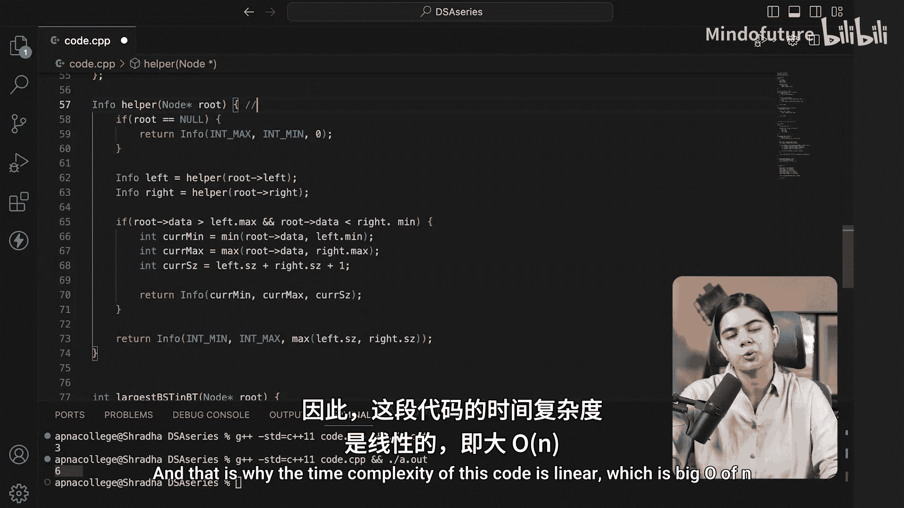

# C++ 数据结构与算法课程：105：二叉树中的最大二叉搜索树


在本节课中，我们将学习如何在一个给定的二叉树中，找到节点数最多的二叉搜索树（BST）。这是一个经典的算法问题，我们将通过分析问题、设计递归策略并最终实现代码来解决它。

## 问题概述

给定一个二叉树，它本身不一定是二叉搜索树。我们的目标是找出这个二叉树中，**节点数最多**的二叉搜索子树（BST），并返回其节点数量。

例如，考虑以下二叉树：
```
       10
      /  \
     5    15
    / \   / \
   1   8 7  18
```
在这棵树中，以节点 `5` 为根的子树（包含节点 `1`、`5`、`8`）是一个有效的 BST，其大小为 `3`。而以节点 `15` 为根的子树（包含节点 `7`、`15`、`18`）不是 BST，因为 `7` 小于 `15` 但位于其右子树，违反了 BST 的性质。因此，最大的 BST 大小为 `3`。

## 核心思路

解决这个问题的关键在于，对于树中的每一个节点，我们需要判断以它为根的子树是否是一个有效的 BST。如果它是，我们就可以计算其大小。为了高效地完成这个判断，我们需要在递归遍历树的过程中，为每个节点收集并传递一些必要的信息。

上一节我们介绍了问题的基本概念，本节中我们来看看具体的解决策略。

### 递归所需信息

对于每个节点，我们需要从它的左右子树获取以下信息，才能判断以当前节点为根的子树是否是 BST：

1.  **子树的最小值** (`minVal`)：该子树中所有节点的最小值。
2.  **子树的最大值** (`maxVal`)：该子树中所有节点的最大值。
3.  **子树的最大 BST 大小** (`maxBSTSize`)：在该子树中找到的最大 BST 的节点数。
4.  **子树本身是否是 BST** (`isBST`)：一个布尔值，表示该子树本身是否是 BST。

然而，我们可以巧妙地利用 `minVal`、`maxVal` 和 `maxBSTSize` 这三个信息来推断 `isBST`，从而简化设计。

### 判断 BST 的条件

一个以 `root` 为根的子树是 BST，当且仅当满足以下所有条件：
*   它的左子树是 BST。
*   它的右子树是 BST。
*   `root->val > 左子树的最大值`。
*   `root->val < 右子树的最小值`。

如果满足条件，那么以 `root` 为根的 BST 的大小为：`左子树BST大小 + 右子树BST大小 + 1`。同时，整棵树的最小值是 `左子树的最小值`，最大值是 `右子树的最大值`。

如果不满足条件，那么以 `root` 为根的子树不是 BST。此时，我们向上返回的信息中：
*   `maxBSTSize` 应为左右子树中 `maxBSTSize` 的较大者。
*   为了确保在父节点判断时不会错误地认为当前子树是 BST，我们需要返回一个“无效”的 `[minVal, maxVal]` 区间。通常的做法是令 `minVal = INT_MAX`, `maxVal = INT_MIN`。这样，在父节点判断条件 `root->val > left.maxVal && root->val < right.minVal` 时，一定会失败。

### 递归函数设计

基于以上分析，我们设计一个递归辅助函数。它返回一个结构体，包含 `minVal`, `maxVal`, `maxBSTSize` 三个信息。

以下是递归函数的伪代码逻辑：

```cpp
信息结构体 遍历(节点* root) {
    if (root == nullptr) {
        // 空节点是“有效”的BST，大小为0，但区间设为[INT_MAX, INT_MIN]使其在父节点判断中失效
        return {INT_MAX, INT_MIN, 0};
    }

    // 获取左右子树信息
    信息结构体 leftInfo = 遍历(root->left);
    信息结构体 rightInfo = 遍历(root->right);

    // 判断当前子树是否为BST
    if (root->val > leftInfo.maxVal && root->val < rightInfo.minVal) {
        // 是BST
        int currentMin = min(root->val, leftInfo.minVal);
        int currentMax = max(root->val, rightInfo.maxVal);
        int currentSize = leftInfo.maxBSTSize + rightInfo.maxBSTSize + 1;
        return {currentMin, currentMax, currentSize};
    } else {
        // 不是BST
        // 最大BST大小继承自左右子树中较大的那个
        int largestBSTSize = max(leftInfo.maxBSTSize, rightInfo.maxBSTSize);
        // 返回无效区间，确保父节点判断失败
        return {INT_MIN, INT_MAX, largestBSTSize};
    }
}
```
主函数只需调用这个辅助函数，并返回其结果的 `maxBSTSize` 成员即可。

## 代码实现

现在，我们将上述逻辑转化为 C++ 代码。我们将定义一个 `NodeInfo` 结构体来封装信息。

```cpp
#include <iostream>
#include <climits>
#include <algorithm>
using namespace std;

// 二叉树节点定义
struct TreeNode {
    int val;
    TreeNode *left;
    TreeNode *right;
    TreeNode(int x) : val(x), left(nullptr), right(nullptr) {}
};

// 用于递归返回的信息结构体
struct NodeInfo {
    int minVal;      // 子树中的最小值
    int maxVal;      // 子树中的最大值
    int maxBSTSize;  // 子树中最大BST的节点数
    NodeInfo(int minV, int maxV, int size) : minVal(minV), maxVal(maxV), maxBSTSize(size) {}
};

class Solution {
public:
    // 主函数，返回整棵树中最大BST的大小
    int largestBSTSubtree(TreeNode* root) {
        NodeInfo result = helper(root);
        return result.maxBSTSize;
    }

private:
    // 递归辅助函数
    NodeInfo helper(TreeNode* root) {
        // 空节点处理：视为“有效”但大小为0的BST，返回特殊区间
        if (!root) {
            return NodeInfo(INT_MAX, INT_MIN, 0);
        }

        // 后序遍历：先获取左右子树信息
        NodeInfo leftInfo = helper(root->left);
        NodeInfo rightInfo = helper(root->right);

        // 判断以root为根的子树是否是BST
        if (root->val > leftInfo.maxVal && root->val < rightInfo.minVal) {
            // 是BST，计算当前子树的信息
            int currentMin = min(root->val, leftInfo.minVal);
            int currentMax = max(root->val, rightInfo.maxVal);
            int currentSize = leftInfo.maxBSTSize + rightInfo.maxBSTSize + 1;
            return NodeInfo(currentMin, currentMax, currentSize);
        } else {
            // 不是BST
            // 最大BST大小来自左右子树中较大的那个
            int largestSize = max(leftInfo.maxBSTSize, rightInfo.maxBSTSize);
            // 返回一个无效区间，确保在父节点判断时失败
            // 注意：这里minVal和maxVal的设置与空节点相反，是为了覆盖所有无效情况
            return NodeInfo(INT_MIN, INT_MAX, largestSize);
        }
    }
};

// 测试代码
int main() {
    /* 构建示例树:
            10
           /  \
          5    15
         / \   / \
        1   8 7  18
    */
    TreeNode* root = new TreeNode(10);
    root->left = new TreeNode(5);
    root->right = new TreeNode(15);
    root->left->left = new TreeNode(1);
    root->left->right = new TreeNode(8);
    root->right->left = new TreeNode(7);
    root->right->right = new TreeNode(18);

    Solution sol;
    int ans = sol.largestBSTSubtree(root);
    cout << "最大二叉搜索子树的大小是: " << ans << endl; // 输出应为 3

    // 简单内存清理（实际生产环境需更完善）
    delete root->right->right;
    delete root->right->left;
    delete root->right;
    delete root->left->right;
    delete root->left->left;
    delete root->left;
    delete root;

    return 0;
}
```

## 复杂度分析

*   **时间复杂度：O(N)**，其中 N 是树中的节点数。每个节点我们只访问一次。
*   **空间复杂度：O(H)**，其中 H 是树的高度。这主要是递归调用栈的空间消耗。在最坏情况（树退化为链表）下，空间复杂度为 O(N)。

## 总结



本节课中我们一起学习了如何寻找二叉树中的最大二叉搜索子树。我们通过后序遍历，自底向上地为每个节点计算并传递关键信息（最小值、最大值、最大BST大小），从而在 O(N) 时间内高效地解决了问题。这个问题的核心在于理解 BST 的性质，并设计合适的递归返回结构来整合信息。掌握这种方法对于解决复杂的树形DP问题非常有帮助。