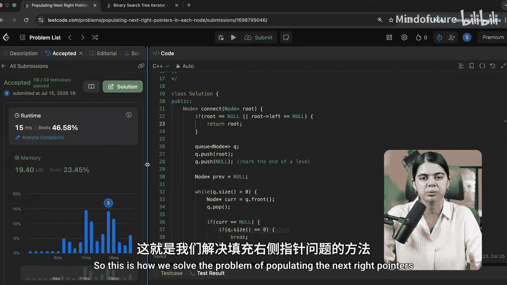

# C++-DSA课程-｜-数据结构-｜-leetcode-｜-Apna-College-｜--Complete-C++-Dsa-Course-p106-P108_填充每个节点的下一个右侧节点指针-DSA系列_-L.106--BV18oUGBkEmV_p106-

Hi everyone welcome to the complete series。 and today we are going to solve one more problem。

 which is called populate next right pointers there is a company is called populate next right pointers This is also problem16 or are the same is also an pointer which is given to us called the nexter right。

😊，The right pointer here it should point to null value because one K right may co be node the other on the same level。

2 Ca next right pointer here it should point to3 or three Ca next right pointer It should also point to null4 next point should point to55 should be   and equal to nu node next solve will be diagram node。

in the form of being to and。Now， this is the first level is value is is not and right and and basically next which is the previous right。

er of point krega， which is the null value。 O Baham up in the previous quote。

 the bar say reset cur head to a null value and Jse Hamripa nu Aga。😊，next。

 Then we are going to start with the next level。 next level simply and and righters Je if previous is not。

😊，Jebbi Hamipas， previous key value， not nalagi， the previous。Is not equal to Nll。

 whosese casemeam Charki Hamage of previous car next he。That should point to the current value。

 This is basically what we want to achieve。Toki previous two Ca head that will now point to3 the two next will now point to3 and children and7 and andari and now we are on the last level in is equal to Similarly。

 but that is to next time right。and next time previous is not equal to null is going to 0 and next time and check is equal to and is equal to is not equal to nu and time will be equal to null sinceq is and automatically or。

right point。 So that is something that we are going to directly write and This is the function that we have to complete is function root creating Q Q let us suppose values's call it a Q Q。

Along with a null value， this null is to mark the end of a level。

W going add me a core extra node pointer an than previous just scan the of me previous value quo track carrying it。

😊，Aekluchal Jubtuk Hamari cua size is greater than 0。

T the Khar barcuse Jobi cuki front per value him。Sa pop to Q。

 say pop value Co And though conditions exist correctly Yatoari Q say Hamko valid value pop A value pop。

 those cases， Bgi a toki current。Is equal to null。And else vac kiss him。

The current is not equal to nu sub not value case co handle cur J let us suppose how many4 value value copoia Those case may subium check4 kos left and right pointer existju Q and add if。

😊，Current car left is not equal to null。Those case may Cuki underham push Carling a cur cu left。

And similarly， if current car right is not equal to null。Those case may Khamush K kka。Right。

And Ja Ja humme above my previous k checkerai key F the previous value is not equal to null。😊。

Those case may previous car next will be equal to the current value。

 and Ja Jame me previous co update Kna to current。 This is something Johamme dono he kiss Kenhamra Kki value N not No he cases me on previous update Kheni to current value。

 Kki 8 level complete orium Edi andra previous If Val Ca meari Kki value N the Yaha。😊。

There are going to be two cases， sub a K Ogaki Q cas Z that becomes equal to 0。

And Iskael vahe jmm dubarra Se Kander， insert Kevni。

Nal key valueo your current key valueem next to level koska n markers again。

 So this is how we write level audit reversal and Jaja Yaseem return Kni root vo。

 Let us also write a base case here。 base case ma'amlingki Agarriju root here。

 if that becomes equal to null。😊，Or Hamari rootutka。

Let us suppose a A B pointer becomes equal to null。

 Since this is supposed to be a perfect binary tree。

 Saval kandderra Mariba's perfect binary tree given here Giskalabe Agarruska left Neka right pointer V Yo。

 This case may root Ciic single nor here。 whose case may bemikoi next right update Kanegi Zruia to Yase simply return Geringam me root value go。

 Let us run our quote。😊，And submit it。So this is how we solve the problem of populating the next right pointers Ani time complexitybani simply level audital could use k level audital can aic node per exactly a bar visit curtain just come the time complexity of the solution is going to be big off。

 If you have successfully completed today's lecture。 Then you can market in is now in the comments。

 me can also share your progress with me on Twitter just callingku box Ja Ask Mil next lecture can keep learning and keep exploring。

😊。

