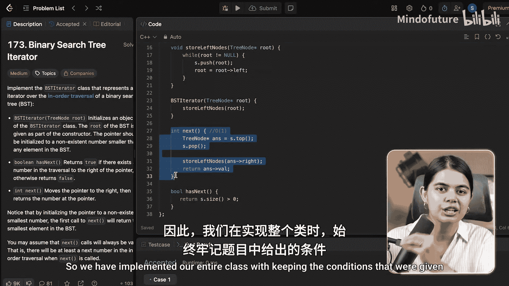

# C++-DSA课程-｜-数据结构-｜-leetcode-｜-Apna-College-｜--Complete-C++-Dsa-Course-p107-P109_二叉搜索树迭代器-DSA系列_-L.107--BV18oUGBkEmV_p107-

Hi everyone and welcome to the complete D series。 and today we' are going to solve one more important B problem。

 which is calledator Also there is link for company in this problem is called binary given and class design is the class two important functions basically binary in So it has a function called has node function true function false or in function basically。

😊，Implementation wise if this is my B S to in order in order sequence Then we travel the route in order7 915 and 20 always sorted in order next function same functionga next same functionga or has next co this is a boolean function function return。

😊，For example， last time printku value exists， which is 15。

 So obviously there is a value that exists in order to has next true next time5ja579。

 this will be equal to true and this will be equal to 15 functions implement and we have to design as well as implement our entire itator class but there is a in the question which basically is suggested time and complexity Jo next and has next function with an average runtime complexity of of1 and memory case complexity height of the Now how do we implement that basically time complexity1 on average。

😊，And overall complexity and willopim function。😊，t for future calls。

 basicallyuraj to perform next timeari information single call but how do we store this informationura in order reval and is he specific problem solve with the help of basically often actual data information what exactly we are going to do functions say function is basically our constructor constructor and information we save something for ourselves constructor。

😊，H upne Bstki sari kari。Leftmost nodes， coast or kling。

 we are going to store all the leftmost nodes。 Leftmost nodes Kennyhamlabe is starting from the root。

 Ham Saari Kari Jobi Nors left hiter of Ar on subcotona Kling， basically， example K Ani 3 K left me。

let us assume andor in order or writes Similarly right basically。😊。

To in left root and right basically left part information whenever we have to return the next。

 What exactly are we going to do。 basically that is our next and。

So two is the first node that we will return andarial maybe2 node sub and now comes the most interesting part。

 Basically j in order next time right for example 2。52。7 node next time in order 2。 time2。

 before right or nodes exist starting from this or additional nodes exist nodes next time iterations look at the dry run of the。

😊， basically， if we started with twomnetuko kiatuko popkaia Abrahamzeque kringgiki juice B no kmne popkiia。

 let us call this answer note。 Jobihamra answer him。 Agar Ukee kakoi valid the right value exist。

 Katheea Tokiari Kiari store all。😊，Left most notes。From starting from。

Haari Jobi Nor heky right value。Basically，se pop me2is right k right next timeis right right same7 right7 right7 right2 and77 right155 and and right same。

😊，next time99 rightch k doesn't exist。115 is equal to 20 right node right0 to20 in the and next20 are going to get all of the nodes in order Third function wasolean function has has next functional has next basically return。

😊，かリ个。Haara Jobi stack here Uque sizeisco。 If the size is greater than 0。

 those case maam true return K Neon falses return Ka。

 So this function is very easy to implement in donno functions scanme basically figure out Kneki kiss node Sgrammrunet top left most nodes Ca them left most nodes casual logic have boza simple v。

 basically Hamari constructor andni next function K acor helper function Manosam。

 we can call it store。😊，Left notes。Store left notes can the Jobi Hamipas knao root Nor Agi hamk kringi I loop chaangi Jup tuuck the root。

Is not equal to null。Hhaba upnit kander。Push Kinger root E value co and her bar root co update Kingi。

Do root 가。Lift。So this is the while loop， and this is the。

Function just come complete kname to Kabibi is function goarm called Kaangi for a specific node。

 Those node karikiari left valley values。 Hamtak and the Srojagi。

 The constructor say basically Ham Ane is function go call Kna。 we are going to call this function。

 which is called store left nodes。😊，Similarly， Yam k kringgi upne stack k topper Jobi value here U say upne answer nodeka and the store Kvalingi and U say pop Kingi from the stack Ukeba agar answer Kliku right value exist Ktier Toham Karingi is the same function go call Karinggi。

 which is called store left notes。😊，But Im called Kanevalhe for uncircharite。

Yuki Kissvi Nord Kmeoska right and right Kisari left Val Noshoka。

 So this is exactly how we are going to implement our B S T iterator class。

 Takebarpore logic chander convert curtain。 and Then we are going to analyze the9men face complexity。

 The Kander， This is the class that we have to complete。

mi Ski Zgi topni class the subyhammic stack create Kle。😊，Will create a stack of node pointers。

 Let's call it S and Uski A mehamic helper function moral。

 Let's call this store left notes justca Koibi root value agarragi Toham start carrying a Jept root is not equal to null。

Tta kmiak Genem。Push Kanihe value of the root and herbar rootkoham update K it to Roka next。

So this is the entire function。 In fact， this will be left。

A B S T iterator k is see same function co call Kring for3 key rootkiariari left most nodeam Kbi has next callho return Kbi greater than0pa next value exists Ktli co next value existing next the sub return K。

 which is available at the top of the stack Fermus Val K。😊，And Sariki Sari Jo left most know them。

Uvaling for。On ci。Right。return and return。😊，Also， Harjaham。Noode go update Ka as3 node。

 because3 node is the。Clasasses's name。 though this is how we have completed the entire class code。

 And let's also try to submit it。 So this is how we successfully solve the problem of implementing an itator class time in space complexity complexity perform next function it left at at that basically means that space complexity at is going to be binary and complexity even thoughor。

😊，ingari equal node Also， next function can particular particular set of this function time complexity complexity of the next function that will be of will it be of is the complexity not the complexityor complexity will be big of because or on average node and function on average。

😊，To an operations perform， which includes the push and the operation in the stack average ni that will be big of one。

 This is theortized or the average time complexity function has next function key this is the constant complexity function next constant complexity So we have implemented our entire class with keeping the conditions that were given to us in the question in mind I hope that al this is an important concept And if you have successfully completed today's lecture。

 then you can mark in is down the can also share your progress on Twitter lecture and keeping。😊。

