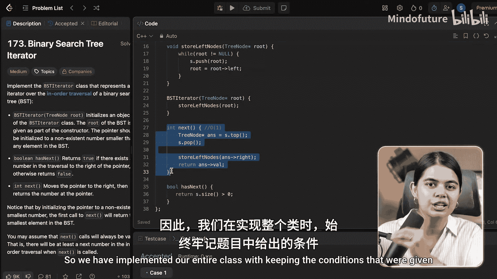

# C++数据结构与算法课程：107：二叉搜索树迭代器


在本节课中，我们将学习如何实现一个二叉搜索树迭代器。这个迭代器能够以中序遍历的顺序，逐个返回BST中的节点值。我们将遵循特定的时间和空间复杂度要求来实现它。

---

## 概述

我们将设计一个名为 `BSTIterator` 的类。这个类需要实现两个核心方法：`next()` 和 `hasNext()`。`next()` 方法返回中序遍历序列中的下一个值，而 `hasNext()` 方法检查是否还有下一个值。实现的关键在于，`next()` 和 `hasNext()` 操作的平均时间复杂度应为 O(1)，并且空间复杂度应为 O(h)，其中 h 是树的高度。

---

## 核心思路

为了实现 O(1) 的平均时间复杂度和 O(h) 的空间复杂度，我们不能一次性存储整个中序遍历序列。相反，我们采用一种“惰性”或“按需”遍历的策略。

核心思想是：利用一个栈来模拟中序遍历的过程。我们首先将根节点及其所有左子节点压入栈中。栈顶元素始终是当前中序遍历序列中的下一个节点。

### 算法步骤

以下是实现迭代器的基本步骤：

1.  **构造函数 (`BSTIterator`)**: 初始化一个栈，并从根节点开始，将所有左子节点压入栈中。
2.  **`next()` 方法**: 弹出栈顶节点，这个节点就是当前中序遍历的下一个节点。在返回该节点的值之前，如果这个节点有右子树，我们需要对这个右子树执行与构造函数相同的操作：将其及其所有左子节点压入栈中。
3.  **`hasNext()` 方法**: 检查栈是否为空。如果栈不为空，说明还有下一个节点；否则，遍历结束。

---

## 代码实现

现在，让我们将上述思路转化为具体的 C++ 代码。

```cpp
#include <stack>
using namespace std;

// 假设 TreeNode 结构体已定义
struct TreeNode {
    int val;
    TreeNode *left;
    TreeNode *right;
    TreeNode(int x) : val(x), left(nullptr), right(nullptr) {}
};

class BSTIterator {
private:
    stack<TreeNode*> nodeStack;

    // 辅助函数：将给定节点及其所有左子节点压入栈中
    void pushAllLeft(TreeNode* node) {
        while (node != nullptr) {
            nodeStack.push(node);
            node = node->left;
        }
    }

public:
    // 构造函数
    BSTIterator(TreeNode* root) {
        pushAllLeft(root);
    }

    // 返回中序遍历序列中的下一个值
    int next() {
        TreeNode* currentNode = nodeStack.top();
        nodeStack.pop();
        int returnValue = currentNode->val;
        // 如果当前节点有右子树，处理右子树
        if (currentNode->right != nullptr) {
            pushAllLeft(currentNode->right);
        }
        return returnValue;
    }

    // 检查是否还有下一个值
    bool hasNext() {
        return !nodeStack.empty();
    }
};
```

---

## 复杂度分析

上一节我们介绍了代码实现，本节我们来分析其时间和空间复杂度。

*   **时间复杂度**:
    *   `hasNext()`: O(1)，只需检查栈是否为空。
    *   `next()`: **平均** O(1)。虽然单次 `next()` 调用可能涉及多次入栈操作（例如处理右子树时），但每个节点恰好会被压入和弹出栈各一次。在整个遍历过程中，总操作次数是 O(n)，因此分摊到 n 次 `next()` 调用上，平均每次是 O(1)。
*   **空间复杂度**: O(h)，其中 h 是树的高度。栈中最多同时存储从根节点到某个叶子节点路径上的节点。

---

## 总结



本节课中，我们一起学习了如何实现一个高效的二叉搜索树迭代器。我们利用了栈数据结构来模拟中序遍历过程，从而满足了 `next()` 和 `hasNext()` 方法在平均 O(1) 时间复杂度和 O(h) 空间复杂度下的运行要求。理解这个迭代器的实现，有助于加深对二叉树遍历和非递归算法设计的认识。