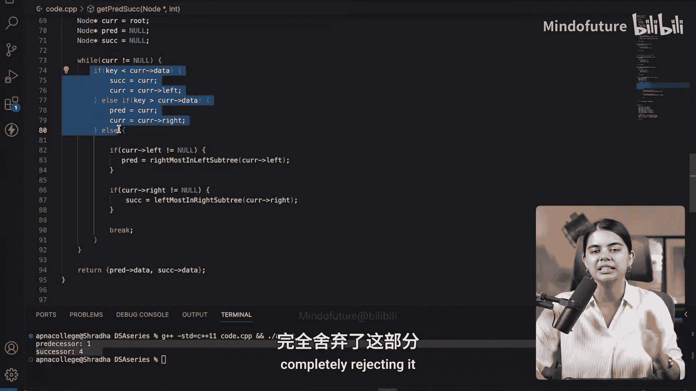

# C++-DSA课程-｜-数据结构-｜-leetcode-｜-Apna-College-｜--Complete-C++-Dsa-Course-p108-P110_二叉搜索树中的中序前驱和后继-DSA系列_-L.108--BV18oUGBkEmV_p108-

Hi， everyone and welcome to the complete series。 and today we are going to solve one more problem。

 which is called in order predecessor and successor company problem is called finding out the in predecessor and successor in binary for key for example。

 is key predecessor andor predecessor and successor。😊，BST Maabjo nodeca sequence Hoga that will be 1。

4，5，6，7，8 and 9。😊，To7ka in order predecessor is 6 and in order successsor is 8。

 So the answer should be 6 and 8 in the form of a vector。

 basically this is the function complete given given and of injaeth position predecessor and first position in order successor Now how do we exactly solve this problem basicallygi predecessor in successor in order andri in order to outne andneneme predecessor and successor Don values Milrigi。

😊，How exactly are we going to implement it， Basically， Agar。

 let's supposeari key 7 k equal observe k B S Stheo Spa key given him。😊。

That might be equal to let's suppose 3 Agggar the key is equal to 3 to 3 kos predecessor to1jaga and successor 4jaga。

 even though3ari Bkiki situationpabki casesbki there are three cases that exist sub case just made thekiki value is less thanari root value Jobi current routeari Chari chki Jobi lesserrikiki。

Jessica's case mehoga， if we compare 3 with 6， Tame Patligaki 3 is less than 6。

 Justka la Hamhamriki Kahaer miriogiari Jokihebohamari left the sri Kriogi。 The next iteration。

 Kahhamme update Kanahe Roco。 in fact， let's call this value current Jobi Hamari current No he。😊。

Current nodedki data saym compare Kap Nikkiko， and next Barri Johama search Hogakikile。

 Whaa update Kingiki current should be updated to current cali。😊，Similarly。

 second case exist value is greater than k example in the right next right is also one more important piece of answer or。

😊，That becomes a potential candidate for the in order predecessor value in order predecessor predecessor me write in the second case candidate order predecessordecessor。

 predecessor predecessor because predecessor is 6 which is greater than。😊。

ari actual in order predecessor value right call right。

 what are we going to do in order predecessor basically root and I same opposite case value like writes in order traal which root So root is a potential candidate for the in order successor traverse candidate for the in order successor value in the first case。

First case may left hitther of Janis ahamju successor value。 That could be the current root value。

 Zruin finally successorru valuegi predecessor the valuegi， But this is one of the potential values。

 A answer E to 6 is going to be the answer。 Just say example k33 k answer4 Abki Abtoju largest value that is going to be 6 I th or imagine basically Agarham。

😊，Puraura in order。 it is going to look something like this。

3 or successor4 per is a potential candidate So these are the two cases that exist per third case an important case exist For example。

ari the third caseari becomes equal toari root。😊，usk Agarhamari key 6 H， Hammeovni key 60 A permgi。

 the a is 6 k K Case Hammika in order predecessor and successor。

 find out K Jpi Hamari pass Hamari root key value becomes equal as the key to Vahaa in order successor is always the right most or the largest value in the left sub。

😊，I'll just repeat it。That the in order predecessor。Is always the。Write most value。In left sub。

Similarly。In the order， successor。Is always the leftmost value。

In the right sub y basic definition of in order predecessor and successor basic definition Kenlabe is 6 k in order predecessor kho in order canish sorted value So6 just value value Hogi that will be the in order predecessor 6 just peella value body value is 5 just value body value k left sub right most node can exist k right most node klabe a right k of right hitther of to last right value node exist kgi that is the largest available value right most value is the largest available value in the left sub So that will be in order predecessor same opposite logic right sub6 k just by the value value in order successorgi just by the value value mula right sub sub value sub value Kagi left k to right sub left most value is going to be 7 to 7。

😊，Will be the。In order successor for our note to third case kander jaamari Kihammeil Japh Neriander。

 Vahapper Agarhamara left Sre exist ktto in order predecessor kander。

 This is the value that we have to find out。 How do we find out the right most left spri value。

 Basically， Agarhamme left Sri kander。 rightmost value。 Find out Carneia。😊，In left sri。

 those maham upne root car， left child passeringgi and a loopchadinggi Jeptuck our root is not equal to null。

답딱 simply 되지 않아 답딱。Apne right， ker of Provoja， the root mehamish Ru right ker of provoja or answer value layingham storene Ro vluko to y this is the vi and last ma return Kingne answerko。

 Similarlyly， I see thatriki say hamap left most valueo find out curthe left most in right sri。😊。

Jbham right most in left sub。 Find out current to Yahapa starting Mayhamippa's current car。

Left child hadjupakiiajari， Similarlyly， Jem left most in right surise Karinggi Yaaram Rukopa Karinggi。

 This route is basically Hamari。Current car writes sub。 Yeah， but we same logicname。Yanny Jeptak。

 a root is not equal to null。Tuptak simply of me answer Kihammni Ru Ko or kthangnge or Kkihamil left most find out Knai though her bar route go up date Kingi as Ruka。

Left， this is the while loop。 and Yaham returned Gaingpni。

Answer key vlu same answer v is the and last me return。

 So these are the basic loopsmost in right s and right in out order predecessor and these are the final values that we have to return basically calculate we can simply break out of the loop that we have created to find out to find out our answers So this is the overall logic basis order predecessor andor first example is equal to 6 third third in order predecessor andor。

Predecessor Kelly。Left sub and the right most node niallingi， which is equal to 5。In order。

 successor Ka right left most knowni which is equal to 7。

 So these are the answers that we are going to get is k example let us suppose 7gar equal will get the second case is greater than k but candidate for predecessor to6 in the predecessor values predecessor successor k next timegi with 8hem potential successor potential successor is equal to 8 thirdgaro equal predecessor。

decessor answer for example if we with is equal is equal in the first case successor is successor second casedecessordecessor and right。

Do anything else。 J current key value na value na value doesn't become null So j in order predecess successor don who values for the given key。

 So this is how we are going to solve our problem。 And let us now convert the entire pseudo code into C code。

😊，The code can， this is the function that we have to complete。

Ais function Gander sub start kne current Nord kat， current Koham initialize Kinga with the root。😊。

And Sa casat let us also create two variables。 One is the predecessor disqu initialized Ka al cassat。

 One is the successor。Jaisco he initialize Ka al， Jept。Our current is not equal to null。

T that we are going to run a loop。 Lo can the Hamifas cases was subella case。

 if the key becomes less than root car datata。Wse case may sutoabna potential successor Milga。

 the successor can interrupt me rootki value Cotova， and we are going to update current as current。

 In fact， this will also be current and this will also be current Ru current value variable to current co update K to current K I v if the key becomes greater than。

😊，Current car data， those case may predecessor will be equal to current and current will be current car。

Right。And third case， Elwaa Cahoga。Just scanander if Hamari current Chie。

 the left s exist if this value is not equal to null。

Whose case me will find the in order predecessor。And just kiss me， current car。

Right is not equal to null， whose case may will find the in order successor Innume calls Laanni and Jese Miljai Yasem Kjagi B。

 And last May Ja Ham Kingi， a vectorctor of integer values。

 integer values Kander subsehamni predecessor Kadita Ra Ki anduskyne successor Ka Dita Ra Ki Pire going to assume Kihams Hammea S givenhoga predecessor and successor values exist Kthhi Kthi。

The Ya to complete these functions in order predecessor could find out Carneicular。

 we basically have to find the。😊，Rightrite most value。In left sub。

Right most value in left sub those scalleum current k left going upper past cur a。

 and this will be the predecessor value。Similarly， Yahoa's successor value will be。Leftmost value in。

Right sub。Justander Hammni k。Right value pass thing B dont know functions and income complete can I sub。

Let's complete this function。Right most in left Sri Ken Maripaskoruai Hammeiska right most return K。

 the rightmost return， Kanekalam。Let's create an answer。Jept root is not equal to null。

Tup tu answer Kdarham initialized King with root value。

 and we are going to update root with I may write most chair。Through the right value。

 And he ask him return curl up an answer。Similar Sahi function， Hami left most skill ofban boa。

 let us。Copyied this here and Yahapper， Hu simply update Kingi to rootka left。

 So these are the two functions。 This is the first function to find the leftmost value in left sub 3。

 This is the first function to find the rightmost value in left sub3。

 And this is to find the leftmost value in right sub3。

 Yamara overall function here get predecessor and successor values。

 J Samm answer code return K A B K Hamari Joki here。 that is equal to 7。

7 K Hamaripa same answer Anaminate dry and k， because we have created the same tree here。

Takebar code run。And predecessor is 6。 successor is it， Similarly， Agerham，6 kilo runcurringgi。

Those case predecessor is 5 successsor is 7。m 3 k1 and 4。 So these are the values that we get。

 So this is how we solve the problem of finding out the predecessor andor predecessor and successor in complexity basically logic use and of completely ignore completely second case in the worst case time complexity that is going to be which is the height of the complexity use constant space complexity and these are the time and complexity solution work So if you are。

😊。

Completed today's lecture。 then you can mark and is now in the comments。

 I me can also share your progress with me on Twitter is calling company description box can mill Jaga Ask89 Mil next lecture can then keep learning and keep exploring。

😊。