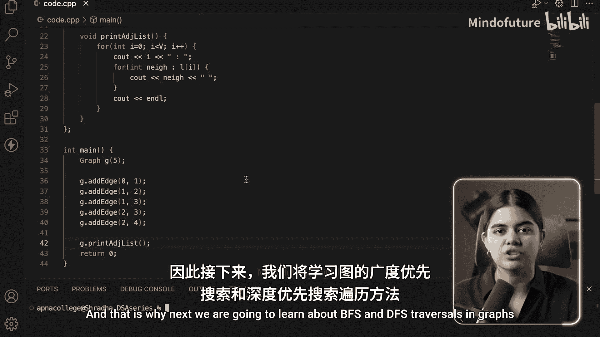

# C++-DSA课程-｜-数据结构-｜-leetcode-｜-Apna-College-｜--Complete-C++-Dsa-Course-p109-P111_图简介-数据结构与算法--BV18oUGBkEmV_p109-

Hi everyone and welcome to the complete series。 and today we are going to start an important data structure。

 which is called G Also there is a link for company box data structure graph important data especially are preparing for top product based get a of graph and dynamic programming fundamental graphs visual visual a of notes graph is no hierarchy in the graph binary node have a parent。

😊，Relationship， I me exactly Patriki parent parent cancheari child node daie child node K further upni children nodezoaki。

 And I therike said there is a clear hierarchy that goes on。

 But graphraph scanander is theriki K Koi hierarchy nu and node simply austic are connected with him。

 The Jium graphphkibaka thing graphph is basically。😊，A network of node。

To Qki there is no hierarchy is simply node connected here So it is called a network of nodes oripas graph nodes connected every connection between two nodes is called and nodes which is called verex single node ver multiple nodes real practical examples for example map use whose map informationjaja。

😊，between any two cities there is a path that exists and see information in the form of graphs a the form of consider the case of social media are of accounts that exist this account might be friends and also friends with person is friends with and profile friends with social network。

visualize in the form of graphs to graph practical real life applications exist In fact。

 machine learning when we talk about neural networks neural networks graphs one of the versatile software in my into when we talk about graphs graph。

the a common type of graphs do exist on the basis of their edges graph multiple types of edges exist basis graph classifys sub type of graph directional graph directional graph nodes edge is direction direction1 to2 there is a direction that exists in the or direction is a uni directional graph directions direction direction this is called a unidirectalial edge for example。

 we have a graph like this nodes and node。Now there is ani represent any information in real life。

 For example， have person one person1 is friends with person2 and person2 is friends with persondirectdirect we remove thesdirectdirectdirectdirectdirect and two。

And2 and three are also friends This is therijo information with changes based on the edge direction aarias though typei graphs and exist a cotehamari undirected graphs and those three types of graphs quo to uniti direction Loeeham Ca Hamri directed graphs apart from the edge there is also something called E U weight。

😊，Edge weight k basis per graphco class。 For example。

ney undirected graph to beardia per graph weight associate Kia weight value associate K For example。

 this value is 5。 is graphka example to us suppose value associate K10 when value associate K to jse K value associate G weighted graph。

😊， for example， if this is city1 city2 and city3 to city12 distance this could be 10 kilometers and be 9 kilo distance in fact weight value could basically  weightedweightedweighted simplys do not have any weight associated。

😊，With them。 So depending upon the edgeipas different different types of graphs exist themme justma say Hama first type of graphja undirected and unavweighted graph。

 For example， if we look at this graph undirected and unweighted graph second typeipasja undirected and weighted graphhi am weight associate k plus 109 undirected weighted graphho third type Hamipas directed and weighted graph if we associate some direction in the edges toipas directed and weighted graphho and the fourth type is directed and unavweighted graph am weight values score remove tohama directed unweighted graphja So her question can different graph basis per different different solutions co divide apart from these there is also one more category of graph exist generally Uanas encounter。

😊，uskibi understanding on Sa Je a generally Jbiham Gco imagine Katheem hum Gco imagine Carthe as all the nodes being connected。

 For example， Kiy Gphka under， in fact， any node for example eium。😊，Hameripas 3，4 and 5。

 is that Rika a five nodes andjori Gr can that exists Cartheium。

Up generally imagine different nodes unconed and second component of single node in these are just two parts of the same graph disconnect graph disconnected components cases but is not。

😊，for all the questions。 And in fact， based k algorithms detail this is not something that we have to worry about for now。

 concepted parts Now we are going to talk about how do we exactly build a graph for ourselves have a lot of will be an basically importants important importants or and popular is something called if we look ater list is different from vectors and this is different。

😊，From a linkedist C+ was scandal Johari list toier list is basically。😊，A doubly linked list。

Which is internally implemented in C internally visualize visualize and available multiple operations and can add a new node at the front of second most common operation remove and we can also remove this node element can also check the size of the list logic。

😊，Ca you exist ktahe behind the implementation of list which is also a linked list。

 the JM SL list who use kongish link list who imaginek yes are a common function since you exist K with the help of list we implement our graph data structure。

😊，Case implement Ka， basically adjustnc list car logic Committee k k。😊，Sari Qari， whatte Skiib。

Hum up。Neighbors categortoally store neighbors for all verortices。😡，To all veres called Lichica。

 this is a。Pallel， therea， all what it says。mjabbi verring will refer to this capital v symbol E will refer to this capital E symbol for all vertices we are going to store their neighbors is3 kham edges and vert information store for example。

 is graphka example is graph ver is graph v value that is equal to4 1，2，3。

4 vertesium first vertex value02 to basicallyme vertex01 K2 k3 ksbi is vertex store information storei。

😊，Example， Kgramm，2 kbari，2 k neighbours may agaham1 co over kle。

 Agam 3 co over Kle tokhamne indirectlytayaki 2 k 1 ksat and 3 katic edge exist kt This theri in the edjacency list representation for every vertex we store the neighbor information。

 start k me first vertex casemla 0 ksat，0 can neighbor conhead， basically graph can then Neham k。😊。

vertex direct connection1 travel they are going to bes of ones similarly2s we have1。

 we have three or three ands we have1 and we have two threes or or every list ofs basically。😊。

of neighborsang in the form of a list of int individual list of inte individual list of inte and individual list of intetex individual list of intes her vertex basically integer value fromteger V v v number of different in the form of。

Vectctor of。List of integers gma is vector Cas Zjaga V equal toki V different list of integer a metrokanium。

 If we can also store this in an array of size V， gcanander her a。

Index per we are going to store a list。 basically a formathamm graphko toward will be creating an array Ekis equal012 and 318 indexpa exists andino index per list of integersang So this will be a list of integers will be a list of integers This will be a list of integers and this will be a list of integers first value store。

 which will be1 is can the second value store which will be0 to and third value which will be1 and3 fourth value。

 which will be1 and2 this is how we are going to represent a graph internally in our plus visualize paper per to store graph implementation vector use static use we are basically going to use a dynamic dynamic already us revision。

😊，per vector or static array normal a A B up graph gives implementation here called Now let's talk about how exactly are we going to implement our graph。

 Just graphcom implement Kkua yripaio graph given here This is an undirected。😊，And unweighted graph。

ki equal we have five different vertic，1，2，3 and 42 and and13 and4 and12 and and let us start by building class called。

😊，defined set of veres ver vert list ofte vert of for each vertex to create an one of the main reasons we are not using a static number ver ver verdefin are basically going to of of。

ARR goes simply harmam the area so this is how we create our dynamic list of integers。😊。

And let's now create a constructor constructor canandergraph constructor here。

 just maybe we are going to receive the vers value。

 vers value Ig to subseli upne v co initialize Kge with this vers value andba initialize Kge Ame listco listco initialize Knepa integer Eta the integer E co initialize Kne A R R is equal to new int of some size V to I initialize Kthe top me list of integer co initialize Kne V L is equal to new list of integer。

😊，Of size。 we we can also give it a space here。 I theri representation complete k Next thing that we are going to do Hamic function Man and we call this function add Eari Es K toariari Es a edge exist Kai as nodes Ca may exist K U and V to U and V。

 though nodes E exist Kari add E functionpa U and Vki value let's suppose Agaripas U and Vki value1 and31 and3 k E exist kai to Je1 and3 I1 k3 k3 k but1 kme we have3 and3 kme we are going to have one。

😊，The Jesse， Hamipas， U and V， the values Atheem。List under。At index U， we are going to。Bushback。V。

And similarly， list kander at index V， we are going to push back U This theri A ham undirected Echoto Ab Agakie Egar directedu。

 for example， Abbiham S H Bari just may use a Wikiter of direct connection。 But Yahaer。

 if we have a case， Japers use a Vita connection those case may。

Agarhamappa one say three the connection o to one ks me to three other three ks me one the other。

 T thejab directed E exist K。 case me mehamgraph directed tohaa will make a special case。

 Kse you ks may V Vs me U over anchoring is case me1 ks me3 A three ks may oneco over to exchange head depending upon the graph。

 saymi class k me function can。 So this is how we have created our graph class。

 And now we are going to create a new graph， let's call it G Gpa number of vertees only 5 k equal and G K we are going to call the function。

😊，Add H， add H Kderham U and Vco pass Kinggi， lets make this capital G subse P sub first at G co mad Kna Chain。

 That is between 0 and1， tohamm pass King is 0 and 1 co。 and similarly， Hamipas 1，2，3，4。

5 edges edge exist khen。To we can pass on information，1 Ca connection here， Vo2 and 3 kss he。

0 kssth already form ho Chiukaai。Then2ka connection，1 case has already formed Ojukaimi 3 and 4 k Aka。

 The2ka connection we have formed with 3 and2ca connection we have formed with。4， lets save it。

 And is the graph values Koam just say we can create a new function called print adjacency list or adjacency list co printni is list for a loopam In fact。

 ver per lu for。😊，For integer i equals 0 i less than v i plus thus。Subseelium， print Kvai Kiham Kci。

Vortex Kle value Co Carvari and Uskiba Hamuski adjacency list for lula。 So for all the neighbors。

Yeah， let's call it Nibur。Nber off。tex information So we are going to see out the neighbor with some space for example。

 save and function and if you look list as。But it is also important to know how to traverse a graph graph travel a node informationax graph important and that is why next we are going to learn about Bf and D traverse in graphs。

 So I hope to ask a lecture how many complete understanding Mil Ho what exactly is the graph data practical scenarios using if you successfully completed today's lecture then you can mark in is down the can also share progress with me on lecture or important concepts and was it lecture can keep learning and keep exploring。

😊。

