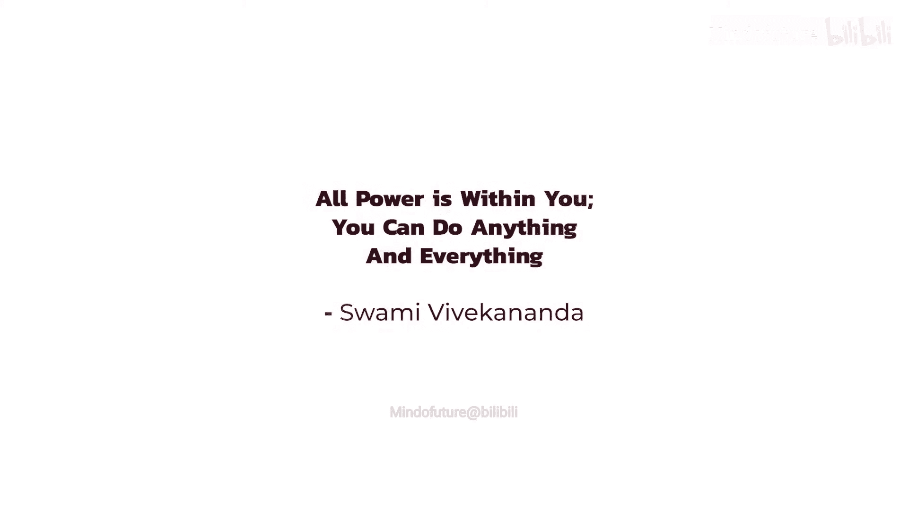
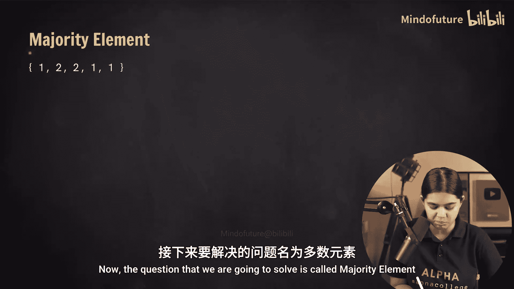
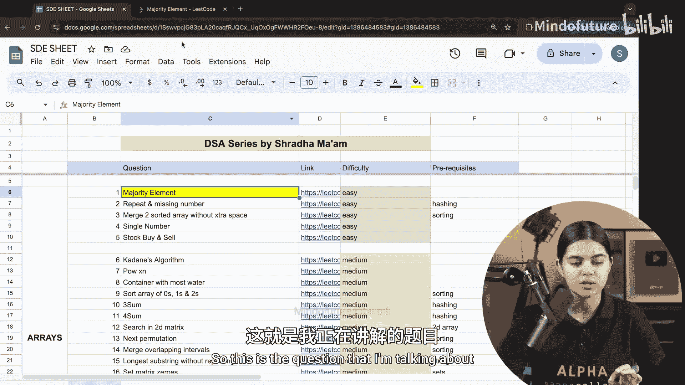
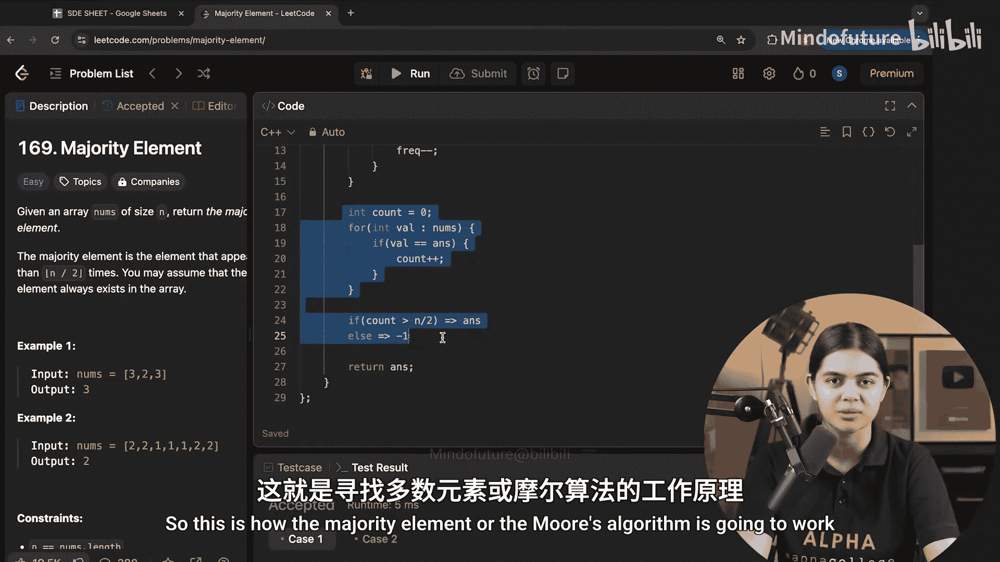

# C++-DSA课程-｜-数据结构-｜-leetcode-｜-Apna-College-｜--Complete-C++-Dsa-Course-p11-P11_多数元素-暴力_更好-最佳方法-摩尔投票算法-两数之和--BV18oUGBkEmV_p11-

Hi everyone， and welcome to the complete D series， myju all questions pair and majority element or playlistjase my first question。

 which is called Pe。😊。

given sorted elements ascending descending order ascending order and also given a sum is equal to return of numbers plus 1。

2 and given and answer and is easy bru brute force。😊，막 아이규。Is or equal pair equal11 or。

Subseli toham Peka first element pile first element。

 hum I is equal to 0 sre I less than n I plus plus thelijagi。

 or her a element Koalinggi Ana first number Benalinggi Peka first number to Peka first number over2 Hoia to scheduled next to Sarisari number Zgi wasari second element of the pairgi Tohammi Ecor loop lagannaga4 integer J equals I plus1。

😊，Agar already first element the2 or 7 is I plus1 plus2 plus3 plus1 n J plus plus pair number pair I and J I and J I and Jari pair basically of。

😊，I plus E of J。Which is basically the pair sum Agariski value Hamari target key equalojaia to first qui me。

Vctor canander hum simply up now， I push back Curing it。

operations and and finally satisfy is equal31 equal and is not the most optimized。

Value basicallyass dot equal In fact， I function vector of integer I pair vector nus and target finally is vector of integerhi。

And vector of integer Emanalli， the answer。Toara overall logic j is equal to I plus1 less than n j nu of value is equal to our target value equal to to and finally return So this is what the code is going to look like from。

😊，Numbers or target could pass can I give up。Asmahamm Sio Karainggi answer。Ind 0。And answer。Index 1。

With end of。😊，ed complexity optimize basicallyending order ascending order sorted elements elements elements value。

To pointer approach Cacaey U carryingringgi。 I'm basically a pointer liingy8 pointer Hamas start mehem。

Gs pointer Kohammna I pointer or a pointeringhammna J Poer I pointer Jer toari pass Eri subsete and subse Bu element Caa is sumko Mu yjobi mepa pair Iga。

😊，Is Sam Ko Muche compare Knahi up targets。Or Jabi some khammnet targets a compare carrying team cases Oak them。

😊，Yto pairs some targets， a Bahoak， Yae pair some target。

 a Chotahoak Yae pair some target K equal hosak Yea in particular cases， and you exist kakam。

 Just a for example in the upper target value 9 he。2 plus 1117 case。as 26 target 26 k equal or。

 which is 2 plus 15， which is equal to 1717 or numbers are sending order numbers next second case case 7 plus 15。

 which is equal to 2222。😊，11 plus15 which is equal to26。

0 j star n12 pointer approachp basicallyari I value less than J I jp while I is less than equal equal to j equal to this will not be pair pair can only be made between two different numbers condition sum calculate pair sum is going to be equal to of i plus of basicallyari case may j minus。

Second 개 소가。Else pair sum those case and return I and case scenario case scenario may meet or case that is why the complexity of is going to be which is function。

😊，I am going to remove all of this and I I and J Lire， I co start carrying a0。

 say J co start carrying a n minus1 say。😊，While I is less than G。Uptaami karine， subseel2 Ana。

 pair subnialai。Pair sum is equal to。Nums of eye plus numbs off。J。

First case aajaga agar pair some key value。Is less than target。

 you are greater than target roughly there。If this is greater than than target the to J minus minus ke。

Else， if pair some a less than target to Jate。W case me I a start pointer Kuberni。

Or else Valley case me， simply answer can the pushback or then give me values one。Not one， but I。

And J and returnari and 13 answerja2ham target26 equal。😊。

Those case may answer ofja to n3 k equal any 11 plus 15。

 So this is how we solve our problem of target sum。

 up this question co solve it is called majority element。

 and it is a classical question when we talk aboutari This is the first question called a majority element is So this is a question that I am talking about it is called majority element E level question given an array nus of size n return the majority element similar to this is majority element majority element it is the element that appears more than n by two times is the n by2 n by2 times to n by2 basic matlagar Let's suppose8 divided by value to49 divided by value 4。

gi。😊。

5 consider value9ju majority element greater than four times exist k programming question practicallyju majority element's call it M greater than n by two times exist is element you may assume that the majority element always exist in element exists sub。

😊，Using brute force approach。😡，or opt sub optimized。

 which is called Mos voting bru algorithm majority。😊。

N by2 says is equal to majority element greater than two times than brute force approach frequency sub sub or sub by。

😊，by majority element or basically elements frequency or greater than n by greater than and than。

Ikchete1 kidney bar exists Kte puri the T bar exist Ktte to one key frequency Ajati 3 equal 3 greater than n by to o Matla 1 mirror Major element oga。

 which is my final answer to brute force approach kiki ak Kque sari elements Ko to k B。😊，Vctor Gali。

 let's suppose manylo Chii in Teaja nus。man akque， Ani， sari sari valuespicia。

lets suppose shera me me piatuo Tommee Eer， Yaakeake vctorper E all looplonggi say element in numbers。

Or a girl。element here if this becomes equal to my value to mu frequency co plus plus frequency element or frequency or that becomes greater than n by case brute force that is brute force is going to takeov n square time。

😊，Y， but I'm trying to same approach like them for。Integer value。In numbersms。Sse vre。

 the yaju frequency hereseingbi count El Ki barak Im just second loopang and the frequency go count k。

😊，The4 integer Juby element tiger element who shot me many E liia in numbers。Agar Kabibi。

 my element is equal to my value。 Those caseme Mojaar case mehamriju frequency wjagi plus plus a purura loop of Kaarmojaga Ferm checking a Agarhamari frequency greater than N divided by two here。

 And what is this N divided by2。😊，In teacherger n is basically nus dot。

Size frequencygar n divided by2 return answer orki majority element Hamriri already given him ye condition Ka true or return orgar return1 statement be execute isgi。

😊，which is based upon。I frequency Oga2 next one pair I frequency Oga3 to ya frequency3。

 Oga to Mujiga 3 is greater than n by2 Yni， this is my majority element。 Yes。

 Kagri Go example just say for exampleipashi just my elements send0，0，11。😊，读 do and do。equal。😊。

From11 giveb frequency delete is but majority update carrying it to frequency top the same numbers are a frequency co or J number different target frequency quo reset carrying it to value。

😊，one。😡，upper last maybe2 frequency5 j5 y value greater than n by2 greater than n by2 majority element secondari sorting sub sorting algorithm useari function use directly second step element frequencying frequency initialize and element answer。

😊，initialize nus ofed image of first element majority element assume first of frequency may already count from I is equal to1 I less n i pluss of i value is index index equal equal frequency update frequency1 equal situations numbers of i equal to numbers of I1。

😊，Agar equal to a the to frequency co cardinahi plus plus。

 or L value casemic arni frequency co reset cardina to 1。😊，Plus， answer22。😊。

Se Agarhamari frequency greater than n by2 H Toham returned Kingi Jo B。 Hamari answer kander。😊。

Sttored value here is value go to brute force k U optimization here。

 Or yjo Mariri overall approach Lagigi is avalcoal canly using sorting。

 O my first step my sorting Hogi the bigov n login time Le up plus second step May Ciic loop children is my bigov N time Lare to overall your time complexity。

 Atheya Yper。😊，Vhe big of n login equall or ye algorithm here y faster he as compared to this algorithm ch can converttheme the ch can subseella。

 we can use the sort function vector is subseium vector B pointer which we get using nus dot bigin and for ending pointthe。

 which we get using nus dot n window function beginning and ending pointerjaga or numbers vector sort second stepme frequency count The second step sub frequency equals to1 andlean to nus0 ver loop for integer equals to1 element。

😊，Agyy clean in him。Are you plus the same。Herba ahama of Ine index v number k equal same number simply a frequency equal plus v or else valley case number reset King。

 which is frequency becomes equal to1 and Hama answer Bja nu of Ia number or herba frequency update beme iteration if frequency is greater than n by2 agar frequency greater than n by2 those case may have return King answer。

 which is the majority element。😊，All Yahaad last may be， in fact。

 Hu return Gnevalabne answer to Yahamaara overall Khoge Izebarranka。😊。

many test cases accept Oge I'm trying to say submit be k them the N loginka solution He accept to Jaga per is saybi a core optimize solution exists Kathe。

 which is Moore's voting algorithm， and it is an important concept， Jome analogji。😊。

To is concept go above detail mycusneval the moors。Voting。

Egorithm Gae subse intuition gibbbaal time intuition is algorithm gaier time。😊。

Ka majority element frequency greater than n by is voting algorithm frequency majority element frequency basically frequency frequency we take an example of this particularris simply simply frequency very similar to the sort simply element first element frequency different。

😊，aiIf frequency I if frequency is by voting algorithmic power guitar Ya is same votes Jse frequency agi to agar same element multil top frequency co plus plus Ki matla same element K case made frequency co plus plus Ki same element I。

 but different element Jseai。😊，frequency frequency or frequency is equivalent to the power frequency majority element last after this loop frequency frequency frequency frequency greater than n frequency n by or n element frequency at end of the loop。

😊，B0 ho the a majority element exists ko to basically am frequencyka0 ksat or answer may k answer me。

 let's suppose a B 0 is stored tohamura kura loop error for integer I equals 0。😊，I less than N。

 I plusless。Harbar Lu가。And haming Shiruaggar frequency value 0 toham Ii numberk answeralinggi to Agar。

If at any point， my frequency becomes equal to 0。 Those case me， my answer is going to be numbs of I。

same element frequency equal greater than n is works easy。😊，harash frequency。Subly checker link it。

K agarari frequency，0회。Abi frequency0 to Muju the answer is going to be equal to nus of I Jubi element children。

 Uke Agarari。😊，Answer is equal to nus of I mulaam same element Quebaka。

 whose case my frequency Ojagi plus verse， or else v case my frequency Ojagi。Min thingss。And finally。

 Yail last Mahammed return Geringevna answer answerw with Neel Waramhamil Lini is arurathe Yaer E nus dot sizeismam Kle and Ski again。

 And this will be frequency equal to the Sir Angartheem。😊，My test case is K is Kkujato submit be。

And our answer is successfully submitted。 which the re P more algorithm cotheme is say egg but dry and bele。

😊，On this particular array， Jo may already given him。

The Shiwaam Gme frequency equals 0 kat and Shirumehamari answerky value be 0。😊。

frequency frequency equal。😊，equal。and that is the logic that takes into accountte second majority second step。

Or is this frequency count greater than n by2 answer1 extra step in fact or count variables suppose count is equal to 0。

😊，Lop canander integer value of nums mayhemch Klethanki agar value equal to me answer Hoier。

 Those case may count co Klinggi plus less。Last me， uncle。

Agar count key value greater than n by to him Those case meham return K answer and else Valley caseham return K-1 simple are a additional step he just K just case mahamme already given youtaki answer Hamish exist So this is how the majority element or the mood or algorithm is going to work。

 I hope that we are all having a lot of fun solving these DSA questions So askgarne lecture successfully complete Kya you can let me know in the comments you can also let me know on Twitterling Nature description box andja ask late the next video keep learning and keep exploring。

😊。

