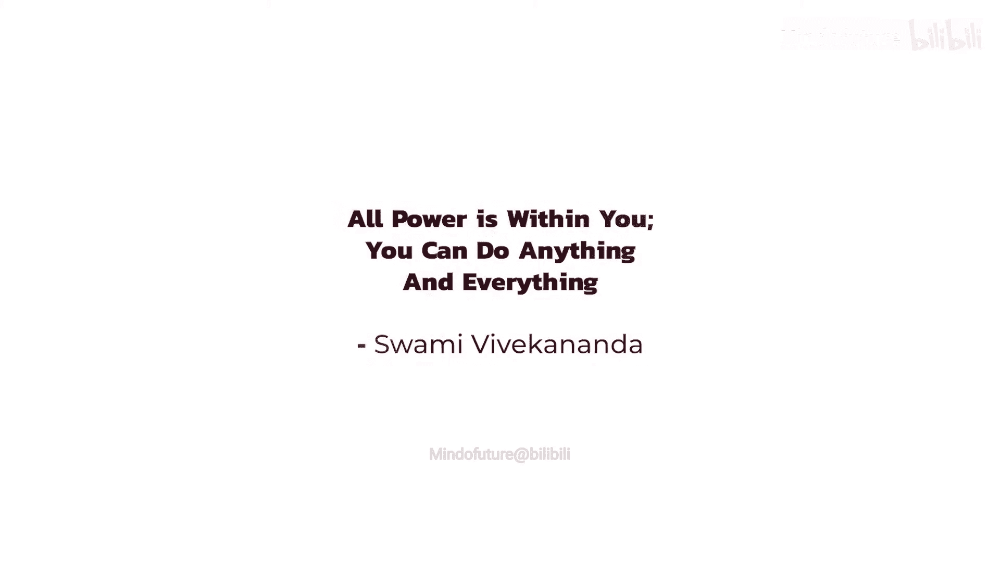
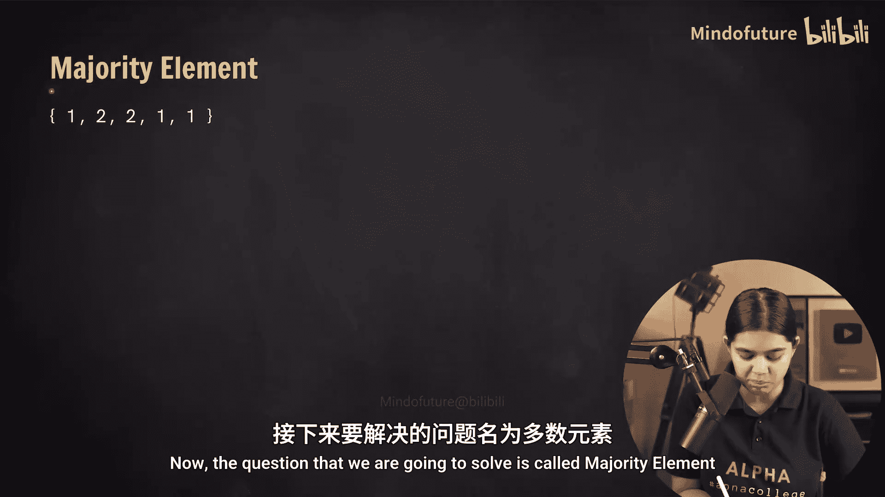
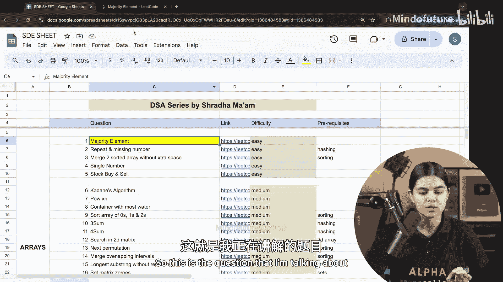
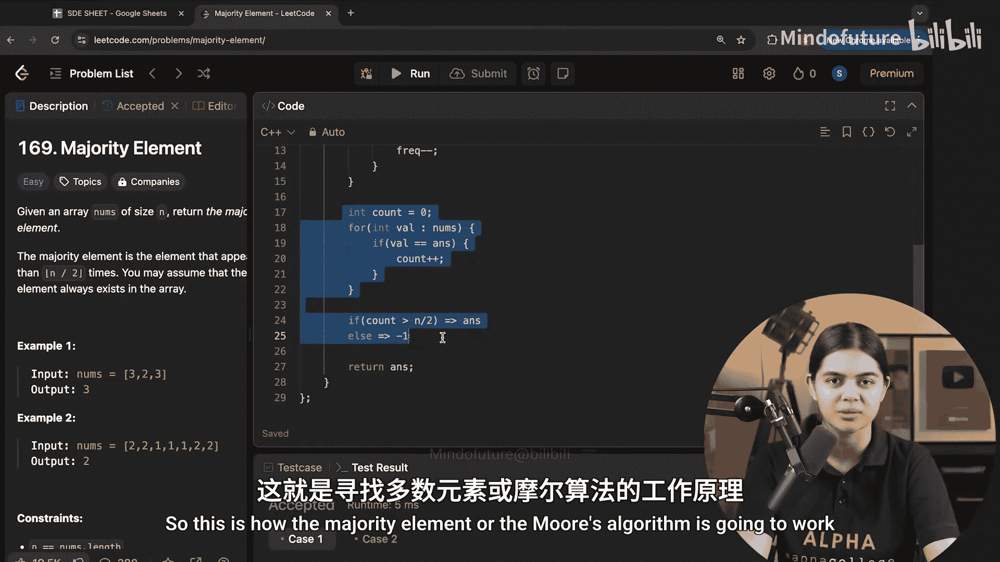

# C++ DSA课程：P11：两数之和与多数元素



在本节课中，我们将学习两个经典的算法问题：**两数之和**与**多数元素**。我们将从暴力解法开始，逐步优化，并最终学习解决多数元素问题的高效算法——**摩尔投票算法**。

---

## 两数之和

给定一个按**升序排列**的整数数组 `nums` 和一个目标值 `target`，请你在数组中找出和为目标值的那**两个**整数，并返回它们的数组下标。

### 暴力解法

最直观的方法是使用双重循环检查所有可能的数对。

以下是暴力解法的步骤：
1.  使用外层循环遍历数组中的每个元素，将其作为第一个数。
2.  使用内层循环遍历当前元素之后的所有元素，将其作为第二个数。
3.  检查这两个数的和是否等于目标值 `target`。
4.  如果相等，则返回这两个数的下标。

对应的C++代码框架如下：
```cpp
vector<int> twoSum(vector<int>& nums, int target) {
    int n = nums.size();
    vector<int> ans;
    for (int i = 0; i < n; i++) {
        for (int j = i + 1; j < n; j++) {
            if (nums[i] + nums[j] == target) {
                ans.push_back(i);
                ans.push_back(j);
                return ans;
            }
        }
    }
    return ans; // 题目保证有解，此行不会执行
}
```
这种方法的时间复杂度是 **O(n²)**，在数组较大时效率较低。

### 双指针优化解法

由于数组是**已排序**的，我们可以利用这个特性进行优化。我们使用两个指针，一个指向开头（`left`），一个指向末尾（`right`）。

以下是双指针解法的逻辑：
1.  计算 `nums[left] + nums[right]` 的和。
2.  如果和**等于** `target`，则找到答案。
3.  如果和**大于** `target`，说明和太大了，需要减小，因此将 `right` 指针向左移动。
4.  如果和**小于** `target`，说明和太小了，需要增大，因此将 `left` 指针向右移动。





这种方法只需要遍历数组一次，时间复杂度为 **O(n)**。

对应的C++代码如下：
```cpp
vector<int> twoSum(vector<int>& nums, int target) {
    int left = 0;
    int right = nums.size() - 1;
    vector<int> ans;

    while (left < right) {
        int pairSum = nums[left] + nums[right];
        if (pairSum == target) {
            ans.push_back(left);
            ans.push_back(right);
            return ans;
        } else if (pairSum > target) {
            right--;
        } else { // pairSum < target
            left++;
        }
    }
    return ans;
}
```

---

## 多数元素 🗳️

上一节我们解决了有序数组的两数之和问题。现在，我们来看一个新的问题：**多数元素**。

给定一个大小为 `n` 的数组 `nums`，返回其中的**多数元素**。多数元素是指在数组中出现次数 **大于** `n / 2` 的元素。你可以假设数组总是存在多数元素。

### 暴力解法

我们可以统计数组中每个元素出现的频率。

以下是暴力解法的思路：
1.  遍历数组中的每个元素。
2.  对于每个元素，再次遍历整个数组，统计它出现的次数。
3.  如果某个元素的出现次数大于 `n / 2`，则它就是多数元素。

这种方法需要嵌套循环，时间复杂度为 **O(n²)**。

### 排序解法

一个更优的解法是先对数组进行排序。因为多数元素的数量超过一半，排序后，数组**正中间**的那个元素一定是多数元素。

步骤如下：
1.  对数组 `nums` 进行排序。
2.  返回位于索引 `n / 2` 的元素。

使用C++标准库的 `sort` 函数，代码非常简单：
```cpp
int majorityElement(vector<int>& nums) {
    sort(nums.begin(), nums.end());
    return nums[nums.size() / 2];
}
```
这种方法的时间复杂度取决于排序算法，通常是 **O(n log n)**。

### 摩尔投票算法 🏆

这是解决多数元素问题的最优算法，时间复杂度为 **O(n)**，空间复杂度为 **O(1)**。其核心思想是“对拼消耗”。

算法步骤如下：
1.  初始化一个候选者 `candidate` 和计数器 `count = 0`。
2.  遍历数组中的每个数字：
    *   如果 `count` 为 `0`，则将当前数字设为候选者 `candidate`。
    *   如果当前数字等于 `candidate`，则 `count` 加 `1`。
    *   如果当前数字不等于 `candidate`，则 `count` 减 `1`（表示一次对拼消耗）。
3.  遍历结束后，`candidate` 中存储的就是可能的多数元素。由于题目保证多数元素存在，可以直接返回。如果需要验证，可以再遍历一次数组统计 `candidate` 的实际出现次数。

这个算法模拟了投票过程，不同的元素相互抵消，由于多数元素的数量占优，最终剩下的必然是它。

对应的C++代码如下：
```cpp
int majorityElement(vector<int>& nums) {
    int candidate = 0;
    int count = 0;

    for (int num : nums) {
        if (count == 0) {
            candidate = num;
        }
        if (num == candidate) {
            count++;
        } else {
            count--;
        }
    }
    // 题目假设多数元素一定存在，所以candidate就是答案
    return candidate;
}
```

---

## 总结

本节课中我们一起学习了两个重要的算法问题：
1.  **两数之和**：对于已排序数组，使用**双指针**技巧可以在 O(n) 时间内高效解决。
2.  **多数元素**：我们学习了三种方法，从暴力的 O(n²)，到排序的 O(n log n)，最后掌握了最优的 **摩尔投票算法**，它能在 O(n) 时间和 O(1) 空间内解决问题。



理解这些解法的演进过程，掌握双指针和摩尔投票算法的思想，对于解决更多复杂的算法问题非常有帮助。