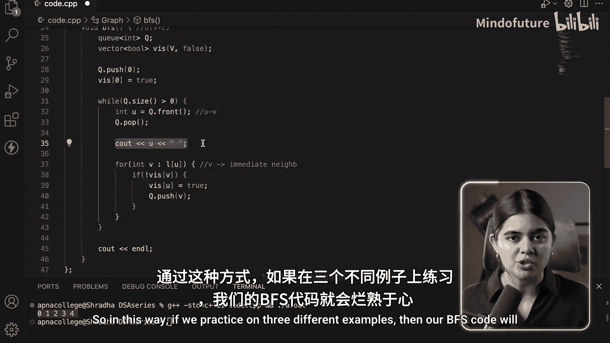

# C++-DSA课程-｜-数据结构-｜-leetcode-｜-Apna-College-｜--Complete-C++-Dsa-Course-p110-P112_图中的广度优先搜索遍历-数据结构与算法--BV18oUGBkEmV_p110-

Hi， everyone， and welcome to the complete D series。

 And today we' are going to cover B F traveral in graphs。 A Valley lecture may。

 we've already covered what exactly are graphs and how do we create them and ask lecture may have graphs but B traveral could detail cover B traveral algorithm dry and code and time in space complexity explore Now when we talk about graph traverem traver in order post order preoral level audit say graphs can B and tra a though no traver let us talk about B traverals。

 which is also called breadth first search bread first search traal fundamental common rule basically B and B。

😊，Travel to。Immediate neighbors first Amd those node casese immediate neighbors could travel kgi before we travel any other node in the graph basically let suppose is trase gra oral make difference Then the starting point of the structure in traveral is always the route of the as fixed starting pointtex for the sake of simplicity vertex travel to the immediates Let us suppose us as visitedva。

😊，Is important for both Bf as well as importantkiss hierarchces is no parent relationship or is andtex the rule sayss and。

😊，already visit next visit and visited visited and neighbors immediate neighbors next So this is how we ins and thens and and So this is how works immediates is the source is basically a starting note。

😊，level is very similar to structure which and do we exactlys take the example of thes suppose also which is calledole for example is ver equal23 and4。

And initialize with all the false values。 false visited for example。

 is And to start with the initialization process and as visited and first visited basically what do we have to doan greater than。

😊，Carring a value and is pop value could let us suppose this is our integer U value。

Basically connection and these are easily recognizable and。The neighbour Haric Ne goham。

 we said note Kaneval， the Ugar visited of V is false。 Those case， may we have to do two things。

Let us resize this a bit and I say in fact，ni visited Kya Harper Lete。And let us resize this。

Agar if that is unvisitedse visit visitedvis So these are the two steps that we want to do and for all the neighbors So this is the basic logic that we going to follow This logic is very similar to starting andse this is my output for。

😊，Neighbs of you， if it is visited or not already visited here1 here it is not visited and next is ands2 andino is visited next。

😊，and and then we are also going as compared and which and。

We are going to pop 33 is which is is only one neighbor which is already visited and and and basic logic convert this to discuss。

Complexity of Bf S traversal the code can y graph Gam already implement Caria this was the same graph disccoerm dryron K。

 let us remove this print adjacency list function because iskimi acid ztheium aic naya function mananggi which will be for Bfs traversal so let us call this function B FS。

😊，And B F S traveral cand， Hamme， as such coach pass thena。

 Ham subsequently create Karingi a cu of integer。 Let's call this cu。 And Uer， in fact。

 include Vilere Ane Hamari cu。😊，Do you게 안 there。Sse No No as0 and Ham visited visited as vector of Boolean values。

 Iga initialize Kai as the size of all the veresnias visitedjaarias false。

 So this is our visited vector visited of we are going to haveptari is greater than 0。😊，se in fact。

 Q dot front and is valuem basically Is immediates immediate destination but source and destinationja destination v and we are going to simply see out you with some space。

And for Hammiski neighbours for Lu， youkijarigiari neighbours Vo list of index you may exist curte to make for each loopu use Kgi Jaaris Liki Sariari values Hamari V variable Kandarraja Harri variable Kihammina。

 if this is visited or not visited Maab， if the neighbor is not visited， V Iar。😊，Immediate neighbor。

 if the immediate neighbor is not visited， those case may sub El to Hammosse visit Kingi visited of V is equal to true Anuskeba Qki Hamush Kingevne visited Viki Vallugo Jessehamara whilelu complete Ojaga。

😊，We are going to have end of line， and this is how the entire B F S traveral is going to work。

 It is also called this function。 You ask a graph Ke hum B F S function go call Carringe。

 Let's save this and run。pa output that is the same as the dryran output that we had， which is 0，1。

2 and34ham complexity vertexs single vertexs case time complexity is of v plus all the ver plus all the edges in the graph。

 This is the worst case time complexity for complete logic Now let me also tell you one more thing begins beginner and there is this one common mistake that a lot of beginner students do when they are studying for the first time。

 and that mistake basically is visited visited not when they pushing in the queue but when their。😊。

Sririnking the node basically， let me give you an example of this。😊。

Let us supposeas is have three nodes connected in the form of this triangle。

 and this is the graph that we next and common mistakeb Now this。😊，common mistake。

programming that is。practice curl on three different examples to B code tips perja and it will be easier for us to solve the graph questions in the future lectures I hope we ask lecture may B that chasesga is next lecture can D traveral in graphsco complete K ask9 lecture can that is then keep learning and keep exploring。

😊。

