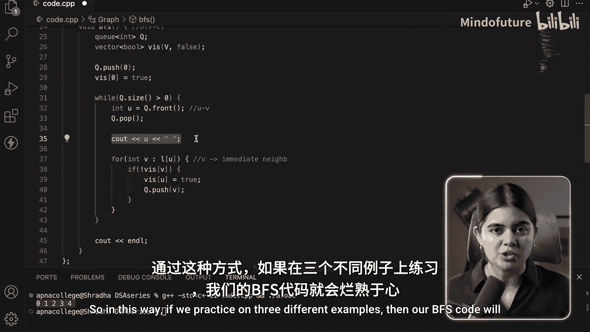

# C++ 数据结构与算法课程：110：图中的广度优先搜索遍历 🗺️


在本节课中，我们将要学习图数据结构中的一种基础且重要的遍历算法——广度优先搜索。我们将从概念入手，通过示例理解其工作原理，并最终用C++代码实现它。

## 概述

广度优先搜索是一种用于遍历或搜索图或树的算法。它的核心思想是“由近及远”，即优先访问起始节点的所有直接邻居，然后再逐层向外探索。这与树的层序遍历非常相似。

## BFS 核心概念与规则

上一节我们介绍了BFS的基本思想，本节中我们来看看其具体的工作规则。

BFS算法遵循一个基本原则：**优先访问当前节点的所有直接邻居**。这意味着在访问图中任何其他更远的节点之前，必须先完成当前“层级”所有节点的访问。

为了实现这一点，我们需要一个起始点。在树中，这个起点通常是根节点。在图（特别是无向图）中，我们可以选择任意一个顶点作为起点。算法还需要一个关键机制来避免重复访问和无限循环：**记录节点的访问状态**。我们使用一个布尔数组 `visited` 来标记每个顶点是否已被访问过。

算法从起点开始，将其标记为已访问并放入一个队列中。然后，只要队列不为空，就重复以下步骤：
1.  从队列中取出一个节点。
2.  访问该节点的所有邻居。
3.  对于每一个尚未被访问过的邻居，将其标记为已访问并加入队列。

这个过程确保了节点是按照它们距离起点的层级顺序被访问的。

## BFS 算法步骤详解

以下是BFS遍历的具体步骤，我们将通过一个例子来演示。

假设我们有一个简单的无向图，包含顶点 0, 1, 2, 3, 4。其邻接关系如下（以邻接表表示）：
*   0 连接 1, 2
*   1 连接 0, 2
*   2 连接 0, 1, 3, 4
*   3 连接 2
*   4 连接 2

我们选择顶点 `0` 作为起点。

**初始化**：
*   创建一个队列 `q`。
*   创建一个布尔数组 `visited`，大小等于顶点数，初始值全部为 `false`。
*   将起点 `0` 标记为已访问 (`visited[0] = true`)，并将其加入队列 `q`。

**遍历过程**：
1.  队列初始状态: `q = [0]`。
2.  取出队首 `0`。访问其邻居 `1` 和 `2`。
    *   邻居 `1` 未被访问，将其标记为已访问并加入队列：`visited[1]=true`, `q = [1]`。
    *   邻居 `2` 未被访问，将其标记为已访问并加入队列：`visited[2]=true`, `q = [1, 2]`。
3.  取出队首 `1`。访问其邻居 `0` 和 `2`。
    *   邻居 `0` 已被访问，忽略。
    *   邻居 `2` 已被访问，忽略。队列变为 `q = [2]`。
4.  取出队首 `2`。访问其邻居 `0`, `1`, `3`, `4`。
    *   邻居 `0` 和 `1` 已被访问，忽略。
    *   邻居 `3` 未被访问，将其标记为已访问并加入队列：`visited[3]=true`, `q = [3]`。
    *   邻居 `4` 未被访问，将其标记为已访问并加入队列：`visited[4]=true`, `q = [3, 4]`。
5.  取出队首 `3`。访问其唯一邻居 `2`（已访问，忽略）。队列变为 `q = [4]`。
6.  取出队首 `4`。访问其唯一邻居 `2`（已访问，忽略）。队列变空，遍历结束。

最终的BFS访问顺序（输出）是：**0, 1, 2, 3, 4**。

## BFS 的C++代码实现

理解了算法步骤后，现在让我们看看如何用C++代码来实现它。我们假设图使用邻接表（`vector<vector<int>>`）存储。

```cpp
#include <iostream>
#include <vector>
#include <queue>
using namespace std;

void bfsTraversal(vector<vector<int>> &adjList, int startVertex) {
    int numVertices = adjList.size();
    vector<bool> visited(numVertices, false); // 初始化访问数组
    queue<int> q; // 创建队列

    // 从起始顶点开始
    visited[startVertex] = true;
    q.push(startVertex);

    while (!q.empty()) {
        int currentVertex = q.front();
        q.pop();
        cout << currentVertex << " "; // 访问当前顶点（此处为打印）

        // 遍历当前顶点的所有邻居
        for (int neighbor : adjList[currentVertex]) {
            if (!visited[neighbor]) {
                // 如果邻居未被访问，则标记并加入队列
                visited[neighbor] = true;
                q.push(neighbor);
            }
        }
    }
    cout << endl;
}

// 示例：在主函数中调用
int main() {
    // 假设有5个顶点，构建上述示例图的邻接表
    vector<vector<int>> graph = {
        {1, 2}, // 顶点0的邻居
        {0, 2}, // 顶点1的邻居
        {0, 1, 3, 4}, // 顶点2的邻居
        {2}, // 顶点3的邻居
        {2}  // 顶点4的邻居
    };

    cout << "BFS Traversal starting from vertex 0: ";
    bfsTraversal(graph, 0); // 输出: 0 1 2 3 4

    return 0;
}
```

## 时间与空间复杂度分析

*   **时间复杂度**：`O(V + E)`。其中 `V` 是顶点数量，`E` 是边的数量。每个顶点被访问并出队一次（`O(V)`），在访问每个顶点时，我们会检查它的所有边（`O(E)`）。
*   **空间复杂度**：`O(V)`。主要空间消耗来自存储访问状态的 `visited` 数组（大小V）以及队列 `q`（在最坏情况下可能存储所有顶点）。

## 初学者常见错误与提示

在实现BFS时，初学者常犯一个关键错误：**错误地设置访问标记的时机**。

**错误做法**：在从队列中取出节点时才将其标记为已访问。
```cpp
// 错误示例片段
while (!q.empty()) {
    int u = q.front();
    q.pop();
    visited[u] = true; // 错误！此时标记太晚
    // ... 处理邻居
}
```
**问题**：考虑一个三角形图（三个节点两两相连）。节点A先入队。当处理A的邻居B和C时，由于它们都未被标记，会被重复加入队列。这可能导致逻辑错误或非预期的访问顺序。

**正确做法**：**在将节点加入队列的同时，立即将其标记为已访问**。这确保了每个节点只被加入队列一次，正如我们上面的代码所示。
```cpp
visited[startVertex] = true; // 起点入队前标记
q.push(startVertex);

// 在循环中，邻居入队前标记
if (!visited[neighbor]) {
    visited[neighbor] = true; // 正确！入队前标记
    q.push(neighbor);
}
```

**学习提示**：多在不同的图例（如链状、星状、环状）上手动画出BFS的执行过程，并对照代码理解。这将极大地帮助你掌握BFS，并为后续解决更复杂的图论问题打下坚实基础。

## 总结



本节课中我们一起学习了图的广度优先搜索遍历。我们从BFS“由近及远”的核心思想出发，详细讲解了其算法规则和步骤，并通过一个具体例子进行了推演。随后，我们给出了完整的C++实现代码，并分析了算法的时间与空间复杂度。最后，我们指出了初学者在实现时容易犯的“访问标记时机”错误并给出了正确做法。BFS是图算法中的基石，理解并掌握它对于学习后续更高级的图算法至关重要。