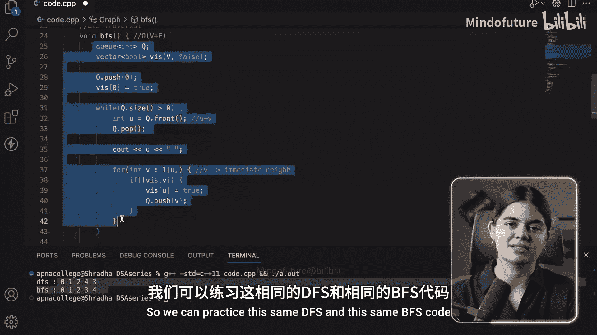

# C++-DSA课程-｜-数据结构-｜-leetcode-｜-Apna-College-｜--Complete-C++-Dsa-Course-p111-P113_图中的深度优先搜索遍历-数据结构与算法--BV18oUGBkEmV_p111-

Hi， everyone， and welcome to the complete D series and Arch lecture canham graphs can under D traveral code detail meval last lecture can graphs per B traveralne already study Arch lecture G D traveral algorithm dry run code and time space complexity code detail meval next traveral is。

 That is depth for search Y D traal D traveral is different from B traveral D traveral car rule k。😊。

Keep going。To first。Unvisited neighbor。B immediate unvisited neighbor Jo first united neighborja our sequence was 0。

1，2，3 and 4ham and second not and first unvisit neighbor。😊，2 K8 neighbor have1。

 which is already visited。 those are Ne4， which is not visited。

 Tomkygi4jaang4kujaar visit Kgi4 v print Kgi and Ica first unvisited neighborjaki exists k I visitgi k。

😊，3 next from visit and we have covered the entire graph to basically rule change going to the first unvisited neighbor immediate So this is the difference between and is basically is basically direction。

😊，And is implementne plain normal simple recursions implement we can also use an explicit generally majority implementation that will be using recursion which in my opinion is a much simpler implementation as compared to using an explicit recursion co Now how do we write the code for D function let us call this function sub source node is source nodeham U and notes consider source node and also going to get our vector of boolean values visited。

😊，as visitedari visited 0，1，2，3 and 4ri in the and then we can mark as visited print simply out visited of as true Je of for in of。

😊，K if he neighbor Ugar， not visited him。If visited of V is false to subay Paleham's first unvisited neighbor go visit Caringgi。

 those neighbor Kileham D F Sco called Kinggi， next time， source node V Bjaga。

 So just to specify this is R U and this is our V。 This is basically the source node and this is basically the destination。

 to Eucica Jobi destination。 A next time Klevo source Bjaga。

 and hum up Ni Sakiat visited go Mark Kthinggi。 Ts therikiay， this is the if statement。

 this is the for loop。 and this is the。😊，D with is equal to 0 is basically our output asvis is equal tovis is to which is second。

😊，and next we are going to analyze neighbor visited second neighbor unvisit and marked as call this is also and go to and this is tra sequence sequence and。

Put the pseudocode into C plus code， the C plus code km。

me basically a DF S functionnaanderham D S traal the let write this function Dfs function cards return v that will be voidander we are also expecting this vector of Boolean values。

 which is called visited already false value initial sub with some space and we want to mark R source as visited tobaaris in teacherger V。

😊，In list of you。Sse if the neighbor is unvisited to visited ofki false those case may sub and willll also passcur now the problem in this is and and main function function So instead of calling this function we are going to call this helper or function is function simply is going to be0 and of boolean values。

😊，And we'll call this visitor is initialized cardingge with false values。

 and hum D F S helperco call Carrige for our source note。Along with visited vector。

 the Jia main functions I call carrying a BFS K Jge is by simply DfS co call Kna E function call Hoga。

😊，Zero Hamari source node Hoge visited vector Passhoga and is DFS helper function Ca Co logic Uskuhaminvoringgi。

 Let us save the code and run it。😊，Tohammaara output exactly same Nira。

And let us check the graph once Amari graph can edge Ho from 0 to1， correct a1 say2 tu。

 correct a1 say3 tu， correct a2 say3 tu to E2 say3 v Eari graph can exists Neta justni upper extra create Ktier we are going to remove this edge Y O graph。

 this is the graph just perney BfS and DfS donukuron to be DfS K output here say implement Kthe to Df S K。

 this is the output that we have gotten let us also do C out end of line here。😊。

The DFS K Hamapas you output here v output here which is 0，1，2，4 and 3。 in fact near Harper。

 let us see out。😊，D。And similar the case humni BFS casual output here。say printvanival。

Let's save this and run。The subse Df output here， which is 0，1，2，4 and 3 Bfander， it is 0，1，2，3 and4。

 So there is a difference in both the outputs and is3f and complexity logictext then the time complexity is same for the graph which is v and but depending upon the situations just like I suggested for minimum three examples and we also have to practice writing the code and also check if the answer ofran and the answer of our code are same or not core extra which I wanted to share with you regarding。

😊，and basically a implement weve assumed that the entire graph is connected disconnect is connected with one one is connected with two is connected with and and different connections exist core logic multiple source for exist first time and next time。

Kas 4 to Jubiipas vers is exist kthjo visit Nehipathhi a single sourceat Hamun Sabuko next time source k Ane B F S and Dco implement K。

 What that means is Giari D S equation kander。 There is some indication Kragra disconnected bios Those case may D F S called kmi simply D S helper go calledne I loop Chilani。

😊，Just loop canander Hamsari Kaari verte is sci checking from v is equal to 0 to v less than v。😊。

Be plusless Sarigiari Verts is skillly checkeringgi Job he Verts。Visited Nehihoga， in fact。

 is a Vii Jegaham I Klium， Jobihamara， Aeth vertex visited Nehihoga， D F S helper Kiim。😊，咁我 see。

Pas K as the source sourceja and thepa multiple starting points who gave different different components perform So this is a simple change that we can do to our future lecture graphs are going to do implementation。

 But for the sake of practice and for the sake of is completely and is the same is and is he same practice I hopes completed today's lecture you can the also share progress with me on lecture learning and keep exploring。

😊。

