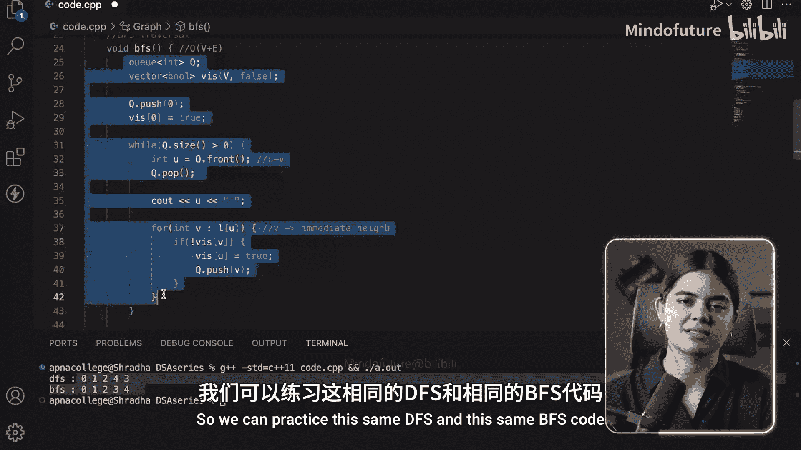

# C++ DSA课程：111：图中的深度优先搜索遍历 🧭


在本节课中，我们将要学习图数据结构中的另一种基础遍历算法——深度优先搜索。我们将详细探讨其核心思想、与广度优先搜索的区别，并学习如何用C++代码实现它。

上一节我们介绍了广度优先搜索，本节中我们来看看深度优先搜索。

## 概述

深度优先搜索是一种用于遍历或搜索树或图的算法。其核心策略是尽可能深地探索图的分支，当到达尽头时再回溯。这与广度优先搜索“逐层”探索的策略截然不同。

## DFS的核心规则

深度优先搜索遵循一个简单的规则：从当前节点出发，总是访问其**第一个未被访问的邻居节点**，并沿着这条路径一直深入下去，直到无法继续，然后回溯到上一个节点，尝试其他未访问的邻居。

## DFS与BFS的遍历顺序对比

为了理解区别，我们以一个图为例。假设图的邻接关系如下：
*   节点0的邻居是：1, 2, 3
*   节点1的邻居是：0, 2
*   节点2的邻居是：0, 1, 4
*   节点3的邻居是：0
*   节点4的邻居是：2

以下是两种遍历从节点0开始的访问顺序：
*   **BFS顺序**：0, 1, 2, 3, 4
*   **DFS顺序**：0, 1, 2, 4, 3

区别在于，DFS在访问节点1后，会立即深入访问节点1的第一个未访问邻居（节点2），接着访问节点2的第一个未访问邻居（节点4）。而BFS则会先访问完节点0的所有直接邻居（1,2,3）后，才访问下一层节点（4）。

## DFS的算法实现

深度优先搜索通常使用**递归**来实现，这种方式代码简洁直观。其核心思想是“标记-访问-深入”。

以下是DFS的递归算法伪代码：

```
函数 DFS(当前节点 u, 访问标记数组 visited):
    1. 标记节点 u 为已访问 (visited[u] = true)
    2. 输出或处理节点 u
    3. 对于节点 u 的每一个邻居节点 v：
        如果 v 未被访问 (visited[v] == false)：
            递归调用 DFS(v, visited)
```

## 将伪代码转化为C++

现在，我们将上述逻辑转化为实际的C++代码。我们通常编写一个辅助函数来执行递归逻辑，并在主函数中初始化必要的变量。

```cpp
#include <iostream>
#include <vector>
using namespace std;

// DFS递归辅助函数
void DFS_Helper(int source, vector<bool> &visited, vector<int> adj[]) {
    // 1. 标记当前节点为已访问
    visited[source] = true;
    // 2. 处理当前节点（这里选择打印）
    cout << source << " ";

    // 3. 递归访问所有未访问的邻居
    for (int neighbor : adj[source]) {
        if (!visited[neighbor]) {
            DFS_Helper(neighbor, visited, adj);
        }
    }
}

// 供外部调用的DFS函数
void DFS(int source, int V, vector<int> adj[]) {
    // 初始化访问标记数组，所有节点初始状态为“未访问”(false)
    vector<bool> visited(V, false);
    // 调用递归辅助函数
    DFS_Helper(source, visited, adj);
    cout << endl; // 遍历结束，换行
}

// 主函数示例
int main() {
    int V = 5; // 图中节点数量
    vector<int> adj[V]; // 邻接表

    // 构建示例图 (0->1, 0->2, 0->3; 1->0, 1->2; 2->0, 2->1, 2->4; 3->0; 4->2)
    adj[0].push_back(1); adj[0].push_back(2); adj[0].push_back(3);
    adj[1].push_back(0); adj[1].push_back(2);
    adj[2].push_back(0); adj[2].push_back(1); adj[2].push_back(4);
    adj[3].push_back(0);
    adj[4].push_back(2);

    cout << "DFS 遍历顺序 (从节点0开始): ";
    DFS(0, V, adj); // 输出: 0 1 2 4 3

    return 0;
}
```

## 处理非连通图

上述代码假设图是连通的。如果图由多个互不连通的子图（组件）构成，从单一源点出发的DFS将无法访问所有节点。

以下是修改方案，确保遍历整个图的所有组件：

```cpp
void DFS_Disconnected(int V, vector<int> adj[]) {
    vector<bool> visited(V, false);
    for (int i = 0; i < V; i++) { // 遍历所有节点
        if (!visited[i]) {        // 如果节点i未被访问过
            DFS_Helper(i, visited, adj); // 以i为新的起点开始DFS
            cout << endl; // 一个连通组件遍历完成
        }
    }
}
```
这段代码会检查每一个节点，如果它未被访问，就以它为起点发起一次DFS，从而覆盖图中所有的连通分量。

## 复杂度分析

*   **时间复杂度**：**O(V + E)**，其中V是顶点数，E是边数。每个顶点和每条边都会被访问一次。
*   **空间复杂度**：**O(V)**，主要消耗在递归调用栈（最坏情况深度为V）和访问标记数组`visited`上。

## 总结



本节课中我们一起学习了图的深度优先搜索遍历。我们理解了DFS“一路到底再回溯”的核心思想，掌握了其递归实现方法，并学会了如何用C++代码实现。同时，我们也了解了如何处理非连通图，并分析了算法的时间与空间复杂度。请务必动手实践代码，并比较DFS与BFS的输出结果，以加深理解。