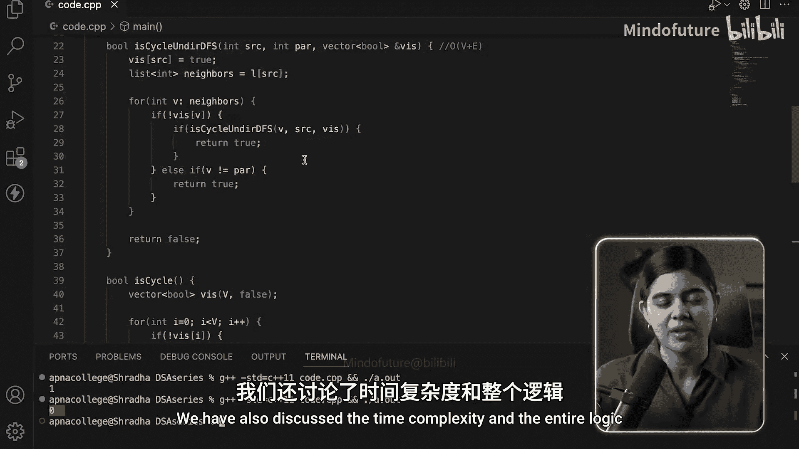

# C++-DSA课程-｜-数据结构-｜-leetcode-｜-Apna-College-｜--Complete-C++-Dsa-Course-p112-P114_使用DFS检测无向图中的环-数据结构与算法--BV18oUGBkEmV_p112-

Hi and welcome to the complete D series。 and today we're going to learn about cycle detection in undirected graphs usingja also re for company sheet in the description box to start let's talk about the general phenomena of detection first is our undirect generally undirected graphs and second graphs exist graphs graph undirect exist In fact graphs graphs hierarch structureium and in fact。

verse。😊，Algothms putting at DFS and BFS in Donok under humick visited Boolean era usektheme。😊。

algorithmsham visited Boolean to track is Boolean es And when we are using thisor basically single node detection undirect graph graph undirected graph use use and there is also something calledjoint set union which is basically a structuredirect graph Similarlyly directed graphs use use plus there is an algorithm called algorithm normally。

😊，Loical sort。Tological sort is a thing in graphs seriesjo directed graph top graphdirect graph multiple graphs multiple generally will be a intuitive simpler approach。

😊，y is generally more intuitive I'll also give you a link of overflow articledirect detectiondirect basically。

😊，Is our depth first searchri and visitedole is an visited of and12 and3s suppose is thes for all the neighbors and this is not visited next is and this is。

If statement this iss and which is visited which is。s which which is visited at this whichham。

W a 0 kilo parent would be maybe -10 c 1 per gto 1 k parent convoa。

1 k parent was 0 A Gham Yahaa2 per gto 2 k parent convo 2 k parentwa1 to ca caseec naked 2 k8 ignored as he exists Cathio already visited here。

😊，2 kai Usca8 Ne exist Qatar， which is already visited， which is one。😊。

Jo Uka parent to be him Ttuka a neighbour who visited her and Uka Par。

 So this is to completely normal in D F S revversal or any kind of traversal。 Kigarm is ra。

 They say I am one k through Agarm Tuba。 The one who obviously visited Hoai。

 But too k Iuserra neighbour has0。 Joe visited her per parent N。😊，which is visited。

 but it is not the parent exists in which is。Condition we say that we have detected a cycle in our graph Iska example。

 let us suppose basically So this is theeth node。 This is the first note。

 and this is our second note。 and nons next ands， which is already visited is parent is to be0 parent is to be the parent is going to be0 or which is a very natural thing。

😊，second is of which is completely visited but that is and would havedirect。

b and what are the conditions for visited or detection so that we can compare are going to include an additional which will be condition which will be an condition。

lecture。😊，Jo unvis visited unvisited visited is the condition for back else is not equal to visited case true which means that there is that exists in and un is a cycle that exists。

😊，Condition use case return there is a cycle that exists。

 this becomes condition indicate is this is logicdirect convert logic already created。

Graph can same graph just example other per here this is the same graph come example area and edge add graph create we have already created this class called graph can add edge function E class can function which is called boolean is cycle E see function use cycle detection。

😊，Though Hamraju graheha G dot I Cyko call kriga and I Cy to Jobi function return kriga print I Cyura I Cy is not a recursive function。

 Ham or function manang， which is called Boolean。😊，Is cycle。Undirected D F。

m and this will be the functionura logicri and visited called visited。😊。

The yaberak Losejubi So Nose visited Ma， So this will become visitedhamris Adri， the source Nodri。

 which will be a list of integers。😊，ang neighbors， which will be L of are source node Graka implementation different ho from any other platform or whatever way you have implemented graph。

 And that is completely O logic basicallyss， this is the implementation that you can also follow for your neighbor。

I make Lo Cha la， so each neighbor will be we if the neighbor is not visited。

If visited of V is false， those case ma D F S Kii I he same function key called and vnevapa Kingi Ija Son andne visited Kopa K and Yagaippa true vlahammed A Le deier。

 those case may Yahi returning true value I see Ka else if vga， in fact，😊，Else。

 if vki neighbor visited， but the neighbor value is not equal to parent value。

 case may return true value false value。 So this is the entire logic is function called function connected connectedri notes connected2 parts3 parts multiple component and to basically This will be the visited vector of Boolean type。

😊，Just say howm initialized cutting of size V and values false。

A loop chai from integer I equals0 Sariari vertices per Jepta Kaari Koibi vertex visited I node is not visited。

 Tomkne is function recur functionko call and Yahapa Pa King Ime， which will be the source node。

 basicallymeham pass Kingi starting parent， which will be -1 and visited Eri。😊。

And Agar Yahariri cycle detector true value else last maham return false value。

 So this is the entire logic。 This is the main function core function。

 say main function and core logic is functionura function it is using D logic D conditions time complexity that will be big of V plusri complexityari cycle detection with D complexity let us save this。

😊，And run our code， Oto yahaper。We won't have this。 Let us rerun the code。 And Ham1 printga。

 which means to Mahamari is gra the cycle exists Je Gr Am opposite case they supposeju gra I Sgra Iari ye va E exists inta Am is Eari gra cycle exists in02 va E。

Aham， let's comment this out。 Let's save it。 and rerun the code。 Those casemen。

 there is no cycle that exists in the graph。 So is the cycle detection complete using in our undirect graph we also discussed the time complexity and the entire logic。

 I hope lecture logic next lecture detection tra complete if you have successfully completed today's lecture you can mark it in down in the says can also share your progress with me on description box lecture learning and keep exploring。

😊。

