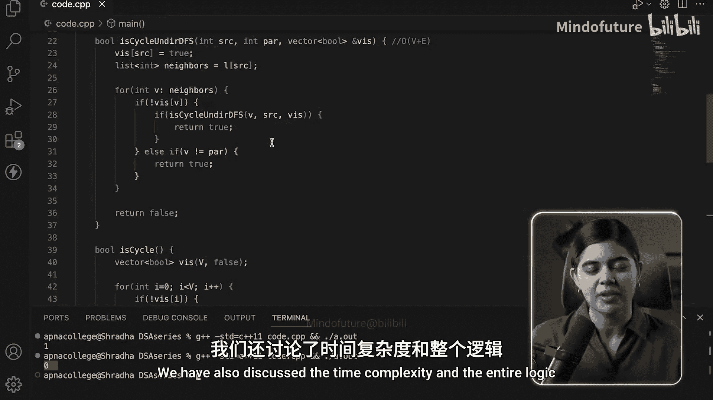

# C++ DSA课程：112：使用DFS检测无向图中的环 🔄


在本节课中，我们将学习如何使用深度优先搜索算法来检测无向图中是否存在环。我们将从理解检测环的基本现象开始，逐步深入到具体的算法实现和代码逻辑。

## 概述

检测图中的环是图论中的一个基本问题。对于无向图，我们可以使用深度优先搜索算法，并配合一个记录访问状态的布尔数组来实现。本节课将详细介绍这一方法的逻辑和实现步骤。

## 检测环的基本概念

首先，我们需要理解在无向图中检测环的一般现象。无向图由节点和连接节点的边组成。当我们在图中进行遍历时，如果发现一条边指向了一个已经访问过的、且不是当前节点父节点的节点，那么就说明图中存在环。

## 使用DFS检测环的算法逻辑

以下是使用深度优先搜索检测无向图中环的核心算法逻辑。我们将通过一个布尔数组 `visited` 来跟踪节点的访问状态。

**核心逻辑伪代码**：
```cpp
bool isCyclicUtil(int v, bool visited[], int parent) {
    visited[v] = true;
    for (每个与v相邻的节点i) {
        if (!visited[i]) {
            if (isCyclicUtil(i, visited, v))
                return true;
        } else if (i != parent) {
            return true;
        }
    }
    return false;
}
```

**算法步骤解释**：
1.  将当前节点标记为已访问。
2.  遍历当前节点的所有邻居节点。
3.  如果邻居节点未被访问，则递归调用函数进行深度搜索，并将当前节点作为父节点传入。
4.  如果邻居节点已被访问，且该邻居节点不是当前节点的父节点，则说明检测到了一个环。
5.  如果遍历完所有邻居都没有发现环，则返回 `false`。

## 完整的代码实现

现在，让我们将上述逻辑整合到一个完整的图类中。假设我们已经有一个图类，它能够添加边并存储邻接表。

**完整的检测环函数示例**：
```cpp
class Graph {
    int V; // 顶点数
    list<int> *adj; // 邻接表

public:
    Graph(int V);
    void addEdge(int v, int w);
    bool isCyclic(); // 检测环的主函数
};

bool Graph::isCyclicUtil(int v, bool visited[], int parent) {
    visited[v] = true;
    list<int>::iterator i;
    for (i = adj[v].begin(); i != adj[v].end(); ++i) {
        if (!visited[*i]) {
            if (isCyclicUtil(*i, visited, v))
                return true;
        } else if (*i != parent) {
            return true;
        }
    }
    return false;
}

bool Graph::isCyclic() {
    bool *visited = new bool[V];
    for (int i = 0; i < V; i++)
        visited[i] = false;

    for (int u = 0; u < V; u++) {
        if (!visited[u])
            if (isCyclicUtil(u, visited, -1))
                return true;
    }
    return false;
}
```

**代码说明**：
*   `isCyclicUtil` 是递归辅助函数，实现了DFS和环检测的核心逻辑。
*   `isCyclic` 是主函数。它初始化访问数组，并遍历图中的每个连通分量。对于每个未访问的节点，调用 `isCyclicUtil` 函数。
*   初始调用时，父节点参数设置为 `-1`。

## 时间复杂度分析

该算法的时间复杂度为 **O(V + E)**，其中 V 是顶点数，E 是边数。这是因为每个顶点和每条边在深度优先搜索中最多被访问一次。

## 运行示例

我们可以创建一个图实例并测试环检测功能。

**测试用例1（有环图）**：
```cpp
Graph g(3);
g.addEdge(0, 1);
g.addEdge(1, 2);
g.addEdge(2, 0); // 这条边构成了环
cout << g.isCyclic(); // 输出：1 (true)
```

**测试用例2（无环图，例如树）**：
```cpp
Graph g(3);
g.addEdge(0, 1);
g.addEdge(1, 2);
// g.addEdge(2, 0); // 注释掉构成环的边
cout << g.isCyclic(); // 输出：0 (false)
```

## 总结



本节课中，我们一起学习了如何使用深度优先搜索算法来检测无向图中的环。我们了解了检测环的核心条件：当遍历过程中遇到一个已访问的节点，且该节点不是当前节点的父节点时，即表示存在环。我们实现了完整的代码，并分析了算法的时间复杂度。掌握这一方法对于理解和解决更复杂的图论问题至关重要。