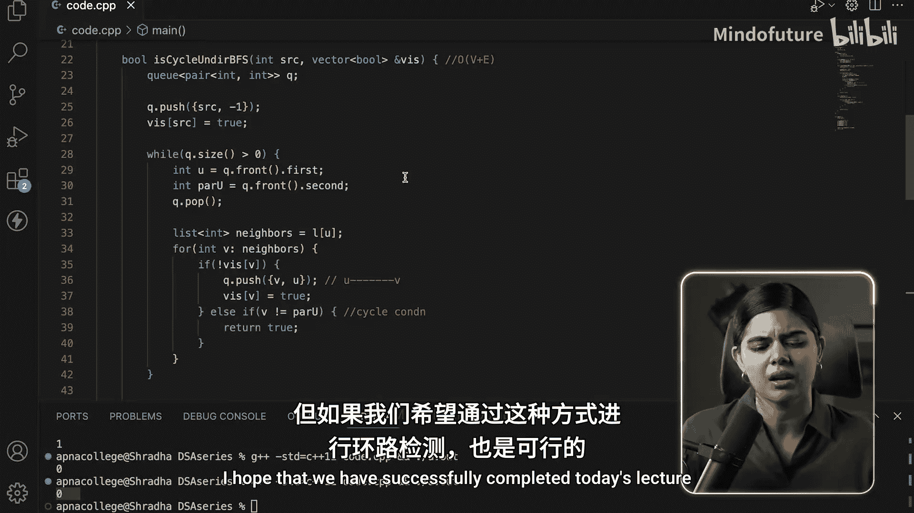

# C++-DSA课程-｜-数据结构-｜-leetcode-｜-Apna-College-｜--Complete-C++-Dsa-Course-p113-P115_使用BFS检测无向图中的环-数据结构与算法--BV18oUGBkEmV_p113-

Hi everyone welcome with the complete series。 and today we' are going to talk about cycle detection in undirected graphs using box problem is called cycle detection in undirected graph using bread my basic before the lecture would complete basically undirect is。

😊，The loop exist kat and I I cycle or cycle return and cycle basic condition of the undirect last lecture can we discuss which is basically the condition of a back edge。

😊，Back edge special type basically B perform perform performs trasne or basic source visited。😊。

I visited bullion Ericriki helps him track Kney K in company already visit K。😊。

Is thereriki Kahamra Bscallog de Jmahammed cuku initial we have or Q。

Dander integer values and initially example node is going to be 0 is basically the starting node visited visited as true does not become empty is greater than 0。

😊，Ttak a k kque， Hamari Jobi K No him。In fact， is current let us supposess and there is a which is not visited there is a v。

 which is not visited and visited second So this is condition。

This becomes our for loop on the neighbors。Andju So this is the entire logic of how works say So this is complete let suppose and。

and visited。theoretical logic。Coin or no hey Co or neighbour Hes too。

 Joki visited he per2 is not parent of one to Ika Mala Yahapa I special extra edge exist cart。

 Gkoham Kahe back edge。condition of undirect basically one basically there are multiple ways to reach the same is the condition of meet basically。

Hmharri Nord Gille escape parent Nordko S metroinggi。To0 kilo-1123ly visited。Ki neighbour。

 which is already visited and which is not the parent。

 This is the condition for bagage Matla Yaha or Hamme Hamari cycle miga。

 to those Chiizoco implement kt change k B F scanander， Hamni cycle detection cookr。 So basically。

 what exactly do we have to do。 Let us remove this。😊，Upne code canander。

 what exactly do we have to do E torijo Qke under A though in teacher values goes to game。😊。

Pli Hamari Nodojagi and Duri integer value is going to be the parent to Aham Pe Kosto kringgi E mehamari Nodhogi and Duowska。

 Parhammni K and the kgi。 So if this is the cu。ands what do we have do visited visited is not equal to visited is the condition of or false return and。

Last me。false statement So this is the overall logic basis as plus So if we look at the dry of the entire process。

😊，me basically logicnagi to0 and parent1 Ki Q to next time and I visited Ma Kgi next time ja Kgi toari。

 first neighborjagaka parent I visit K， second neighborjaga parent Ho I visit K and third neighborjaga3 I visit Kgi。

 next time Ham Q。😊，Jaop Curingitto Isbar Kki start me。Now we are standing at one to10。

 which is already visited which but or is the entire logicdirect let convert this logic created the same you have created your custom basically function let's call this boole。

😊，Cycle is cycle function Hamran normal function do you say hum up knee。Mean function。

Access carryinggi Toham sea out Karai Jobii is Cyka。

Loic Coga and Hamrajo core B F Sca code U say him perform Kdu function Gander。

 Let's call this a cycle in undirected graph using。B F。To yevo functionander。H B S calledari。

 we are going to get a boolean vector。ander visited Ko。

A Q created calculated subel though will have a Q。Of bed off。

In teacher and in teacher values is Ko Q Q can Shiwa me jaringgi。

Thanpushkaringgi Ikto Ani So Nodgo and isk parent correctlyrac a -1 plus visited of So Nogo mark Kbins trokebadilu Chalangi Jepta cua size is greater than 0。

😊，These front。Jobi first element Hoga， that will be the current node， which is the UF node。

And parent of you is equal to Kqueran per Jobi second valueer and Kse Po Kne Perkucasrigiri neighbours Fer Luchi a at Nordsgiri neighbours Mohamari L Kda told him。

This lists say， how do we access the neighbours， basically list of in teacherger。

 If I want to access the neighbours， this is going to be L of you and of nasari neighbours。

 but Luchalainge in Tea V。 This is a for each loop for all the neighbours。 I'm Che Klingge Agar。

 There is an unvisited neighbour we。Tkona visit Kaika parentjagaika parentjaga U Viek E Ferm visited of Viko true and Iikaeljaga V is already visited。

 but v is not equal to Yuka parent or parent of。😊，You。

So is case canander Hamriasic backage you exist Ka Aga Yu parent is not equal to we to Ya。

 This is the condition。 and he hasim return causing a true value that there is a cycle that exists。

 So this is basically our cycle condition。s。 So this is the core logic disk basis for cycle detectionf logic isari。

😊，Lop to e vector create Kleium boion， which will be visited。

 Just canar size is v false values says quo initialize K or sariari nodeari Ger su loop If there is an unvisited node I to say source bymi B F S use for Ina is function kander because our graph could be disconnected General G who imagine kham connected graphph imagine kemhamari G So would disconnected disconnected kki G kander。

😊，T nodes a 1，2，3， Jo the exist Cartheier and next to jo nodedes，4，5，6， voice the exist Carea。

 even though is component or is component can which with coi edge nee connected Ne。

 But fair B innoacic single graphco create k to the first component K under Kobi cycle now。

 But second component can exist K we should have a loop to ensure all the components are visited。

 and we are visiting all the nodes to find a cycle but。😊，AbibiM in Palta key this function。

Has returned a cycle for an eightheth note， Jmam visited Co。

Send Kingi to Yahiaiium return Kingi true value。Nto last me return false value。

 So this is the function。 just call main function a call is cycle or is cycle indirectlyari B valley function co overallum is function key。

 that is going to be the same as B F S function keyum。

 which will be bigger of v plus sameum So lets test it。

 true cycle But let us supposeham is case cycle in is in Let us remove this0 H。😊。

comment false false Similarlyham and and false value which is logic preferred approach is using the preferred most intuitive depending upon completed today's lecture If you have completed the lecture you in is share progress with on。

😊。

Thinkrink。