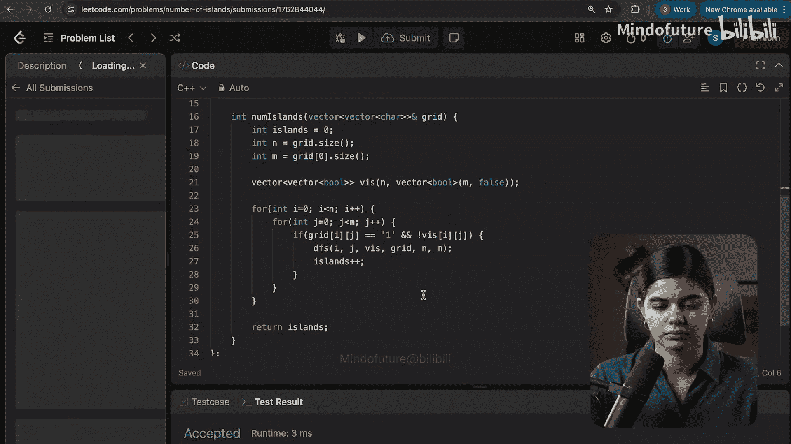

# C++-DSA课程-｜-数据结构-｜-leetcode-｜-Apna-College-｜--Complete-C++-Dsa-Course-p114-P116_岛屿数量-矩阵中的连通分量-Leetcode_200--BV18oUGBkEmV_p114-

Hi everyone， and welcome to the complete series。 And today we are going to solve an important D problem。

 which is called number of islands。 available Also there is link for company in the box this problem is called number of islands。

 and this is also problem 200 on lead basically function given2 grid2 grid。

 which is of n cross cross  grid and grid numbers or we can have1 basically represents land and represents is the land is the land is the land and basically and。

😊，out number of island islands are basically lands which are surrounded by water and surrounded is information which is already given in the question basically is island and So this is number Similarlyly second vertical in third island。

😊，G these are the two ones， and this is the third island basically returnan that should be equal to three months up there are three islands which are existing in this grid as problem as intuitivene butne basically but this we can imagine it basically then that isju or that is the connection basically let's suppose。

😊，and and Similarly third third and。😊，Yam total components quo they。😊。

Total aham components go count curry to aari graph Kendle。 This is the first component。

 This is the second component。 This is the third component。 Ani Al D， F S， B。

 F S vniurrani graph lectures Kender barkiki hergra is aru near connector Koigranahihu。😊。

nodes exist node exist multiple disconnect So is the first is the second is the third and can we say that the in are equal to the number of basically which or。

😊，I give graphra canner， that will be the total number of islands Abraham is py grid co G caner convert ksing。

😊，Basically。hamme Bari would chahi at max all no we have a node1 in the graph at max 4 notes let us suppose we also have a one here at cha boundaryuska bottom at cha gra at max chahis This is the first neighbor。

 this is the second neighbor。 this is the third neighbor。

 This is the fourth neighbor is says neighbors possibleto horizontally a verticalgarari cell number I N Gka top neighbor top neighbor cell number I1 a is right。

😊，Right and j plus1 bottom plus1 and and and combinations second。

s number of islands number of islands out in general， how many。

Do we have in the graphney to basically node single node I and column which is basically source notean visited complete clarity plus。

😊，2jo visited and visited or different different source notes connected number one。😊。

Uskeba next to callgi Iham I visit this will become our island number 2keba next call Igi visit visit this will become our island number 3 to Jese D S visit D F S basic logic。

😊，Is very simple。 Basically， Jam D S par subse visited Ma K So Noko。

 which is Iji visit K Ukero S D Skisegi， which will be I-1ji Samim visited and Sarigi， Similarlyly。

rikija， Similarlyly rightki S， which will be Iji plus1。😊。

And I see thatris at DF S Kander Ham I plus1 comma J。

 which will be bottom neighborki call La Ge and DF S Kander。 I comma J -1。

 which will be Hamri left neighborki call is called K Ge This theque at DF S Kander。

calls if this neighbor is already visited or not visited to let us minimize this and and I N。😊。

ja Agar I kbi less than Ya J less than I kbibi greater than equal tobibi greater than equal to M return could travelneni Yabi visited of I That is already true。

 Those case already visited second time that grid of I J is not equal to1。😊。

 which is basically So this is logic function first time n is going to be second third function is main let us convert is。

😊，A this function can8 to hum up now answer liliium which is the number of islands just initialize Kium0 k at me upne n value liliium。

 which is the grid dot size plus upn m liliium which is grid of0 dot。😊，Size。

 so these are the basic things， g。Bae logiclyness a。 Let us create a void DF S function。

 DF S function， can themipathhiasic integer I N J I U me， we are going to have a vector。😊。

Of vector of Boolean values visited to create， we are going to have a vector of vector of Boolean values。

 which we call visited n and vector of Boolean。M and false grid basically plus for the sake of simplicity and。

😊，Neighbs who visit the neighbors who visit Ka same D F S called subse top neighbor visit Kagi top neighbor Ken I-1 g Sami visited Pa grid Pa Marija Mja。

 So this is the call for the top neighbor。😊，Fhamari， right， Neki Kajagi， similarly bottom。

 neighborki Kajagi and Ya left neighborki Kja right， Nebuki call Ken come。 I will be same。

Column J plus1 O Jaga bottom canny comela here。 I will be I plus 1 left canny come La here。

 It will be J -1， and I will remain same。 U base case K checker later Eto Hamari sell valid only H Mula I other less than 0 He Y J other less than0 H。

 Ya I becomes greater than equal to n or J becomes greater than equal to。😊，M。 Yair。

 who already visited him if visited of Ia J Yair Agaari Grker Ia Japer， we do not。

Have this one value。 He I reckon this is a character grid。 justkalami character Kiana。

 not with an in teacher in mebi condition through o， whose caseas simply Mala D Fco continue Carne。

 This is the core logic。 Ja D F S perform D F S perform herel4 in teacher I equals0 I less than n I plus plus。

😊，Or in teacherger J equals 0 J less than m J plus plus。Agarhamamiika kmaari grid Ia J Val。

Is equal to one。And Yejo G K under Hampa Salhe。 This is unvisited。 Mulab， visited of Iaji is false。😊。

Those case may and or visit Third and at the end are going to return the total number of So this is the overall logic make call for all and is the same loop。

😊，D S and B F S K Sari And this is the overall D S logic the logic D S connected component but form2 So let us run this code。

😊，And submit it。

So this is how we solve the problem of number of island。 So I hope Ni lecture。

 If you are successfully completed today's lecture， then you can mark it in his now in the comments。

 I help me can also share your progress with me on Twitter just calling Kaku description boxther Ja ask Mil next lecture them keep learning and keep excluding。

😊。