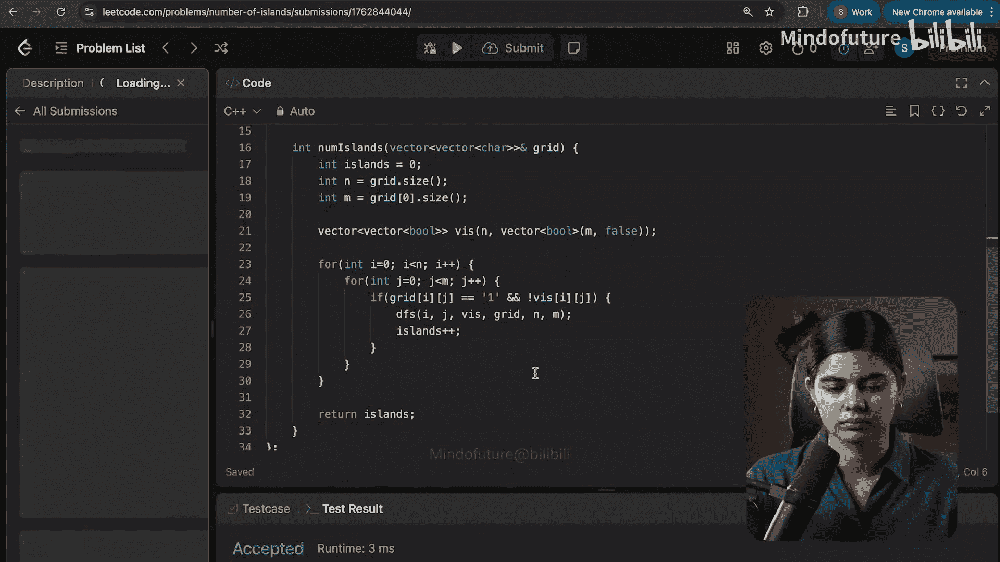

# C++ DSA课程：114-116：岛屿数量 - 矩阵中的连通分量


## 概述
在本节课中，我们将学习如何解决一个重要的数据结构与算法问题：**“岛屿数量”**。这是LeetCode上的第200题。我们将通过将二维网格视为一个图，并使用深度优先搜索算法来统计其中由“1”表示的陆地（岛屿）所形成的连通分量的数量。

---

## 问题理解
问题提供一个由字符 `'0'` 和 `'1'` 组成的二维网格 `grid`。
*   `'1'` 代表陆地。
*   `'0'` 代表水域。

岛屿被定义为**水平或垂直方向**上相邻的陆地（`'1'`）组成的区域，并且被水域（`'0'`）完全包围。我们的目标是计算网格中岛屿的总数。

**示例：**
```
输入：grid = [
  ["1","1","0","0","0"],
  ["1","1","0","0","0"],
  ["0","0","1","0","0"],
  ["0","0","0","1","1"]
]
输出：3
```
在上面的网格中，存在三个互不相连的由 `'1'` 组成的区域，因此岛屿数量为3。

---

## 核心思路：将网格视为图
解决这个问题的关键在于思维的转换。我们可以将整个二维网格想象成一个图：
*   **节点**：网格中的每一个单元格。
*   **边**：如果两个相邻的单元格（上、下、左、右）都是陆地（`'1'`），那么它们之间就存在一条边。

这样，问题就转化为：**在一个图中，找出所有互不相连的连通分量的数量**。每个连通分量就是一个岛屿。

---

## 算法设计：深度优先搜索
我们将使用深度优先搜索算法来遍历图，并标记访问过的节点。基本步骤如下：

1.  初始化一个计数器 `islandCount = 0`。
2.  遍历网格中的每一个单元格 `(i, j)`。
3.  如果当前单元格是未访问过的陆地（`grid[i][j] == '1'` 且 `visited[i][j] == false`）：
    *   将 `islandCount` 加1。我们找到了一个新的岛屿（连通分量）的起点。
    *   从这个单元格开始，执行DFS，访问并标记所有与其相连的陆地单元格。
4.  遍历完成后，`islandCount` 就是岛屿的总数。

**DFS函数的作用是“淹没”一个岛屿**：它会递归地访问当前单元格的上、下、左、右四个邻居。如果邻居是有效的、未访问过的陆地，就继续递归访问。

---

## 代码实现
以下是基于上述思路的C++代码实现。

```cpp
class Solution {
public:
    int numIslands(vector<vector<char>>& grid) {
        if (grid.empty()) return 0;
        
        int n = grid.size();    // 网格的行数
        int m = grid[0].size(); // 网格的列数
        int islandCount = 0;
        
        // 创建访问标记数组，初始化为false
        vector<vector<bool>> visited(n, vector<bool>(m, false));
        
        // 定义DFS递归函数
        function<void(int, int)> dfs = [&](int i, int j) {
            // 递归边界条件：索引越界、已访问、或当前单元格是水域
            if (i < 0 || i >= n || j < 0 || j >= m || 
                visited[i][j] || grid[i][j] == '0') {
                return;
            }
            
            // 标记当前单元格为已访问
            visited[i][j] = true;
            
            // 递归访问四个方向的邻居
            dfs(i - 1, j); // 上
            dfs(i + 1, j); // 下
            dfs(i, j - 1); // 左
            dfs(i, j + 1); // 右
        };
        
        // 主循环：遍历整个网格
        for (int i = 0; i < n; ++i) {
            for (int j = 0; j < m; ++j) {
                // 找到一个未访问的陆地起点
                if (grid[i][j] == '1' && !visited[i][j]) {
                    ++islandCount; // 发现新岛屿
                    dfs(i, j);     // 用DFS“淹没”这个岛屿
                }
            }
        }
        
        return islandCount;
    }
};
```

---

## 关键点解析
上一节我们介绍了代码的整体结构，本节我们来详细看看其中的关键逻辑。

**DFS递归函数的边界条件**：
这是确保递归正确终止的核心。条件包括：
1.  索引 `i` 或 `j` 超出网格范围。
2.  单元格 `(i, j)` 已经被访问过 (`visited[i][j] == true`)。
3.  单元格 `(i, j)` 是水域 (`grid[i][j] == '0'`)。

只要满足以上任一条件，递归就立即返回。

**主循环的逻辑**：
以下是主循环中寻找岛屿起点的步骤：
1.  使用两层循环遍历每个单元格。
2.  检查条件 `grid[i][j] == '1' && !visited[i][j]`。
3.  如果为真，说明找到了一个**新的连通分量**的起点。
4.  岛屿计数器加1，并从这个起点发起DFS，标记整个连通分量。

---

## 复杂度分析
*   **时间复杂度：O(n * m)**。其中 `n` 是行数，`m` 是列数。在最坏情况下，我们需要访问网格中的每一个单元格。
*   **空间复杂度：O(n * m)**。主要开销来自存储访问状态的 `visited` 数组。此外，在最坏情况下（网格全是陆地），DFS的递归调用栈深度也可能达到 `n * m`。

---



## 总结
本节课我们一起学习了如何解决“岛屿数量”问题。我们掌握了以下核心内容：
1.  **问题转化**：将二维网格中的连通区域问题，转化为在图论中寻找连通分量的问题。
2.  **算法应用**：使用**深度优先搜索**算法来遍历和标记一个连通分量中的所有节点。
3.  **实现细节**：注意递归边界条件的设置，以及如何通过主循环寻找每一个新的连通分量起点。

通过这个经典问题，我们巩固了图遍历算法在矩阵类问题中的应用，这是解决许多更复杂搜索问题的基础。