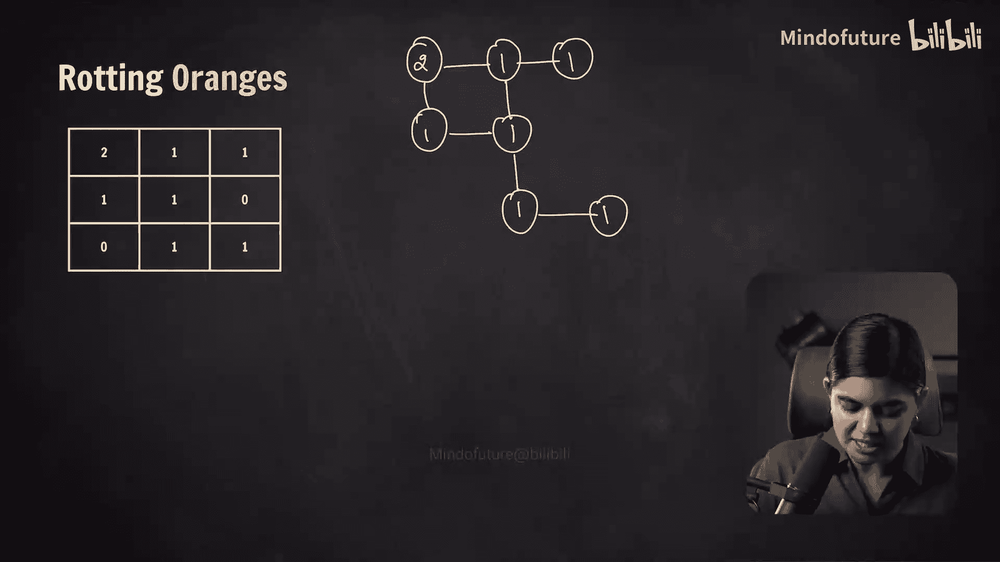

# C++-DSA课程-｜-数据结构-｜-leetcode-｜-Apna-College-｜--Complete-C++-Dsa-Course-p115-P117_腐烂的橘子-多源BFS-Leetcode_994--BV18oUGBkEmV_p115-

Hyro welcome to the complete D series。 and today we' are going to solve a classical DSA problem。

 which is called rotting oranges。ja。 Also there is a list for company in the box star problem this problem is called rotting oranges。

 and this is also problem 9，9，4 on grid grid and2 cell。

 which basically means that this is an empty cell is， which means a fresh orangeic to。

 which means already rotten orange gridip fresh orange empty androten oranges question condition given fresh vertically a horizontally adjacent oranges to rotten。

😊，basically what it means equal。it is impossible to rott all the oranges。 Those case canmi -1 Je。

 for example， Agarhampa is thekeka。ch gridander， we have a rotten orange here。 but sells empty hand。

 this is one this case2 boundaryap vertical and horizontally boundary is orange configuration and case because it is impossible for this grid to no freshs problem first time it might look like a2 problem or grid problem but this is actually a problem basically imagineas empty cells。

😊，is the second cell ors right。😊，a core connection is one k a connection downwards one k connection right hit is k ino connection because they are sharing this boundary plus acor connection either k and acor connection is one k So this is kind of a graph。

 which is given to us in the form of a grid same rotten orange problem solve it becomes actually easier to solve that problem。

ten travel travels neighbors rottenja first minute。😊。

they will become rot in the first minute and the second minutes third third minute and will be equal to and which is similar tosss So that is the core logic of breadth search or。

😊，Basic condition to solve this particular question is graph dedicated is very or going to be exactly。

which is basically equal equal equal equal。K Eatoari greatander， a rotten， orange， gridander。

 multiple rotten oranges， B Jese， for example。Let us try and remove this。

Agarhammni gridka examplely just candleander， though rotten orange is。Hamerus egg ignored。

Yet tooto exist， Ka at me， we have one more node this to。

Let's suppose original answer original answer is to be is equal to equal first equal equal of at the same time equal equal is equal multiple。

Something called multi B multi single generally multiple starting because we have multiple rot at is equal is equal and time will increase multiple basically let us。

Resize this。So this is a representation of a how graph is going to be logical isna or of。

Pair Coal Guanni volume。Pair of pair of integer and integer values。 So this is our node。

 Andusatmi I or integer valueham st krainggi。 This will be the time twindu valueska I and J and T the values Kaham combination edge is Koni the st kanggi to Shira me hammna Lucharagi from I equals 0 to n Aniriri gridpa and J equals 0 to M Kahibi Agarhamparotan orange O。

 That becomes our starting point for multi source B F S Hamus kham multi source。😊。

B F S multiple sources outnaander I。 we have a two value two valuese combination plus rot is always equal to 0 basic multiple sources。

😊，Let us also resize this。Final B， F S traveral perform。 Can you come Lahe。😊。

Y Bari Q is not equal to 0。 cua sizes not equal to 0。 T k。Sseelleto， Q say Hammni I comma J。

 commma Jobi Hamra time He。and which is vertical and horizontal top which is which is and1。😊。

Should be greater than equal to 0 I value and unvisit unvisit not visited of I1 j and isjugar is is rotten is freshari1ari。

😊，I-1 comma j per2 value head。 that should be equal to1。plus plus j。😊。

Was value push Kis Q I-1 Jco Push Ki plus Ijaga Jobihuara Purana time T plus1 and Ham visited Ma Kingi I-1a Jco。

😊，To B F S traveral can Jesse Humkissby8 neighbor cab。😊。

A unvisited neighbor Co youchannder P Carde Hamse visited Mare。

 So this is what we have done for the top neighbor。 Yea same cheese A my right。

 neighbor Kly Yae same cheeses bottom neighbor Kan Ye same cheese A left neighbor K tone subki China to simply conditions could accept him let us。

😊，Remove this。 And let's bring this part here。To yejohamakku logic here。

 this is what we have done for one neighbor Yeaseim Chi Johanm Anessri Sari Neb Kli K。Let's one。

Resize this。Tob second neighbor case me if statement may second neighborgi。

 if J plus1 is less than m。 and isriarigi third neighbor bottomgi。

 if I plus1 is less than n andkiari samegi fourth neighbor left vgi if J-1 is greater than equal to 0 andariarigi thero neighbors may Jobi unvisit visit So this is something that we are going to do in our vi loopbrigi。

😊，answer basically answer will be maximum of answer and time maximum is to be answer is to time for and last let us convert logic on the same problem。

😊，The code can the convert can kbaki subse topa function just may we have the grid to grid K subse n value colithium。

 which will be the grid dot size。😊，W kiss out me。We also have the M value。

 which is grid of0 dot size。Plus， come of me answer value just ma。Zero Coto culing 게。

And Oskea may let us create a visited Hammi BfS Kandderrick visited to yoga to check if a value is visited or not。

 Tommis therikeka formatlyname we will take a visit discuss sizei yogaga vector of it will be a Boolean vector of vector vector of Boolean with size m or is a initialized Kingi false value Skea。

😊，And plus a come queue li cu off。Pair of integer integer values。This will be another pair。An。😔。

Indiwajagi。Hmt Karaana Ekto Abna Ia Jacob Pe andkimihamara Acu multi source B F S performed Gnival to starting me Q can the Sariari rotten oranges compus Tukic loop Chiic name from I equals 0 I less than n I plus thus for。

Nteger J equals 0 J less than m J plus plus kbi B ame Pat type key grid Kander I comma j value is equal to 2。

Those case can hum cu me push carding game。First pair， just me I comm ajijaga。

And Sa Kaat 0 will be the starting time。 So is there you say Ham is Sariari So school。

 What is this step we are pushing all。Soces。In Q， Ukebahammna finally B F S performed Gne。

 B F S performed Gnemilu Jepta Ka size is greater than 0。

 Ttamigi Sari values Ko values Ki Johampaari Aeth value Ajagi Segile， which will be Q dot front。😊。

Mejo first pairhe Uki first value， Similarlyly Hamipasji Ajaga， which will be Q dot front。

First pairme， second value。 And this case Arme will have a time T。 let's call this time。

 which will be Q dot front。Not second value。And ham Q popcar。Upko And。

 we are going to compare it with answer to maximum of answer and Jobiari currentki Val Muhamari I and Jelki neighbor neighbor condition toate top neighbor。

So this will be for the top neighbor。 top neighbor Kenickala， Hamra。I -1 comma G。

Though humch Klinggi I -1 is greater than equal to 0 and， and not of visited of I-1 gamma J and。

 and the grid I -1 J has a fresh orange。 Just come the way。 its value is equal to 1。 Those case may。

Q kander Push Ki Aerku， which has I1 comma J and Iipjaga Jubi time plus1 complete pair plus visit K I-1a J visitytorane Iri we are going to have a right neighbor。

We are going to have。A bottom neighbor。And we are going to have。

On left neighbor to right neighbor Kle Hamripas condition wier for J plus1， tomichekna J plus 1。

Should be less than m Ya parameterpa G plus 1 A。This will also be I comma J plus 1。

 The sari valueskome simply replace cardtina Yaer bi Marpas J plus1 al， Similarly， Yahaper。

 we are hoping to have the bottom value。 justka La I plus 1。

Less than n value condition of Mariippa Ajagi。 So this will be i plus1。 haper B Maripa plus Ajaga。

 this will be plus1， and this will be plus 1。 Similarlyly， left heley， we will have J -1。

Yeah mypa J -1 Aga， this will also be。Do you mind this one。And this will also be J -1。

Though we have all the four conditions。 And is theri Hamra B F S Ca completejaga Jeie B。

 F S completega Aky Babi，ari Gr fresh orange ba tohambo k。😊，We can check。For fresh orange。

 the fresh orange we1 plus itvis which is not visited via So this is logic true logic。😊。

K value go and schedule Charro neighbours un they cling if they are valid neighbors to un and visit K last me check Kling for fresh oranges and answer return K。

 So this is the overall logic。 Let us try and run this quote。😊，And submit it。

 to theriki say hamap me rotting oranges valley problem coalka them。

 A big bar let us also try and dryran for this problem。 Agarhammi Savalko， dryran curri。

On R B F S Bo simple cell logicni subseopni graphraqueg by imagine Galleem Hamari Gph kander subseeltoaripai 2 v nodeas 1 v node 1。

 more，1， and is3 k Hampa sariari Noske connections here for this particular grid is graph kander。

 If we also write the index to his 0 comma 0，0a 1，0a 2，1 comma 0，1 comma 1。😊。

2a 1 and2 comma 2ba cell numbers B A B F S Kander Hammiki ham a Q Kat。

I which is basically plus which is maximum answer is already last time which is which is1 and last time which is be next time equal answer and。

I first neighbour this node visit visit orja time， which is1 plus1ja equal the third value。

 These are all the time values which is the node of next which is already the answer to next which equal next time which is。

1 or is equal to 2 is equal to3 next time Q orit time time if successfully completed today's lecture share progress with me on lecture and。

😊。